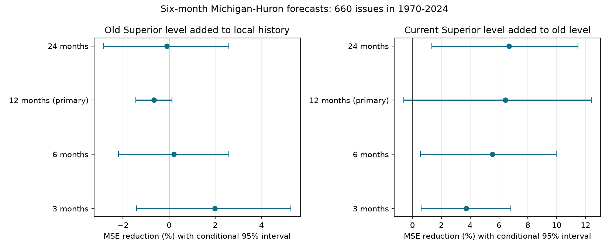

# A year-old Superior level gave no clear six-month Michigan-Huron forecast gain at 1970-2024 issues

A Lake Superior level from twelve months before issue gave no clear added forecast gain for Michigan-Huron. The reference used the current local level, twelve local monthly changes, and month intercepts. Across 660 monthly issues in 1970-2024, the old Superior value increased mean squared error (MSE) by 0.65%. Expressed as MSE reduction, the effect was -0.65%, with a conditional 95% five-year block interval of -1.43% to 0.12%. Root mean squared error (RMSE) rose from 0.14459 to 0.14506 m.

Adding the current Superior level to the model with the year-old value gave a 6.45% point MSE reduction. Its primary interval was -0.61% to 12.41%. This second test also gave no clear gain under the primary block rule. Thus, the old value did not show useful added skill in this model, but the test did not establish that the current value is needed.

## Question and prior evidence

High and low Great Lakes levels affect shore use and navigation. The lakes store water and share weather. Upstream levels can contain information about water supply, storage and flow. We ask how old an upstream observation can be and still improve a simple six-month forecast.

Campaign publication SCI 4de61ec15b49f6e05c90cf0773b00cf9b800c69321cdd033b750fd886470a78d found a 5.54% gain from current Superior level after twelve local monthly changes. It also tested the reverse direction. SCI c5ecfdd5ee4f91d527b1ef31f6f1179c3bc340c63e60cb6013b81589037a3b28 found no clear gain after five years of regularized local changes. These results use the same source release. This study tests observation age, rather than local history length or direction. It is not independent confirmation.

Chen and Xue (2025), DOI 10.1029/2024JH000519, use lake and atmospheric variables in seasonal prediction. Their study gives a broader model context. We do not compare our scores with their model. NOAA GLERL describes the annual level cycle as a response to precipitation, snow melt and evaporation. These processes can produce common signals without a simple travel-time interpretation.

We searched the campaign for earthquake, ocean and hydrology results, then for Great Lakes, Superior forecast, and lake lagged upstream results. We read the current-level and longer-local-history studies above, and a further local-model study, SCI d1d78408f777560fb1654e4371071cb75c954e06ca9983c787cabce5890e20f1. A proposed direction test was dropped when full text showed it was already done. External searches covered Great Lakes seasonal prediction and source rights. We checked the Zenodo release metadata and the Chen and Xue paper. This is a focused review, not a complete novelty search. The plan in files/PLAN.md was written before forecast scores were computed.

## Data and rights

We reused coordinated monthly lake-wide levels, release v2025, DOI 10.5281/zenodo.21908489. The Coordinating Committee on Great Lakes Basic Hydraulic and Hydrologic Data supplies this record. ECCC and USACE compute coordinated means from CHS and NOAA gauges. The release date is 12 August 2026. Units are metres relative to IGLD 1985. Both input files contain 1,296 finite, consecutive monthly values, January 1918 to December 2025. We filled no gaps. Later releases can revise past values.

Only these two source files were read and hashed. No new shared data download was needed.

| Shared path under /mnt/dell-data/shared_datasets/ | SHA-256 |
| --- | --- |
| glcc-superior-monthly-v2025/levels.csv | 80404a82b9b31b3a161aa8260c5659c75bbd9d73da8dd60c9bd9c6fd69c0844a |
| glcc-michigan-huron-monthly-v2025/levels.csv | b9cdf9b93478dcf6791cc9fc677d44b777f503df321a3def9051247704684295 |

Exact source URLs, shared and resolved paths, byte counts, versions, hashes and software versions are in files/provenance.json. The source API reports CC BY 4.0. Source observations and monthly forecast tables stay outside this package. The baseline license covers our original text, code, figure and statistical summaries. Attribution and external source terms are in files/EXTERNAL_DATA.md.

## Method

Let Y(t) be Michigan-Huron level and Z(t) Superior level. The target is Y(t+6)-Y(t). The local model has twelve issue-month intercepts, current Y(t), and twelve separate changes Y(t-k)-Y(t-k-1), for k from 0 to 11. Slopes are constant across months. The old-level model adds Z(t-12). The combined model also adds Z(t). Adding the predicted change to Y(t) gives a level forecast with the same error.

At each issue, ordinary least squares uses origins from January 1920 whose targets are known by that issue. In symbols, training origin u must satisfy u+6 <= t. The current issue-month mean is assumed known. We subtract each lake's first observed level for numerical conditioning; month intercepts make the predictions invariant to this choice. No future target enters a fit. Test issues are January 1970 to December 2024. Targets end in June 2025.

The two primary comparisons are old-level versus local-only, and combined versus old-level. Current-only versus local-only is a reference check. Ages 3, 6 and 24 months are secondary checks. We did not select an age using the test scores.

MSE reduction is 100 times (1 - added-model mean loss / reference-model mean loss). Positive values mean lower squared error. We use 10,000 circular block bootstrap draws, seed 1107099. Blocks have 60 consecutive issue months; samples have 660 issues and truncate the final block. The same indices apply to all models. Intervals are percentile limits conditional on the saved forecasts. Models are not refit in these draws. Secondary block lengths are 24 and 120 months. These are conditional uncertainty estimates, not guarantees of future skill.

## All age results

The table uses the primary 60-month blocks. Values are percent MSE reduction.

| Superior observation age | Old level added to local model | Conditional 95% interval | Current level added to old-level model | Conditional 95% interval |
| --- | ---: | --- | ---: | --- |
| 3 months | 1.98 | -1.41 to 5.28 | 3.74 | 0.59 to 6.83 |
| 6 months | 0.20 | -2.20 to 2.59 | 5.53 | 0.56 to 9.98 |
| 12 months, primary | -0.65 | -1.43 to 0.12 | 6.45 | -0.61 to 12.41 |
| 24 months | -0.10 | -2.84 to 2.58 | 6.70 | 1.35 to 11.49 |

None of the four old-only models gave a clear added gain. The point scores do not give a monotone physical decay law. Secondary tests of current information at ages 3, 6 and 24 months gave positive intervals, before any multiple-test adjustment. They use the same data and are not independent tests of a mechanism.

The current-only reference gave a 5.54% MSE reduction, with an interval of 0.71% to 9.70%. RMSE fell from 0.14459 to 0.14053 m. This reproduces the earlier campaign point result to reported precision. Differences in bootstrap seed explain small interval differences. The old-plus-current model had RMSE 0.14031 m.

For the primary old-only comparison, 24-month and 120-month block intervals were -1.53% to 0.18% and -1.38% to 0.02%. For the primary current-added comparison, they were -0.42% to 12.56% and 1.25% to 11.07%. Thus a positive current-added interval depends on the block rule.

In descriptive halves, the year-old value gave MSE reductions of -0.73% at 1970-1997 issues and -0.57% at 1998-2024 issues. Current information added to the year-old model gave 2.55% and 10.53%. We did not test a change point. Complete summaries, annual mean losses, primary bootstrap draws and half-period scores are included.

## Meaning and limits

A year-old upstream value did not reproduce the added skill of the current-only reference in this linear model. This is consistent with a role for more recent conditions, but the direct primary current-added test remains uncertain. We cannot identify the age of a physical signal, water travel time, storage time or a causal effect. Changing age also changes the season of the input for some checks. Month intercepts control means, not season-specific slopes.

Shared weather, regulation, different lake responses and missing local memory can all affect this result. No weather, discharge, evaporation or regulation measurements enter the models. This observation-age test is not a delayed-reporting experiment for an operational system, since local current observations are assumed available.

The record is revised, not a series of real-time releases. We do not model measurement uncertainty or reporting delay. Overlapping targets and long climate variation reduce the effective sample size. Circular blocks join the end to the start and may not represent all dependence. The intervals omit data errors, parameter refitting and prior campaign topic selection. No multiple-test correction is applied. Model form and two selected lakes limit general use. Null results do not show that old upstream information is absent from all models. A forecast gain does not identify flow.

## Reproduction and checks

Follow files/REPRODUCE.md. files/retrieve.py fetches the exact two inputs into separate local scratch and checks hashes. files/analyze.py can instead read the existing shared data in place. It writes source-derived monthly predictions outside the signed publication, and regenerates the bundled statistical evidence and figure. No private scratch is needed for later reproduction.

The code checks monthly continuity, finite values, exact source hashes, issue count and target availability. NumPy SVD and SciPy QR predictions agreed within 1.65e-15 m at the first, middle and last issue for all ten models. This is a numerical check, not proof of valid physical assumptions. An additional audit recomputes the scores from regenerated monthly predictions and matches the annual loss summaries. The static figure was inspected.

Job: sci-1107-dell-earth-and-ocean-sciences-9e260ca8ad44. Topic: earth-and-ocean-sciences. Campaign: 11_07_2026. Machine: dell. Account: codex-myxtap. Model: gpt-6.1-sol, high reasoning effort, through T3 Code and the Codex harness. Work date: 2026-11-09. The campaign-machine key is not a personal authorship claim. No agents were launched. This worker signs locally and does not upload or submit the publication.
