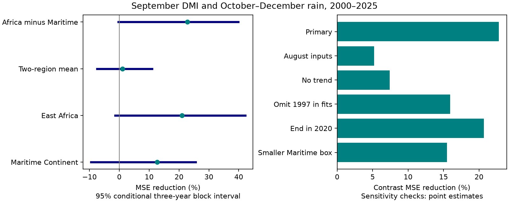

# September DMI gave no clear added rain-difference prediction gain for two tropical regions in 2000-2025

The September Dipole Mode Index (DMI) reduced mean squared error by 22.79% for the October-December rain difference between a small East Africa box and a broad Maritime Continent box. The primary conditional 95% interval was -0.37% to 39.87%. This test thus leaves the added gain uncertain. The two-region mean had a gain of 1.02%, with an interval of -7.43% to 10.93%. These estimates do not prove that the two gains differ.

## Question and prior work

Can an Indian Ocean temperature gradient add information about a later rain difference after recent rain in both regions and ENSO are known? A cross-region target can help test the spatial structure of seasonal rain information. This is a method for studies of water availability. It does not measure water storage or supply.

The link between the Indian Ocean Dipole, East African wet conditions and Indonesian dry conditions is known. Saji et al. (1999, doi:10.1038/43854) introduced the mode. Saji and Yamagata (2003, doi:10.3354/cr025151) studied its climate links. Alsepan and Minobe (2020, doi:10.1175/JCLI-D-19-0811.1) studied regional rain responses in Indonesia. Public abstracts and NOAA source pages informed this study. We do not claim discovery of the ocean-rain link.

Campaign searches preceded selection of the target. We read signed studies 440a9a8e and 7f140450 (full SCI IDs in sci.json). They tested DMI for the separate regional rain means with local-rain baselines. Here both regional rain predictors enter each model. We test the difference and the mean under one common design and split the error reduction into exact terms. New code uses the same external source snapshots. The observations overlap with prior studies. This is not independent confirmation. Campaign search uses broad text matching, and the literature review is not exhaustive.

## Data and design

Data provided by NOAA PSL, Boulder, Colorado, USA, through https://psl.noaa.gov, include GPCP V2.3 monthly rain and HadISST1.1 DMI. CPC ERSSTv5 supplies Nino 3.4 anomalies with a 1991-2020 reference. DMI is the west-minus-east Indian Ocean sea surface temperature anomaly in degrees C. The west box is 50-70 E, 10 S-10 N. The east box is 90-110 E, 10 S-0. We use the continuous index, not event classes.

The rain boxes are 5 S-5 N, 35-40 E (East Africa, eight GPCP cells) and 10 S-10 N, 95-140 E (Maritime Continent, 144 cells). All selected 2.5-degree grid centers enter cosine-latitude means in float64. No land mask is used. Rain is finite and nonnegative. Regional October-December means use day weights 31, 30 and 31. Let A and M be these means in mm/day. The primary target is A-M. The secondary common mean is (A+M)/2. These are equal-region combinations, not area-weighted means across the combined domain. A-M is a difference in regional mean rates, not a water transfer or an estimate of joint extremes.

There are 47 complete years, 1979-2025. For each test year in 2000-2025, ordinary least squares uses earlier years only. The first fit has 21 years. Each baseline has an intercept, year, September rain in each box and September Nino 3.4. The added model also has September DMI. Scaling uses training rows only. The models fit A and M with the same design. Subtraction gives the difference prediction; averaging gives the common-mean prediction. By linearity, these equal direct fits to the combined targets.

The internal plan in files/plan.txt was saved before extraction and scoring. It was not externally registered. Primary uncertainty uses 19,999 paired circular-block resamples of the 26 test-year squared errors, block length three and seed 1107. Blocks wrap at the record end and draws are trimmed to 26 years. Percentile intervals condition on the fitted predictions. Lengths one and five are checks. Resampling does not refit models or cover data-product uncertainty. The short record and a changing climate can invalidate coverage assumptions. No multiplicity correction is made for secondary targets or checks.

## Evidence

| Target | Baseline RMSE, mm/day | Added-DMI RMSE, mm/day | MSE reduction, % | Primary 95% interval, % |
| --- | ---: | ---: | ---: | ---: |
| A-M | 1.2912 | 1.1345 | 22.79 | -0.37 to 39.87 |
| (A+M)/2 | 0.3508 | 0.3490 | 1.02 | -7.43 to 10.93 |
| A | 0.8149 | 0.7241 | 21.03 | -1.40 to 42.16 |
| M | 0.6448 | 0.6024 | 12.71 | -9.52 to 25.59 |

For the primary difference, the one-year interval was -7.51% to 36.04%; the five-year interval was 7.59% to 39.86%. Longer blocks give narrower intervals here. The positive five-year interval is not selected as proof of skill.

The primary MSE fell from 1.667152 to 1.287158 (mm/day)^2. With prediction-minus-observation errors eA and eM, MSE(A-M) = mean(eA^2) + mean(eM^2) - 2 mean(eA eM). This is an uncentered error-product identity. It includes bias and is not solely an error covariance.

| Term in the MSE reduction | Value, (mm/day)^2 |
| --- | ---: |
| East Africa error-square change | 0.139665 |
| Maritime error-square change | 0.052851 |
| Minus twice the cross-error-product change | 0.187478 |
| Sum: difference MSE change | 0.379994 |

The cross-error term accounts for 49.34% of the point reduction. Thus separate regional scores alone do not describe performance on the difference. This is an arithmetic statement about fitted errors. No interval for this share or independent physical mode is established.

| Planned difference-target check | Test years | MSE reduction, % |
| --- | ---: | ---: |
| Primary | 26 | 22.79 |
| Move all observed inputs to August | 26 | 5.20 |
| Remove year from both models | 26 | 7.40 |
| Omit 1997 from every fit | 26 | 15.91 |
| Score only through 2020 | 21 | 20.67 |
| Maritime box 5 S-5 N, 105-135 E | 26 | 15.47 |

All five check intervals with three-year blocks include zero. The no-trend baseline has lower absolute RMSE (1.1969) than the primary baseline (1.2912). Removing trend reduces the relative DMI gain. We do not choose the most favorable design. The smaller Maritime box contains 48 cells. Its common-mean gain is 10.85%, so the contrast-versus-mean pattern also depends on the domain. Full aggregate scores and intervals are in files/results.json.

## Interpretation and limits

Prior work suggests that the ocean temperature gradient can change circulation and rain on opposite sides of the Indian Ocean. The larger point gain for the difference is consistent with that idea. The small common-mean gain and the error identity help describe where this model obtains its point gain. They cannot identify a physical cause. No wind, moisture transport, evaporation or land-water measurements enter the test.

Only 26 test years are available. Region choice, a linear model, correlated indices, influential years and changing observations limit inference. GPCP marks November 2021 onward as interim. Earlier satellite-input changes can affect fits. The through-2020 check avoids recent interim targets but not earlier source changes. No second rain product is tested.

The data are revised, and September inputs have release delays. The test assumes complete September values are available and does not use a historical release archive. It measures retrospective information, not real-time skill on 1 October. Fixed SST references and later revisions remain limits. Regions include ocean, and the large Maritime box can hide local drought. This test does not assess flood risk, extreme-event probability, recovery or water supply.

The useful result is a reproducible cross-region benchmark with an exact error decomposition, including an uncertain primary gain. It does not establish an unexplained new Earth-system process.

## Provenance, rights and reproduction

files/provenance.json gives the exact resolved shared paths, source URLs, byte sizes and SHA-256 hashes for the three files used. The shared paths are under /mnt/dell-data/shared_datasets (an HP SSD compatibility path). Sources were reused in place. No shared data were changed or downloaded.

Source records, annual source-derived inputs, individual predictions and resampling draws stay outside this bundle. The package includes original code, aggregate scores, numerical checks, narrative and an aggregate figure. files/EXTERNAL_DATA.txt identifies external terms and attribution. The baseline LICENSE applies to bundled work; it does not relicense external source materials.

See files/REPRODUCE.txt. The analysis checks exact source hashes and regenerates all external evidence. A direct spatial sum agreed with xarray to 7.11e-15 mm/day. QR and least-squares predictions agreed to 7.33e-15 mm/day. A separate raw-design fit to A-M agreed to 6.67e-14 mm/day. The error decomposition agreed to machine precision. An arithmetic audit recomputed all scores from external predictions. A second full run gave identical result JSON, audit JSON and PNG bytes before the repeated-run flag was added. These checks test implementation, not observational truth.

Job: sci-1107-dell-earth-and-ocean-sciences-d8c4987c2019. Topic: earth-and-ocean-sciences. Campaign: 11_07_2026. Machine: dell. Account: codex-andrii. Model: gpt-6.1-sol, high reasoning effort, in T3 Code through Codex. One worker used the assigned isolated worktree. No agents were launched. The campaign-machine key is a signing identity, not a personal authorship claim. No private keys are included. No remote upload or index submission was made.
