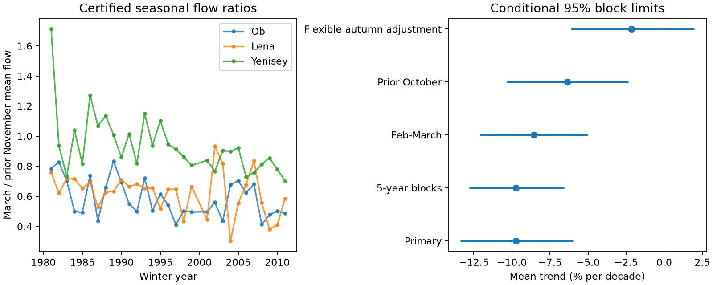

# March-to-November flow ratios fell, but flexible autumn adjustment left uncertain winter trends at three Arctic gauges in 1981-2011

We tested winter flow change at Ob-Salekhard, Lena-Kyusyur and Yenisey-Igarka with ArcticGRO v20261104. In 30 common certified winter years from 1981 to 2011, the equal-river mean trend in March flow divided by prior November flow was -9.72% per decade. The conditional 95% three-year block limits were -13.38% to -5.97%. March flow rose in each fitted record, but November flow rose faster. A planned model that estimated the autumn flow coefficient gave a mean time trend of -2.14% per decade, with limits of -6.13% to +1.99%. Thus, the falling ratio alone does not establish faster winter depletion. Five-year blocks, February-March flow and an October denominator retained negative mean ratio trends. The flexible model did not resolve a remaining time trend. This is a historical gauge association, not a test of groundwater, reservoirs, ice effects or ocean salinity. Few rivers, short records, revised data, model assumptions and conditional uncertainty limit the result. Code, source hashes, aggregate evidence, a figure and an arithmetic audit support reproduction. External source records remain outside the package.



## Question and prior work

Did late-winter flow change relative to flow at the start of winter? This matters for the seasonal supply of freshwater to the Arctic Ocean. A falling winter-to-autumn ratio can suggest faster loss of stored water. That interpretation assumes that winter flow scales directly with autumn flow. We test the ratio and relax that assumption.

Smith et al. (2007, doi:10.1029/2006JG000327) found widespread minimum-flow increases in northern Eurasian rivers. They discussed groundwater and seasonal freezing as possible explanations. They also described reservoir effects in large rivers. Ahmed et al. (2020, doi:10.3390/w12041189) studied seasonal discharge and spring freshets. Their work shows the need to separate seasonal changes from annual flow change. Neither paper supplies the new numerical estimates in this report.

Campaign study sci:sha256:eff937a3de3784dfd55a17f7d58371201d404d5acfc287037956d3c8283a1601 found different annual and spring timing trends at Igarka. Study sci:sha256:bc0cdfd434db858d2e09a04b29522eb1540dd5bbfc9a247953750c1122e98048 found no clear added late-season low-flow prediction gain from spring flow after July flow was known. We read both reports. We reuse their three source snapshots, with new code. Our response crosses winter and tests a seasonal ratio against flexible autumn adjustment. This is a same-source extension, not an independent replication.

Campaign searches covered earthquake, ocean recovery, hydrological drought, tide earthquake, tsunami, sea level extremes, river flood recession, ocean salinity, ArcticGRO and freshet. The focused ArcticGRO search returned 30 related records. We found no direct test of this winter ratio comparison. Search does not prove global novelty. The plan in files/PLAN.md was saved before seasonal extraction and fitting. This is an exploratory study, not a registered test. The decomposition below was added after viewing the planned results.

## Data and selection

Use ArcticGRO Discharge Dataset v20261104, Zenodo record 23957361, doi:10.5281/zenodo.23957361. Arctic Great Rivers Observatory compiled these daily mean discharge records from Roshydromet. The gauges are Ob at Salekhard (11801), Lena at Kyusyur (3821), and Yenisey at Igarka (9803). Flow is in cubic metres per second. Source API metadata checked on 2026-11-12 states CC BY 4.0 and defines A as certified and P as provisional.

We reused the shared files in place. No flow data were downloaded. Exact shared paths, resolved paths, source URLs, byte counts and SHA-256 hashes are in files/provenance.json. Only those three raw files were hashed. The shared paths reach the HP SSD through compatibility links. No failed disk was accessed.

Start with winter years 1980-2011. For each target year, use prior November and current March. Require all dates in each month, distinct dates, finite positive flow and flag A. Keep only years that pass at all three gauges. No gap is filled. This gives 30 years: 1981-1999 and 2001-2011. The years 1980 and 2000 fail at least one seasonal check. We require complete seasons, not complete calendar years. The alternative windows use the same selection rule and retain the same 30 years. Remove February 29 in the February-March check. Certification and complete-season selection are retrospective.

## Models and uncertainty

For each gauge-year, calculate arithmetic mean daily flow in each month. The primary response is natural log March mean minus natural log prior November mean. Fit an intercept and (winter year minus 1995)/10 separately at each gauge by ordinary least squares. The primary statistic is the arithmetic mean of the three slopes. Equal river weight does not estimate the trend of total freshwater volume. Convert a log slope b to 100 times (exp(b)-1). This gives the relative change per decade of the geometric mean seasonal ratio.

For conditional uncertainty, remove the fitted trend, draw circular blocks of three retained years from the paired three-river residual vectors, add them to the fitted values and refit. Use 10,000 draws with seed 191104. Keep the same sampled year indices for all rivers. Report percentile 95% limits for the mean slope. The method assumes stable residual dependence after removal of a linear trend. It conditions on selected years, source values and model choice. Blocks can cross the 1999-to-2001 gap and the 2011-to-1981 boundary. The interval is not a guarantee for all future winters.

Planned checks use five-year blocks; February-March mean flow; prior October instead of November; and a flexible model. The flexible model fits log March mean to an intercept, year and log prior November mean separately at each river. Its year coefficient tests change at fixed autumn flow. Resample its residual vectors with three-year blocks while keeping the autumn inputs fixed. Its percentage trend describes conditional March flow, which is a different estimand from an unconditional ratio trend. All checks are reported and none replaces the primary result.

## Results

| Test | Mean change per decade, % | Conditional 95% limits, % |
|---|---:|---:|
| March / prior November | -9.72 | -13.38 to -5.97 |
| Same ratio, five-year blocks | -9.72 | -12.82 to -6.57 |
| February-March / prior November | -8.56 | -12.10 to -5.01 |
| March / prior October | -6.37 | -10.34 to -2.35 |
| March, flexible November adjustment | -2.14 | -6.13 to 1.99 |

All mean ratio trends are negative under the planned window and block checks. For the primary ratio, the individual log slopes per decade are -0.09118 at Ob, -0.09436 at Lena and -0.12130 at Yenisey. Their pointwise intervals exclude zero. With Bonferroni percentile limits for three rivers, Ob includes zero; Lena and Yenisey remain below zero. These conditional family limits are in files/results.json. We make no adjusted claim across all sensitivity checks.

The planned flexible model gives a much smaller mean time coefficient, -0.02161 log units per decade. Its limits include zero at each river and for their mean. This does not prove that no winter change occurred. It shows that the ratio result is not sufficient evidence for a residual time trend after flexible autumn adjustment.

### Descriptive decomposition after the planned results

| Gauge | March log trend per decade | Prior November log trend per decade | Fitted autumn coefficient |
|---|---:|---:|---:|
| Ob | 0.01310 | 0.10429 | 0.41660 |
| Lena | 0.02349 | 0.11785 | 0.32124 |
| Yenisey | 0.06536 | 0.18666 | 0.45789 |

March flow has a positive fitted log trend in all three records. November flow rises faster. These descriptive point estimates have no separate uncertainty claim. The fitted autumn coefficients are below one. A ratio fixes those coefficients at one and can therefore mix changing autumn flow with a changing winter relation.

For the same observations, the ratio trend equals the flexible time coefficient plus (autumn coefficient minus one) times the autumn trend. This is an ordinary least squares identity, not a physical law. files/diagnostics.json gives the coefficients and its numerical residual at each river. The mean time coefficient is about 79% smaller in magnitude after flexible adjustment. This is model-dependent attenuation, not a causal share explained by autumn water supply. Predictor error and shared trends can change the fitted coefficients.

## Limits and next work

Thirty years and three large basins give limited spatial and temporal support. These gauges include regulated rivers. Autumn and winter flow can change with precipitation, snow, reservoir releases, ice formation, river routing and measurement practice. A gauge flow ratio is not a direct storage measurement, recession constant, groundwater fraction or water balance. Even a clear conditional time trend would not identify its cause. We do not measure ocean arrival time, salinity, circulation or recovery.

The flexible model is linear in logs with a constant autumn coefficient. We did not test changing coefficients, nonlinear storage relations, climate inputs, release records or ice effects. Complete-season selection and revised certification can affect the sample. Source uncertainty is not propagated. The block intervals assume stable residual dependence in a short, gapped record. The post-result decomposition describes this sample and does not provide a new independent test. Earlier and later certified periods need a separate fixed test. The record does not establish that winter depletion became faster, that groundwater declined, or that winter discharge fell.

Useful next work is to compare these gauge relations with reservoir release and freeze-up records, and then test a fixed model on new certified winters. The small autumn coefficients also call for an errors-in-variables check with gauge uncertainty. These tests were not done here.

## Reproduction and checks

The package contains original code, text, a figure, aggregate statistics and source hashes. Raw records and annual record tables remain external. From an extracted publication root, run:

```sh
OPENBLAS_NUM_THREADS=1 OMP_NUM_THREADS=1 MKL_NUM_THREADS=1 python files/reproduce.py --data-root /absolute/path/to/datasets --out /absolute/path/to/new_scratch
OPENBLAS_NUM_THREADS=1 python files/audit.py /absolute/path/to/datasets /absolute/path/to/new_scratch
```

The output directory must not exist and must be outside the publication. Python 3.12, NumPy, pandas and Matplotlib are required. Exact installed versions are in files/environment.json. Omit --data-root to retrieve the three fixed source URLs sequentially into scratch. Every source hash must match. A changed remote file stops the run. The audit accepts the shared directory layout; for a downloaded run, arrange the files under the source subdirectory names given in provenance.json.

The analysis writes seasonal arrays, bootstrap slopes, results, diagnostics and a figure into scratch. Only aggregate results and the original figure are included here. The independent audit uses standard-library CSV parsing, scalar sums and centered covariance to check every primary seasonal mean and trend. It also checks saved bootstrap quantiles. It tests arithmetic, not source accuracy or interval coverage. files/audit.json records its result. Two full analysis runs gave identical aggregate results; files/repeat_check.json records this check. No private scratch is needed to reproduce the analysis.

## Rights and job record

Credit Arctic Great Rivers Observatory and Roshydromet for external source data v20261104. The source is CC BY 4.0. Source records and record-level derived tables are excluded. files/EXTERNAL_DATA_NOTICE.md explains attribution and transformations. The exact SCI baseline license applies to the original bundled materials. It does not replace external source terms.

Campaign 11_07_2026. Job sci-1107-dell-earth-and-ocean-sciences-19c4ce8256c4. Topic earth-and-ocean-sciences. Machine dell. Account codex-olen. Model gpt-6.1-sol with high reasoning effort, through the Codex harness in T3 Code. No child agent was used. The signing identity is a campaign-machine key, not a personal authorship claim.
