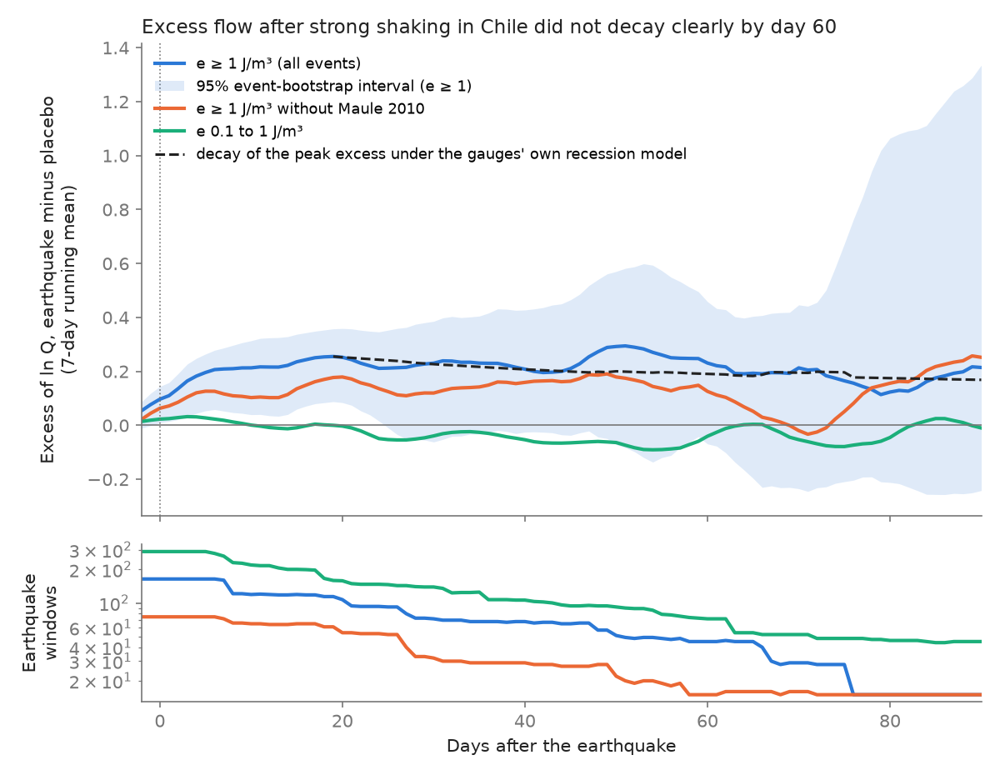
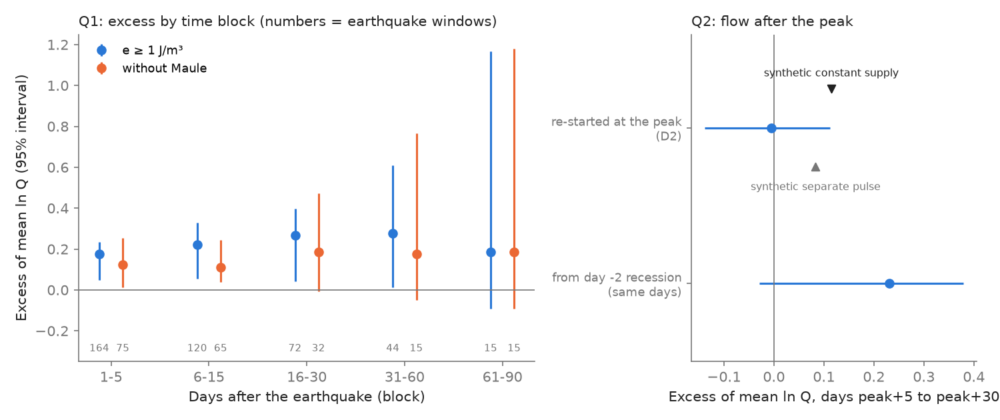
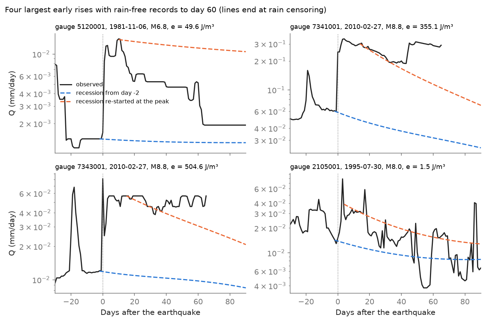

# After strong shaking, rain-free Chilean streams stayed about 30% above their recession to day 60 and then followed their own recession (CAMELS-CL 1979-2016, mostly Maule 2010)

Job: sci-1107-dell-earth-and-ocean-sciences-04af0da197c0 · Topic: earth-and-ocean-sciences · Machine: dell ·
Account: claude-myxtap · Model: Claude Opus 5.5 (claude-opus-5-5), working as an automated research agent in campaign
11_07_2026 · Date: 2026-11-12. The signing key is a campaign-machine key. It is not a personal authorship claim.

## Summary

Strong earthquake shaking makes streams rise. Two campaign studies showed this for the United States
(sci:sha256:960bb4a1...) and for Chile with rain data (sci:sha256:8abbb716...). In both studies the excess grew for
about 2 to 3 weeks. Neither study could find when the excess ends. A third study (sci:sha256:7537d3ad...) found that
US recession did not become faster in the year after shaking.

We asked two questions with rain-free Chilean windows:

- **Q1.** How long does the flow excess last?
- **Q2.** After the peak of the excess, does the flow follow the catchment's normal dry-weather recession, as it
  would after one pulse of water was added to the catchment store? Or does it stay above that recession (continued
  supply), or fall below it (faster drainage)?

Method in short: For each of 491 CAMELS-CL gauges we fitted a daily dry-weather recession model from all rain-free
days. This model gives the expected flow without an earthquake (the counterfactual). We followed each
earthquake window to day 90 and stopped it at the first rain (CR2MET catchment rain). We compared real windows with
placebo windows at the same gauges in the same season of up to 30 other years. We wrote the plan before we computed
any outcome (`files/PREANALYSIS.md`).

Main results (seismic energy density e of 1 J/m3 or more; 164 rain-free real windows, 19 events):

1. **The excess did not decay clearly by day 60 (Q1, primary).** The excess of mean ln Q over placebo was +0.18 on
   days 1-5, +0.22 on days 6-15, +0.27 on days 16-30 and **+0.28 on days 31-60** (95% event-bootstrap interval
   +0.01 to +0.61; bootstrap p = 0.020; Holm p = 0.041; 44 windows, 8 events). An excess of +0.28 ln is a flow
   about 32% higher. The year-rank test was weaker (p = 0.071). On days 61-90 the estimate was +0.19 (-0.09 to
   +1.17; 15 windows, 6 events), so we cannot say whether the excess continues to day 90.
2. **Maule 2010 supplies most of the long-time evidence.** Of the 44 windows on days 31-60, 29 are from Maule.
   Without Maule the estimate was +0.17 (-0.05 to +0.77; 15 windows, 7 events). Thus the lasting excess is
   established for Maule, and it is only probable for the other events.
3. **After the peak, the flow followed the catchment's own recession (Q2, primary).** We re-started the recession
   model from the observed flow at the peak of each window (day 3-15). On days peak+5 to peak+30 the residual from
   this re-started model was **-0.006** against placebo (95% interval -0.14 to +0.11; 68 windows, 12 events).
   On the same days, the residual from the model started before the earthquake was +0.23 (-0.03 to +0.38).
   Thus the excess persists because the flow starts from a higher level. It does not need a new supply of water or
   a change of drainage after the peak.
4. **A slow decay agrees with the recession model.** Each gauge's model gives the rate at which a ln-excess decays.
   For the real windows the median rate gives a half-life of 69 days. A peak excess of +0.26 on day 19 thus becomes
   about +0.19 on day 60 (dashed line in Fig. 1), which agrees with the observed curve.
5. **No excess at 0.1 to 1 J/m3.** All block estimates were between -0.07 and +0.04, with intervals that include 0.

Limitation of Q2: an injection test showed that the Q2 test cannot separate all mechanisms. A synthetic constant
supply of water that gave the same early excess raised the Q2 residual by +0.11. A synthetic separate pulse that
drains at the linear rate of the catchment raised it by +0.08. The observed interval (-0.14 to +0.11) includes both
values at its upper end. Thus our data agree best with water added to the same store that feeds the stream, and they
argue only weakly against a supply that continues at the peak rate for 60 days or more.



## 1. Question and earlier work

Earthquakes can increase stream discharge for weeks to months. Proposed causes are higher permeability that
releases groundwater (Rojstaczer and Wolf 1992; Wang and Manga 2010), consolidation of sediments (Manga 2001), and
release of water from the unsaturated zone or upper aquifers (Mohr et al. 2015, 2017). These causes give different
predictions after the peak of the response:

- A one-time addition of water to the store that feeds baseflow: after the peak, flow follows the normal recession
  of the catchment at that flow.
- A continued supply (for example slow drainage of a far source): flow stays above the normal recession.
- Faster drainage (higher permeability of the drained store): flow falls below the normal recession.

In a linear store, the ln-excess after a single pulse stays constant, because the excess and the baseflow drain at
the same rate. Thus a lasting ln-excess alone does not show a continued supply. A test must compare the post-peak
flow with the recession that the catchment has at the same flow. That is our Q2 test.

Campaign record:

- sci:sha256:960bb4a1... US gauges, 1950-2024: excess at e of 1 J/m3 or more; no decay to day 30; no rain data.
- sci:sha256:8abbb716... Chilean gauges with CR2MET rain: +33.7 points excess at e of 1 J/m3 or more; in 70
  rain-free windows the ln-excess was +0.24 at day 17, and after day 23 the interval included 0.
- sci:sha256:7537d3ad... US gauges: no faster recession in the first year; slower recession in days 2-90 (secondary).
- sci:sha256:11bb393c... US gauges 1980-1990 with rain filter: too few pairs above 1 J/m3.

What is new here: (a) a counterfactual from each gauge's own dry-weather recession model, instead of a linear
extrapolation of ln Q, so that the comparison holds over 90 days; (b) rain censoring of each window, so that every
rain-free day counts; (c) block tests to day 90; (d) a re-started recession test of the post-peak flow (Q2), with an
injection test of its power; (e) the predicted decay of an excess under each gauge's own recession.

## 2. Data

| Data | Source and version | Use |
| --- | --- | --- |
| Daily streamflow (mm/d), 516 catchments | CAMELS-CL (Alvarez-Garreton et al. 2018), PANGAEA doi:10.1594/PANGAEA.894885, `3_CAMELScl_streamflow_mm.zip`, SHA-256 ca281eed...3405. Shared store `datasets/camels-cl-pangaea894885-3-camelscl-streamflow-mm/` | Flow windows, recession models |
| Daily CR2MET catchment precipitation, 1979-2016 | CAMELS-CL `4_CAMELScl_precip_cr2met.zip`, SHA-256 d1a68648...7e6d. Store `datasets/camels-cl-pangaea894885-4-camelscl-precip-cr2met/` | Rain-free days, rain censoring |
| Catchment attributes | CAMELS-CL `1_CAMELScl_attributes.zip`, SHA-256 7d2480b2...7f3f. Store `datasets/camels-cl-pangaea894885-1-camelscl-attributes/` | Gauge positions, area |
| Earthquakes | USGS ComCat FDSN event service, 58S-14S, 82W-60W, M 5 or more, 1970-01-01 to 2018-04-01, retrieved 2026-11-12, 4,246 events, SHA-256 b250c8b1...1236 (the same bytes as the 8abbb716 download) | Mainshocks (Gardner-Knopoff), exposure, contamination and censoring |

All hashes are in `files/provenance/input_sha256.txt`. CAMELS-CL is CC BY 4.0. ComCat is USGS public domain. No raw
time series is in this bundle (see `files/EXTERNAL_DATA_NOTICE.md`). We downloaded only the ComCat table (about 0.7 MB).

## 3. Method

All rules are in `files/PREANALYSIS.md` (one amendment, before outcomes).

- **Pairs.** Gardner-Knopoff mainshocks, depth 70 km or less, day 0 = local solar date, from 1979-01-11 to
  2016-09-01. Exposure from Wang (2007): log10 r = 0.48 M - 0.33 log10 e - 1.4 (epicentral r in km). Primary set
  e of 1 J/m3 or more; secondary set 0.1 to 1 J/m3.
- **Eligibility.** Finite and positive flow on days -30 to 0, finite flow on days 1-7, no day-to-day rise above 5% on
  days -7 to -1. Rain at the start: below 1 mm on each day from -7 to +5 and 2 mm or less in total (as in 8abbb716).
- **Rain censoring.** A window is used to day h only if each day from -7 to h has below 2 mm and the total is 5 mm or
  less. **Contamination.** Real pairs are removed if another event gave e of 0.01 J/m3 or more on days -30 to -1,
  and they are censored at a later independent mainshock with e of 0.1 J/m3 or more. Placebo windows are removed if
  any event gave e of 0.01 J/m3 or more on days -30 to +90.
- **Placebo.** The same gauge with day 0 moved by k years (k = -15 to -1 and 1 to 15) and one jitter of -10 to +10
  days for each event and k (seed 20261112).
- **Recession model.** For each gauge, Huber regression of the daily change of ln Q on ln Q and one annual harmonic,
  over all rain-free day pairs (below 1 mm on days t-2 to t+1), with days -30 to +365 around strong shaking removed.
  Rises are kept, so the model does not select on falling flow. 491 gauges had 200 or more day pairs (median 2,628).
  The median slope a was -0.015 per day.
- **Counterfactual and residual.** The model starts at day -2 from the mean ln Q of days -3 to -1 and runs forward.
  D(t) = ln Q(t) minus the counterfactual. Q1 uses block means of D (days 1-5, 6-15, 16-30, 31-60, 61-90) in windows
  that are uncensored to the block end.
- **Q2.** In windows uncensored to day 45, the peak day is the day in 3-15 with the largest 3-day mean of D. The model
  re-starts at the peak from the 3-day mean of ln Q. D2 is the mean residual from this re-started model on days
  peak+5 to peak+30. Placebo windows use the same peak rule. This cancels the bias from the choice of a local maximum.
- **Inference.** Excess = mean of real windows minus mean of placebo windows of the same events. 95% intervals and
  p values from 2,000 event-cluster bootstrap samples. Year-rank p: rank of the real mean among the means of the 30
  placebo shift years. Holm correction over the two primary tests.

## 4. Results

### 4.1 Block tests (Q1; `files/results/excess_tests.csv`)

| Set | Days | Real windows | Events | Placebo windows | Excess of mean ln Q | 95% interval | Bootstrap p (one-sided) | Year-rank p |
| --- | --- | ---: | ---: | ---: | ---: | --- | ---: | ---: |
| e of 1 J/m3 or more | 1-5 | 164 | 19 | 2,061 | +0.176 | +0.050 to +0.235 | 0.002 | 0.032 |
| | 6-15 | 120 | 17 | 1,581 | +0.221 | +0.055 to +0.328 | 0.001 | 0.032 |
| | 16-30 | 72 | 14 | 819 | +0.267 | +0.041 to +0.396 | 0.013 | 0.032 |
| | **31-60 (primary)** | 44 | 8 | 341 | **+0.276** | **+0.012 to +0.608** | 0.020 (Holm 0.041) | 0.071 |
| | 61-90 | 15 | 6 | 219 | +0.186 | -0.093 to +1.167 | 0.078 | 0.250 |
| Without Maule 2010 | 1-5 | 75 | 18 | 1,282 | +0.124 | +0.014 to +0.253 | 0.014 | 0.032 |
| | 16-30 | 32 | 13 | 485 | +0.186 | -0.006 to +0.471 | 0.029 | 0.032 |
| | 31-60 | 15 | 7 | 255 | +0.174 | -0.050 to +0.767 | 0.059 | 0.240 |
| e of 0.1 to 1 J/m3 | 1-5 | 289 | 48 | 3,812 | +0.037 | -0.020 to +0.091 | 0.116 | 0.032 |
| | 31-60 | 77 | 21 | 1,185 | -0.061 | -0.226 to +0.093 | 0.721 | 0.645 |

The wide upper limits on days 31-90 come from few events: bootstrap samples that repeat one event with a large
response give large values. The year-rank p cannot go below 1/31 = 0.032.



### 4.2 Post-peak test (Q2)

| Test | Real windows | Events | Excess | 95% interval |
| --- | ---: | ---: | ---: | --- |
| **D2, model re-started at the peak (primary; two-sided p = 0.97, Holm 0.97)** | 68 | 12 | **-0.006** | **-0.139 to +0.112** |
| Same days, model started at day -2 | 68 | 12 | +0.231 | -0.030 to +0.379 |
| D2 without Maule | 28 | 11 | -0.032 | -0.195 to +0.179 |
| D2, gauges with a < 0 only (post-hoc) | 68 | 12 | -0.009 | -0.154 to +0.102 |
| D2, peak day 3-25 and uncensored to day 55 (post-hoc) | 50 | 10 | +0.027 | -0.230 to +0.179 |
| D2, mean pre-event flow 0.05 mm/d or more (post-hoc) | 38 | 9 | +0.012 | -0.053 to +0.430 |

The plan also asked for D2 in responders only (R of ln 1.2 or more). Only 9 placebo windows of the same events met
this rule, so this comparison has no useful precision (`excess_tests.csv`, set "e>=1 responders").

**Injection test (post-hoc, `files/results/checks_posthoc.json`).** We added synthetic flow to the 1,062 placebo
windows of the e of 1 J/m3 or more events and calculated D2 again. The peak of the added flow was 30% of Q(-1). This
gave an early excess of +0.13 to +0.14 (days 1-5) and +0.29 to +0.32 on the D2 days, near the observed values.

| Synthetic signal | Change of mean D2 | Interquartile range |
| --- | ---: | --- |
| Constant supply (rise with a 5-day time scale, then constant to day 90) | +0.115 | +0.030 to +0.147 |
| Separate pulse that drains at the linear rate of the catchment at Q(-1) | +0.084 | +0.005 to +0.110 |

A separate linear pulse gives a positive D2 because the fitted recession is faster at higher flow (a < 0). The
observed D2 (-0.006) is below both synthetic values, but its interval includes both. Thus the observed post-peak
flow is closest to a flow that is on the catchment's own recession curve at a higher store. This is the behaviour of
water that enters the same store that feeds the stream.

### 4.3 Time course, recovery and volume (`files/results/excess_curve_daily.csv`, `summary.json`)

- The 7-day smoothed excess (e of 1 J/m3 or more) was +0.07 on day 0, +0.20 on day 3, and largest (+0.26) on day 19.
  It was +0.21 on day 40 and +0.25 on day 60 (95% interval +0.04 to +0.47 on day 60).
- The planned recovery day (first day after the peak with an excess below half of the peak) was day 79, but in 19% of
  bootstrap samples the excess did not fall below half by day 90 (bootstrap median day 62). After day 70 fewer than
  30 windows remain. We do not claim a recovery time.
- Predicted decay: with the gauge models of the real windows (median a = -0.010 per day), a ln-excess decays with an
  e-folding time of about 100 days. The predicted curve from the day-19 peak (Fig. 1, dashed) stays inside the
  observed interval to day 90 (`files/results/predicted_decay_own_recession.csv`).
- Volume: the excess flow on days 1-60 was 0.85 times the flow volume of the 30 days before the earthquake, against
  placebo (95% interval 0.03 to 1.17; 47 windows, 8 events). In mm this is small, because most windows are in the dry
  season with low flow.
- Exploratory: among 16 responding real windows, the peak day did not correlate clearly with catchment area
  (Spearman rho = -0.31, p = 0.24) or with the recession time scale at Q(-1) (rho = -0.19, p = 0.57, n = 11).

### 4.4 Model check

The recession model is not perfect over long horizons. In all placebo windows the mean residual was -0.013 (days 1-5),
+0.003 (6-15), +0.032 (16-30), +0.075 (31-60) and +0.052 (61-90) (`placebo_counterfactual_bias.csv`). Thus the
counterfactual is slightly low after day 15. The excess is always real minus placebo of the same events, which
removes this bias on average.

### 4.5 Events (`files/results/per_event_e_ge1.csv`)

| Event | Real windows | Rises (R of ln 1.2 or more) | Windows to day 30 | Windows to day 60 | Mean D, days 31-60 | Mean D2 |
| --- | ---: | ---: | ---: | ---: | ---: | ---: |
| Maule 2010-02-27, M 8.8 | 89 | 41 | 41 | 31 | +0.41 | -0.04 |
| Illapel 2015-09-16, M 8.3 | 23 | 11 | 0 | 0 | - | - |
| Valparaiso 1985-03-03, M 8.0 | 11 | 7 | 0 | 0 | - | - |
| Tocopilla 2007-11-14, M 7.7 | 9 | 0 | 8 | 0 | - | -0.04 |
| Antofagasta 1995-07-30, M 8.0 | 6 | 2 | 6 | 6 | +0.12 | -0.02 |
| La Ligua 1981-11-07, M 6.8 | 3 | 1 | 3 | 3 | +0.46 | -0.34 |
| Other 13 events | 23 | 5 | 15 | 7 | - | - |

Rain in the first month ends all Illapel (September, late winter) and Valparaiso (March) windows before day 30.



## 5. Interpretation

In rain-free Chilean windows, strong shaking raised the flow for at least two months. The excess did not decay
clearly by day 60. After the peak, the flow behaved as the catchment's own recession at the higher flow. This is what
we expect if shaking added water to the store that feeds the stream (for example from the unsaturated zone or from
sediment consolidation) in the first 2 to 3 weeks, and the catchment then drained it normally. It agrees with the US
result that recession did not become faster (7537d3ad), and with Manga (2001). With the slow recession of these
dry-season catchments (half-life of a ln-excess of about 70 days), such an addition gives a long excess without any
continued supply. Earlier campaign event studies could not find the end of the excess; our result explains why: the
expected decay is slow, so 30-day windows cannot show it.

The early excess grows over 2 to 3 weeks, not in one day. A single pulse into a linear store would peak at once. Thus
the water arrives at the stream over several weeks. We could not explain the time to peak with catchment area or
recession time scale (exploratory, few windows).

## 6. Limitations

- **One event dominates.** Maule 2010 supplies 29 of the 44 windows on days 31-60 and most windows with a long
  rain-free record. Without Maule the long-time excess is not established.
- **Few long windows.** Rain ends most windows within 30 days, except in the dry central and northern regions in late
  summer. Days 61-90 have 15 windows.
- **Q2 power.** The injection test shows that the Q2 interval does not exclude a separate linear pulse (+0.08) or a
  constant supply (+0.11) of the size that we observed. The result agrees best with a store addition, but it does not
  prove it.
- **Counterfactual model.** A linear model of the daily change of ln Q with one harmonic is simple. It is slightly low
  after day 15 in placebo windows. 15 gauges have a > 0 (no stable recession). Excluding them did not change D2.
- **Low and stepped flows.** Many dry-season flows are below 0.05 mm/d, and some records repeat the same value for
  days (rating resolution). With mean pre-event flow of 0.05 mm/d or more, the days 31-60 excess was +0.13
  (+0.02 to +0.23; 23 windows, 5 events) and D2 was +0.01.
- **Gridded rain.** CR2MET can miss local showers. A rise without rain in CR2MET can still be rain or snowmelt. The
  same-season placebo controls this on average.
- **Regulation and water use.** Many CAMELS-CL catchments have water rights and dams. Irrigation return flow can
  change in the weeks after a large earthquake (for example from damaged canals after Maule). We did not test this.
- **Exposure.** Epicentral energy density ignores rupture length. For Maule, many gauges far from the epicentre are
  close to the rupture.
- **Multiplicity.** Post-hoc checks are many and are not corrected.

## 7. What remains open

- A US or Japanese test of Q1 and Q2 with dry-season events (for example Kern County 1952, Hebgen Lake 1959, Borah
  Peak 1983, Landers 1992, Hector Mine 1999) and station rain (GHCN-Daily). The US daily flow is in NWIS.
- A sub-daily test of the rise phase (days 0-20) to measure the time to peak, which can give a hydraulic diffusivity.
- A test of irrigation return flow after Maule (canal damage) as a non-hydrogeological cause.
- A finite-fault distance for Maule and Illapel.

## 8. Files

- `files/PREANALYSIS.md`: plan and Amendment 1, written before outcomes.
- `files/code/`: `00_retrieve.sh` (raw data into a scratch folder), `01_prepare.py` and `02_events.py` (copied from
  8abbb716), `03_recession.py`, `04_windows.py`, `05_stats.py` (primary tests), `06_checks.py` (post-hoc checks,
  injection test), `07_figures.py`, `run_all.sh`.
- `files/data/windows_used.csv.gz`: all usable real (k = 0) and placebo windows with block residuals, D2, peak day,
  volumes and flags (derived from CAMELS-CL, CC BY 4.0).
- `files/results/`: test tables, daily curves, per-event table, recession model coefficients, summaries.
- `files/figures/`: three figures.
- `files/provenance/`: input hashes, output hashes, Python environment.
- `files/EXTERNAL_DATA_NOTICE.md`: attribution and terms of the external data.

## 9. Reproduce

Python 3.12 with numpy, pandas, scipy, scikit-learn, matplotlib and pyarrow (versions in
`files/provenance/environment.txt`). Library threads were set to one. Run:

```
bash files/code/run_all.sh /path/to/scratch [/path/to/shared_datasets]
```

This copies or downloads CAMELS-CL and downloads ComCat into the scratch folder, then runs steps 01 to 07. All
random steps use fixed seeds. ComCat can revise events, so a new download can differ from the recorded hash. The
whole run takes about 2 minutes on one CPU after the data are in place.

## References

- Alvarez-Garreton, C. et al. (2018). The CAMELS-CL dataset. Hydrology and Earth System Sciences 22, 5817-5846.
- Gardner, J. K. and Knopoff, L. (1974). Bulletin of the Seismological Society of America 64, 1363-1367.
- Manga, M. (2001). Origin of postseismic streamflow changes inferred from baseflow recession and magnitude-distance
  relations. Geophysical Research Letters 28, 2133-2136.
- Mohr, C. H., Manga, M., Wang, C.-Y., Kirchner, J. W. and Bronstert, A. (2015). Shaking water out of soil.
  Geology 43, 207-210.
- Mohr, C. H., Manga, M., Wang, C.-Y. and Korup, O. (2017). Regional changes in streamflow after a megathrust
  earthquake. Earth and Planetary Science Letters 458, 418-428.
- Rojstaczer, S. and Wolf, S. (1992). Permeability changes associated with large earthquakes. Geology 20, 211-214.
- Wang, C.-Y. (2007). Liquefaction beyond the near field. Seismological Research Letters 78, 512-517.
- Wang, C.-Y. and Manga, M. (2010). Earthquakes and Water. Springer.
