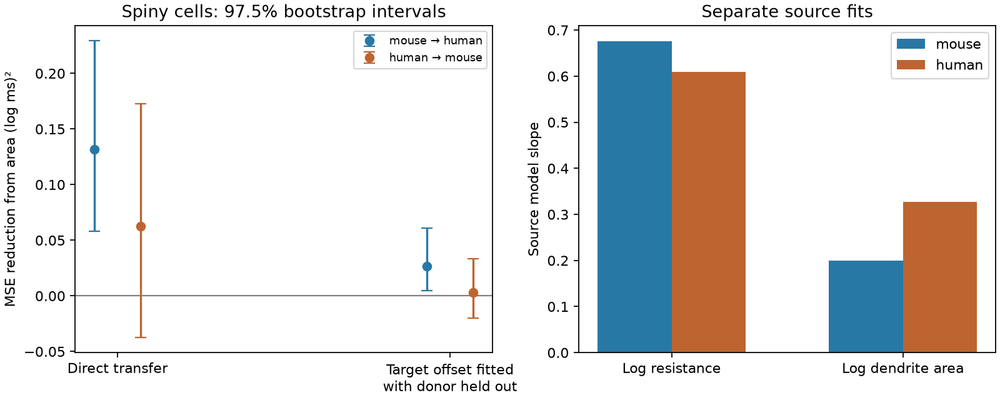

# Dendrite area reduced mouse-to-human response-time prediction error in selected Allen spiny cells

## Results

We tested whether dendrite area adds useful information when a membrane response-time model is trained on one species and applied to the other. We used linked Allen morphology and electrical summaries. The primary sample had 234 mouse spiny cells from 173 donors and 111 human spiny cells from 31 donors. The baseline used input resistance and layer. The area model added reconstructed dendrite area. Positive gain means lower mean squared log error.



| Transfer | Target calibration | Base MSE | Area MSE | Gain | 97.5% interval | Relative gain |
|---|---|---:|---:|---:|---|---:|
| mouse to human | None | 0.28564 | 0.15393 | 0.13171 | 0.05810 to 0.22955 | 46.1% |
| mouse to human | Offset with donor held out | 0.15345 | 0.12698 | 0.02646 | 0.00479 to 0.06103 | 17.2% |
| human to mouse | None | 0.14983 | 0.08729 | 0.06254 | -0.03764 to 0.17241 | 41.7% |
| human to mouse | Offset with donor held out | 0.08830 | 0.08520 | 0.00311 | -0.02018 to 0.03328 | 3.5% |

MSE has units of squared natural log milliseconds. The uncertainty calculation refits source models after resampling donors in both cohorts. The calibrated results use target outcomes from other donors. They answer a different question from direct transfer.

## Sensitivity results

| Setting | Transfer | Calibration | Gain | 97.5% interval |
|---|---|---|---:|---|
| ols | mouse to human | None | 0.13323 | 0.05772 to 0.23491 |
| ols | mouse to human | Offset | 0.02730 | 0.00524 to 0.06325 |
| ols | human to mouse | None | 0.05279 | -0.06983 to 0.17712 |
| ols | human to mouse | Offset | 0.00290 | -0.02327 to 0.04000 |
| ridge_0.1 | mouse to human | None | 0.13309 | 0.05791 to 0.23394 |
| ridge_0.1 | mouse to human | Offset | 0.02721 | 0.00520 to 0.06307 |
| ridge_0.1 | human to mouse | None | 0.05403 | -0.06505 to 0.17616 |
| ridge_0.1 | human to mouse | Offset | 0.00294 | -0.02270 to 0.03913 |
| ridge_10 | mouse to human | None | 0.11500 | 0.04297 to 0.20423 |
| ridge_10 | mouse to human | Offset | 0.02181 | 0.00360 to 0.05162 |
| ridge_10 | human to mouse | None | 0.07666 | 0.01321 to 0.15035 |
| ridge_10 | human to mouse | Offset | 0.00199 | -0.01311 to 0.01503 |
| all_classes | mouse to human | None | 0.17005 | 0.08929 to 0.26672 |
| all_classes | mouse to human | Offset | 0.06911 | 0.03202 to 0.12889 |
| all_classes | human to mouse | None | 0.02798 | -0.08218 to 0.13294 |
| all_classes | human to mouse | Offset | 0.01771 | -0.00856 to 0.05297 |
| soma_added | mouse to human | None | 0.13504 | 0.05855 to 0.23557 |
| soma_added | mouse to human | Offset | 0.02869 | 0.00612 to 0.06542 |
| soma_added | human to mouse | None | 0.06422 | -0.03442 to 0.17596 |
| soma_added | human to mouse | Offset | 0.00462 | -0.01693 to 0.03712 |

All planned settings are shown. Sensitivity intervals are descriptive and do not correct for all comparisons. The all-class setting has 509 mouse cells from 372 donors and 158 human cells from 35 donors.

## Predictor support

| Source | Feature | Source minimum | Source maximum | Target cells outside source range |
|---|---|---:|---:|---:|
| mouse | ri | 45.78 | 487.97 | 10.8% |
| mouse | area | 2016.27 | 14291.80 | 59.5% |
| human | ri | 28.44 | 438.75 | 0.4% |
| human | area | 4514.69 | 60094.81 | 34.2% |

Area is in square micrometres; resistance is in MOhm. These ranges do not measure multivariate overlap. The median area was 5,357 square micrometres in mouse and 16,003 in human. Mouse layer counts for 2/3, 4, 5, and 6 were 23, 86, 71, and 54; human counts were 70, 13, 20, and 8. All 667 SWCs had zero missing parent references.

## Interpretation

In the primary mouse-to-human test, area reduced error by 46.1%. The absolute reduction was 0.13171 squared log units, with a 97.5% donor bootstrap interval of 0.05810 to 0.22955. The estimate remained positive across all planned penalties, with soma area added, and in the all-class sensitivity. After fitting a target offset with each scored donor held out, the reduction was 17.2%, with an absolute interval of 0.00479 to 0.06103. Thus, in this test, a single shared offset did not account for all of the added value of area.

The reverse direct-transfer estimate was a 41.7% reduction, but its interval included zero (-0.03764 to 0.17241 squared log units). After target calibration, it was 3.5%, with an interval that also included zero. Stronger ridge shrinkage gave a positive interval for reverse direct transfer in one sensitivity. This model dependence limits a general claim about reverse transfer. A clear result in one direction and an unclear result in the other do not establish a statistical difference between directions.

The area slope was 0.200 in the mouse source model and 0.328 in the human source model. These slopes are descriptive estimates without a formal slope-difference test. They are not specific membrane capacitance. In the mouse-to-human test, 59.5% of target cells had area outside the source range. In the reverse test, 34.2% did. The fitted linear rule therefore makes substantial extrapolations. Its success here supports a limited practical use of morphology for transfer in these selected cells. It does not establish a universal cell law or equal slopes between species.


## Question and prior work

Does a relation between dendrite area and membrane response time transfer between mouse and human cells? A compact passive cell gives a reason to expect a role for area: response time is resistance times capacitance, and membrane area contributes to capacitance. A real dendrite tree has spatial voltage gradients and active currents. The compact-cell formula is only motivation for this prediction test.

Gouwens et al. studied joint electrical and morphological cell classes in mouse visual cortex (2019, doi:10.1038/s41593-019-0417-0). Eyal et al. used detailed models and patch data to study human membrane properties (2016, doi:10.7554/eLife.16553). Neither result requires a simple regression to transfer between species. Allen documentation defines the response time as an exponential fit to hyperpolarizing current responses. We use that source feature, not a new fit to traces.

We searched the local campaign for Allen morphology, capacitance, sag, and cross-species dendrite transfer. We read verified publication sha256:7a8d2fb1764d832b1d66d6e70fc250edd572b51a69785d6d69109c987cdc675d. It tested the added value of area within each species and did not test transfer. The present work asks a different question with the same raw cache. No prior code or result tables were copied. The shared cache also cites an older SCI study of specific capacitance; we did not review its full text. We make no claim to be the first study of species differences. The plan and its metadata-only layer amendment are in files/analysis_plan.txt. This is an exploratory benchmark, not a registered test.

## Data and structural link

The exact data path is /mnt/dell-data/shared_datasets/allen_cell_types/v2026-10-28. The cache was made on 2026-10-28 from the Allen Cell Types API, which has no fixed release identifier. Structure and function are linked by exact specimen ID. We use specimen metadata and SWC reconstructions in place. We do not use raw activity traces, inferred connectome edges, or data from other animals as if they were from the same cell.

files/provenance.json records the absolute path, byte count, SHA-256 hash, and source URL for every input used. This includes the source README, specimen JSON, and all 667 available SWCs. For each dendrite segment with both endpoint types 3 or 4, we sum lateral frustum area pi*(r0+r1)*sqrt(L^2+(r1-r0)^2), with radii and length in micrometres. We omit axons, end caps, spines, and soma-to-dendrite segments. A sensitivity test adds the surface of a sphere with the median soma-node radius. No shrinkage correction is applied. Source ef__ri is in MOhm and ef__tau is in ms. The QC input-resistance field is a different measure and is not used.

The primary sample contains spiny cells with positive finite area, resistance, and response time. Layer 2, 3, and 2/3 are merged as 2/3; layer 6, 6a, and 6b are merged as 6. Other source labels are unchanged. This merge was chosen from label metadata before scores were available. Human regions and mouse visual cortex are different. Region is therefore not a shared control. Cre labels are also not shared. The all-class sensitivity adds dendrite class indicators but cannot fully control cell identity.

## Models and uncertainty

For each transfer direction, the base model predicts natural log response time from an intercept, log resistance, and layer indicators. The area model adds log dendrite area. Source label levels define indicators; the first sorted level is the reference. An unseen target level has zero indicators. Source donor weights give each donor equal total weight and are normalized to the source cell count. Continuous predictors use source weighted means and standard deviations. Indicators are not scaled. The ridge penalty is 1 and the intercept is not penalized. Predictions use no target outcomes in the primary direct-transfer test. Target errors are first averaged within donor, then across donors.

The secondary calibration retains source slopes and fits one target offset. For each scored target donor, the offset is the average residual of the other target donors. No cell from the scored donor enters its offset. This calibration needs labeled target data and is not zero-shot transfer.

For 2,000 bootstrap draws with seed 110708, we independently resample source donors and target donors. The source model is refit in each draw, including source centering and scaling. Each sampled donor retains its original within-donor cell weights. Total training weight remains the original source cell count. Target donors have equal weight per draw. Calibration excludes every bootstrap copy of the scored donor. We report 1.25 and 98.75 percentiles, giving nominal 97.5% intervals for the two primary directional tests. These intervals include source training variation but condition on selected cells, source measurements, and model choice. They do not correct for all secondary analyses.

Sensitivity analyses use penalties 0, 0.1, and 10, all dendrite classes, and added soma area. Penalty 0 uses a least-squares solution. All planned results are saved, including results that weaken the primary finding. Repeated bootstrap seeds across settings pair the resampling draws; settings are not independent replication.

## Limits

These data do not isolate a species effect. Brain region, donor condition, cell selection, recording conditions, age, slice damage, and cell identity can all shift the relation. Human donors are selected clinical donors. Reconstructed area can miss cut branches and spines and is sensitive to radius estimates. A fitted somatic response time is not a direct measure of total capacitance or specific membrane capacitance. Prediction error cannot identify the cause of transfer failure or prove a biological mechanism. The sample does not test intact-brain dynamics, behavior, synaptic wiring, or representation reliability. A transfer result within these data does not establish generalization to other regions or conditions. Full training bootstraps do not remove systematic source error or cohort bias.

## Reproduce and inspect

Use Python 3.12 with numpy, pandas, and matplotlib. Exact run versions are in files/environment.json. From an extracted bundle root, run:

```sh
sh files/reproduce.sh /mnt/dell-data/shared_datasets/allen_cell_types/v2026-10-28 reproduced
```

This rebuilds derived features, predictions, bootstrap results, and the figure in a new output directory, then checks the evidence. With no raw cache, the complete prediction analysis can be rerun from the saved cell features:

```sh
python3 files/analyze.py --features files/cell_features.csv --out reproduced
python3 files/check_evidence.py --dir reproduced
```

To check published evidence without refitting, run `python3 files/check_evidence.py --dir files`. The check reconstructs all scores and interval endpoints from saved predictions and bootstrap draws. It also checks the source fit by a separate augmented least-squares calculation and checks that calibration excludes all copies of a scored donor. These are numerical checks, not a check of biological measurement quality. A separate segment-loop geometry check in three cells agreed within 2e-15 relative error; run `python3 files/check_geometry.py --data <cache-path>` to repeat it.

To retrieve raw data if needed, get the specimen JSON from its URL in files/provenance.json. For each row with nrwkf__id, retrieve https://api.brain-map.org/api/v2/well_known_file_download/<nrwkf__id> to local scratch as swc/<specimen__id>.swc. Compare exact byte hashes with provenance.json. The mutable API may prevent exact recovery; the shared cache is the reference. Do not replace files in that cache. For a reusable shared download, use the campaign-dataset helper named in the workspace README. Raw source data are not included in this bundle.

## Job and rights

Job: sci-1107-syam2-neural-structure-and-computation-a45a93f1d04f. Topic: neural-structure-and-computation. Campaign: 11_07_2026. Machine: syam2. Account: codex-myxtap. Model: gpt-6.1-sol with high reasoning effort, in T3 Code through the Codex harness. No child agents were used. The campaign-machine key is not a personal authorship claim. The signed bundle is stored locally only.

Credit: Allen Institute for Brain Science (2015), Allen Cell Types Database, https://celltypes.brain-map.org/, and the source investigators. Source files retain the Allen Institute Terms of Use, https://alleninstitute.org/legal/terms-of-use. The SCI baseline license applies to new text, figures, code, and derived analysis material to the extent permitted by source terms. It does not replace source terms. No raw source files or private keys are in the package.
