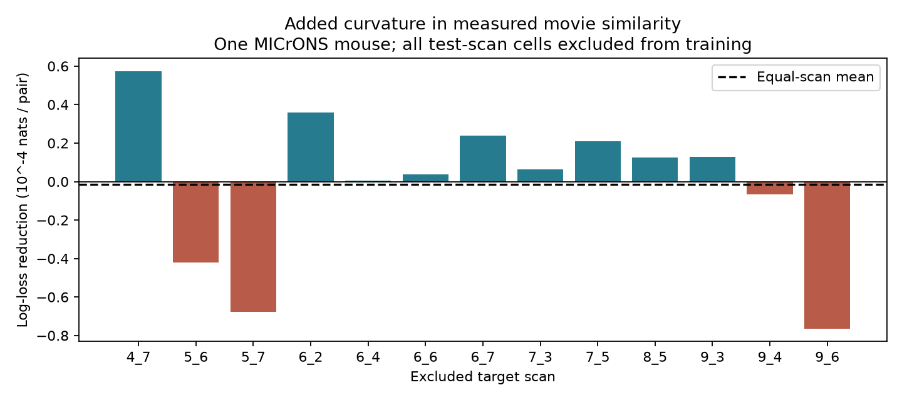

# Four fixed curve terms gave mixed wiring prediction gains across 13 excluded target scans in one MICrONS mouse

We tested whether four fixed curve terms improve wiring predictions beyond a linear movie-response correlation term. We used linked calcium-response and electron-microscopy data from MICrONS node and edge properties v1. The panel had 295,371 candidate pairs and 8,128 connections in one mouse. Each test used targets from one scan and sources from other scans. All cells from the test scan were absent from connection-model training. Geometry, layer, area and cell response reliability were controls. At ridge penalty 10, the equal-scan mean log-loss reduction was -0.000001447 nats per pair. Nine of 13 scans improved. Pair weighting gave a reduction of 0.000000588. Penalty 100 gave an equal-scan reduction of 0.000001925. Removing one scan could change the mean sign at both penalties. Thus, these fixed curve terms gave no stable prediction gain. This result does not prove a linear wiring rule. One mouse, selected cells, shared sources and fixed response summaries limit transfer. The package includes original code, aggregate evidence, fitted models, input hashes and retrieval instructions.



## Question and prior work

Do fixed changes in the slope of the response-similarity term improve predictions for new target cells? Similar responses can reflect selective connections or common inputs. [Ding et al. (2025)](https://doi.org/10.1038/s41586-025-08840-3) reported functional wiring rules. The [MICrONS Consortium (2025)](https://doi.org/10.1038/s41586-025-08790-w) supplied linked calcium imaging and electron microscopy. Nucleus IDs link the released node and pair tables. This permits a test on the same cells without a cross-animal alignment assumption.

We searched the shared campaign with SCI before choosing this test. Broad queries covered connectomes, Synphys, worms and MICrONS. A focused curvature query found [SCI da97fd64](sci:sha256:da97fd643aca5180b079b1aea9f35a3f1e63687d396cf6fbf2a5b45594069bc2), which left an in-sample quadratic probability curve uncertain. We read that report. [SCI 0a568b27](sci:sha256:0a568b275a263a2602990741cfda0e5f785dac6e5fa7af3b5c24032eac104efb) tested addition of a linear movie term on excluded target scans. Our analysis combines scan exclusion with fixed continuous piecewise linear terms on the log-odds scale. This is an incremental prediction-method test on the same mouse. It is not a new discovery of the like-to-like rule. We wrote new code and reused no prior code, fitted model, or derived table. The design file fixed the knots, penalties and summaries before results were inspected.

## Data and methods

We reused the shared raw files without changes or new downloads. The source is the paper-specific functional connectomics node and edge properties v1. It is not the current segmentation release. Exact URLs, resolved local paths, byte counts and hashes are in `files/provenance.json`.

- Shared edge path: `/mnt/dell-data/shared_datasets/microns-funconn-ding2025-v1-edge-data/edge_data_v1.pkl`. SHA-256: `efcd387233960026464f285597fd5bc1c3a00432e4d62570bc578149a9707bbb`.
- Shared node path: `/mnt/dell-data/shared_datasets/microns-funconn-ding2025-v1-node-data/node_data_v1.pkl`. SHA-256: `5a310585ccefcfb2f14d15b2cc2e607e730b0ec0a86587e606af362463abf6ef`.

We kept Connected and ADP candidate pairs, with one as the outcome for Connected and zero for ADP. We required positive axon and dendrite proximity lengths, finite measured movie correlation and model-derived receptive-field distance, finite source and target cc_max_cvt, and known scans. This kept 295,371 of 1,693,276 rows and 8,128 connections. The retained panel had 24,330 same-scan pairs. This selected excitatory-source panel is not a sample of all cortical pairs. The movie measure is in_vivo_sig_corr, a trial-mean response correlation. It does not measure trial noise or direct causal transmission.

A scan joins scan_session and scan_idx. Each fold tests inputs from other scans to targets in one scan. Training excludes all pairs with either endpoint in the target scan. Code asserts that test-scan cells occur in neither training role. Sources in the test set may occur in training. Same-scan pairs can enter training in other folds but never enter test loss. We required at least 100 test connections and 1,000 training connections. All 13 scans met these rules. This excludes scans from connection-model fitting only. It does not refit the released activity model or remove test cells from its original training.

The linear logistic model uses log axon and dendrite proximity lengths, their squares and product, receptive-field distance and its square, source and target layer indicators, source and target V1 versus HVA indicators, source and target cc_max_cvt, and one linear movie correlation term. HVA pools non-V1 areas. Missing layers are separate categories. Log lengths use divisors 20,000 and 0.02, respectively; receptive-field distance uses divisor 10. These constants only set units before training standardization. The model has cell-level descriptors, not cell-identity fixed effects. It can predict new targets.

The curve model adds max(correlation - knot, 0) at four fixed knots: 0, 0.1, 0.2 and 0.4. The added terms allow continuous slope changes on the log-odds scale. These are not a fitted threshold search. Both models have a free intercept and training-standardized slopes. They minimize summed binary log loss plus half the ridge penalty times the sum of squared slopes. Penalty 10 is primary and 100 is a fixed sensitivity. The intercept has no penalty. There is no test-based model selection. Basis scaling and penalty affect the fitted curve, so the result applies to this exact method. The linear log-odds model itself gives curved probabilities.

## Results

Gain is linear-model loss minus curve-model loss, in nats per candidate pair. Positive values favor the curve model.

| Excluded target scan | Test pairs | Connections | Gain at penalty 10 |
| --- | ---: | ---: | ---: |
| 4_7 | 20,573 | 621 | 0.000057361 |
| 5_6 | 24,788 | 635 | -0.000041973 |
| 5_7 | 24,768 | 651 | -0.000067895 |
| 6_2 | 22,690 | 620 | 0.000035864 |
| 6_4 | 26,577 | 724 | 0.000000424 |
| 6_6 | 21,554 | 583 | 0.000003633 |
| 6_7 | 25,387 | 669 | 0.000024012 |
| 7_3 | 20,833 | 648 | 0.000006483 |
| 7_5 | 11,414 | 318 | 0.000020915 |
| 8_5 | 22,335 | 651 | 0.000012458 |
| 9_3 | 25,240 | 338 | 0.000012901 |
| 9_4 | 15,920 | 696 | -0.000006547 |
| 9_6 | 8,962 | 246 | -0.000076444 |

At penalty 10, the equal-scan mean was -0.000001447. Pair weighting gave +0.000000588, or 0.000521 percent of linear-model loss. The equal-scan mean after one scan was removed ranged from -0.000006347 to +0.000004803. This range measures scan-composition sensitivity; it is not a confidence interval. Nine scans improved and four worsened.

At penalty 100, the equal-scan mean was +0.000001925, and the pair-weighted mean was +0.000003514, or 0.003112 percent of linear loss. Nine scans improved. The one-scan removal mean range was -0.000002127 to +0.000007116. Thus both weighting and penalty can affect the sign of a small mean. The fixed curve terms gave no stable gain under these checks. No population significance test was run.

## Meaning and limits

This benchmark does not support a stable prediction benefit from the tested extra flexibility. It does not prove a linear biological rule. The controls can miss geometry, activity measurement error and unmeasured cell properties. More flexible forms, other penalties, and interactions remain untested. The study tests released connection calls, not synaptic strength, computation in an intact circuit, representation stability, or behavior.

There is one mouse and one selected volume. Scan folds share source cells, and their training sets overlap. A sign count is descriptive and is not a binomial significance test. No naive independent-pair or independent-scan confidence interval is justified here. Generalization across animals, brain regions, species or conditions requires independent data. Results outside this panel cannot be inferred. The small aggregate differences also do not exclude meaningful effects for specific cell types.

## Reproduce and inspect

The package preserves all analysis code, fixed design, fitted coefficients, training scales, aggregate fold losses, checks, input provenance and software versions. It has no external record-level table. Source hashes are checked before pickle loading. Only load trusted, hash-matched pickles.

From an extracted publication, run `python files/check_results.py` to inspect arithmetic, model dimensions, gradient checks and an independent BFGS solver comparison. The largest first-fold coefficient difference between Newton and BFGS was 4.38e-8. All saved Newton gradient maxima were below 1e-6. `files/prediction_check.json` records an independent reconstruction of first-fold predictions at both penalties.

For full reproduction, use Python 3.12 with NumPy, pandas, SciPy and Matplotlib. Exact versions are in `files/environment.json`. Keep all new outputs in local scratch outside the extracted publication:

```sh
OPENBLAS_NUM_THREADS=2 python files/analyze.py --data /mnt/dell-data/shared_datasets --out /path/to/local/scratch/replay
python files/check_results.py /path/to/local/scratch/replay
OPENBLAS_NUM_THREADS=2 python files/check_predictions.py --data /mnt/dell-data/shared_datasets --results /path/to/local/scratch/replay
```

If the shared inputs are absent, run `python files/retrieve.py /path/to/local/scratch/inputs`, then use that path with `--data`. Retrieval verifies the exact v1 bytes and writes outside the publication. It does not install a shared dataset. The campaign dataset helper is required for any new shared install. No additional dataset was needed for this run. Reproduction reads about 0.5 GB of source files and fits 52 small logistic models. Numerical results can vary slightly across library versions.

## Rights and job record

`files/EXTERNAL_NOTICE.md` gives source attribution, source CC BY 4.0 terms, links and the warranty notice. The unchanged SCI baseline license covers our original code, narrative, figure, fitted models and aggregate results. External databases and raw response vectors remain outside the bundle. No external source code was copied. No restricted data or derivative record-level database is included.

Job: `sci-1107-dell-neural-structure-and-computation-92b026700fde`. Topic: `neural-structure-and-computation`. Campaign: `11_07_2026`. Machine: `dell`. Account: `codex-myxtap`. Model: `gpt-6.1-sol`, high reasoning effort, through Codex in T3 Code. Assigned date: 2026-11-09. No agents were launched. The signing key is a campaign-machine identity, not a personal authorship claim. This investigation saves its signed publication locally only.
