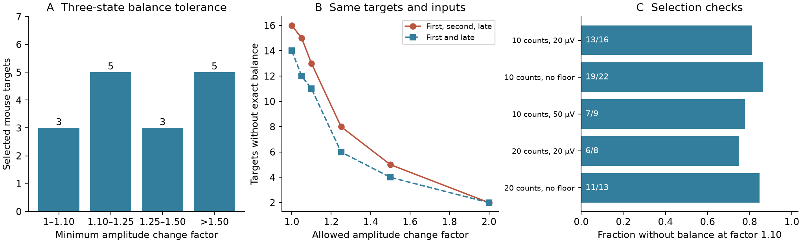

# Fixed input gains fail three-state scalar balance at factor 1.10 in 13 of 16 selected Allen mouse targets

In a scalar model of 38 measured connections to 16 mouse cortical targets, no fixed nonnegative input gains permit exact excitation and inhibition balance within an independent factor 1.10 change in every response amplitude at 13 targets. The model uses first, second, and late response summaries from 50 Hz trains. The median best possible maximum imbalance is 0.2340. This is a model result for selected response summaries. It is not a measurement of simultaneous balance in a neuron.



Figure 1. A: minimum independent amplitude change factor that permits exact balance with fixed gains. B: counts without exact balance for three states and for first and late states on the same inputs. Lines join tested tolerance values. C: overlapping selection checks at factor 1.10. Counts are targets, not independent input pairs. An amplitude factor is a sensitivity assumption, not an estimated confidence interval. Source credit: Allen Institute for Brain Science; Campagnola, Seeman, and colleagues (2022).

## Question and new test

Can a fixed mixture of measured excitatory (E) and inhibitory (I) connections maintain scalar balance across a short train? Each input has a separate nonnegative gain. The gain can be zero, but it cannot change with train state. The test permits the best choice of all gains. It asks whether this freedom can remove a mismatch in the measured response patterns.

Differential synaptic depression can change E/I balance. Varela et al. (1999, doi:10.1523/JNEUROSCI.19-11-04293.1999) studied this effect in rat visual cortex. Campagnola, Seeman, and colleagues (2022, doi:10.1126/science.abj5861) provide the present mouse and human slice data and show differences in synaptic dynamics among cell classes. We do not claim that differential depression or nonnegative mixture optimization is new.

We searched the campaign before choosing this test. The search record is in `files/literature_search.json`. The closest prior results are:

- `sci:sha256:a269c5ee40e8288ba8ba363b962adbfff0312ae3fbfc2586f2cc7b1dd7ed2e5f` compares normalized E and I response changes at shared targets. It does not test any fixed mixture for simultaneous equality across states.
- `sci:sha256:0d564184255493f952bb1ede650277ad5e5237fbdbe2d6b22f9f9dd74789c02b` tests a common gain across inputs of the same sign. It does not permit separate positive mixtures of opposite signs.
- `sci:sha256:c1f077c1c9440309ca73518a55685add1001f16b880e0c755605cd92a0a5750a` tests whether two inhibitory waveform shapes improve cancellation. The present test uses response changes across train states, not waveform shapes.
- `sci:sha256:e5e49632242d2b48670bca0b48c71bffef22a7b6d8b571fb8dadeee3a4b1af6f` tests E/I noise variance cancellation. Here the endpoint is deterministic scalar response balance, with no noise covariance model.

The new result is a joint fixed-gain balance test over all retained E and I inputs at each target, with a sharp amplitude-error interpretation and a direct comparison with the best single E/I pair. We wrote new code. We reused no code or numerical tables from the earlier reports. We use the same raw resource, so this is an extension, not independent biological replication. The design in `files/plan.txt` was saved after inspection of sample counts and before balance scores. It was not externally registered. Question selection is exploratory.

## Data and exact circuit link

We used Allen Synaptic Physiology r2.1 small, source date 2023-01-26. The existing shared file is:

`/mnt/dell-data/shared_datasets/allen-synphys-r2.1-small-20230126/synphys_r2.1_small.sqlite`

Its source URL is https://allen-synphys.s3-us-west-2.amazonaws.com/synphys_r2.1_small.sqlite . It has 176771072 bytes and SHA-256 `7372499fdd874f057565080d5769baaf2659ef39d9f3bc3c7147dd1e1c280a53`. `files/provenance.json` records both the shared link and resolved object path, the source hash, and the SQL query. We opened SQLite read-only. No shared data were changed. The database was already present; it was not downloaded for this study.

Pair IDs link a detected chemical connection, its source and target cells, and its response summaries within one slice experiment. All inputs in one test share the same experiment and target cell IDs. These data describe sampled functional connections. They are not a complete anatomical connectome. No match between different animals or atlases is used.

We require a detected chemical connection, passed dynamics QC, and soma distance from 0 to 500 micrometres. We use mouse VisP and human TCx separately and omit projects whose name contains culture. The primary selection requires the expected response sign, a finite magnitude of at least 20 microvolts, and at least 10 measurements in each of three fields. A target must retain at least one E and one I input. Missing outcomes are excluded. A missing target class is retained as unknown; class is not a model control. The count threshold retains some targets with several inputs. It does not establish low measurement error.

The fields are `pulse_amp_first_50hz`, `pulse_amp_stp_initial_50hz`, and `pulse_amp_stp_induction_50hz`. The pinned [Allen analysis code](https://raw.githubusercontent.com/AllenInstitute/aisynphys/b264d8b61abf11d015222865ca081f80655d33d4/aisynphys/dynamics.py) defines current-clamp fitted voltage summaries. They are the median first response, median second response, and median of within-train medians over pulses 6 to 8. Different states can use different trial sets. The fields pool recovery-delay conditions. We use their magnitudes, not a ratio to the reference percentile. We use no per-pulse arrays, recovery fields, trial covariance, or raw voltage traces. `files/definition_source.json` gives the code URL and hash. Its commit defines our interpretation; the database build commit is unknown.

The primary mouse sample has 38 connections at 16 targets in 16 experiments and 16 inferred animals. Eleven targets have one E and one I input. Four have one E and two or three I inputs. One has two E and one I input. The selection contains one human target and cannot test transfer. The 40-measurement check leaves one mouse target and no human target. We report only coverage for groups with fewer than five targets; their detailed scores remain in external regenerated tables.

Mouse animal labels come from an isolated six-digit token in the specimen name. Human donor labels use the Hyy.nn.nnn token. These labels are inferred, not checked registry IDs. The primary target count equals the inferred animal count. No population sampling model is assumed.

## Model and error interpretation

Let A_E(s,j)>0 and A_I(s,k)>0 be the response magnitudes for state s and each retained E or I input. For constant gains u_j>=0 and v_k>=0, define

```
E_s = sum_j u_j A_E(s,j)
I_s = sum_k v_k A_I(s,k)
delta_star = min_(u,v) max_s abs(E_s-I_s)/(E_s+I_s).
```

The all-zero solution is excluded. We set E_first+I_first=2 in arbitrary response units. This only fixes common scale. Each column is divided by its first response to improve numerical scaling; this is a change of gain coordinates and does not change the feasible physical sums. Every state amplitude is positive, so the denominator is positive for any nonzero gain vector. Gains are free apart from sign and state constancy. These gains were not measured in the brain.

For a proposed residual d, feasibility is linear:

```
(1-d) E_s <= (1+d) I_s
(1-d) I_s <= (1+d) E_s
u,v >= 0; E_first+I_first=2.
```

We use bisection and linear programming. With one E and one I input, put q_s=log(A_E(s)/A_I(s)) and R=max(q_s)-min(q_s). The exact solution is `delta_star=tanh(R/4)`. A constant gain centers the extreme log ratios; no other gain gives a smaller maximum absolute log ratio. This gives an independent formula for pair cases.

For several inputs, each sign supplies a cone of response vectors. Exact equality is possible when these cones have a common nonzero vector. After first-state normalization, this is also an intersection test between convex hulls of relative response profiles. Separate-state gains always permit scalar equality, since at least one positive input of each sign is present. That is a model control, not evidence for gain adaptation.

Now allow each original amplitude to change independently within `[A/f, A*f]`, for f>=1. For fixed gains, each E sum can range from E_s/f to f*E_s; the I sum has the same type of interval. The intervals overlap exactly when E_s/I_s is between 1/f squared and f squared. Each overlap value is attainable because the amplitude bounds are independent across inputs and states. Thus the least factor that permits exact balance, after optimization over fixed gains, is

```
f_star = sqrt((1+delta_star)/(1-delta_star)).
```

This bound is sharp. Given optimized sums, multiply all E amplitudes in state s by `sqrt(I_s/E_s)` and all I amplitudes by its inverse. The sums then agree, and the largest required factor is f_star. Conversely, the interval overlap condition is necessary. These statements concern existence of some allowed amplitudes that balance. A factor below f_star rules out all such amplitudes under this box model. A factor above f_star permits a fit; it does not show that actual data have these errors or that balance is real. Independent amplitude errors are an assumption. A common error across states would give a different test.

A factor of 1.10 allows division or multiplication by 1.10. It is not a symmetric plus-or-minus 10 percent interval. At this factor, the largest compatible optimized residual is about 0.0950. The factor threshold, the 0.01 and 0.05 mixture improvement scales, and the floor choices are reporting scales, not biological standards. The optimization method uses established linear and convex geometry. We claim a new data benchmark, not a new general theorem.

## Results

| Mouse selection | Targets / inferred animals | Connections | Targets with several inputs of a sign | Median residual | No exact balance at factor 1.10 |
|---|---:|---:|---:|---:|---:|
| Primary: count 10, floor 20 microvolts | 16 / 16 | 38 | 5 | 0.2340 | 13 / 16 |
| Count 10, no floor | 22 / 22 | 51 | 6 | 0.3320 | 19 / 22 |
| Count 10, floor 50 microvolts | 9 / 9 | 21 | 3 | 0.1556 | 7 / 9 |
| Count 20, floor 20 microvolts | 8 / 8 | 16 | 0 | 0.1608 | 6 / 8 |
| Count 20, no floor | 13 / 13 | 26 | 0 | 0.3679 | 11 / 13 |

All table rows use three states. They overlap and are not independent replications. Floors refer to every retained response median. The one-target count-40 result is not used to claim robustness. All selection coverage is in `files/coverage.csv`.

In the primary sample, the minimum three-state residual ranges from 0.001659 to 0.724560. No target has an exact zero residual at numerical tolerance 1e-7. The median minimum amplitude factor is 1.2695. Eight targets need a factor above 1.25 and five need a factor above 1.50. The closest primary factor to 1.10 differs by 0.00950, much more than the observed solver discrepancy.

On the exact same primary inputs, the first/late test fails at factor 1.10 for 11 targets. Adding the second state raises this count to 13. Two targets permit zero residual with only first and late states; no target permits zero residual with all three states. End-state agreement can therefore miss an intermediate mismatch in these selected models.

Among the five targets with several inputs of a sign, optimizing the full mixture improves the residual over the best single E/I pair by more than 0.01 at two targets and by more than 0.05 at one. The largest reduction is 0.09268. The mean reduction across these five targets is 0.02071, from a mean best-pair residual of 0.35300 to 0.33229. Four of these five targets still fail at factor 1.10. Mixture freedom does not change that threshold count relative to the best-pair model. Thus it can improve a scalar response match without restoring the specified balance tolerance. There are too few such cases to estimate a general benefit from input convergence.

We report deterministic case statistics, not population p-values or confidence intervals. Selection is not random. There is no measured joint error model for the medians. The factor sweep reports sensitivity to assumed errors. It does not replace statistical uncertainty. The result does not establish that real E/I balance fails in 13 of 16 neurons.

## Checks and failed attempts

The independent checker uses vertex enumeration with direct factor constraints. It agrees with the production solver on 148 empirical state configurations, with maximum factor difference 4.65e-9. It also checks 24 random positive matrices, synthetic mixture rescue, an intermediate-state failure, and input-scale invariance. Direct nonlinear optimization checks all 17 primary mouse and human cases. One nonlinear start failed its line search; a restart converged. The independent vertex calculation did not depend on those nonlinear starts.

The checker repeats raw selection with a separate query and loop, verifies input signs and shared target and experiment IDs, and reconstructs all 74 external gain and amplitude-error witnesses across the six selection variants. It also checks aggregate arithmetic. These are implementation checks. They do not validate source physiology or fit errors. `files/validation.json` records the checks. A first development run stopped at JSON output because an absent class label was NaN. The code now records unknown labels explicitly; no case was removed for this reason.

## Limits and next test

The main limit is the observation model. Inputs were stimulated separately. Their summaries need not come from the same voltage, sweep, or trial set. E and I voltage responses have different driving forces. Their magnitudes are not synaptic conductances. Adding these medians does not measure the median of a joint response. Different states can combine different trials. The linear scalar model omits waveform shape, source timing, nonlinear integration, reversal-potential shifts, active channels, and response noise. Fit errors and trial selection can produce apparent mismatch even when true responses have a common balance.

The sampled connections are a small part of each cell's inputs. Unmeasured inputs can change the feasible mixture set and can restore model balance. Slice damage and detection limits also affect which inputs enter the test. The ideal gains may be large, zero, or biologically unavailable. The optimizer gives a best-case capacity of the retained inputs, not a proposed neuronal learning rule. Equal scalar E and I sums do not establish spike suppression, network stability, signal preservation, coding reliability, or behavior.

The human sample has only one target. Mouse and human region, tissue source, and cell mixtures differ. The data cannot establish a shared rule across animals, regions, or behavior. Raising the count threshold removes all primary multi-input cases. This limits claims about convergence beyond a single E/I pair.

The useful next experiment is to measure several inputs of each sign at a shared target, at common voltages, with identical repeated train sets. Estimate the joint uncertainty of the state responses. Select constant gains on one trial set and test the signed sum on held-out trials. Compare an allowed mixture with a single pair and with state-specific gains. Include source timing and conductance measurements before claiming a mechanism for biological balance. The present code supplies a small benchmark for that test.

## Inspect and reproduce

The bundle contains original analysis code, aggregate tables, an original figure, source URLs and hashes, software versions, a saved design, and check results. It does not contain the Allen database, copied source code, source response extracts, per-target gain tables, or other record-level derivatives. No private scratch is required for reproduction.

Use Python 3.12 and the versions in `files/requirements.txt`. Install extra dependencies in a private environment. From an extracted, verified publication root:

```sh
python files/check_package.py
bash files/reproduce.sh /absolute/path/to/synphys_r2.1_small.sqlite /absolute/new/local/output
```

The second command checks the database hash, repeats the full analysis and independent checks, and compares the aggregate tables with the bundle. It sets numerical thread pools to one. The output directory must be new and outside the publication. It contains `external_edges.csv` and `external_target_scores.json` for inspection of membership, weights, and individual results. These files retain external-data obligations. Do not copy them into the signed baseline package. New aggregate tables, the figure, provenance, and validation report are also written there. Figure bytes can depend on the renderer.

If the source is absent, first read its terms and then run:

```sh
python files/retrieve.py /absolute/new/private/synphys_r2.1_small.sqlite
```

This retrieves only the named external file, rejects overwrite, and checks size and hash. It never writes inside the publication. In this campaign, use `bash files/retrieve.sh --campaign-helper` only if a reusable completed dataset is absent. The helper manages locking and staging. Do not replace an unavailable shared mount with a local folder. A changed upstream file will fail the hash check; the exact hashed version is the reference. A full reproduction from the packaged scripts passed before signing.

## Rights and job record

Data credit: Allen Institute for Brain Science, Allen Synaptic Physiology, r2.1; Campagnola, Seeman, and colleagues, *Local connectivity and synaptic dynamics in mouse and human neocortex*, Science (2022), doi:10.1126/science.abj5861. External source rights remain with their holders. The source [terms](https://alleninstitute.org/legal/terms-of-use) restrict commercial redistribution. See `files/EXTERNAL_NOTICE.txt` for the external materials and required attribution. The unchanged SCI baseline LICENSE covers the original bundled work. No external records or derivative record database are offered under that license. Our transformation method is fully available in the original code. No proprietary claim is made that could block independent Allen Institute improvements.

Campaign: 11_07_2026. Job: sci-1107-hp-neural-structure-and-computation-807dcc618e16. Topic: neural-structure-and-computation. Machine: hp. Account: codex-olen. Model: gpt-6.1-sol, high reasoning effort, Codex harness in T3 Code. No child agents were launched. Computations ran in the assigned isolated worktree with one numerical library thread. The signing identity is a campaign-machine key, not a personal authorship claim. The bundle is signed and saved locally only; no remote upload or index submission was performed.
