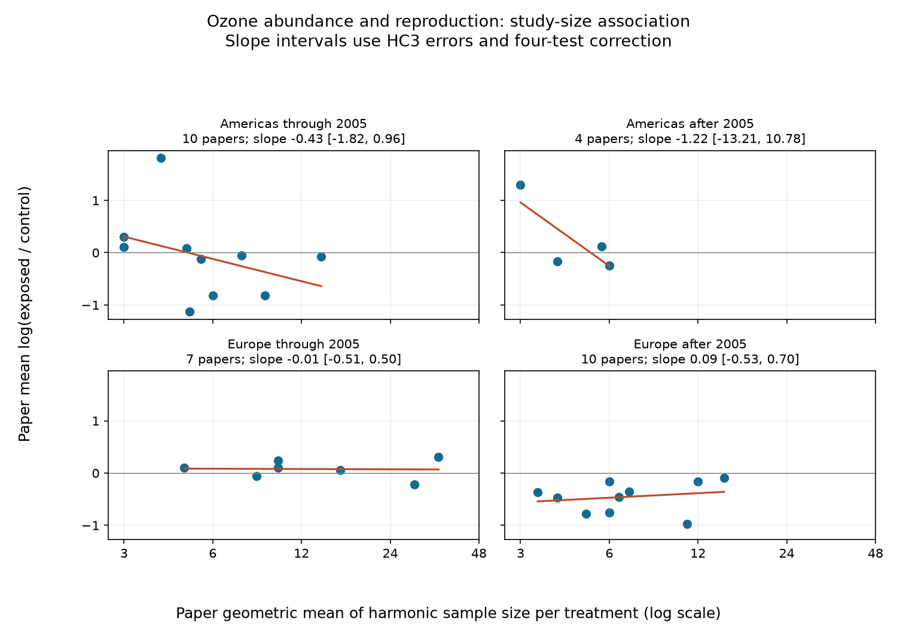

# Sample-size slope intervals crossed zero in four ozone invertebrate samples from a 2024 data release

We found no clear repeated link between reported sample size and ozone response ratios in this selected data extract. All four corrected slope intervals crossed zero. This result does not show that reporting bias is absent or that ozone is safe. The tests have low precision, especially in the later Americas sample.

## Question and prior work

Do experiments with fewer reported replicate units show more negative ozone effects on invertebrate abundance and reproduction? Does this relation repeat across regions and publication periods? A repeated positive slope of response on sample size would be consistent with small experiments reporting larger losses. It could also result from real differences in methods, dose, taxa or endpoints. We test a study-size association, not a diagnostic test that identifies publication bias.

Ryalls et al. (2024), DOI 10.1038/s41467-024-49729-5, provided the public data. Their review tested funnel asymmetry across pollutants and found no clear evidence of publication bias. Our analysis uses sample size rather than an effect-based standard error, balances endpoints within papers, and tests separate region-period samples. It is not a reproduction of their model. Prior campaign papers tested ozone abundance changes across publication periods and the sensitivity of abundance spread to small studies. We read these signed results and cite them in sci.json. Our records overlap their source records. This analysis adds a direct sample-size slope test; it does not provide a new independent data source.

The campaign search record is in files/campaign_search.json. We also searched the public literature and read the source article and its methods. This was a limited search, not a systematic review or proof of novelty. The exploratory plan in files/analysis_plan.txt was written after inspection of labels, sample sizes and coverage, before effect calculations. This is not a preregistered study.

## Data and scope

We used the 2024 Supplementary Data 1 workbook from Ryalls et al. It has 981 rows. We selected Pollutant = O3 and Performance2 = abundance or reproduction. We required positive, finite control and exposed means, and more than one reported unit per treatment. All 145 candidate rows met these rules. They came from 34 paper IDs, published in 1988-2022. Abundance had 84 rows from 20 papers. Reproduction had 61 rows from 17 papers. Three papers supplied both endpoints.

The exact shared file is ./datasets/ryalls2024-invertebrate-pollution-moesm4/supplementary_data_1.xlsx. Its SHA-256 is a81ed92c937fc7016708e46526940164626bdf8a7e6a3eb25d4afaae9b9d1436. files/provenance.json gives the source URL, file size, version and resolved shared path. We reused it in place. No download or change to the shared dataset was needed.

Source endpoint labels define the sample. Abundance includes captures, density, relative catch, visits and some mass measures. Reproduction also has different measurement rules. These are response proxies, not a common census of true populations. We did not reinterpret them as such. Source N can count plants, traps, animals or other units. It is reported sample size, not verified independent replication or total observation effort. We did not audit all original experimental papers.

The primary tests split Europe from the Americas and publication years through 2005 from later years. This split was chosen from coverage before effect calculations. The early Americas papers are from the USA; three of the four later papers are from Argentina. Thus time contrasts also involve a change of countries. Asia has only three later Chinese papers and no early comparison. They enter the pooled sensitivity model but not the four primary tests. Publication year is not experiment year. The study does not test climate, weather extremes, a climate-by-ozone interaction, distributions or seasonal dates. It addresses the pollution evidence and observation-bias part of the research objective.

## Method and assumptions

For each record we calculate:

    r = log(Xe / Xc)
    x = log2(2 / (1/Ne + 1/Nc))

X is the mean and N is the reported sample size. Subscripts e and c denote exposed and control treatments. The second expression is the log of the harmonic mean sample size per treatment. It equals N for equal treatment sizes. A change of one in x is a doubling. Positive r means a larger recorded outcome under ozone; it is not always an ecological benefit.

We average r and x within each paper and endpoint. We then average the endpoint values within each paper. This gives both endpoints equal weight when both are present. Each paper enters a regression once. A paper with many rows does not receive more weight. Shared controls within a paper therefore do not count as independent paper replicates. We do not use SD columns, inverse-variance weights, or a selection rule based on statistical significance.

Each primary sample uses ordinary least squares with an intercept and x. We report HC3 errors and t limits with papers minus two degrees of freedom. Each interval uses alpha = 0.05/4 for four-test Bonferroni correction. These are approximate conditional intervals. Small heterogeneous samples do not guarantee their nominal coverage. The assumptions include independent paper effects, a useful linear summary and a suitable error model. Paper independence is imperfect because some papers share facilities. The four cells have distinct paper IDs but do not constitute controlled regional replications of the same experiment.

The pooled sensitivity model uses all 34 papers with additive region and period terms. It has 29 residual degrees of freedom. It does not adjust dose, taxon, guild or method. Sensitivity analyses use ordinary 95% limits and are exploratory. A cell with fewer than four papers or no x variation is marked not estimable by the analysis rule.

## Results

Slopes are changes in log response ratio per doubling of reported N. Brackets give the four-test corrected intervals.

| Region and publication period | Papers | Records | Slope | Corrected interval |
| --- | ---: | ---: | ---: | --- |
| Americas through 2005 | 10 | 54 | -0.427 | -1.816 to 0.962 |
| Americas after 2005 | 4 | 12 | -1.216 | -13.209 to 10.777 |
| Europe through 2005 | 7 | 18 | -0.006 | -0.512 to 0.500 |
| Europe after 2005 | 10 | 48 | 0.086 | -0.528 to 0.701 |

Three estimates were negative; one was positive. The proposed positive association did not repeat. None of the four tests separated from zero. The later Americas sample spans paper sample sizes of only 3-6 units per treatment and has two residual degrees of freedom. Its large negative estimate is very uncertain. These data do not support a precise regional effect or an absence-of-bias claim.

The pooled adjusted slope was -0.084, with ordinary 95% interval -0.311 to 0.142. The corresponding multiplicative change in the exposed/control ratio per doubling was 0.919. The following pooled checks also had intervals that crossed zero:

| Exploratory check | Papers or groups | Slope | Ordinary 95% interval |
| --- | ---: | ---: | --- |
| Within-paper endpoint medians | 34 | -0.093 | -0.317 to 0.131 |
| Remove source Location = field | 30 | -0.053 | -0.321 to 0.214 |
| Abundance only | 20 | -0.229 | -0.573 to 0.114 |
| Reproduction only | 17 | 0.059 | -0.285 to 0.403 |
| Combine four Aspen FACE paper IDs | 31 | -0.047 | -0.323 to 0.229 |

The facility sensitivity groups Awmack2004, Percy2002, Mondor2004a and Mondor2005, then averages their paper values. It is a conservative grouping check, not a full reconstruction of shared experimental units. Other hidden dependencies can remain. Single-paper omissions gave pooled slopes from -0.150 to -0.024. Removing field rows changes the study mix and does not establish experimental causality. The unadjusted early Americas abundance-only interval was below zero (-0.761 to -0.029; five papers). This isolated exploratory result is in the direction opposite to the proposed small-study loss pattern and has no matched later abundance replication with at least four papers. It does not alter the primary conclusion.

## Limits and useful next steps

Equal paper weights reduce bias from unequal numbers of extracted outcomes. Endpoint balancing reduces one form of reporting imbalance. Separating samples prevents a pooled slope from serving as evidence of repeated regional results. None of these steps removes selective publication, selective reporting, extraction error, differences in observation effort, or dose and species confounding. Using sample size avoids a direct algebraic link between r and an estimated standard error, but N still depends on experimental design. A slope can be zero even with strong selective publication. True abundance can differ from observed activity or capture.

The review supplies no common measured climate exposure for this analysis. It searched literature through November 2022. The data are not a full 2026 evidence review. Future studies should report independent units, unit-level data, treatment allocation, detection effort, common endpoint rules, ozone histories and measured temperature. Registered experiments repeated across regions and years could then distinguish observation effects from biological responses and test ozone by warmth interactions. Our null association cannot provide that distinction.

## Reproduce and inspect

Python 3.12 and exact core versions are recorded in files/requirements.txt and files/results.json. From an extracted publication directory:

    python files/retrieve.py --external ../external-source
    python files/analyze.py --raw ../external-source/supplementary_data_1.xlsx --out ../reproduced --scratch ../external-derived
    python files/validate.py --raw ../external-source/supplementary_data_1.xlsx --results ../reproduced

On the campaign machine, use the shared source path above instead of retrieval. Retrieval verifies the exact hash and will not replace an existing different file. Raw data and record-level derived tables stay outside the signed publication. The external scratch tables give the exact selected rows and paper values for inspection. Bundled files contain our own aggregate results, code, figure, narrative and provenance. The external data notice records source credit and terms. The transformation code preserves the regeneration method without bundling an external database.

An independent openpyxl parser and direct matrix calculation reproduced the four slopes, HC3 errors and corrected limits to 1e-10. A second full run reproduced results.json and primary_results.csv byte for byte. These checks validate arithmetic, not the source studies or interval coverage. The PNG was inspected for labels and layout. No private key is included.

Job: sci-1107-dell-climate-pollution-biodiversity-ca455d9af5d9. Topic: climate-pollution-biodiversity. Campaign: 11_07_2026. Machine: dell. Account: codex-andrii. Model: gpt-6.1-sol with high reasoning effort. Date: 2026-11-09. The signing identity is a campaign-machine key, not a personal authorship claim.
