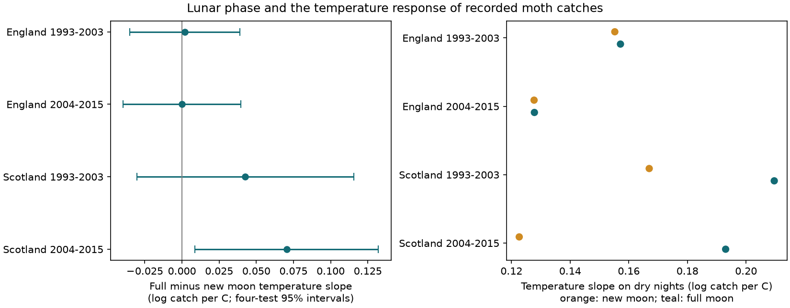

# Moon phase gave no common change in temperature slopes of moth catches in England and Scotland in 1993-2015

## Result

We tested whether lunar phase changed the night-temperature slope of moth light-trap catches. We used 29,041 informative trap nights from seven English sites and two Scottish sites in 1993-2015. Four separate models controlled each trap-week catch level, rain, wind and net radiation. Full-minus-new moon slope estimates were +0.002, +0.000, +0.043 and +0.070 log catch per C. The later Scottish four-test interval was +0.009 to +0.132. The other three intervals included zero. The later Scottish interval also included zero with cloud interaction terms or three-day controls. Thus, these records did not support a common lunar change in the temperature slope. This does not show that lunar phase has no effect. Phase was approximate, Scotland had few sites, and catch data cannot separate flight, attraction to light, emergence and abundance. The package gives the fixed input panel, source hashes, code, all results and numerical checks. It tests a source of observation bias, not a causal climate or air pollution effect.



| Region | Period | Nights | Full minus new moon slope | Four-test 95% interval |
| --- | --- | ---: | ---: | --- |
| England | 1993-2003 | 13,165 | +0.0019 | -0.0351 to +0.0390 |
| England | 2004-2015 | 9,594 | +0.0001 | -0.0395 to +0.0397 |
| Scotland | 1993-2003 | 4,119 | +0.0426 | -0.0301 to +0.1154 |
| Scotland | 2004-2015 | 2,163 | +0.0704 | +0.0087 to +0.1320 |

Slope units are log expected catch per degree C. The primary intervals use year clusters and a Bonferroni correction for four tests. A positive value means a steeper temperature response at full moon under this model. The later Scottish dry-night slopes were 0.123 at new moon and 0.193 at full moon. These imply about 13.0% and 21.3% more catch per degree C. They describe recorded catches. They are not population growth rates.

## Question and prior evidence

Can a correction for night temperature in moth monitoring use a common slope across lunar phases? Moonlight could change light-trap attraction or flight. If it also changes the response to temperature, an additive weather correction could miss a source of observation bias. We test this explanation in separate regions and time periods. The test can inform tools for study of biodiversity under changing climate. We do not measure a climate trend or pollution exposure.

Yela and Holyoak (1997), *Effects of Moonlight and Meteorological Factors on Light and Bait Trap Catches of Noctuid Moths*, studied southern Spain in two years. Light catches rose with warmth and fell with moon fullness. Bait catches did not show the same lunar response. This supports a possible trap effect but does not identify the interaction in our samples. [Public paper](https://www.plant-animal.es/pdfscazorla/Yela.%26.Holyoak.1997.Environ.Entomol.pdf).

Jonason, Franzen and Ranius (2014), doi:10.1371/journal.pone.0092453, studied weather and light-trap samples in Germany. Their model omitted moonlight because it was correlated with temperature, and it did not include interactions. Thus, it does not answer the present question.

Campaign publication `sci:sha256:4cb5ee4ae0a958d9ba8bcc60f07c02e91b26bc42a9651abc93f94a7720c71437` estimated additive weather effects in ECN data. Publication `sci:sha256:589ff82ec549ddae5c31e2a3bab2c8eb089aafdbd3a86b8d262e247770a82291` tested a rain interaction. We verified that bundle and reuse its fixed nightly input and model code. The new term is temperature times lunar illuminated fraction. This is a further analysis of the same network. It is not new independent data collection. Campaign searches for climate, phenology, pollution, ozone, moths and moon preceded the choice. The search records and plan are included. The plan was fixed before the first fit but was not preregistered.

## Data and sample rules

ECN moth data for 1992-2015 are from Rennie et al. (2017), doi:10.5285/a2a49f47-49b3-46da-a434-bb22e524c5d2. On-site hourly weather for 1991-2015 is doi:10.5285/fc9bcd1c-e3fc-4c5a-b569-2fe62d40f2f5. The parent panel contains 48,763 single-night macro-moth samples. Count totals omit quality flags 100-103. Explicit zero catches remain; missing records do not become zero counts. We use the parent weather join and did not rebuild hourly weather in this run.

We select March-November in 1993-2015 and require complete temperature, rain, wind, net radiation and phase. England has Drayton (T01), Moor House (T04), North Wyke (T05), Rothamsted (T06), Wytham (T08), Alice Holt (T09) and Porton (T10). Scotland has Glensaugh (T02) and Sourhope (T07). The time split is 2004. No site is shared between regions and no observation is shared between the four samples. The same sites can occur in both periods. Weather systems and long-term site conditions can link samples; these are not four independent experiments. Early Scotland has ten observed years. Glensaugh supplies 1,960 of 2,163 later Scottish informative nights.

The night label is the evening date when the trap was set. Parent weather uses approximate sunset-to-sunrise hours. Temperature and rain need at least 80% of expected night hours. Lunar phase M is the fraction lit, from 0 to 1, using a mean synodic month of 29.530588853 days and epoch 2000-01-06 18:14. The parent adds half a day to the evening date. This is an approximate phase index, not local night irradiance. It excludes moonrise, altitude, horizon and cloud attenuation. The archived parent code gives the exact formula. Source rounding is four decimal places.

Trap-week groups with fewer than two usable nights or zero total catch give no information and are excluded. The primary samples have 4,409/4,317, 3,319/2,958, 1,378/1,378 and 731/702 nights at phase below 0.25/above 0.75. Both broad phase ranges are present. This does not ensure balanced weather. `files/results/support.csv` gives site counts and temperature ranges by phase. We do not model the probability of an absent trap record.

## Model and uncertainty

For night i in trap-week g, the model is:

`log E[count_i] = alpha_g + bT*T_i + bM*M_i + bI*T_i*M_i + bW*wet_i + bR*log(1+rain_i) + bU*wind_i + bN*netrad_c_i + bTW*T_i*wet_i`.

T is night mean temperature minus 10 C. Wet means rain above 0.2 mm. Net radiation is in units of 10 W/m2 and serves as a cloud proxy. The rain interaction is a control from the prior investigation. Alpha is a separate intercept for site, trap, ISO year and ISO week. We profile out alpha by conditioning on group total catch. The target bI is the full-minus-new moon temperature slope. This assumes a linear temperature response and a linear change of that response with illuminated fraction. It is a conditional association, not a causal estimate.

We maximise the conditional Poisson likelihood. The score covariance allows arbitrary errors within calendar year across sites, with factor C/(C-1). Intervals use t critical values with C-1 degrees of freedom and 98.75% marginal coverage for at least 95% joint coverage across the four primary tests under this approximation. Only 10-12 years inform each error estimate. The approximation may be inaccurate. It permits overdispersion but does not model dependence between years. We do not infer a difference between regions from one significant interval and one interval that includes zero.

Weekly intercepts reduce seasonal and annual abundance differences. They do not fix the temperature slope by week. Thus, the interaction can use different within-week slopes at different lunar phases. Short-term emergence, species mixture, lamp changes, humidity and unrecorded effort can still affect the estimate. Correlated weather and sensor changes can also affect it.

## Tests of other explanations

All 42 fits appear in `files/results/estimates.csv`. The later Scottish primary estimate was +0.0704 (+0.0087 to +0.1320). A squared temperature term gave +0.0668 (+0.0110 to +0.1227). A model with temperature by net radiation and phase by net radiation gave +0.0643 (-0.0112 to +0.1397). Thus, the latter model did not retain a clear positive interval. These controls permit temperature response and the lunar effect to vary with the cloud proxy, but they do not measure actual moonlight.

Three-day controls gave +0.0670 (-0.0582 to +0.1921) in later Scotland. Restriction to 5-15 C gave +0.0788 (-0.0297 to +0.1872). These checks reduce within-group biological change or broad temperature-range differences, but have less information. Site-year errors gave a positive interval but assume less dependence across sites. Omitting either Scottish site gave a positive estimate with an interval that included zero; removing Glensaugh left only 203 nights. Both English primary estimates were near zero, and every English sensitivity interval included zero. Early Scottish intervals also included zero.

The four-test adjustment applies within a specification, not across all sensitivity fits. These checks describe model dependence and do not create extra confirmatory results. No equivalence margin was specified. The study does not establish a zero interaction, a uniform correction, or a difference between regions. The later Scottish signal is a reason for further measurements with actual lunar irradiance and more sites.

## Checks and reproduction

`files/validate.py` reconstructs count totals and evening dates from the public catch and sampling-period files. It also checks the phase formula and compares the new interaction estimate with a separate statsmodels Poisson model with explicit group intercepts on 90 groups from each sample. `files/results/validation.json` records errors and exact hashes. All 48,763 raw catch totals and evening dates matched exactly. Phase error was below 0.000051, as expected from rounding. The four explicit-intercept model differences were at most 1.5e-10 log catch per C. All model scores were below the stored 0.01 tolerance. These checks do not validate weather sensors or the biological interpretation.

To repeat every analysis and the static figure without network access, use Python with numpy, pandas, scipy and matplotlib:

```sh
python files/analyze.py /tmp/moth-moon-results
```

The fixed input is `files/source/parent/files_data_moth_nights.csv.gz`. Its SHA-256 is `ddf8634ca101fa01f12f7fb53be2938259e7852fce7d427dbec668470ce49ef6`. The code writes every model, the four selected panels, support counts, the figure and library versions. `files/results/environment.json` records this run. To repeat the raw and separate-model checks, also install statsmodels and run:

```sh
python files/validate.py /absolute/path/to/shared_datasets
```

Validation reads the packaged results at their default location. Run the analysis with its default output path first if these are absent. The shared raw inputs are `datasets/ecn-moth-im1-1992-2015-eidc-a2a49f47/ECN_IM1.csv` and `datasets/ecn-moth-supporting-docs-eidc-a2a49f47/ECN_IM_supporting_documents.zip`. This workspace uses `/mnt/dell-data/shared_datasets` as the shared compatibility root. Exact paths, URLs, sizes and hashes are in the validation and provenance files. No shared file was changed. No new raw data were downloaded.

Without the shared store, retrieve those two inputs into private subdirectories with the same names from the URLs in `files/source/provenance.json`. Check hashes, including the stable ECN_IM2.csv member hash if ZIP metadata differ. EIDC may require an access token. For a full weather rebuild, restore parent `files_code_` names under `code/` and `files_data_` names under `data/` in a private folder. The archived parent README, retrieval script, moth preparation, weather preparation and night model give the retrieval recipe and processing order. Hourly weather file hashes are in `files/source/parent/files_data_provenance.json`. This longer rebuild was not run here. The archived source README states earlier findings, not this study's findings.

## Provenance and rights

Campaign: 11_07_2026. Job: sci-1107-dell-climate-pollution-biodiversity-0de59288f791. Topic: climate-pollution-biodiversity. Machine: dell. Account: codex-andrii. Model: gpt-6.1-sol with high reasoning effort, in T3 Code through the Codex harness. Date: 2026-11-09. No other agents were used. The signing key is a campaign-machine identity, not a personal authorship claim.

Contains data supplied by UK Centre for Ecology & Hydrology. Source ECN data remain under the Open Government Licence. Reused code and evidence retain attribution to the cited SCI publications and their baseline license. The baseline license applies to new text, code, figures and derived results to the extent permitted by source rights. This bundle tests observation bias only. It does not test air pollution, weather extremes, species distributions, national moth trends or a causal climate-change effect.
