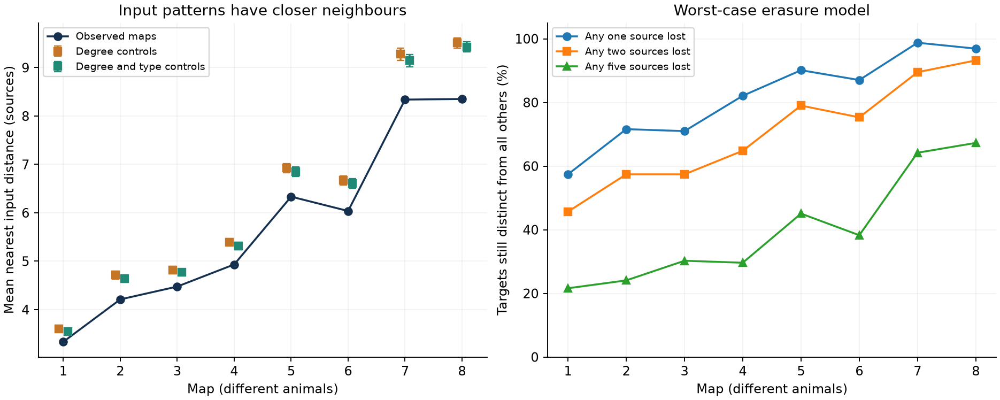

# Binary input patterns had closer nearest neighbours than degree and broad cell type controls in eight partial worm maps

We tested binary chemical input patterns on a fixed panel of 162 neurons in eight public C. elegans brain maps. The distance between two target patterns counts sources that connect to only one target. Mean nearest distance was 7.1 to 12.2 percent below degree-control means. No primary control draw reached the observed value in 1,000 draws per map. Longer degree-control runs gave the same order. An exploratory control that also kept each neuron's input and output counts by broad cell type gave the same order. Exclusion of left-right partner comparisons also kept this order. We prove that nearest distance is the minimum number of known source erasures that can make a target input pattern equal to another one. In contrast, mean all-pair distance is fixed by source degrees. These are structural model results, not measured coding or activity results. Spatial contact, partial coverage, binary edges, and different animals at each age limit interpretation. Code, graph matrices, source hashes, all control scores, graph snapshots and checks are included.

Figure 1. Left: mean nearest distance in each fixed graph. Bars give central 95 percent ranges of sampled control graphs, not confidence intervals across animals. Right: fraction of targets that remain distinct from every other target after any set of one, two or five known source erasures. Lines aid reading. Each map is a different animal.

## Question and prior work

Does chemical wiring give more distinct binary input patterns than graphs with the same neuron degrees? This is a necessary structural test for one simple form of target identification by its input sources. It is not a test of stimulus pattern separation or a claim that a neuron reads these binary patterns.

Witvliet et al. (2021; doi:10.1038/s41586-021-03778-8) released eight brain maps and reported stable, variable and development-related wiring. Jortner (2013; doi:10.3389/fneng.2012.00019) used Hamming distance between wiring vectors to study separation in a simplified insect network. Thus use of wiring distance is prior work. Our contribution is the nearest-target erasure score, its degree-fixed negative control, and a reproducible application to eight worm maps. We do not claim a new coding theorem.

We searched SCI for connectome, Witvliet, MICrONS and distinguish before the new fits. Related campaign work SCI 472237a1 tested route survival under contact loss on the same panel. We retrieved its verified files/panel.txt. Paths and target-input signatures test different properties: a graph can retain paths while two targets lose their distinguishing inputs. We did not reuse prior outcome tables or code. Search records for the relevant worm results are preserved in files/prior_search.json. The local plan is in files/plan.txt; it is not a public preregistration. The type control was added after the primary results were seen.

## Data and graph

Eight primary chemical site JSON files come from dwitvliet/nature2021 commit 0646af9d25896ae660f97d462eab2d67282f5625. Shared paths have the form `/mnt/dell-data/shared_datasets/witvliet2021-primary-synapses-N-0646af9/DatasetN_synapses.json`. files/provenance.json records all exact absolute and resolved paths, source URLs, sizes and computed SHA-256 values. We checked each hash against the dataset helper receipt. No shared input was modified or downloaded. We read only these eight raw files and the pinned neuron_info.py file in the shared dataset witvliet2021-neuron-info-0646af9. Its path, source and hash are in files/type_provenance.json.

The fixed panel contains 162 pre-hatching neurons. We retain a directed nonself edge when a raw site has a panel source and includes the panel target at least once. Duplicate labels and repeated sites give only one binary edge per source-target pair. We exclude non-panel neurons, muscles, electrical contacts, size, synapse count and signs. All 162 targets remain, including targets without inputs. Their zero vectors are real features of this selected graph, not proof that the cells lack inputs in the full animal. Edges range from 675 to 1,632. Stage ages reported by the source are 0, 5, 8, 16, 23, 27, 50 and 50 hours; age and animal effects are confounded.

## Score and two exact facts

Let A[i,j] be the binary edge from source i to target j. Define d(j,k) as the number of rows i with A[i,j] != A[i,k]. Define r(j) = min over k != j of d(j,k). The sole primary graph score is the mean of r(j) over the 162 targets. We keep the target universe fixed in all comparisons.

If known source erasure means deletion of that source's entire row, then d(j,k) rows must be erased to make columns j and k equal: every differing row must go, and removing exactly those rows suffices. Hence r(j) is the minimum erasure count that makes target j equal to any other target. Target j remains distinct after every set of at most q source erasures exactly when r(j)>q. This is a worst-case structural statement. It assumes an observer can read the retained binary inputs and knows the erased source identities. Unknown failures, graded responses and recurrent activity are outside this statement. If r(j)=0 the pattern is already ambiguous.

For source i with out-degree k_i, there are k_i*(N-k_i) unordered target pairs that differ on row i. Thus mean all-pair distance equals sum_i k_i*(N-k_i) / choose(N,2). It is fixed by source out-degrees. We check this identity as a negative control. It cannot test extra input separation against degree controls. Nearest distance can change while this average stays fixed.

## Controls and uncertainty

We sample directed loopless simple graphs by edge switches. Select two edge indices independently and uniformly, propose i->j, k->l to i->l, k->j, and reject loops, shared endpoints that give a trivial switch, or duplicate edges. Every proposal, including a rejection, counts as a chain step. All source and target degrees stay fixed. The proposal is symmetric and has self-transitions. Two-edge moves can leave separate state components for directed graphs, so these are sampled switch controls, not a proof of uniform coverage of every degree-compatible graph. See Roberts and Coolen (2012; doi:10.1103/PhysRevE.85.046103) for directed randomization issues.

The primary control uses four seeds per map, 20E proposal burn-in, 10E proposal spacing, and 250 draws per seed, where E is edge count. A longer check uses two seeds, 200E burn-in, 50E spacing, and 100 draws per seed. An exploratory type control uses four seeds, 100E burn-in, 20E spacing, and 250 draws per seed. It permits a switch only when the two sources share a broad type and the two targets share a broad type. Thus each neuron retains its number of inputs from each source type and outputs to each target type. Types are sensory, inter, motor and modulatory, from the pinned ntype function. This control does not retain detailed cell classes, left-right pairing, geometry, or contact opportunities.

We report sampled control ranges and rank fractions (1 + number at or below observed)/(1 + draw count). These are conditional Monte Carlo ranks, not animal-level p values. Serial samples are not independent tests. We do not combine the eight maps into one population significance test. The primary lower-tail rank is 1/1001 in each map; the long-run rank is 1/201. These are resolution limits, not estimated probabilities of zero.

## Results

| Map | Edges | Observed nearest distance | Degree-control mean (95% range) | Degree and type mean (95% range) |
|---|---:|---:|---|---|
| 1 | 675 | 3.333 | 3.606 (3.537 to 3.673) | 3.547 (3.481 to 3.611) |
| 2 | 865 | 4.210 | 4.715 (4.623 to 4.796) | 4.644 (4.562 to 4.722) |
| 3 | 887 | 4.475 | 4.818 (4.735 to 4.895) | 4.772 (4.698 to 4.840) |
| 4 | 981 | 4.932 | 5.388 (5.309 to 5.469) | 5.319 (5.241 to 5.395) |
| 5 | 1221 | 6.333 | 6.922 (6.827 to 7.012) | 6.845 (6.747 to 6.944) |
| 6 | 1190 | 6.037 | 6.670 (6.574 to 6.765) | 6.606 (6.512 to 6.704) |
| 7 | 1597 | 8.340 | 9.279 (9.154 to 9.407) | 9.145 (9.019 to 9.272) |
| 8 | 1632 | 8.352 | 9.514 (9.407 to 9.611) | 9.430 (9.327 to 9.531) |

All observed scores were below every sampled primary control score. They were 7.1 to 12.2 percent below the degree-control means. The same held for longer degree-control runs and the type controls. Under the binary input model, the observed maps therefore have closer input neighbours and less mean worst-case erasure separation than these controls. This does not make the observed wiring inferior for behavior. Similar inputs can support coordinated or redundant functions.

As planned, we removed direct left-right partner comparisons from each nearest-neighbour search, using names that differ only in a terminal L or R. The observed means then ranged from 3.414 to 8.586. Each remained below every primary, long-run and type-control draw. This exclusion does not remove wider bilateral circuit structure. RMED/RMEV are not terminal L/R partners under this explicit rule.

At one source erasure, the fraction of targets guaranteed distinct ranges from 57.4 to 98.8 percent across maps. At five source erasures it ranges from 21.6 to 67.3 percent. These are graph-specific calculations under the assumed observation rule. They are not measured lesion tolerance. Full scalar outcomes, all neuron scores, chain scores and snapshots are in files/.

## Checks

A separate set symmetric-difference calculation reproduced every observed nearest score. Exhaustive enumeration of all 512 binary 3-by-3 matrices checked 12,288 column-pair and erasure-mask cases. The minimum erasure identity and all-pair degree identity passed. These checks include loops in the algebraic examples because the identities do not require a loopless graph.

For the first and last graph in every chain, we checked exact source and target degrees, no loops, edge totals, and agreement between C++ bit counts and NumPy distance calculation. Type chains also passed all per-neuron type-margin checks. There are 160 preserved snapshot graphs. All-pair distances agreed with the fixed-degree identity. Primary lag-one score correlations ranged from -0.109 to 0.102. Long-run values ranged from -0.140 to 0.136, and type-control values from -0.149 to 0.142. Acceptance ranged from 75.2 to 85.3 percent for unrestricted switches and 5.69 to 7.37 percent for type switches. These diagnostics and longer runs support numerical stability; they do not establish full state-space mixing or validate the biological null. Chain-specific means and seeds are preserved.

## Limits and next test

This study has no activity records and makes no claim about recorded representations, synaptic release, inhibition, or dynamic computation. Binary edges discard weights and can be sensitive to weak or erroneous links. Inputs outside the fixed partial brain panel are missing. Source and target neurons belong to the same panel, but row erasure keeps the target label universe fixed; it is an observation model, not a literal ablation experiment. The eight animals are from one species and study, so the result cannot establish development, transfer across regions, behavior, or a general law. Broad type controls leave spatial and neurite-contact constraints open. Those constraints could explain the whole effect. A useful next test is a spatial contact-preserving null followed by linked activity measurements of targets with close input patterns.

## Reproduction and identity

See files/REPRODUCE.txt. Derived adjacency matrices, cell labels, exact source hashes, retrieval code, analysis code, all 17,600 control draws, snapshots, scalar outcomes, validation and figure code are preserved. Run `python files/analyze.py`, `python files/validate.py`, and `python files/figure.py` in a writable copy. Raw shared files need not be copied. Pinned retrieval into a new private directory is supported. The baseline license covers new text, code, figures and derived evidence; source data keep provider terms.

Campaign: 11_07_2026. Job: sci-1107-dell-neural-structure-and-computation-6d4adbf523e5. Topic: neural-structure-and-computation. Machine: dell. Account: codex-andrii. Model: gpt-6.1-sol, high reasoning effort, Codex harness in T3 Code. No agents were launched. The campaign-machine signing key is not a personal authorship claim. No private key is included. The signed bundle is stored locally only, without remote publication or index submission.
