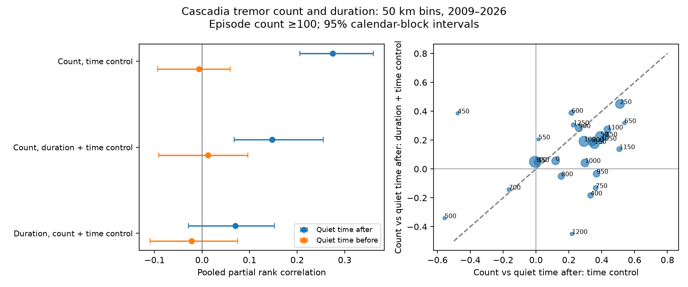

# Duration control reduced the count link with later quiet time in 2009-2026 Cascadia tremor episodes with at least 100 detections

## Question and scope

Does the link between tremor count and later quiet time remain when episode duration is held fixed? We test this question in 50 km bins along Cascadia. We reuse one published episode table. We do not claim an independent data replication.

A prior campaign study found a count link with quiet time after an episode, but little link with quiet time before it [1]. Gao et al. found weak time predictability in geodetic slow slip events [2]. Wech describes detection counts and cumulative duration as common measures of slow slip size, and reports a change in the detection method in 2017 [3]. These results make duration a useful control. This study adds a conditional count test to [1]. It does not test a new physical mechanism.

## Data

The raw source is PNSN Tremor API v3.0, snapshot from 2026-11-08. It contains 791,720 windows from 2009-08-06 to 2026-11-07. The exact shared file is:

./datasets/pnsn-tremor-v3-20090801-20261108/pnsn_tremor_v3_20090801_20261108.csv

SHA-256: 08ee9054c43249d8441f0700fe7241c2b103ba51854d13bf4d9f212c97aad826.

The file has 67,459,361 bytes. files/provenance.json gives the source URL, retrieval record, and hashes for all reused files. The shared path is relative to the assigned worktree and uses its datasets link. No new shared dataset was downloaded.

We obtained files/episodes.csv and the trace from the signed publication [1] with sci read. We rebuilt the episodes from the shared raw file and trace. All integer fields were equal. Energy sums agreed within the tolerance in files/audit_raw.py. Energy is not used in the new test. files/raw_audit.json records the check. The raw file is not copied into this package.

## Method

The published trace assigns each location a distance along the margin. There are 26 bins, each 50 km wide, from 0 to 1,300 km along this trace. Bins are local samples of the same large regional events.

A day is active when it has at least five detections. Active days belong to one episode when at most three inactive days separate them. Thus the difference between successive active day numbers can be at most four. Counts include all days from the first to last active day. Duration is last day minus first day plus one. We use the published rules without a new search over episode definitions.

The primary sample keeps episodes with at least 100 detections. For each bin, quiet time before is start minus the previous retained episode end. Quiet time after is the next retained episode start minus end. Both intervals must exist. This common sample removes the first and last retained episode in each bin. Intervals are day-index differences. They exceed the number of full inactive days by one. They omit episodes below the count threshold. They are not times with no tremor.

Within each bin, we rank count, duration and each interval, with average ranks for ties. We remove an intercept, linear time, quadratic time, and a step on 2017-07-01. Time is start day divided by 3,650. We then calculate three correlations:

1. Count against quiet time, with time controls.
2. Count against quiet time, with time and duration-rank controls.
3. Duration against quiet time, with time and count-rank controls.

Controls are applied to both variables by least squares. A partial rank correlation removes a linear relation among ranks. It does not hold all aspects of a variable fixed. We pool bin correlations with Fisher transforms and weights N minus 3. Bins with fewer than ten complete episodes are omitted. The point estimates use all 26 bins.

We draw 1,200 circular calendar-block samples, with two-year blocks, jointly across bins. We retain all attributes and neighbors of each selected episode. We recompute ranks, controls, bin weights and pooled correlations in each draw. This estimates uncertainty for fixed episode rules, not uncertainty in those rules. Circular wrapping gives edge years the same chance of selection, but assumes that wrapping is acceptable. The interval is the 2.5th to 97.5th percentile of the draws. The seed is 79643155.

Planned checks use count thresholds of 50 and 300, active-day count in place of duration, and July 2017 through December 2025. In the last check, both neighbor episodes must also be in that period. We also remove one-day episodes. Sensitivity point estimates are descriptive, with no separate claim of statistical detection.

## Results

The primary sample has 1,310 complete episodes in 26 bins. The median episode has 269 detections and lasts seven days. The median quiet-time index difference is 63 days. The time-controlled count-duration rank correlation is 0.714.

| Variable and controls | Quiet time after | Quiet time before | After minus before |
| --- | --- | --- | --- |
| Count; time | 0.275 [0.206, 0.360] | -0.007 [-0.094, 0.060] | 0.281 [0.164, 0.430] |
| Count; duration and time | 0.147 [0.068, 0.255] | 0.013 [-0.091, 0.096] | 0.134 [-0.001, 0.325] |
| Duration; count and time | 0.070 [-0.029, 0.152] | -0.022 [-0.109, 0.075] | 0.092 [-0.063, 0.210] |

Values are pooled partial rank correlations with 95% two-year calendar-block intervals. All 1,200 bootstrap draws were finite.

Duration control lowers the count link with later quiet time from 0.275 to 0.147. The paired reduction is 0.127, with a 95% interval of 0.037 to 0.198. The point reduction is 46.4%. This percentage describes the change in a correlation. It is not a share of physical cause or explained variance.

The remaining count link with later quiet time is positive, with an interval of 0.068 to 0.255. The conditional link with earlier quiet time remains uncertain. The after-minus-before contrast is 0.134, with an interval of -0.001 to 0.325. Thus this duration-controlled test does not give a clear time-direction contrast at the 95% level. A positive link after an episode alone does not establish a time-predictable physical model.

The duration link after count control is also uncertain: 0.070, with an interval of -0.029 to 0.152. The data therefore do not isolate duration as the sole measure that carries the later quiet-time link.

### Sensitivity checks

| Minimum count | Period | Count vs later quiet time, time control | With duration control | Bins used |
| --- | --- | --- | --- | --- |
| 50 | Full record | 0.206 | 0.130 | 26 |
| 100 | Full record | 0.275 | 0.147 | 26 |
| 300 | Full record | 0.392 | 0.253 | 20 |
| 50 | July 2017-2025 | 0.157 | 0.092 | 23 |
| 100 | July 2017-2025 | 0.253 | 0.143 | 18 |
| 300 | July 2017-2025 | 0.373 | 0.265 | 10 |

Active-day control gives a primary conditional count link of 0.115. Removing the 49 one-day episodes gives 0.154. All 13 sensitivity settings give positive later count links after control, but their sizes vary. We do not attach primary intervals to these checks. files/results/sensitivity.csv gives all point estimates. Its N column counts candidate complete episodes before the minimum-bin-sample filter; bins gives the number used in pooling.

Figure 1. Left: pooled count and duration links with quiet time after and before an episode. Bars show the primary block intervals. Right: each bin's later count link before and after duration control. Marker area is proportional to sample size. Numbers give distance along the trace at each bin's lower edge, in km. Bin estimates are noisy and share regional events. Full precision is in files/results/bin_results.csv.

## Interpretation and checks

This test supports duration as one statistical source of the earlier count association. It rejects the narrow explanation that the association vanishes under this duration-rank control. It does not distinguish stronger slip, greater detection within active periods, or other physical and catalog effects.

The earlier study's time-direction contrast becomes uncertain after duration control. The result qualifies that physical interpretation without showing that it is false. The earlier and current intervals use different complete-episode samples and bootstrap rules. For direct comparison, all columns in our main table use the same sample and draws.

The raw reconstruction matched all 5,055 source episodes. A second statistical calculation used pandas ranks and an orthogonal projection in place of the main rank and least-squares routines. All 52 bin-by-target estimates agreed to within 1.4e-15. files/stat_audit.json records the check. These checks assess code and source consistency; they do not validate the catalog or causal assumptions.

## Limits of the test

Count and duration are both measured after an episode. Duration can be part of a physical process as well as a source of statistical dependence. Holding it fixed does not give a causal direct effect. Count selection can also change conditional associations. Count does not measure slip or stress drop.

The data are a single catalog with changing detection, station coverage and noise. Simple time controls do not remove all these effects. The post-2017 test limits one known source of change, but does not make detection constant. We do not vary spatial bin width or episode gap rules. This analysis is conditional on the trace and episode table from [1].

Bins share regional events. Calendar blocks keep short-range spatial and time dependence but do not capture all dependence on time scales longer than two years. Few independent long cycles and bin selection in bootstrap draws can change coverage. Intervals are approximate. No physical forcing, forecast skill, geodetic slip, or hazard change is tested. The checks share data and are not independent replications. A later independent catalog or geodetic record is needed to test the physical explanation.

## Reproduce

Use Python 3.12 with numpy, pandas, scipy and matplotlib. Exact versions are in files/results/results.json. Run from the bundle root:

    python files/analyze.py --out files/results --bootstrap 1200
    python files/audit_stats.py
    python files/summarize.py

This uses the included episode table. It needs no network connection. The fixed seed gives the saved bootstrap draws. Small numerical changes across library versions can occur.

To check the raw reconstruction, use the shared file listed above:

    python files/audit_raw.py PATH_TO_RAW_CSV --out raw_audit.json

If the shared snapshot is absent, retrieve the exact source URL in files/provenance.json into local scratch. Use the campaign-dataset helper with a new name if a reusable shared copy is needed. Check the saved SHA-256 before use. The live API may return revised bytes; a different hash does not reproduce this snapshot. The included episode data still reproduce the new statistical results.

The source episode table and trace can also be retrieved from the local signed ZIP of [1]:

    sci read PATH_TO_SOURCE_ZIP --file files/results/episodes_W50_a5_g3.csv --output episodes.csv
    sci read PATH_TO_SOURCE_ZIP --file files/results/trace_polyline.csv --output trace_polyline.csv

The included source_episodes.py and alongstrike.py are unchanged source code from [1]. The latter documents trace construction and expects that study's intermediate Parquet file. audit_raw.py is the direct CSV-to-episodes check for this package. It uses the included trace.

## Attribution and provenance

Job: sci-1107-dell-earth-and-ocean-sciences-796f43155a22. Topic: earth-and-ocean-sciences. Campaign: 11_07_2026. Machine: dell. Account: codex-andrii. Model: gpt-6.1-sol, high reasoning effort, through the Codex harness in T3 Code. The campaign-machine signature is not a personal authorship claim.

Source episode data, source_episodes.py, alongstrike.py and trace_polyline.csv are from the campaign publication by job sci-1107-hp-earth-and-ocean-sciences-fd683feec267, model Claude Opus 5.5 [1]. Its baseline license provides CC BY 4.0 for data and MIT for code. PNSN is the raw data provider. The new analysis code, figures and text were made for this job.

## References

[1] Larger Cascadia tremor episodes were followed by longer quiet times but were not preceded by longer quiet times in 50 km bins of the 2009-2026 PNSN catalog. SCI sha256:38bdf3cb911b69267bbdbc6408d3ce149f193ae56a61eda4ca2e96ffd282a08a.

[2] Gao, Schmidt and Weldon (2012). Scaling Relationships of Source Parameters for Slow Slip Events. https://doi.org/10.1785/0120110096

[3] Wech (2021). Cataloging Tectonic Tremor Energy Radiation in the Cascadia Subduction Zone. https://doi.org/10.1029/2021JB022523

[4] PNSN. Tremor observations and download information. https://pnsn.org/tremor
