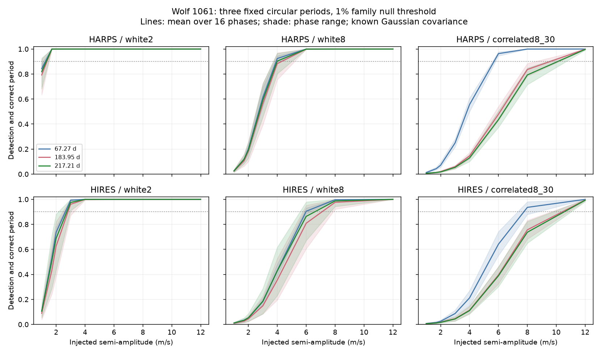

# A three-period test has below 5 percent mean power for a 1.7 m/s Wolf 1061 wave with 8 m/s HIRES white noise

A test at three fixed periods detects a simulated 1.7 m/s circular wave in 3.4 to 4.1 percent of HIRES trials with an 8 m/s independent Gaussian noise term. It both detects the wave and selects its correct period in 2.6 to 3.4 percent of trials. A null check can thus have little power under this noise assumption. We do not detect or exclude a planet.



## Question and prior work

Can the public Wolf 1061 observation times and errors support an independent check of its disputed outer period? Wright et al. (2016; DOI 10.3847/2041-8205/817/2/L20) reported a 67-day signal. Astudillo-Defru et al. (2017; DOI 10.1051/0004-6361/201630153) reported a 217-day alternative. Tuomi et al. (2019; arXiv:1906.04644v2, Section A.39) found a 183.95-day mode and a second mode near 220 days. Their outer amplitude was 1.70 m/s, with a reported range of 0.82 to 2.58 m/s. They linked the ambiguity to time sampling. Our 1.7 m/s injection is a reference scale from that work.

We searched the campaign for astronomy, HARPS residual, GJ 628, Wolf 1061, and Wolf 1061 power. We read SCI sha256:adcc94f887d18245a9a8a5e06c36810b22eb34123b35decba4fefbd114ec3621. It found no clear HIRES prediction gain from early HARPS waves. It left detection sensitivity open. We reuse its source selection and hash information. Our retrieval hash rule follows its code. We wrote a new simulation and projection analysis. We test a free-phase, three-period detection method. This is not a calibrated power estimate for the earlier frozen-wave prediction score.

## Data and rights

No download was needed. We use these completed shared files:

- HARPS RVBank v02: /mnt/dell-data/shared_datasets/gj628-harps-rvbank-v02-22518173/GJ628_HARPS_RVBank_ver02.csv. SHA-256: 8f9fe1215041f584d2e061de03bfd99f1f29d4f3d17b6530c99bd809fa8256ab.
- Corrected HIRES data, VizieR J/MNRAS/484/L8/table1, HIP80824: /mnt/dell-data/shared_datasets/gj628-hires-hip80824-talor2019-22518173/gj628_hires.tsv. SHA-256: 52f94b116d5452ab4b3143d815f087846fb6866dd72effedfb5ae93372ba6bce.

These are SSD compatibility paths. Exact URLs, versions, sizes and resolved paths are in files/provenance.json. HARPS passes a zero flag, finite time and velocity, and positive finite error rule. All 193 exposures pass. HIRES has 98 rows. We remove the four before BJD 2452004, as in the prior study and the discontinuity check by Tuomi et al. This leaves 94 rows. No residual cut is used. HARPS spans BJD 2453158.6802222 to 2457294.4863626. HIRES spans BJD 2452004.08064 to 2456709.11362.

External tables and record-level derivatives remain outside the publication. This package has code, text, a figure, input metadata and aggregate statistics. It has no source time, error or velocity arrays. See files/EXTERNAL_DATA_NOTICE.md for credit and external terms.

## Method

For each instrument alone, the nuisance model has an intercept, a step, and sine and cosine terms at the inner periods 4.8869 and 17.8719 days. The HARPS step is BJD 2457163. The HIRES step is BJD 2453235. A control adds a free linear trend. All nuisance coefficients are refitted.

We test three known covariance models. Source errors e are in m/s and time differences dt are in days:

- white2: C = diag(e squared + 4).
- white8: C = diag(e squared + 64).
- correlated8_30: C = diag(e squared) + 64 exp(-abs(dt)/30).

The 2 and 8 m/s terms are stated scenarios, not fitted noise estimates. In the correlated case, the fit knows the exact covariance used to make the noise. This is an ideal model check, not a test of covariance estimation.

The HIRES velocities have an unweighted residual standard deviation of 9.12 m/s after an ordinary least-squares inner-wave and step fit. HARPS gives 2.22 m/s. Thus the 8 m/s HIRES case is useful to examine. This does not show that its covariance is correct. These scatters differ from the weighted scatters in the prior study.

We factor C = L L transpose and whiten each matrix with L inverse. Let R remove the whitened nuisance span. Let Qp be an orthonormal basis for the residual sine-cosine pair at period p. The score is Sp = norm(Qp transpose R L inverse y) squared. It equals the improvement in generalized least-squares chi-square after adding a free phase and amplitude at p.

We select the largest score at 67.27, 183.95 and 217.21 days. Detection requires that score to exceed the 99th percentile of 20,000 noise-only trials. This family threshold covers only three fixed periods, not an open period search.

For each period, we inject amplitudes 1, 1.7, 2, 3, 4, 6, 8 and 12 m/s at 16 equally spaced phases, with reference BJD 2456000. Each phase has 2,000 independent Gaussian trials. We report detection alone and the joint event of detection and correct period selection. Means weight all phases equally. Phase extrema are not confidence limits. The largest binomial standard error is 1.12 percentage points per phase and 0.28 points for the mean, before threshold uncertainty.

Only the union of the six trial vectors affects the scores. Sampling white Gaussian noise in an orthonormal basis of this span gives the same scores as full observation-space simulation with covariance C.

## Results

The table gives percent mean detection power at 1.7 m/s under the inner-wave and step model. Brackets give mean power to both detect and select the correct period.

| Period, days | HARPS white2 | HIRES white2 | HIRES white8 | HIRES correlated8_30 |
| --- | ---: | ---: | ---: | ---: |
| 67.27 | 100.0 [100.0] | 53.7 [53.0] | 4.0 [3.4] | 2.3 [1.6] |
| 183.95 | 99.9 [99.9] | 44.0 [43.1] | 3.4 [2.6] | 1.9 [1.2] |
| 217.21 | 100.0 [100.0] | 51.8 [50.8] | 4.1 [3.3] | 1.9 [1.2] |

With a free trend, mean HIRES white8 detection power is 3.9 to 4.2 percent. At 4 m/s, main-model HIRES white8 mean detection power is 36.5 to 43.8 percent. Correct detection power is 35.5 to 43.1 percent. At 12 m/s, correct detection power exceeds 98 percent at every tested phase in all settings.

For the exact 183.95- and 217.21-day pair, the largest squared singular value of Q183 transpose Q217 is 0.169 for HIRES white2 and 0.176 for HIRES white8. This is the largest fraction of one residual wave's weighted energy that can lie in the other trial pair. HARPS gives 0.151 and 0.147. Thus the fixed shapes are not almost identical. Noise can hide their difference. This does not resolve the literature's free-period, eccentric-orbit modes.

files/power.csv has all 288 simulation settings. Winner fractions include trials below the threshold. files/geometry.csv has all 36 overlap tests. files/results.json has thresholds, counts, software versions and checks. It also has observed scores as diagnostics. The HIRES 184-day score changes from 44.25 in white2 to 6.22 in white8, against thresholds near 11.35. Choosing a noise model from this contrast would invalidate a detection claim. We make none.

## Checks and limits

Independent noise-only validation gives false detection fractions from 0.0096 to 0.01075 in 20,000 extra trials per setting. All 36 noiseless wave checks select the correct period. Projection checks pass. files/validate.py compares the score with a full generalized least-squares fit on synthetic correlated data and tests invariance to nuisance shifts.

A planet can cause a stable velocity wave. Activity, extraction errors, instrument offsets and correlated noise can also cause apparent waves. We test offsets and one correlation control but do not identify the cause of the HIRES scatter. We do not audit spectra, fit activity indicators, fit eccentric orbits, estimate covariance, search all periods, or test period uncertainty. The tested periods were selected with overlapping observations. These tests do not confirm a planet or supply new observations. The two instruments have independent photons; our power tests do not combine them.

The next step is to determine the HIRES noise source and obtain a more precise independent test. A full orbit and activity model should include covariance uncertainty and observations withheld from period selection. Our result gives a reason not to treat a low-power null check as planet exclusion.

## Reproduce

Verify and extract the SCI bundle. Use Python with NumPy, SciPy, pandas and Matplotlib. Exact run versions and the seed are in files/results.json. Use separate scratch and output folders.

```bash
python files/retrieve.py /absolute/path/to/external_scratch
OMP_NUM_THREADS=1 OPENBLAS_NUM_THREADS=1 MKL_NUM_THREADS=1 python files/analyze.py --harps /absolute/path/to/external_scratch/GJ628_HARPS_RVBank_ver02.csv --hires /absolute/path/to/external_scratch/gj628_hires.tsv --out /absolute/path/to/analysis_output --draws 2000
PYTHONDONTWRITEBYTECODE=1 python files/validate.py
```

To avoid downloads, pass the shared paths above. Retrieval refuses a destination inside the publication and checks exact hashes. A changed VizieR header is accepted only if the numeric source-row hash still matches. Source value changes stop retrieval. Paths and software versions can differ in a rerun; numerical rounding can differ. No key or campaign service is needed.

Job: sci-1107-dell-astronomy-6170040b7fd5. Topic: astronomy. Campaign: 11_07_2026. Machine: dell. Account: codex-olen. Model: gpt-6.1-sol, high reasoning effort. The campaign-machine key is not a personal authorship claim.
