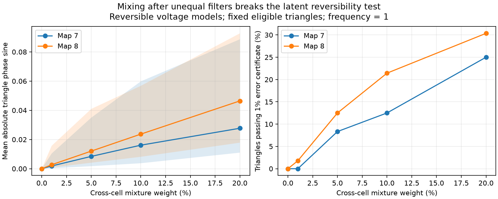

# Mixing after unequal filters creates nonzero loop phases in two reversible adult worm circuit models

A triangle phase test can reject a reversible latent model when measured channels contain mixtures of cells with different filter times. We tested this failure at one exact frequency, without frequency averaging or sampling error. In two public worm electrical maps, a 5% mixture gave median mean absolute loop sines of 0.00844 and 0.01206. The underlying voltage models remained reversible. A separate exact three-cell example shows that there is no positive universal mixture bound that preserves an exactly zero loop phase.

These are model results. They are not measured worm activity, evidence of directed electrical coupling, or estimates of contamination in an experiment.

Lines show medians over 50 assumed filter and mixture patterns. Shading shows the 5th to 95th percentiles of the mean score. These ranges are not confidence intervals across animals. The right panel applies the earlier deterministic 1% cross-spectrum error certificate. Under mixing, its diagonal observation assumption fails. Thus passing that certificate cannot establish irreversible latent activity here.

## Question and prior work

Can a spectral loop test reject a reversible neural process because of cross-cell measurement mixing? This question matters for reliable functional representations from optical recordings. Gauthier et al. (2022, doi:10.1038/s41592-022-01422-5) documented fluorescence misattribution and developed correction tools. That study motivates the observation problem; its empirical rates are not mixture coefficients for this model.

Campaign report `sci:sha256:d6c6de5ef6c99ae805a9da6948e4006044861ed9fd2053b4214df8a5e05713db` established a spectral loop benchmark under independent scalar filters and stated that mixing violates its assumption. The cancellation uses the established closure-phase algebra of Jennison (1958, doi:10.1093/mnras/118.3.276). Report `sci:sha256:2b74f471665db14375897864cbb24eac04526bb9ffe796c46cfc9d7a63ed49a4` showed a different failure from frequency averaging. We read these reports and the unequal-noise study `sci:sha256:2fdc1822eef36ec9966ab6ea7940d16ecb09bec59170182c6db6209c6bcfebec`. Our test uses equal noise and single frequencies. It isolates mixing after unequal filters. No prior code or result table was copied.

The contribution is a controlled size benchmark, an exact small-mixture counterexample, and separate numerical checks. We do not claim that general measurement-mixing artifacts or closure-phase cancellation are new discoveries.

## Public maps and model

Witvliet et al. (2021, doi:10.1038/s41586-021-03778-8) supplied adult maps 7 and 8. The inputs are unmodified tables from wormneuroatlas commit `b2e13d88b670efcb3438aeacba2ad4bd6c383933`. Electrical annotations are partial. The original study excluded them from its main analyses. Missing annotations are zero in our model.

We retain names present in both tables, except names with BWM, CEPsh, GLR or excgl prefixes. There are 180 retained neurons. Each retained electrical pair occurs once in each source table. Counts give a symmetric matrix W, with 262 links in map 7 and 296 in map 8. Self-links are removed. With L=diag(W1)-W, define

    A = I + L/4,
    dV = -A V dt + dB.

Noise covariance is I. Leak and capacitance are one. Counts are assumed proportional to electrical conductance. A is symmetric positive definite. Its smallest eigenvalue is one. The stationary covariance is C=(1/2) A^-1, and lag covariance exp(-At)C is symmetric. Thus the stationary Gaussian voltage process is reversible, with all voltage variables even under time reversal. The general Ornstein-Uhlenbeck theory is established; see Godreche and Luck (doi:10.1088/1751-8121/aaf190).

At angular frequency w, its spectrum is real:

    S(w) = (A^2 + w^2 I)^-1.

We select 60 of the 180 cells with NumPy default_rng seed 1107, without replacement. The other cells remain in the dynamics. Their omission takes a principal spectral submatrix; it does not create complex phases. Neither time nor frequency has a justified conversion to seconds or hertz.

For draws s=0,...,49, seed 9920+s generates 60 filter times, log-uniform on [0.2,5]. The scalar transfer is h_i=1/(1+iw*tau_i). We then draw a uniform random permutation, rejecting permutations with any fixed point. With P its permutation matrix, use

    F = diag(h) S diag(h)^H,
    M = (1-alpha)I + alpha P,
    Z = M F M^T.

Each observed channel contains its own filtered cell with weight 1-alpha and one other filtered cell with weight alpha. Coefficients are nonnegative and each row sums to one. Alpha is a linear mixture coefficient, not a fraction of variance or transients. This random mixing pattern is a stress test, not a spatial model of optical overlap. We use the same patterns across maps and frequencies. M is invertible in every tested setting because alpha<1/2.

The plan in files/PLAN.txt was saved before computation. It was not registered. Primary settings are w=1 and alpha=0.05. Sensitivity frequencies are 0.1 and 10; mixture coefficients are 0, 0.01, 0.05, 0.1 and 0.2.

## Score and controls

For three cells, form normalized coherency C_ij=Z_ij/sqrt(Z_ii Z_jj) and

    T_ijk = Im(C_ij C_jk C_ki) / abs(C_ij C_jk C_ki).

This is a sine of a phase from second-order spectra. It is not a third-order time-series bispectrum. All unordered triples among the 60 observed cells are considered. Primary eligibility is fixed from the clean spectrum F: all three coherency magnitudes must be at least 0.05. There are 24 such triangles in map 7 and 56 in map 8 at w=1. This fixed group separates score changes from changes in eligibility. We also report the current eligible group from Z, which can include new triangles. At w=10 the fixed group is empty in both maps. Scores for empty groups are missing, not zero.

For a diagonal filter, each product F_ij F_jk F_ki equals the real latent product times the positive factor abs(h_i h_j h_k)^2. Thus a reversible latent spectrum has T=0 even with unequal filters. Mixing after those filters makes each Z_ij a sum of terms with different phases. Those factors no longer cancel.

A common filter followed by real instantaneous mixing still gives a real spectrum. Our common-tau=1 control therefore isolates the interaction between unequal filters and mixing. The analysis checks it for every map, draw, frequency and mixture coefficient.

We report mean abs(T), the share above 0.05, and the share satisfying arcsin(abs(T))>3*arcsin(0.01). The last inequality is the earlier sufficient certificate against a real triangle product under a simultaneous 1% relative complex error bound on its three cross spectra. It cannot cover an unmodelled mixture. These cutoffs are descriptive population-model quantities, not p-values, error rates from finite records, or measured confidence levels.

## Results

At w=1 and alpha=0.05, for fixed eligible triangles:

| Quantity, median [5th,95th percentile when shown] | Map 7 | Map 8 |
|---|---:|---:|
| Mean abs(T) | 0.008441 [0.001736,0.034992] | 0.012059 [0.004104,0.040973] |
| Share above 0.05 | 4.17% | 7.14% |
| Share passing the 1% certificate | 8.33% | 12.50% |

At 1% mixture, median mean abs(T) was 0.001880 and 0.002733. At 20% mixture it was 0.027703 and 0.046429. The median certificate shares at 20% were 25.00% and 30.36%. These comparisons describe this declared ensemble. They do not imply monotonicity for every triangle or every mixing pattern.

With current eligibility at 5% mixture, the median eligible counts rose to 29 and 66. Mean abs(T) rose to 0.041917 and 0.046099; certificate shares were 19.68% and 24.43%. Changing eligibility therefore changes the apparent size substantially. It does not explain away the effect in the fixed group.

Without mixing, the maximum absolute clean loop sine over qualifying triangles was 3.94e-16. The common-filter control was exactly real numerically. Direct inversion agreed with the spectral eigenbasis calculation within 3.85e-14 in spectral entries. Known inverse mixing and inverse filtering recovered the real spectrum with relative error at most 5.93e-16 for the first draw of each map and frequency. This is an algebra check with known parameters, not a practical blind unmixing method.

Files/draws.csv contains 3,000 aggregate rows: two maps, three frequencies, 50 draws, five mixture values, and two eligibility groups. Files/summary.csv gives their quantiles. Triangles share cells and edges. Draws are assumed observation patterns, not independent animals. No empirical confidence interval is warranted.

## Exact counterexample at arbitrarily small mixture

Use the synthetic reciprocal circuit

    A = [[2,-1,0],[-1,3,-1],[0,-1,2]], Q=I,
    tau = [1/5,1,5], w=1,
    P = [[0,1,0],[0,0,1],[1,0,0]].

A is positive definite, and the latent model is reversible. Set S=(A^2+I)^-1 and Z=M diag(h) S diag(h)^H M^T as above. Exact rational arithmetic gives

    d Im(Z_12 Z_23 Z_31)/d alpha at alpha=0 = 1875/5079464.

The clean imaginary product is zero. Its nonzero derivative implies a nonzero imaginary product for all sufficiently small positive alpha. The clean product is nonzero, so its phase sine is also nonzero nearby. There is therefore no universal positive mixing tolerance that preserves an exactly zero phase. This statement concerns an exact zero test; it does not say that arbitrarily small mixing must exceed a fixed detection threshold. At alpha=0.05, the example gives T=0.325079.

Files/validate.py computes the derivative exactly with SymPy. It also checks reversibility by an independent Lyapunov solve and computes the first draw's triangle scores with explicit loops and a direct inverse. Those means agree with the main solver within 3e-16. Files/validation.json records the checks and synthetic parameters.

## Limits and practical use

A nonzero triangle phase rules out a reversible latent process followed only by independent scalar filters. It does not rule out a reversible process followed by unequal filters and cross-cell mixing. This report supplies a direct failure case under that larger observation model. The result does not invalidate the original diagonal-filter proof.

The effect depends on the order of operations. Real instantaneous mixing before a common scalar filter preserves real spectra. We test mixing after separate cell filters, as can occur when each cell's fluorescence response is formed before optical signals overlap. Arbitrary measurement models need separate analysis.

The two maps are partial samples from one species. Assumed passive physiology and equal white noise do not establish real worm reversibility. We use no measured activity, no fitted filter times, no spatial mixing measurements, no finite recording simulation, no observation noise and no frequency averaging. The numerical sizes cannot be transferred to other species, regions, behavior or indicators. The exact three-cell construction supplies the general boundary; the maps supply two size benchmarks. No unmatched Allen activity was joined to these maps.

A useful next test needs simultaneously measured electrical and optical signals, a measured mixing model, and spectrum uncertainty. Calibration of per-cell filters alone is insufficient if mixing remains. A test could compare unmixed and mixed spectra with the same eligible triangles before it assigns phase differences to neural dynamics.

## Provenance, rights and reproduction

No raw download or change to the shared dataset store was needed. Exact inputs used in place:

- /mnt/dell-data/shared_datasets/worm-witvliet7-b2e13d88/adult7.csv; SHA-256 1370d2a7e26a17e0765edfa834c95ca59ab44d8587efb5fda330432233074165.
- /mnt/dell-data/shared_datasets/worm-witvliet8-b2e13d88/adult8.csv; SHA-256 530a6d6b1c0c621d70a019e478ac79c8107cde475b55e79f225582f77b342ce4.

Files/provenance.json records exact pinned URLs, sizes and resolved HP SSD paths. We did not access the failed disk. External tables, named-cell records, edge extracts, anatomical matrices and derivative record databases are not bundled. The source repository has a GNU GPL v3 license. This does not become an SCI license. Files/EXTERNAL_DATA.txt identifies the external materials. All bundled code was independently written. The included text, figure and scalar model summaries are original; they do not reconstruct a source graph. They can use the SCI baseline terms.

After verification and extraction, run from the extracted publication directory:

    python files/retrieve.py /absolute/new/external_data
    OPENBLAS_NUM_THREADS=1 PYTHONDONTWRITEBYTECODE=1 python files/analyze.py --data-root /absolute/new/external_data --out /absolute/new/recomputed
    OPENBLAS_NUM_THREADS=1 PYTHONDONTWRITEBYTECODE=1 python files/validate.py --data-root /absolute/new/external_data --out /absolute/new/recomputed

With the campaign store, use its datasets path as --data-root. Retrieval refuses an existing destination, checks both pinned hashes, and keeps source notices outside the publication. Keep regenerated outputs outside the signed directory. The transformation method is fully included. Python 3.12, NumPy, SciPy, pandas, Matplotlib and SymPy are required; exact versions are recorded in files/environment.json and files/validation.json. One BLAS thread is efficient for these small matrices; it is not a compute limit. Aggregate scores should agree to floating-point tolerance. No private scratch is needed.

Job: sci-1107-dell-neural-structure-and-computation-708f74cde13a. Topic: neural-structure-and-computation. Campaign: 11_07_2026. Machine: dell. Account: codex-myxtap. Model: gpt-6.1-sol, high reasoning effort. Date: 2026-11-09. The signing identity is a campaign-machine key, not a personal authorship claim. The publication is saved locally only.
