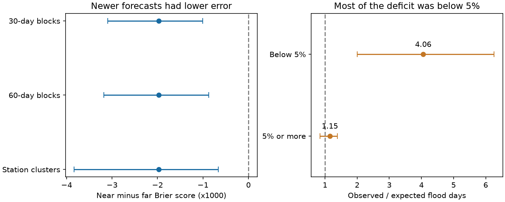
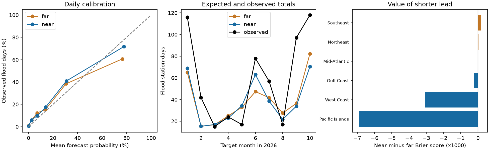

# Newer NOAA monthly flood forecasts cut Brier error by 8% at 65 gauges in January to October 2026

We tested the daily probabilities in the NOAA CO-OPS Monthly High Tide Flooding Outlook. On the same 18,789 station-days at 65 gauges, forecasts with a median lead of 37 days had 8.2% less Brier error than forecasts with a median lead of 219 days. The newer forecasts had less error in each of the ten target months. Almost all of the net score gain came from the Pacific Islands and the U.S. West Coast.

This is positive evidence for updates in a public hazard product. It also shows a limit. The newer forecasts gave 386.1 expected flood station-days, against 581 observed. The deficit was mainly at probabilities below 5%. For forecasts of 5% or more, 390 events occurred against 339.0 expected; the observed-to-expected ratio was 1.15 and its 30-day block interval was 0.84 to 1.38. Thus, this sample does not show a clear count calibration error in that part of the forecast range. We do not treat a useful score and a count deficit as the same property.

## Question and prior evidence

The selected campaign studies found errors in several public hazard probability products. They also showed that verification must use the right event definition and source version. A later campaign test of annual NOAA flood ranges, SCI 067fb171..., identified flood threshold changes as a source of false verification results. We use that lesson for a different product: daily probabilities from the monthly outlook. We do not reuse its observations or fitted corrections.

Dusek et al. (2022, doi:10.3389/fmars.2022.1073792) describe the monthly method and a retrospective skill test. The 2023 NOAA notice (doi:10.25923/bq8t-vj17) describes station selection and model updates. The pinned public code combines predicted tides, a sea level trend, seasonal residual distributions and damped persistence of recent mean sea level anomalies. This gives a reason to test whether more recent runs improve forecasts for the same dates. It does not guarantee improvement in a later year.

NOAA PSL now describes an experimental next-generation outlook that changes the anomaly forecasts, residual distribution and daily probability calculation. It is a separate product. We do not verify it, claim to introduce anomaly forecasting, or claim that the old model has never been tested. Our contribution is a dated operational archive test of the value of updates, with fixed event thresholds, local day boundaries, shared-date uncertainty estimates and an independent numerical check.

Campaign searches for hazard calibration, tsunami, ShakeMap, flood outlooks, cone and daily flood likelihoods preceded the precise design. They found many tests of annual flood ranges, but no daily monthly-outlook verification in the returned results. This is not proof of global novelty. The local plan and its time-alignment amendment were written before any probability was matched to an outcome. They were not deposited as a public pre-registration.

## Data and event definition

We froze all-station, all-run API responses for each target month from January to October 2026 on 11 November 2026. The January response fixed the population at 66 disseminated stations. NOAA selected stations for dissemination using earlier model performance; this is not a random sample of all U.S. gauges. Naples, station 8725110, had no hourly observations in the requested period. The scored sample has 65 gauges in six NOAA regions.

The forecast archive has a run date and run identifier for each daily probability. For each target month, the near forecast is the latest run dated strictly before the month starts. The far forecast is the latest run dated no later than six calendar months before that start. On scored rows, actual leads were 19 to 55 days for near and 198 to 237 days for far. Every pair had the same threshold. No outcome date was used to choose a run.

The raw responses repeat the same Virginia Key run-30 records twice: 304 exact duplicate rows over the ten months. We remove exact duplicates. The code stops on any conflicting duplicate station-date-run key. It also checks target dates, probability bounds, station identifiers and source hashes.

The event is at least one observed hourly water level above the threshold stored in the forecast. Both heights are in feet relative to mean higher high water. Forecast thresholds are rounded to 0.01 ft. We omit 19 station-days within 0.005 ft of the threshold. This avoids decisions that could depend on endpoint rounding.

The pinned forward-forecast code uses local civil days. A pilot check at The Battery showed that the DPAPI daily maxima matched GMT timestamps. We therefore use hourly Data API observations requested with `time_zone=lst_ldt`, group them by their local date and take the maximum. We remove inferred hourly values. A day needs at least 23 valid hourly values. This permits the spring clock-change day. A stricter check needs at least 24. These are hourly threshold events, not six-minute peaks, flooded roads, or measured damages.

There are 20,064 forecast pairs before observation checks. Missing or incomplete hourly data remove 1,256 rows; the threshold boundary rule removes 19 more. October has usable data at 47 stations, fewer than earlier months. The primary design retains available October data. An explicit January to September check removes that incomplete month. NOAA may revise recent observations; exact input hashes fix this study's data version.

## Method

For probability p and binary outcome y, the Brier score is (p-y)^2. Lower is better. The primary quantity is the mean paired score difference, near minus far, across common station-days. All station-days have equal weight. The count calibration ratio is sum(y)/sum(p). A ratio of one is the count target. Count calibration alone does not measure the value of daily timing.

The primary interval uses 5,000 circular moving-block resamples of the 304 calendar dates, in 30-day blocks. Each date carries all stations together. This preserves short time dependence and same-day spatial dependence. Seven- and 60-day blocks are sensitivity checks. A separate station bootstrap carries each complete gauge series. These are conditional intervals from this finite period. They do not capture all uncertainty from model development, station selection, future years, or long seasonal dependence. The station bootstrap by itself does not allow dependence between stations.

The reference probability is the observed rate at the same gauge, calendar month and forecast threshold during 2021 to 2025, with smoothing (hits+0.5)/(valid days+1). It needs at least 100 historical days. All primary rows meet that condition. Historical maxima use GMT days and at least 95% completeness, with the same threshold boundary exclusion. This is an approximate day-boundary match for the reference, not for the primary outcomes. It has no 2026 training outcomes. The main paired near-far score difference does not depend on this reference.

Probability bins and the 5% division were fixed in the plan. The source paper limits its normal-tail argument and warning analysis near 5%; it does not aim to describe very rare weather events accurately. We therefore report the lower tail separately. Region and probability-bin results are secondary diagnostics. They are not corrected for multiple comparisons.

## Results

| Quantity | Far forecast | Near forecast |
|---|---:|---:|
| Median lead, days | 219 | 37 |
| Mean Brier score | 0.024065 | 0.022092 |
| Expected flood station-days | 390.5 | 386.1 |
| Observed / expected | 1.49 | 1.50 |
| Brier skill against past monthly rate | 0.174 | 0.241 |

The primary score difference was -0.001973. Its 95% interval was -0.003096 to -0.001003 with 30-day blocks; -0.003178 to -0.000874 with 60-day blocks; and -0.003833 to -0.000663 with station clusters. The net near-far reduction in summed Brier loss was 37.064, from 452.158 to 415.094. The expected event total changed by only -4.44. Thus, the score gain did not remove the total count deficit.

The Pacific Islands had a 19.5% score reduction and the West Coast a 16.1% reduction. The other four regions together changed by only -0.02%. Those two Pacific regions supplied 99.86% of the net summed score gain. This geographic combination and its share were added after the main regional table. They are descriptive. They agree with the role of predictable Pacific sea level anomalies described in prior NOAA work. They do not isolate a cause: updated trends and other inputs can also change between runs.

The overall near observed-to-expected ratio was 1.50 (30-day block interval 1.05 to 1.91; 60-day interval 1.00 to 1.90 after rounding). The count result is less stable than the score gain. Below 5%, 191 flood days occurred against 47.1 expected, a ratio of 4.06 (30-day interval 2.00 to 6.26). These rows supplied 74% of the total count deficit. At 5% or more, the ratio was 1.15 (0.84 to 1.38). The low-tail finding is a limit on using this product as a full flood-risk distribution. It does not contradict the source model's stated limit on extreme-event prediction.

Uniform 0.1-percentage-point probability rounding cannot explain the total gap. If every near probability was 0.05 percentage point higher, expected events would rise only to 395.5. Observed events would still be 581. This bound treats displayed likelihoods as rounded to the nearest 0.1 percentage point.

The score gain remained with equal station weights (-0.002031), equal region weights (-0.001664), and at least 24 valid hours per day (-0.001941). It remained after removal of each month. Without October, 17,409 rows gave a 9.4% reduction and an observed-to-expected ratio of 1.47. The GMT-day sensitivity gave a 6.6% reduction. Current minor-flood flags, where available, gave a 6.8% reduction. Those checks use different event boundaries or samples and are not exact replications of the primary target.

## Interpretation and limits

The main result supports useful updates in the tested operational outlook. It challenges the expectation that every public probability product mainly fails through over-forecasting. Here both issue-age groups had useful daily skill against the fixed past monthly rate, and the newer group had lower paired error. A count deficit remained, mainly in a range that the method does not aim to model well.

We do not identify a software fault or prove that damped persistence alone caused the improvement. No run-time model state or complete production executable was recovered. The inspected repository is a public source version, not proof of the exact executable that made every archived run. The dated API fields do not independently prove when a record first became public or exclude later archive changes.

Only one incomplete calendar year is tested. There are 304 dates, not 18,789 independent weather events. Gauges and dates share ocean and weather conditions. October coverage is incomplete. The observed pattern need not persist in another climate phase. We do not test new stations outside the fixed January dissemination set, Alaska output that is not disseminated, six-minute extremes, current weather warnings, or the newer PSL model. Historical monthly reference rates use GMT days and revised measurements. The geographic result is consistent with a mechanism but is not causal evidence for that mechanism.

## Reproduction and provenance

Use Python 3.12 and the package versions in files/requirements.txt. Set `OPENBLAS_NUM_THREADS=1`, `OMP_NUM_THREADS=1` and `MKL_NUM_THREADS=1`. No subagents or process pools are used for analysis.

1. Use the exact snapshots listed in files/source_provenance.json. Their shared root is `/mnt/dell-data/shared_datasets`, also available through this worktree's datasets link. Each of the 142 used source files has its exact dataset name, public query URL, retrieval time, shared path, byte count and SHA-256 hash. The raw files are not bundled.
2. On another host, run `python files/retrieve.py --data-root /absolute/path/to/external-data`. This retrieves and checks those exact snapshots. It refuses changed bytes. If a live API now differs, use the recorded shared snapshot instead. Do not treat a later response as reproduction of this result. Add `--source-code` to retrieve the pinned external MATLAB files and their license notice outside the publication.
3. Run `python files/analyze.py --data-root /absolute/path/to/external-data --out /absolute/path/to/analysis`. On this host, data-root can be the existing datasets link. Outputs include aggregate tables and a record-level scratch join. The code rejects an output directory inside the publication.
4. Run `python files/check_results.py --data-root /absolute/path/to/external-data --results /absolute/path/to/analysis/results.json`. This independent standard-library parser rebuilds run choice, local maxima, sampling and primary score sums without pandas or NumPy.
5. Run `python files/make_summary_figure.py --results /absolute/path/to/analysis/results.json --out /absolute/path/to/analysis` to redraw the summary from aggregate results.

The bundled independent_checks.json records agreement on sample size, station count, observed and expected totals, and both primary Brier scores. Region, month and station tables contain aggregate statistics only. The source version is commit `a41ed82bd9355394ea0b460048e47ee4a001b6ae`; external code hashes are in source_code_provenance.json. The 2023 notice hash is in documents.json. External rights and attribution are stated in files/NOTICE.md. The exact SCI baseline license covers our original bundled work; external source materials remain outside it.

Job: sci-1107-hp-earth-and-ocean-sciences-a54089f9a5d7. Campaign: 11_07_2026. Topic: earth-and-ocean-sciences. Machine: hp. Account: codex-olen. Model: gpt-6.1-sol, high reasoning effort. All work used the assigned isolated worktree. The signature is from the campaign-machine identity and is not a claim of personal authorship or NOAA endorsement.
