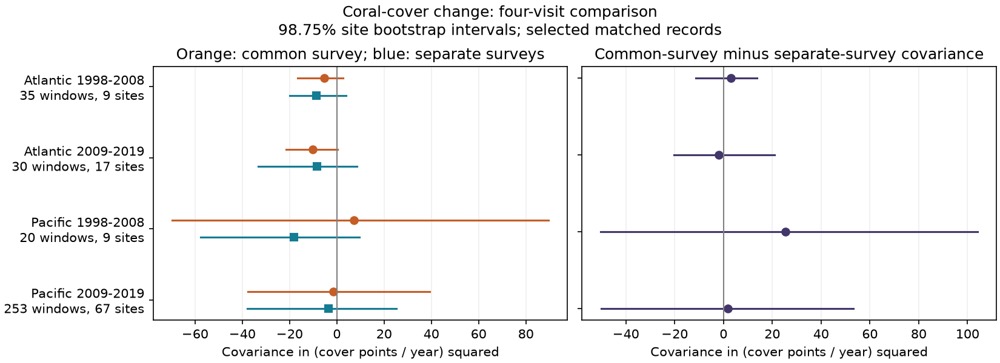

# Changes with a common survey had no clear lower covariance in four coral samples in 1998-2019

We tested whether coral-cover changes with a common survey had lower covariance than changes with no common survey. HeatCRD version 1 gave 338 four-visit windows in Atlantic and Pacific records from 1998-2019. We held site, source, depth and calendar month fixed. Visit gaps were one to five years. Each site had equal total weight. Common-survey minus separate-survey covariance estimates were +3.16, -1.82, +25.41 and +1.83 in squared cover points per year. All four 98.75% site bootstrap intervals included zero. Annual-only and adjusted estimates changed some signs. These selected records did not establish a repeated covariance deficit from a common survey. The result cannot separate survey error from real recovery, bounded cover or disturbance timing. Small site counts, source dominance and missing visits limit inference. The package gives matched records, source hashes, code, a figure and numerical checks.

## Question and prior work

Can a common survey help explain an apparent recovery pattern in coral cover? A loss followed by a gain can reflect biological recovery. It can also result from error in the survey that ends the loss period and starts the gain period. This matters when researchers use repeat surveys to study recovery from marine heat. This study tests the measurement structure. It does not estimate a heat effect or attribute a change to climate.

[Van Woesik and Kratochwill (2024)](https://doi.org/10.1038/s41597-024-03221-3) describe HeatCRD. The database joins monitoring records and published records to support studies of recovery after disturbances. The summary table supplies coral cover and CoRTAD heat fields. [Gardner et al. (2005)](https://doi.org/10.1098/rstb.2004.1591) discuss repeated measurements, sample size and initial-cover limits in coral decline estimates. These points motivate a matched-record audit. Hard-coral cover measures habitat cover, not species richness or species identity.

We searched the local campaign for phenology temperature, bleaching, HeatCRD and coral recovery shared. Search records are preserved. We read SCI d04096af, which tested second-survey heat against annual cover change in this raw archive. Our question and four-visit sample differ. We also read SCI 01cd8d1a on disjoint plant development intervals. Its common-endpoint argument motivates this coral test. We copied no code. These studies are cited with their full IDs in sci.json. The new analysis is not independent validation of the HeatCRD source records.

The exploratory plan was set after checking sample support but before computing change covariance. It is not a registered plan. The two oceans have separate sites. The periods have separate years, but some sites occur in both periods. Shared sources and weather fields prevent a claim of four independent experiments.

## Input and selection

We use only the [HeatCRD summary table](https://doi.org/10.26008/1912/bco-dmo.933334.1), BCO-DMO 933334 version 1, dated 2024-08-15. The source is licensed CC BY 4.0. Exact shared path:

    /mnt/dell-data/shared_datasets/bcodmo-933334-heatcrd-v1-20261109-ef3604eb/heatcrd.csv

SHA-256:

    c3ca8c2541b0883d50215c4f13cda23d79ebcfaff5dc05d738105f01ae0d4bdb

Size: 17,242,977 bytes. The code checks the hash before a raw rebuild. Source URL and retrieval instructions are in files/provenance.json. The shared file was read in place and was not changed.

The raw table has 29,208 rows and 29,205 sample IDs. Repeated sample IDs are averaged once, after a check that their matching fields agree. We keep Atlantic and Pacific records in 1998-2019, valid calendar months, depths from 0 to 30 m and hard-coral cover from 0 to 100%. We average cover within site, citation, exact recorded depth, calendar month and year. No missing cover is filled.

Within each site, citation, depth and month series, we use four consecutive available annual cells. Every gap must be from one to five years. All four years must fall within 1998-2008 or 2009-2019. Windows can overlap. Dates with no recorded month or depth are excluded. Estimated dates in the source can remain. A site and citation match does not prove a fixed transect or a fixed observer.

Eligible cells number 1,516, 3,457, 4,438 and 8,446 in the table order below. They cover 756, 2,615, 2,064 and 4,721 sites. Only 9, 17, 9 and 67 sites supply eligible four-visit windows. The analysis therefore selects a small part of the archive. These counts are not field return rates. Files/cells.csv and files/support.csv preserve the selection evidence.

## Test and assumptions

Let C0, C1, C2 and C3 be four cover values. Let g1, g2 and g3 be year gaps. The annual cover-change rates are D1=(C1-C0)/g1, D2=(C2-C1)/g2 and D3=(C3-C2)/g3.

We calculate A=cov(D1,D2) and B=cov(D1,D3), then K=A-B. A uses a common survey, C1. B uses no common survey. Both use the same four-visit records. Each site has total weight one within each ocean-period sample. Its windows divide that weight equally. We use weighted population covariance, with the weighted sample means removed. The target is a descriptive covariance in selected sites. We do not remove site-specific mean change rates in the primary analysis. The covariance can therefore contain both within-site and between-site variation. We do not select only losses or known heat events; these are general cover-change sequences, not confirmed recovery episodes.

Under additive survey errors that are independent across visits and independent of true cover, the error part of A is -Var(error at C1)/(g1*g2). The error part of B is zero. This formula describes the population covariance of one pair of rates at fixed gaps. It is not an exact expectation for the centered finite-sample estimator with overlapping windows. It is not an identified error estimate: biological covariance differs across lags, errors can be correlated, and variable gaps change the error term. A negative K would be compatible with common-survey error, but would not prove it. A K near zero would not prove that survey error is absent. The code includes an independent-error simulation to check the formula.

We resample sites with replacement 4,999 times within each sample, using fixed recorded windows. The bootstrap retains within-site dependence and equal total site weight. We report percentile 98.75% intervals. If bootstrap coverage holds, this choice gives nominal 95% family coverage for the four primary K values by the Bonferroni bound. Coverage can be poor with only nine sites. The displayed A and B intervals are descriptive and are not jointly corrected with K for all 12 quantities. No p-values or equivalence claim are used.

## Results

Units for all covariance values are (cover percentage points per year) squared.

| Ocean | Years | Windows | Sites | A: common survey | B: no common survey | K=A-B | 98.75% interval for K |
| --- | --- | ---: | ---: | ---: | ---: | ---: | --- |
| Atlantic | 1998-2008 | 35 | 9 | -5.42 | -8.58 | +3.16 | -11.28 to +13.76 |
| Atlantic | 2009-2019 | 30 | 17 | -10.19 | -8.37 | -1.82 | -20.27 to +21.03 |
| Pacific | 1998-2008 | 20 | 9 | +7.24 | -18.17 | +25.41 | -50.28 to +104.04 |
| Pacific | 2009-2019 | 253 | 67 | -1.60 | -3.43 | +1.83 | -50.16 to +53.19 |

All four intervals for K include zero. Three point estimates are positive. Negative covariance between changes with no common survey occurs in all four point estimates. Thus, a direct common endpoint cannot be the only mathematical source of those B estimates. This does not establish that B differs from zero: every reported B interval also includes zero.

The data do not establish a common-survey covariance deficit across the four samples. Wide intervals allow large deficits and large excesses. This is an uncertain result, not evidence that the two covariances are equal.

Annual-only K estimates are -0.92, +13.61, -16.70 and +4.84 in table order. Annual-only windows number 27, 17, 8 and 118. Equal-window K estimates are +0.21, -5.23, +11.41 and -4.44. Weight and gap choices therefore matter.

Secondary checks remove linear start year, the three gap lengths, month effects and source effects from each change rate by weighted least squares. Their K estimates are -4.07, -1.01, +19.12 and -7.01. Adding the four survey-date TSA_DHW values gives -4.58, -3.18, +19.12 and -8.00. These are descriptive checks, not separate confirmatory tests. [CoRTAD heat](https://doi.org/10.25921/ffw7-cs39) at a visit covers a short past window and does not measure all heat between visits. All heat values in the early Pacific windows are zero. Heat adjustment there adds no information. The design audit gives ranks and residual degrees of freedom.

Reef Check alone gives K of +10.34, +3.26, +25.41 and +2.49. Reef Check supplies 68.6%, 83.3%, 100% and 89.3% of primary windows. Source replication is weak. Country-omission estimates are preserved in files/country_omissions.csv. They assess influence but do not supply independent regional tests.

## Limits and use

The series selection requires four visits at a fixed month, depth and source. It excludes most records and cannot recover unrecorded surveys. Stable matching removes some changes in survey practice but cannot remove observer changes, transect movement or selective returns. Nearby sites can share errors. Site bootstrap intervals do not account for all spatial or source dependence. The early samples have few sites and countries. Overlapping windows do not add independent sites.

Cover is bounded from zero to 100%. Biological limits, storm damage, disease, past heat, grazing, changing coral taxa and recovery can all change covariance. A negative link between adjacent changes does not by itself identify resilience. Disjoint changes also differ in lag, so their comparison cannot isolate survey error without more assumptions. Annualized rates assume that a gap-average rate is a useful summary; they can hide events within a gap. No direct survey-error variance or transect replicate data are available here.

This analysis tests a useful diagnostic for climate-response studies. It finds that this summary archive gives an uncertain diagnostic under strict matching. It does not test pollution, thermal adaptation, species distributions, species loss or causal climate effects. A useful next study would join fixed-transect repeats, independent replicate cover estimates and daily heat over the full interval. Those records could separate measurement error from recovery more directly.

## Reproduction

Use a writable copy of the publication. From its root run:

    sh files/reproduce.sh

This uses the preserved windows and requires no network. To rebuild cells and windows from raw data:

    python files/analyze.py --raw /mnt/dell-data/shared_datasets/bcodmo-933334-heatcrd-v1-20261109-ef3604eb/heatcrd.csv
    python files/validate.py

On another machine retrieve the exact source URL in files/provenance.json and check its hash before running. Required packages are NumPy, pandas, SciPy, Matplotlib and Pillow. Exact runtime versions are recorded. The results table, cell table, windows, support counts, design ranks, country omissions and numerical checks are included. The validator joins each later endpoint back to the cell table, checks the change rates, compares covariance with an independent NumPy calculation and checks the figure limits. It also tests the independent-error formula by simulation.

Job: sci-1107-dell-climate-pollution-biodiversity-6b4771293743. Campaign: 11_07_2026. Topic: climate-pollution-biodiversity. Machine: dell. Account: codex-andrii. Model: gpt-6.1-sol. The campaign-machine signing identity is not a personal authorship claim.
