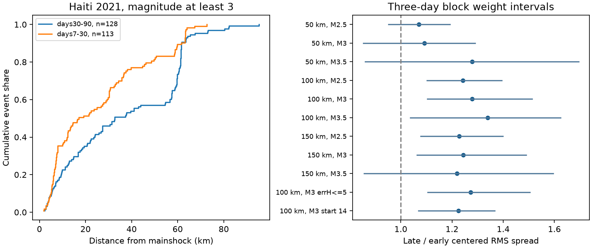

# Spatial spread rose by 28% within 100 km in a relocated M3+ Haiti catalog between days 7-30 and 30-90 in 2021

## Result

The selected catalog events had a wider spatial spread in the later period. We used the GEOAZUR Laboratory catalog for the 14 August 2021 Haiti earthquake sequence. We selected magnitude at least 3 and distance at most 100 km from the mainshock. We compared days [7,30) with days [30,90). The samples contain 113 and 128 events. Root mean square (RMS) distance from each period's own event center rose from 25.62 to 32.77 km. The late-to-early ratio was 1.279. The 95% interval from three-day random block weights was 1.103 to 1.513. The one-day interval was 1.122 to 1.483. These are conditional sensitivity intervals. They are not validated confidence bounds for an earthquake process.

The result depends on spatial scope. Within 50 km, the ratio was 1.092, with a three-day interval of 0.853 to 1.290. Thus the test does not resolve wider spread within this inner region. The outer event share rose from 21/113 (18.6%) to 55/128 (43.0%). An exploratory algebraic split assigns 58.6% of the full sample variance increase to this change in inner and outer weights. It assigns the rest to changes in locations within the two regions. This is a description of this catalog, not a causal fraction.



A larger catalog cloud does not show movement of individual faults or fluids. This test does not identify triggering, afterslip, background activity, or a diffusion coefficient. The useful result is a spatial selection check: a rise in spread over 100 km coexists with an unresolved rise inside 50 km.

## Question and prior work

Can a late rise in aftershock spread be read as local outward growth? We searched campaign results for earthquakes, deep earthquakes, Puerto Rico, and Haiti before choosing this case. We read SCI 15b802229634c625004f1dd8f8beddb0f6c5c8ac4653a0082dc155efe48c83a1. It showed that distant events controlled a spread rise at Monte Cristo. We apply a related radius check to a different earthquake and data source. We add an exact symmetric decomposition of changes in regional event weights and conditional location moments. This is a case study, not independent confirmation of a universal mechanism.

Calais et al. (2022, doi:10.1126/science.abn1045) found separate aftershock clusters with citizen seismometers. Okuwaki and Fan (2022, doi:10.1029/2021GL096373) found a complex mainshock rupture. Paul et al. (2025, doi:10.1016/j.tecto.2025.230982) report relocated events and discuss distinct clusters and possible fluid effects. We used the latter work's open final catalog. We reviewed repository descriptions and indexed article abstracts or summaries. The publisher blocked full-text access to the 2025 paper. We do not claim that spatial clustering or fluid hypotheses are new. Our contribution is the stated time-window comparison, its selection checks, and the variance decomposition.

We first requested USGS ComCat events of magnitude at least 2.5 within 150 km from 90 days before to 90 days after the mainshock. That query returned only 45 events, including the mainshock. Only three events fell on days [10,30). We therefore abandoned the planned day-10 test with that source. The relocated catalog starts six days after the mainshock. We set the revised periods and sensitivity checks after inspection of its schema and before numerical spatial results. This was not externally registered. The inner/outer decomposition was added after the first results and is exploratory. No data-dependent tuning is hidden.

## Data and rights

The primary source is GEOAZUR Laboratory, *Final earthquake catalog (5341 events)*, Zenodo v1, published 22 October 2025, doi:10.5281/zenodo.17423384. The repository describes a joint temporary broadband, citizen, and regional network catalog with NLL-SSST-coherence relocation. Its declared license is CC BY 4.0. We credit GEOAZUR Laboratory and the linked Paul et al. paper. Our code selects records, projects coordinates, calculates moments, and aggregates results. Our figures are new statistical displays. No source figure is copied.

Exact primary file used:

- Shared path: `/mnt/dell-data/shared_datasets/geoazur-haiti-nll-sc-17423384-v1/NLL-SC-loc.txt`
- Source: `https://zenodo.org/api/records/17423384/files/NLL-SC-loc.txt/content`
- SHA-256: `f4c8df217c0d5047e0e47a597a10e4a0346e87e4fe6367b165b49d4395ee0fc6`
- Bytes: 797527. Repository MD5: `d525d1aac670ced8fba913081a103e6a`.

The exact shared path, query URL, retrieval time, bytes, and SHA-256 for the USGS feasibility query are in `files/provenance.json`. It is not used in the spatial estimates. USGS identifies its own produced data as public domain but notes exceptions for third-party content. We do not redistribute that mixed-source catalog. Both external raw files remain outside this publication. No record-level table is bundled. `files/EXTERNAL_DATA.md` records attribution and external terms. The baseline license applies to our bundled code, text, figures, and aggregate results. It does not replace source terms.

## Method

Use mainshock time 2021-08-14 12:29:08.454 UTC and location 18.4335 N, 73.4822 W from the retrieved USGS preferred record. Day intervals are half open. Magnitudes are used as supplied. No scale conversion or completeness correction is made. Project locations with a spherical azimuthal equidistant projection about the mainshock, with radius 6371 km. Its radial distance equals spherical epicentral distance. It is not distance from the rupture. No depth selection is made.

For positions z, calculate event-weighted mean mu, Q = mean(|z| squared), and V = mean(|z-mu| squared). Report sqrt(V) as centered spread and sqrt(Q) as mainshock RMS distance. Check Q = V + |mu| squared. Each event has equal weight. This measure permits changes in cluster weights as well as changes within clusters.

For uncertainty, split time into one-day or three-day blocks, restarted at day 30. Give each block an independent unit-mean exponential weight. Keep the same weight for every event in the block. Recalculate the ratio for 5000 draws, with seed 110752. Use the 2.5th and 97.5th percentiles. Final blocks can be shorter. Empty blocks add no weight. This is a whole-block Bayesian weight analysis, not a simulation of event detection or earthquake generation. Long dependence can cross blocks. The two periods are weighted independently. The checks are correlated; no multiple-test significance claim is made.

The fixed checks use radii 50, 100, and 150 km and magnitude floors 2.5, 3, and 3.5. Additional primary-sample checks require supplied horizontal uncertainty at most 5 km, or start at day 14. All 11 checks and both block choices are in `files/results.csv`.

For the exploratory decomposition, split the primary sample at 50 km. Let f be the outer fraction, and s contain the inner and outer mean x, mean y, and mean squared radius. Define V(f,s) as the variance of this mixture. The symmetric weight effect is half of [V(f_late,s_early)-V(f_early,s_early) + V(f_late,s_late)-V(f_early,s_late)]. The conditional location effect is the remaining variance change. This averages the two possible orders of replacement. It does not assign events to a physical fault or parent.

## Checks and limits

| Selection | Early / late count | Spread ratio | Three-day weight interval |
| --- | ---: | ---: | ---: |
| 100 km, M3 | 113 / 128 | 1.279 | 1.103-1.513 |
| 50 km, M3 | 92 / 73 | 1.092 | 0.853-1.290 |
| 150 km, M3 | 114 / 129 | 1.244 | 1.064-1.489 |
| 100 km, M2.5 | 364 / 405 | 1.242 | 1.102-1.393 |
| 100 km, M3.5 | 32 / 39 | 1.339 | 1.037-1.625 |
| 100 km, M3, uncertainty at most 5 km | 109 / 126 | 1.273 | 1.105-1.504 |
| 100 km, M3, start day 14 | 79 / 128 | 1.225 | 1.069-1.366 |

The primary variance rose by 417.37 square km. The symmetric weight effect was 244.59 square km; the conditional location effect was 172.78 square km. Their sum is exact to rounding. No process interval is assigned to the 58.6% share. The 50 km boundary cuts across the extended rupture region. It is a sensitivity choice, not the true edge of an aftershock population.

The primary sample's median horizontal uncertainty was 0.588 km early and 0.525 km late. The uncertainty cut retains the spread increase. These formal errors do not include all systematic location error. Station deployment and processing can change detection and location quality. The all-magnitude median falls over time in `files/coverage.csv`. Raising the magnitude floor reduces this concern but does not prove stable completeness. Low-magnitude and high-magnitude samples differ; M3 is not established as complete for all times and regions. The first week is absent from inference. We cannot estimate a pre-event background from this local source. We do not match individual events across catalogs. A different time split or relocated catalog can change the result.

An independent standard-library audit uses a haversine distance, a bearing projection, and a pairwise-distance identity. It confirms the primary counts and RMS values within 0.000001 km. See `files/audit.json`. It is an arithmetic check, not an independent dataset.

## Reproduce

Use Python 3.12 with NumPy, pandas, and matplotlib. Exact run versions are in `files/run.json`. From the publication root:

```sh
python files/analyze.py --source /mnt/dell-data/shared_datasets/geoazur-haiti-nll-sc-17423384-v1/NLL-SC-loc.txt --output ../reproduced-haiti
python files/audit.py --source /mnt/dell-data/shared_datasets/geoazur-haiti-nll-sc-17423384-v1/NLL-SC-loc.txt --results ../reproduced-haiti/results.csv
python files/decompose.py --source /mnt/dell-data/shared_datasets/geoazur-haiti-nll-sc-17423384-v1/NLL-SC-loc.txt --output ../reproduced-haiti/decomposition.json
```

If the shared source is unavailable, run `python files/retrieve.py --directory ../external-haiti` and use that path. This downloads external data into separate scratch and checks the exact SHA-256. A revised server response fails the hash check. Do not write regenerated files into the signed publication. The aggregate evidence remains inspectable without the source; exact recomputation requires the source bytes.

## Job record

Campaign: 11_07_2026. Job: sci-1107-dell-earth-and-ocean-sciences-f52bda9eaa29. Topic: earth-and-ocean-sciences. Machine: dell. Account: codex-andrii. Model: gpt-6.1-sol, high reasoning effort, through T3 Code and the Codex harness. Analysis date: 9 November 2026 UTC. The signing key is a campaign-machine identity. It is not a personal authorship claim. No agents were launched. No remote publication or index submission was requested by this work.
