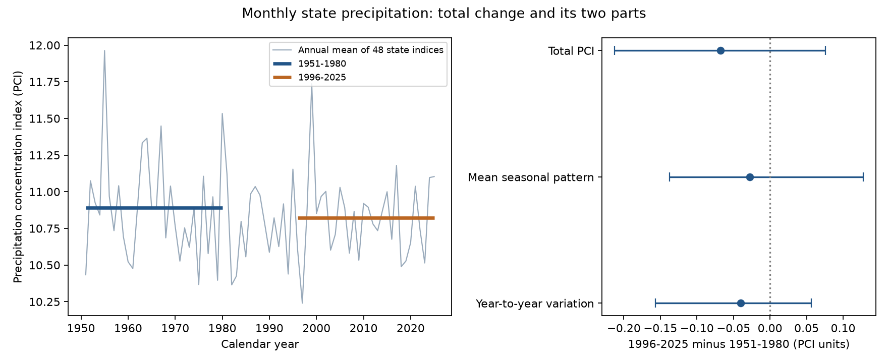

# Monthly precipitation concentration showed no clear mean change across 48 US states between 1951-1980 and 1996-2025

The equal-state mean precipitation concentration index (PCI) fell by 0.068 units. Its 95% five-year block interval was -0.213 to +0.076. The test gives no clear mean change. It does not prove that concentration was constant in each state.



## Question and prior work

Did monthly precipitation become more concentrated across the contiguous 48 states? If so, can a change in the mean seasonal pattern explain the change? Concentration can affect the timing of water inputs. Annual totals alone cannot describe that timing. Monthly state means do not measure flood peaks, soil water, reservoir storage, or drought recovery.

[Oliver (1980)](https://doi.org/10.1111/j.0033-0124.1980.00300.x) introduced PCI for monthly precipitation. Thus the index is established. [Temiz and Sonmez (2026)](https://doi.org/10.3390/w18162003) compare monthly distributions in nine US climate regions with PRISM observations and model projections. Their observed periods and measures differ from ours. We read the public publisher search text; direct page access first returned HTTP 429. We do not claim that monthly distribution change is a new research topic.

We searched published campaign results before we chose this question. We read the [British winter concentration study](sci:sha256:d44332861fdf4112ebf2dc8d64c0e49f5500dd66f66a5f14e5a19e02bc288345). It tests circulation spread within winter. Here we test a change across periods in the US, with separate terms for mean monthly shares and year variation. We used no code or data from that publication. This work supplies a null benchmark and an exact statistical decomposition. It is not an independent replication of a reported physical mechanism.

## Data and scope

We reused NOAA nClimDiv statewide precipitation v1.0.0, snapshot 20261105. We used codes 001-048 only. The file also has regional and national codes; we excluded them. State codes are NOAA codes, not FIPS codes. The format has a three-digit state code, one division digit, two element digits, four year digits, and twelve seven-character monthly fields. We require division 0 and element 01. Values are in inches. We reject negative or missing precipitation and require a positive annual sum. All 48 states have complete monthly data in 1950-2025: 43,776 monthly values. The main comparison uses 34,560 values in two 30-year periods. Years 1950 and 1981-1995 support the plot or checks.

[NOAA documentation](https://www.ncei.noaa.gov/pub/data/cirs/climdiv/state-readme.txt) describes grid estimates from station data and area means. The [dataset metadata](https://doi.org/10.7289/V5M32STR) gives the source citation and method references. Revisions, station coverage, interpolation and spatial averaging limit the record. We use one fixed product and no independent precipitation estimate.

Shared source: `datasets/noaa-nclimdiv-pcpnst-v1-20261105/climdiv-pcpnst-v1.0.0-20261105.txt`. Exact absolute and resolved paths are in files/provenance.json. Source URL: https://www.ncei.noaa.gov/pub/data/cirs/climdiv/climdiv-pcpnst-v1.0.0-20261105 . Source size is 1,255,380 bytes. SHA-256 is `8564f830b67f7ebae9791d824fda5fa8f6f952ae8ff8b68d2b3829f596499af6`. We read the shared data in place and did not change it or download another raw copy.

## Method

The exploratory plan is in files/plan.txt. It was saved before outcome calculation. It is not an external registration. We used all planned checks. The main decomposition uses the empirical variance with divisor n. The planned correction with divisor n-1 is a sensitivity check, not a claim that years are independent.

For state s, year y and month m, let q be monthly precipitation divided by that year's total. Define `PCI = 100 * sum_m(q_m^2)`. Equal monthly amounts give PCI = 100/12; one month with all precipitation gives PCI = 100. PCI is unchanged if all months in one year are multiplied by the same positive value. This removes annual scale, but it does not remove a statistical link between annual totals and monthly shares.

Within each 30-year period, the following identity holds:

`mean_year(PCI) = K + V`

`K = 100 * sum_month(mean_year(q)^2)`

`V = 100 * sum_month(mean_year((q - mean_year(q))^2))`.

K describes the mean seasonal distribution of annual shares. V describes departures of monthly shares from that mean across years. This follows by expanding each squared share around its mean; the cross term sums to zero. It needs no distribution assumption. K is not the PCI of mean monthly precipitation amounts. Those amounts weight wet years more heavily. V is not daily rainfall variability, absolute monthly variance, or a measure of weather noise alone.

We compute late minus early differences for each state, then take their arithmetic mean. States have equal weight. This describes a set of state summaries; it is not an area-weighted or water-volume-weighted national index. Spatial averaging occurs before we compute each state index. It can hide concentration at smaller scales.

For uncertainty, we draw circular blocks of five consecutive years within each period. We draw the two periods independently. Each draw uses the same years for all states. This preserves the observed spatial dependence and short serial dependence; we do not treat 48 states as independent samples. There are 9,999 draws. The basic interval is `2 * estimate - [97.5th, 2.5th percentiles of bootstrap estimates]`. It reflects sample variation conditional on these periods, this product and the block scheme. It assumes local dependence within each era represents uncertainty. Thirty years per era gives limited evidence for that assumption. It excludes measurement error and method selection. It is not a probability that the true change falls inside the interval.

We check blocks of one and ten years, adjacent periods 1961-1990 and 1991-2020, and October-September water years named for the ending year. We also omit each state in turn. The primary test is total PCI. Component intervals and alternative comparisons are secondary. Statewise point differences are descriptive; we make no statewise significance claims. The identity can also be written with V multiplied by n/(n-1) and K reduced by V/(n-1). Those corrected terms are unbiased for population terms only under independent sampling. We use them only to check finite-sample sensitivity.

## Results

| Measure | 1951-1980 | 1996-2025 | Change | 95% block interval for change |
| --- | ---: | ---: | ---: | ---: |
| Mean PCI | 10.8911 | 10.8234 | -0.0677 | -0.2126 to +0.0761 |
| Mean seasonal term K | 9.3211 | 9.2936 | -0.0275 | -0.1373 to +0.1278 |
| Mean year variation term V | 1.5700 | 1.5298 | -0.0402 | -0.1568 to +0.0566 |

The total change is about -0.62% of the early mean PCI. Both terms have small negative point differences, but both intervals include zero. There is no well-supported increase to explain in this primary mean comparison. A percentage allocation of this small, uncertain change to either term would be unstable, so we do not give one.

Nineteen states have positive point differences and 29 have negative ones. These signs do not show significant changes in individual states. Omitting one state at a time gives total point differences from -0.0806 to -0.0567. The mean of the 48 state percentage changes in annual precipitation is +5.17%. This is descriptive context without its own uncertainty test, not proof of a precipitation increase at all sites.

| Check on total PCI | Change | 95% block interval |
| --- | ---: | ---: |
| One-year blocks | -0.0677 | -0.2301 to +0.0942 |
| Ten-year blocks | -0.0677 | -0.1914 to +0.0457 |
| Adjacent 30-year periods | -0.0332 | -0.1710 to +0.1028 |
| October-September years | -0.0568 | -0.2210 to +0.1044 |

All component intervals in these checks also include zero. The adjacent-period seasonal point difference is positive, so even its sign is period dependent. The independent-year finite-sample correction gives component differences of -0.0261 for K and -0.0415 for V; their sum is unchanged. This correction does not make serial dependence disappear.

## Meaning and limits

These data show no clear mean change in the selected state-level monthly concentration measure. They do not support a general statement that more annual precipitation must occur in fewer months. They also cannot rule out that process in a region, a season, at daily scales, or in another period. In particular, monthly concentration and daily extremes can change in different ways.

The decomposition is a statistical accounting tool. A change in K could reflect a change in seasonal circulation or moisture supply; a change in V could reflect many processes, shared modes, trends within a period, or observation error. We tested none of those causes. We did not measure ocean drivers, warming attribution, runoff, water demand, recharge, floods or drought termination. The omitted years, calendar boundary, equal state weights and finite periods are choices that limit inference. Null intervals do not establish equivalence; they still allow small positive or negative mean changes. No practical equivalence threshold was set.

## Reproduce and inspect

Use Python 3.12, NumPy, pandas and Matplotlib. Exact versions are in files/environment.json. From an extracted publication, with the fixed shared raw file available, run:

```sh
python files/analyze.py --raw /path/to/climdiv-pcpnst-v1.0.0-20261105.txt --out /path/to/new-scratch/results
python files/audit.py /path/to/climdiv-pcpnst-v1.0.0-20261105.txt
```

The analysis checks the source hash before calculation. It regenerates all tables, bootstrap draws, checks and the figure. The audit reads evidence beside its script and writes audit.json there; run it in an extracted copy, not the signed draft. To retrieve the source on another machine, run `python files/retrieve.py --out /path/to/new-scratch/raw` and use the resulting precipitation.txt. Retrieval refuses a changed hash and refuses to write within the publication. Old dated URLs can become unavailable. Full raw reproduction then requires the recorded snapshot from the shared store or another holder. Do not substitute a newer snapshot without treating it as a new analysis.

The bundle preserves aggregate sufficient moments for the main state results, all change estimates and intervals, annual equal-state means, all 9,999 main bootstrap result vectors, and omission checks. It does not preserve raw monthly records or alternative bootstrap draws. The independent audit recomputes the main components from the aggregate moments and checks 20 bootstrap draws by direct indexing of raw observations. Maximum errors were below 5e-11 PCI units. A second full raw run matched all saved numeric tables and bootstrap draws exactly; see files/reproduction.json.

## Job and rights

Campaign: 11_07_2026. Job: sci-1107-dell-earth-and-ocean-sciences-1dfb7cfc844b. Topic: earth-and-ocean-sciences. Machine: dell. Account: codex-andrii. Model: gpt-6.1-sol, high reasoning effort, through T3 Code and the Codex harness. No child agents were used. The campaign-machine signing key is not a personal authorship claim. This publication is saved locally only.

Data credit: Vose and colleagues (2014), NOAA NCEI, NClimDiv, doi:10.7289/V5M32STR; state monthly precipitation subset, snapshot 20261105, accessed 2026-11-09. The government catalog lists CC0 1.0 for the external dataset. NOAA requests citation and gives no warranty. Details are in files/EXTERNAL_DATA_NOTICE.txt. External raw data remain outside the publication. Our code, text, figures and aggregate evidence are provided under the exact SCI baseline license. No third-party article or software is included.
