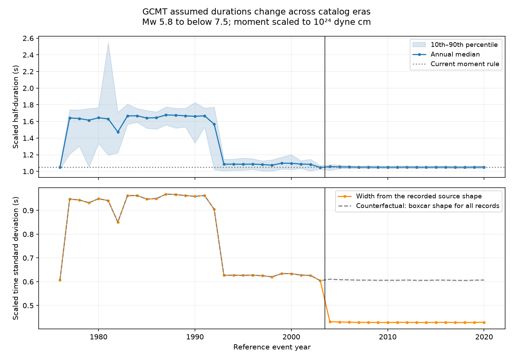

# The 2004 source-shape switch reduced calculated GCMT time widths in a Mw 5.8 to below 7.5 audit

## Result

In the selected Global CMT records, the median scaled half-duration changed by -2.43% between 1998-2003 and 2004-2009. The calculated time width changed by -31.01%. Its conditional 95% interval was -32.03% to -29.89%. The half-duration interval was -3.88% to -0.84%. The samples had 1025 and 1260 events. All earlier records had a boxcar source function. All later records had a triangular source function.

The switch in source shape alone reduces the time standard deviation by 29.29% at the same half-duration. Thus, similar half-durations across this boundary do not imply similar widths of the assumed moment-rate functions. This is a catalog measurement audit. It is not evidence for a physical change in earthquake rupture duration.



## Question and prior work

Can catalog source-function choices make an apparent change in earthquake time width? The Global CMT format guide explicitly states that the source half-duration is assumed from a moment rule and is not derived from the inversion. Duputel et al. (2013, doi:10.1016/j.epsl.2013.05.024) discuss this limit and use centroid delay as a different source-time measure. The study at doi:10.1093/gji/ggac314 describes the source shape change before and after 2004. These facts are already known.

A prior campaign result, sci:sha256:5ade26e06e269e86e6c34238e5127cc0047bb3f1d6c0f18220a956484a9cd1cd, used centroid delays from this same catalog and warned against treating half-duration as independent duration evidence. We read that result. We add a numerical audit of assumed duration statistics across the full catalog period and a tool that calculates time width from the shape flag. We do not claim a new rupture mechanism or the first discovery of the shape switch.

## Data and scope

We reused the existing shared January 1976 to December 2020 snapshot. It has 56,832 five-line records. We selected 8,367 records with Mw at least 5.8 and below 7.5. This range reduces the relative effect of 0.1 s duration rounding and excludes the largest complex sources. There is no depth or location filter in the main audit. We did not decluster the events. This is a selected population of catalog entries, not all earthquakes.

The source SHA-256 is baed5ad29a69b57344c6025b27769b1012858aa6b5c807f984696d573c0f0eb4. Exact shared paths, source URL, version, file size, citation requirements and retrieval instructions are in files/EXTERNAL_DATA.txt. We thank the Global CMT Project and cite Dziewonski et al. (1981) and Ekstrom et al. (2012). No raw source file, event extract or event-level derivative database is bundled. The source pages inspected did not give an explicit redistribution license. The bundle contains our code, text, figures and aggregate research statistics, which can use the SCI baseline license.

## Calculation

We read scalar moment M0 from columns 50-56 of line five, with the exponent from line four. Units are dyne cm. We calculate Mw = (2/3)(log10(M0) - 16.1). We read half-duration H and the BOXHD or TRIHD flag from line two. The scaled half-duration is A = H / (M0 / 10^24)^(1/3). A is in seconds at a reference moment of 10^24 dyne cm. It is a normalization, not a new fit.

For a normalized boxcar function on [-H,H], the time variance is H^2/3. For a symmetric triangular function with support [-H,H], it is H^2/6. We therefore calculate the scaled time standard deviation W = A/sqrt(3) for BOXHD and W = A/sqrt(6) for TRIHD. At equal A, the ratio of widths is 1/sqrt(2). The decrease is exactly 29.2893%. This calculation concerns the second moment of the assumed source function. It is not the full duration, centroid delay, rupture speed, or a fitted waveform duration. The center time does not affect this variance.

We report annual medians and 10th and 90th percentiles. The primary boundary comparison uses 1998-2003 and 2004-2009, adjacent six-year windows around the known shape switch. Within each window, 5,000 independent resamples of three-year circular blocks give percentile limits for the percent change in the pooled event median. We retain the events in each sampled year. The seed is 20261109. These intervals are conditional on fixed source records and selected windows. Six years per side is a short record; circular blocks impose artificial joins. The exact shape-only calculation needs no statistical interval.

The question was chosen after reading prior work. The annual coefficient scan preceded the final window choices. This is an exploratory retrospective audit, with no preregistration or confirmatory p value. The three broader eras below describe stable parts of the plotted record and omit transition years. They were selected after the scan and do not estimate exact change dates.

## Wider era checks

All values in the next table are scaled to the same reference moment. The last column is the fraction within 5% of the current rule A = 1.05 s. This threshold is descriptive and is not a test of physical source duration.

| Years | Records | Median A (s) | Median W (s) | Within 5% of current rule |
| --- | ---: | ---: | ---: | ---: |
| 1983-1991 | 1626 | 1.6642 | 0.9608 | 0.49% |
| 1993-2002 | 1794 | 1.0868 | 0.6275 | 57.80% |
| 2004-2020 | 3470 | 1.0505 | 0.4289 | 97.52% |

The coefficient decrease near 1992-1993 occurs while the shape flag remains BOXHD. Thus the 2004 shape change cannot account for all catalog-era differences. The current 1.05 s rule does not describe the full historical catalog. We do not assign the earlier decrease to a specific processing change, and do not interpret deviations from the rule as measured duration anomalies. Rounding, use of an earlier moment estimate, revisions or manual choices can affect those deviations.

files/sensitivity.csv gives the three eras separately for Mw 5.8-6.2, 6.2-6.6, 6.6-7.5 and 6.0-7.0, and for all depths, depths below 70 km, and depths of at least 300 km. These are descriptive checks without multiple-test inference. They preserve the earlier-to-later order of the median scaled half-duration. They do not remove all changes in tectonic or geographic mix.

## Limits and use

The data are one revised catalog snapshot. Moment and assumed half-duration are not independent, and source model choices can affect moment itself. The fixed cube-root scaling can leave magnitude-dependent error. The older catalog has different coverage. Median changes can also reflect population mix. No independent waveform analysis tests the actual duration distribution here. We do not infer stress drop, recovery, physical source acceleration or hazard from these numbers.

A user who needs physical duration should use independent source-time estimates and inspect their errors. A user who needs synthetic source functions should retain the shape flag. Converting to a common time-width definition fixes a definition mismatch; it does not make the underlying assumed durations into new physical measurements.

## Reproduction and audit

Use Python 3.12 with NumPy, pandas and Matplotlib. Exact versions used are in files/results.json. Use a private environment if packages are needed. Let PUB be the extracted publication and SCRATCH a directory outside it. Reuse the exact shared source in EXTERNAL_DATA.txt, or retrieve it as follows:

```bash
python "$PUB/files/retrieve.py" --dest "$SCRATCH/raw"
python "$PUB/files/analyze.py" --raw "$SCRATCH/raw/jan76_dec20.ndk" --out "$SCRATCH/reproduced"
python "$PUB/files/audit.py" --raw "$SCRATCH/raw/jan76_dec20.ndk" --results "$SCRATCH/reproduced/results.json" --out "$SCRATCH/reproduced/audit.json"
```

The retrieval and analysis scripts reject changed source bytes. The retrieval script rejects a destination inside the publication. Analysis writes aggregate outputs only. Compare results.json, annual.csv, epochs.csv, sensitivity.csv and block_draws.csv. PNG bytes can vary with rendering software. audit.py uses a separate token parser for moment and date, checks the selected count and both boundary estimates, and integrates unit source functions numerically to check the variance formulas. files/audit.json records the check. The publication includes all block draws. A fresh run reproduced all five aggregate output files byte for byte; files/repeat_check.json records this check. No event table is required to inspect the aggregate claims.

## Campaign provenance

Job: sci-1107-dell-earth-and-ocean-sciences-3fd93c030442. Topic: earth-and-ocean-sciences. Campaign: 11_07_2026. Machine: dell. Account: codex-andrii. Model: gpt-6.1-sol, high reasoning effort, through Codex in T3 Code. One worker performed the work without delegates. The campaign-machine signing key is not a personal authorship claim. No remote upload or submission was made.
