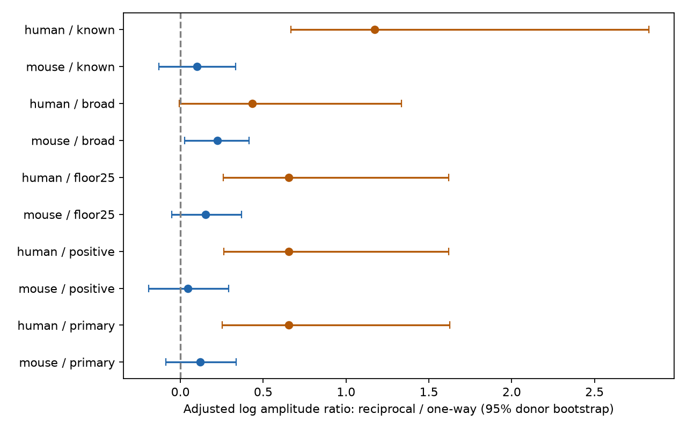

# Matched mouse slice recordings do not resolve a pooled strength increase for reciprocal connections

## Result

We compared resting postsynaptic potential magnitude in reciprocal and one-way connections in Allen Synaptic Physiology r2.1 slice data. We matched recording, synapse sign, and ordered cell class, Cre label, and layer. We adjusted mean log amplitude differences for mean log distance differences. The primary mouse sample had 342 directed connections in 116 matched groups from 93 inferred animals. The reciprocal-to-one-way amplitude ratio was 1.13, with a 95% animal bootstrap interval of 0.92 to 1.40. A broader match that omitted Cre and layer gave 1.25, with an interval of 1.03 to 1.51. Thus, the pooled result depends on the cell-label controls. The primary human sample had only seven groups from six inferred donors. Its estimate changed strongly after distance adjustment and does not establish transfer across species. This report supplies a matched comparison and derived evidence. It does not show equal strengths or measure the effect of reciprocal wiring on brain activity.

This is an exploratory reanalysis. The null result is not an equivalence result. The primary interval permits a decrease of about 8% or an increase of about 40% in the adjusted ratio. The broad-match result is positive. It prevents a claim that reciprocity has no relation to strength in this source. These are pooled tests of excitatory and inhibitory connections, with sign held fixed within each group.

## Question and prior work

Does a reciprocal connection have a larger resting response than a one-way connection in the same recording and cell-label group? Feedback models need both motif counts and connection weights. A strength rule that differs by motif can change a model of recurrent activity. This study tests the measured strength rule. It does not simulate a recurrent circuit.

Song and colleagues (2005, doi:10.1371/journal.pbio.0030068) studied nonrandom motifs and strength in rat visual cortex. Cossell and colleagues (2015, doi:10.1038/nature14182) linked strong and reciprocal connections to visual response similarity. Campagnola, Seeman, and colleagues (2022, doi:10.1126/science.abj5861) supplied these mouse and human paired recordings. Recent work (doi:10.1038/s41593-026-02395-w) relates local motifs to recurrent dynamics. The present test is a narrow matched comparison of measured amplitudes. It does not establish a new general theory of recurrence.

Before this question was fixed, SCI searches for connectome and reciprocity found the campaign publication cited in sci.json. We read that signed report. It tested whether one reciprocal weight predicts the other. It explicitly did not test strength in reciprocal versus one-way pairs. We used its public source and inferred donor rules. We also searched the web for the source study and work on reciprocal motifs and strength. A full-text fetch of the recent Nature paper failed; the accessible primary-source search extract supplied its broad scope. We make no detailed claim about its methods. No private worker workspace was read.

Connectivity and response data are linked by the same cell and pair IDs. The source contains tested local chemical connections in brain slices. It is not an anatomical connectome. No cross-animal registration or atlas link is required.

## Selection fixed before fitting

The plan is in files/analysis_plan.txt. The SQL is in files/selection.sql. Each retained forward direction must have a chemical synapse call and at least one current-clamp average fit that passed manual quality control. The reverse direction must have an explicit chemical call of zero or one. Unknown reverse calls are excluded. Reciprocal means reverse call one. One-way means reverse call zero. The reverse amplitude and its fit quality do not enter selection. Both directions of a reciprocal pair can enter if each forward direction meets the rules.

We keep mouse VisP and human TCx records with finite cell-body distance above zero and at most 500 micrometres. Amplitudes must be finite, nonzero, and have the expected sign. The primary floor is 0.01 mV in absolute resting PSP amplitude. This is a sensitivity choice, informed by near-zero fit values in the earlier publication. It is not a validated detection threshold. No source value is changed. PSP amplitude is in volts in the database. It is a resting response estimate, not a synapse count or conductance.

A primary matched group has one experiment, synapse sign, and ordered presynaptic and postsynaptic nonsynaptic class, Cre label, and target layer. Missing labels form an explicit level. Both motif groups must occur in the same matched group. This drops many recordings. It also changes the population being estimated. Exact matching on missing labels cannot recover the true class.

Mouse animal groups use the six-digit number after a hyphen in the specimen name. Human donor groups use the first three dot-separated fields. These groups are inferred from specimen names, not validated donor identifiers. All names are checked by the code. A common inferred donor includes all its recordings, cells, and directions in each bootstrap block.

## Estimator and uncertainty

Let y be natural log absolute PSP magnitude in mV and x be natural log cell-body distance in micrometres. In each matched group we calculate dy = mean(y in reciprocal directions) minus mean(y in one-way directions), and dx in the same way. We fit dy = alpha + beta dx by ordinary least squares. Every matched group has equal weight. The reported ratio is exp(alpha). It describes a contrast at zero group distance difference under this linear adjustment. It is not the arithmetic ratio of pooled raw means, and it is not a causal effect.

We resample complete inferred donors with replacement 5,000 times and refit this two-parameter model. Percentile intervals use seed 1107765. Each row of the results uses the next draws from the same random generator. This bootstrap preserves dependence from shared cells, paired directions, and recordings within an inferred donor. It does not correct an incorrect donor label. Rare rank-deficient bootstrap samples use the minimum-norm least-squares solution. The results file records their count. There were no such draws in either primary test. There was one in human floor25 and 55 in human known. Such draws further limit those small-sample intervals.

The primary scope is mouse. Human results and all sensitivity tests are exploratory. Tests share records. There is no multiple-test correction. The plan was saved before fitting but is not a public preregistration.

## Results and sensitivity tests

| Test | Species | Groups | Donors | Directions | Ratio [95% interval] |
|---|---|---:|---:|---:|---|
| primary | mouse | 116 | 93 | 342 | 1.129 [0.916, 1.399] |
| primary | human | 7 | 6 | 31 | 1.922 [1.288, 5.092] |
| positive | mouse | 118 | 93 | 347 | 1.045 [0.825, 1.337] |
| positive | human | 7 | 6 | 31 | 1.922 [1.299, 5.059] |
| floor25 | mouse | 115 | 92 | 338 | 1.166 [0.949, 1.446] |
| floor25 | human | 7 | 6 | 31 | 1.922 [1.295, 5.059] |
| broad | mouse | 141 | 118 | 455 | 1.250 [1.025, 1.513] |
| broad | human | 8 | 7 | 33 | 1.541 [0.994, 3.801] |
| known | mouse | 87 | 74 | 282 | 1.106 [0.878, 1.396] |
| known | human | 5 | 4 | 24 | 3.228 [1.949, 16.935] |




The primary mouse sample has 175 reciprocal directions and 167 one-way directions. It uses 103 recordings from 93 inferred animals. There are 44 excitatory and 72 inhibitory matched groups. The unadjusted mean log contrast is 0.202; the distance-adjusted contrast is 0.121. Omitting one inferred animal at a time gives adjusted log contrasts from 0.092 to 0.151. No single animal sets the primary sign.

The positive test removes the amplitude floor but keeps strictly nonzero expected-polarity values. The floor25 test raises the floor to 0.025 mV. Neither resolves a pooled mouse increase. The broad test omits Cre label and layer from the matching keys but keeps experiment, sign, and ordered nonsynaptic class. It gains records and gives a positive interval. The known test excludes missing pre- or postsynaptic nonsynaptic classes and retains the full primary keys. It also gives an interval that includes one. These tests change both controls and cohort composition. They cannot isolate which label or excluded cohort causes the difference.

A post-fit diagnostic separates the primary mouse groups by synapse sign. Adjusted log contrasts are 0.348 for excitatory groups and -0.039 for inhibitory groups. No uncertainty test was planned or run for this split. These values show why the pooled estimate must not be used as an excitatory-only rule. Further sign-specific confirmation needs a separate test with adequate groups and uncertainty control. Each group also holds its ordered cell classes fixed; the two sign subsets still have different compositions.

The primary human estimate uses only 31 directions in seven groups from six inferred donors. Its unadjusted log contrast is 0.072, but the distance-adjusted contrast is 0.653. Omitting one donor at a time gives adjusted log contrasts from 0.480 to 1.174. The estimate therefore depends strongly on the adjustment and sample. The human floor tests have identical records. Their slightly different intervals come from separate bootstrap draws. These results do not establish a common rule across species or a species difference. Species and region differ together.

## Meaning and limits

This report provides a method and benchmark for comparing motif strength under local recording controls. A positive broad comparison becomes unresolved under full matching. Circuit model users should check the matching and population before they assign one strength multiplier to all reciprocal connections. The data allow a modest pooled effect and potentially different effects by synapse sign.

Reverse calls can be false negatives. A weak reverse response can be missed. This can place true reciprocal pairs in the one-way group and can also link detection to measured strength. Slice preparation can remove axons. The analysis does not correct these errors. Requiring a detected forward connection and passed fit creates further selection. Resting responses depend on membrane resistance, synaptic location, holding conditions, and fit error. No raw waveform audit was done. These amplitudes do not measure conductance or in vivo feedback gain.

The estimand weights matched groups, not individual animals or all connections equally. Only recordings with both statuses contribute. Missing labels and incomplete cell sampling remain. The distance model is linear on group log differences; it is an approximation. Sparse human data make its extrapolation unsafe. Animal bootstrap intervals are approximate, with no account of uncertain call labels or response fit uncertainty. There is no behavior or intact-brain activity outcome. Generalization across animals is assessed only through the sampled animal variation; it is not a held-out prediction test. Generalization across brain regions and behavioral conditions remains untested.

## Reproduction and file map

The only shared raw file used is /mnt/dell-data/shared_datasets/allen_synphys/r2.1_small_2023-01-26/synphys_r2.1_small.sqlite (176771072 bytes). Version: r2.1 small, schema 22, S3 last modified 2023-01-26. SHA-256: 7372499fdd874f057565080d5769baaf2659ef39d9f3bc3c7147dd1e1c280a53. Source: https://allen-synphys.s3-us-west-2.amazonaws.com/synphys_r2.1_small.sqlite. The analysis checks this hash before use and opens SQLite read-only. No raw database is bundled. No dataset was downloaded or changed during this investigation.

If this shared version is absent, obtain it with the campaign helper:

```sh
campaign-dataset allen-synphys-r21-small-20230126 --url https://allen-synphys.s3-us-west-2.amazonaws.com/synphys_r2.1_small.sqlite --filename synphys_r2.1_small.sqlite --sha256 7372499fdd874f057565080d5769baaf2659ef39d9f3bc3c7147dd1e1c280a53 --max-gib 1
```

Use Python 3.14.4 with files/requirements.txt. From an unpacked publication, set DB to the SQLite path and run:

```sh
python3 -m venv venv
venv/bin/pip install -r files/requirements.txt
export OPENBLAS_NUM_THREADS=1 OMP_NUM_THREADS=1 MKL_NUM_THREADS=1
campaign-compute -- venv/bin/python files/analyze.py --db "$DB" --out reproduced
venv/bin/python files/check_evidence.py
```

Outside the campaign, run the same Python command without campaign-compute. The checker inspects the supplied files/evidence directory; it verifies matching keys, IDs, transforms, group contrasts, point estimates, interval quantiles, and cohort counts. Its stored output is files/validation.txt. It can run without the raw database. Compare reproduced CSV numeric values with the supplied CSVs to check a full rerun. Figures can differ in bytes across systems. Source hashes and software versions are in files/evidence/provenance.json.

files/evidence/query_rows.csv preserves the SQL result before numerical filters. eligible.csv preserves the filtered candidate records before the amplitude floor and matching. strata.csv lists the contrasts and all pair IDs for every test. results.csv stores estimates and counts. bootstrap.csv stores all uncertainty draws. diagnostics.csv stores post-fit sign estimates and leave-one-donor-out ranges. The package also has the SQL, full code, plan, figure, and source notes. Derived evidence contains public specimen labels. No private subject data or credentials are included.

## Attribution and job record

Job: sci-1107-dell-neural-structure-and-computation-765b253b73d9. Topic: neural-structure-and-computation. Campaign: 11_07_2026. Machine: dell. Account: codex-andrii. Model: gpt-6.1-sol, high reasoning effort, Codex harness in T3 Code. No agents were launched. All substantial analysis used campaign-compute with one library thread.

Credit: Allen Institute for Brain Science and the authors of the source study. The raw data retain the Allen Institute Terms of Use at https://alleninstitute.org/legal/terms-use/. The baseline license covers new report text, code, figures, and derived evidence to the extent allowed by upstream terms. It does not replace those terms. The campaign-machine signature is not a personal authorship claim. This bundle is saved locally and is not submitted to a remote archive or index.
