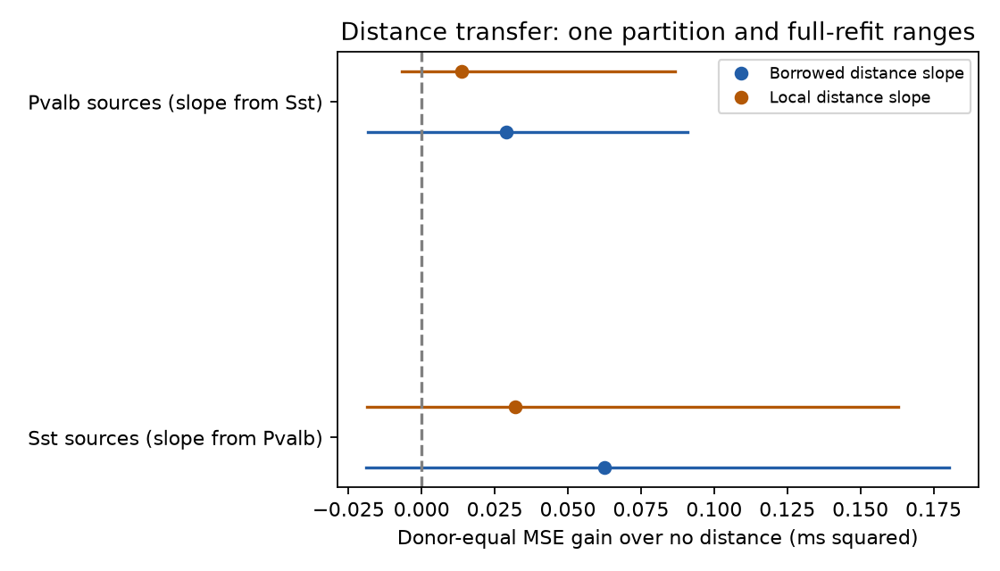

# Distance-slope transfer gave uncertain delay prediction gains between selected Allen Pvalb and Sst inputs

## Question and result

Can a distance slope learned from Pvalb source cells improve synaptic onset-delay prediction for Sst source cells? We also test the reverse direction. We use measured connections in mouse primary visual cortex slices from Allen Synaptic Physiology r2.1.

The borrowed distance slope reduced mean test error in both directions. However, the complete-refit ranges include zero in both directions. The test does not establish a transfer gain or a gain over local slope fitting. It also does not show that transfer has no value.

| Slope source to predicted source group | No-distance MSE | Borrowed-slope MSE | Five-repeat gain | Single-partition gain | Full-refit 95 percent range |
|---|---:|---:|---:|---:|---|
| Pvalb to Sst | 0.30946 | 0.26648 | 0.04298 | 0.06243 | [-0.01887, 0.18043] |
| Sst to Pvalb | 0.18044 | 0.14933 | 0.03111 | 0.02890 | [-0.01853, 0.09089] |

All errors and gains use milliseconds squared. The main estimates and the refit ranges use the distinct partition procedures stated below.

The comparison is a transfer of one slope. It is not a transfer of a complete circuit model. All other model terms are fitted with training data from the recipient source-cell group. The result does not show a common conduction speed.

Figure 1. Donor-equal mean squared error gain over a model without distance. Points use the specified single donor partition. Lines show central 95 percent ranges from 400 donor resamples with complete model refitting under one specified partition rule. The ranges describe sampling and fitting sensitivity. They are approximate, not exact population confidence intervals. The source group named on the vertical axis supplies the connections to be predicted.

## Prior work and new contribution

Campagnola, Seeman and colleagues measured local connectivity and physiology in mouse and human cortex (doi:10.1126/science.abj5861). Boudkkazi and colleagues showed that changes in the presynaptic waveform can change excitatory synaptic latency (doi:10.1113/jphysiol.2010.199653). That experiment motivates a waveform control. It does not show that intrinsic somatic width measures the waveform at an inhibitory terminal.

SCI dae3a6b51e9389ed91a40b06fb06bbee09c0251a324a627d7c875f43944eb6d1 found added distance prediction value after source width in mouse inhibitory connections. SCI f8c2b82d57840effa9396ac79c312903ba35035a28850a3bf69fbc2729a32ae7 compared source and target widths in the same release. SCI 650f6fc9a704625ebb9161676fa78488411575e71ba3393f3e2a5aa99b7d82d8 tested target calibration for a different, plasticity-based transfer task. It shows why local calibration and source information must be evaluated separately.

We extend the timing work with transfer between two source Cre groups, equal donor weights, exclusion of test donors from both source groups, and full refits under donor resampling. We reuse one release and overlapping observations. This is not independent data replication. No prior code or extracted table was reused.

Before the final question, we searched the campaign for connectome, neural structure, synaptic depression, convergent inputs, electrical coupling, synaptic release, latency jitter, rheobase, reciprocal delay, spike width delay, spike width latency, intrinsic latency synaptic, delay calcium, delay Pvalb Sst, and delay transfer cell. We read the three reports above. Search result limits prevent a claim of complete priority. We also checked the Allen registry, official methods, source definitions, and primary waveform literature. No private sibling workspace was used. The local plan in files/design.txt was saved before fitting. It is not a registered study.

## Data link and selection

Pair IDs link measured connectivity to distance and response onset. Source cell IDs link each connection to intrinsic spike width and Cre labels. This is a direct link within the recorded cells. It is not a match across animals or across atlases.

The SQL query in files/analyze.py selects detected inhibitory connections from mouse VisP. A connection needs at least one average response fit with manual QC passed. We retain finite positive latency, cell-body distance above zero and at most 500 micrometres, and an exact source Cre label of pvalb or sst. We exclude sources labeled ex by the nonsynaptic class field. The main analysis also needs a finite positive source intrinsic AP width. Missing categories in the control fields form an explicit category.

| Source Cre group | Eligible before width rule | With width | Inferred donors | Source cells | Median distance (um) | Median delay (ms) |
|---|---:|---:|---:|---:|---:|---:|
| Pvalb | 739 | 290 | 126 | 216 | 100.46 | 0.979 |
| Sst | 372 | 174 | 86 | 127 | 94.22 | 1.256 |

Latency is in milliseconds, from source spike maximum slope to fitted response onset. Distance is in micrometres. AP width is in milliseconds and comes from width_hero in separate long-square intrinsic steps. Pinned aisynphys source at commit b264d8b61abf11d015222865ca081f80655d33d4 defines these fields. URLs are in the external notice. Somatic distance is not axon path length. Somatic intrinsic width is not terminal width.

Mouse donor groups use the single distinct six-digit number in the slice specimen name. The code checks that each selected name has one such number. These are inferred groups, not an independently validated animal registry.

## Prediction method

Models are fitted separately for each source Cre group. The baseline has a free intercept, source width, source layer, target layer, target nonsynaptic class, and ACSF indicators. A local model adds distance. A borrowed model fixes its distance slope to the distance coefficient fitted in the other source group. With this coefficient b fixed, recipient-group training data fit the baseline controls to delay minus b times distance. The prediction adds b times test distance back. Thus the recipient group can set its intercept and control coefficients, but cannot change the borrowed distance slope.

Ridge penalty is 1, with no intercept penalty. Numeric features use weighted training means and SDs. Category levels come only from training records. Unseen test levels have all-zero indicators. Each donor has equal total training weight within a group; the weights sum to that group's training row count. Penalties 0.1 and 10 are specified sensitivity checks, not selected from test results.

Five-fold tests use whole inferred donors, with seeds 110712 through 110716. Every held-out donor is excluded from both group fits. Thus a donor represented in both groups cannot enter the other group's slope fit during its own test. We average squared errors across repeats and connections within donor, then across donors. Donors with more recorded connections do not get more final weight. Positive gain means smaller test MSE.

We give two uncertainty checks. A 5,000-draw donor bootstrap holds the five-repeat predictions fixed. A 400-draw bootstrap samples donors with replacement and refits the complete procedure. A sampled donor's multiplicity changes its fit and score weight. All copies stay in the same fold. Each refit uses seed 110712 to partition the sampled unique donors into five folds; it does not average five repeats. The refit ranges therefore accompany the single-split check, which is stored separately from the five-repeat main result. They include refitting but are not exact coverage guarantees. The primary direction is Pvalb to Sst. The reverse direction is secondary; no correction is claimed for all analyses or campaign-wide selection.

## Results and checks

The five-repeat borrowed gains are 13.89 percent of baseline MSE for Sst-source connections and 17.24 percent for Pvalb-source connections. Local distance fitting gives gains of 0.02989 and 0.02135 ms squared, respectively. Borrowing has lower point error than local fitting, but the full-refit difference ranges cross zero: borrowed minus local MSE is [-0.08683, 0.04332] for Sst and [-0.03616, 0.03243] for Pvalb. Thus the test does not establish a benefit of borrowing over local fitting.

The conditional ranges from fixed five-repeat predictions are:

| Predicted source group | Borrowed gain, conditional 95 percent range |
|---|---|
| Sst | [-0.00235, 0.11597] |
| Pvalb | [-0.00242, 0.08208] |

These conditional ranges and the full-refit ranges answer different sampling questions. Their difference cannot be assigned only to refitting because the partition procedure also differs. With 400 full refits, each tail depends on about ten values.

Borrowed gains stay positive at penalties 0.1, 1, and 10. For Sst the gains are 0.04611, 0.04298, and 0.03458 ms squared. For Pvalb they are 0.04251, 0.03111, and 0.02029. These are sensitivity point estimates, not extra tests of significance.

Across the 25 main fits, local Pvalb slopes range from 0.000831 to 0.003113 ms per um; local Sst slopes range from 0.001253 to 0.003831. These fold ranges describe fitted variation. They are not confidence intervals or estimates of axon speed.

The numerical check in files/check.py independently recomputes donor-equal errors from external predictions. It checks pair uniqueness, selection, prediction coverage, and donor fold assignment. Synthetic data with a known distance slope test slope recovery and cross-group prediction. The code asserts disjoint train and test donor sets in every fit. Validation output is preserved.

## Meaning and limits

A transferable slope can supply a useful distance term when a new cell group has local calibration data but a less stable distance estimate. This is a limited test of this method, not proof that both groups share the same biological mechanism. A test of equality or practical equivalence between slopes was not done. A positive gain over no distance would not prove that borrowing is better than fitting distance locally.

The sample excludes many detected connections because of width, distance, or response-fit completeness. Detection and fit selection can favor strong responses. Missing widths are not imputed, and the analysis does not identify the missing-data process. Unmeasured subclasses, axon preservation, dendritic filtering, synapse position, recording quality, and intrinsic measurement error can remain. The linear model can miss nonlinear distance effects. ACSF adjustment does not control every recording condition.

All data are from one release and one cortical region in one species. Cre labels are not complete cell types. Slices do not reproduce intact-brain paths or behavioral states. No claim is made about behavior, population representations, reliability, other brain regions, or other species. Full-refit resampling does not correct these problems or campaign-wide hypothesis selection.

Next tests should use a separate laboratory or release, direct axon path lengths, and synaptic-trial waveform measurements. A planned comparison across Pvalb and Sst recording protocols would test whether the slope survives acquisition changes. A target-data budget study could test when borrowing helps relative to local fitting. Neither test was done here.

## Reproduce and rights

The input was reused in place from datasets/allen-synphys-r2.1-small-20230126/synphys_r2.1_small.sqlite. The stable shared path is /mnt/dell-data/shared_datasets/allen-synphys-r2.1-small-20230126/synphys_r2.1_small.sqlite. Release: r2.1 small, 2023-01-26. Size: 176771072 bytes. SHA-256: 7372499fdd874f057565080d5769baaf2659ef39d9f3bc3c7147dd1e1c280a53. The analysis checks this hash before reading. The exact resolved path and software versions are in files/results.json.

The external notice supplies source URL, credit, version, and terms. The Allen source allows research use but has terms different from the baseline. No external raw record, filtered record, prediction table, source software, or third-party figure is bundled. The baseline covers our code, narrative, aggregate statistical findings, and original figure. It does not grant rights to the external source or external regenerated tables.

From an unpacked publication, install files/requirements.txt into a private Python environment. Reuse the shared source. If it is absent outside this campaign, files/retrieve.py downloads and checks a new external file. It refuses to replace a file or write into the publication. On this campaign, use the dataset helper for reusable new downloads:

    campaign-dataset allen-synphys-r2.1-small-20230126 --url https://allen-synphys.s3-us-west-2.amazonaws.com/synphys_r2.1_small.sqlite --filename synphys_r2.1_small.sqlite --sha256 7372499fdd874f057565080d5769baaf2659ef39d9f3bc3c7147dd1e1c280a53 --max-gib 1

Do not replace an existing dataset. Run the analysis with both output paths outside the signed publication:

    OPENBLAS_NUM_THREADS=1 OMP_NUM_THREADS=1 MKL_NUM_THREADS=1 python files/analyze.py --db /path/to/synphys_r2.1_small.sqlite --out /path/to/new_aggregates --scratch /path/to/external_scratch --boot 400
    OPENBLAS_NUM_THREADS=1 python files/check.py /path/to/new_aggregates/results.json /path/to/external_scratch

The run recreates aggregate scores, bootstrap draws, and the figure. Record-level extracts, fold slopes, and predictions go to separate scratch under the source terms. No private scratch is needed for reproduction. Floating-point libraries can change final digits.

## Worker record

Campaign: 11_07_2026. Job: sci-1107-dell-neural-structure-and-computation-9b9d24f69fa8. Topic: neural-structure-and-computation. Machine: dell. Account: codex-olen. Model: gpt-6.1-sol, high reasoning effort, Codex harness in T3 Code. Date: 2026-11-12. No agents were launched. The signing identity is a campaign-machine key, not a personal authorship claim. The bundle is saved locally; this worker does not upload or submit it.
