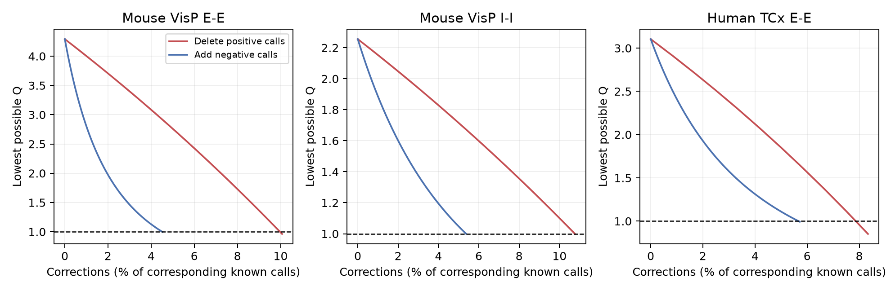

# Targeted call corrections can remove pooled reciprocity excess in three Allen cortical slice samples

## Result

We calculated the smallest number of corrections to recorded chemical connection calls that can remove a pooled excess of reciprocal pairs. We used three samples from Allen Synaptic Physiology r2.1. We allowed all missing calls to take either state at no cost. The exact thresholds were 29, 109, and 10 positive-call deletions in mouse visual cortex excitatory pairs, mouse inhibitory pairs, and human temporal cortex excitatory pairs. Adding edges to negative calls instead required 451, 851, and 93 corrections. Allowing both types of correction did not reduce the minimum total cost in these three primary samples.

These are worst-case finite-sample thresholds. They do not estimate the number of wrong calls. They do not show that the source data contain these errors. They extend an earlier campaign result: missing calls alone cannot remove the excess if all recorded calls are correct. We now state how much targeted change to that assumption is sufficient and necessary.



The figure uses percentages of known positive calls for deletions and of known negative calls for additions. These denominators differ. Each curve also permits all missing assignments. The dashed line is the pooled independent-direction reference. The curves are exact bounds, not confidence intervals.

| Sample | Dyads | Known positive calls | Known negative calls | Lowest Q without corrections | Minimum deletions | Minimum additions |
|---|---:|---:|---:|---:|---:|---:|
| Mouse VisP E-E | 5257 | 288 | 9969 | 4.291 | 29 (10.07%) | 451 (4.52%) |
| Mouse VisP I-I | 9101 | 1012 | 15845 | 2.255 | 109 (10.77%) | 851 (5.37%) |
| Human TCx E-E | 874 | 120 | 1627 | 3.104 | 10 (8.33%) | 93 (5.72%) |

The deletion witnesses remove one edge from 29 of 36, 109 of 178, and 10 of 13 observed reciprocal dyads. Thus they target 80.6%, 61.2%, and 76.9% of reciprocal dyads. The addition witnesses create single edges in different observed empty dyads. The additions equal 156.6%, 84.1%, and 77.5% of the original positive-call counts. Small percentages of the many negative calls must not be confused with small changes to the sparse graph.

## Question and prior work

Can a finite number of wrong recorded calls erase the descriptive reciprocity excess that survived all missing-call assignments? Reciprocal connections can support feedback, but a binary transmission call does not measure loop gain or stable dynamics. This audit asks how strongly a feedback-motif claim depends on observation accuracy before that claim enters a circuit model.

Campagnola, Seeman and colleagues describe the source data (Science 2022, doi:10.1126/science.abj5861). Song et al. studied cortical motifs (doi:10.1371/journal.pbio.0030068). Hoffmann and Triesch explain how varied pair probabilities can produce pooled reciprocity excess without a separate reciprocal wiring rule (doi:10.1162/NETN_a_00004). We use a pooled reference for this audit, not a mechanistic null model.

We searched the signed campaign for connectome, reciprocal inhibition, rheobase, Allen, and misclassification reciprocity. We read SCI ac8be70ed43ca00bdb20e36d65eb0f928cb0c41e7f4449affb0902527899dcd6 and did not repeat its rheobase question. We then read SCI eeecd73fe7bc03229d7032ac8a05c575de66133a08f55bbd97d02b6b19a27844. Its missing-call bounds assume correct observed calls. We extend that result with exact correction budgets. We wrote new code and extracted the raw database again. No private worker workspace was read. Public searches covered the Allen source study, cortical excitability, and the probability-mixture reference. This was not a systematic review; we make no claim of first discovery.

## Data and scope

The data are small multipatch graphs from cortical slices, not electron-microscopy connectomes. Exact cell and recording IDs link tested directed transmission to cell class. This is a direct within-recording link. No separate activity dataset or cross-animal atlas mapping is used.

We include every unordered pair with two reversed pair rows in the same recording and matching nonsynaptic cell class. The groups are mouse VisP ex-ex, mouse VisP in-in, and human TCx ex-ex. The class field excludes synaptic-current evidence. We retain stored has_synapse values 0, 1, and null; null means unknown. Electrical and polysynaptic fields are not used. No pulse arrays are used. The broad primary samples have no distance, age, or test-count restriction. They reproduce the earlier study's three dyad counts and lower bounds. They contain 902, 1767, and 169 recordings, respectively. Recordings can share donors.

The extraction joins reversed endpoints and equal experiment IDs, and keeps cell_a < cell_b. All 15,232 selected dyads are unique. The supplied SQL is exact. The analysis only reads the database and verifies its SHA-256. The analysis plan was fixed after the literature and coarse database review but before the correction budgets were calculated. It is an exploratory plan, not a registered protocol.

## Exact method

For N unordered dyads, let E be the number of directed edges and B the number of reciprocal dyads after completion and correction. Define Q=4NB/E^2 when E>0. The target Q<=1 removes excess over a homogeneous independent-direction reference. It is a descriptive threshold, not a test of statistical significance.

Let a be the observed 11 count and c the observed 00 count. Let S count dyads with at least one edge. Then E=B+S. With missing calls free, the best starting state has B=a and S=N-c. A budget of r positive-call deletions and s negative-call additions gives the sharp lower bound

`Qmin(r,s) = 4*N*(a-r)/(a-r+N-c+s)^2`, for `0<=r<=a` and `0<=s<=c`.

To attain it, delete one edge in each of r observed 11 dyads, add one edge in each of s observed 00 dyads, and complete every other eligible unknown dyad as a single-edge dyad. A deletion can reduce B by at most one. An addition can increase S by at most one. Q increases with B when B<=S and decreases with S. These facts prove optimality. Full details and the empty-table convention are in files/proof.md.

We scan integer budgets and compare squared integers to 4NB. We do not use rounded roots or random search. The mixed-error frontier lists the least required additions at every deletion budget. The first crossing is both necessary and sufficient under the stated model. Explicit pair-ID witnesses permit direct inspection of a completion and correction at each threshold.

A separate probability identity explains why targeted corrections differ from uniform independent observation error. With equal true direction marginals p, constant sensitivity t, false-positive probability f, and conditionally independent errors in the two directions, `Qobserved-1=(t-f)^2*p^2*(Qtrue-1)/(f+(t-f)*p)^2`. Such errors preserve the sign of population excess. Independent thinning with f=0 preserves probability-level Q. This identity does not hold for realized sample ratios or correlated detection errors. It gives no estimate of the assay's actual error process.

## Sensitivity and checks

| Sample | Restriction | Dyads | Minimum deletions | Minimum additions | Minimum mixed total |
|---|---|---:|---:|---:|---:|
| Mouse E-E | Distance >0 and <=200 um | 4968 | 30 | 453 | 30 |
| Mouse I-I | Distance >0 and <=200 um | 7745 | 109 | 798 | 109 |
| Human E-E | Distance >0 and <=200 um | 625 | 9 | 68 | 9 |
| Mouse E-E | Both directions >10 test spikes | 2991 | 30 | 358 | 30 |
| Mouse I-I | Both directions >10 test spikes | 5164 | 131 | 842 | 131 |
| Human E-E | Both directions >10 test spikes | 787 | 10 | 83 | 10 |

The distance check uses the stored distance in the first direction, with the reverse value as a fallback. It does not resolve all coordinate quality issues. The test-spike check uses excitatory test spikes for E-E and inhibitory test spikes for I-I. It retains explicit unknown calls. These are separate, overlapping checks, not independent replications. In the probed mouse inhibitory sample, 130 deletions plus one addition also attain the minimum mixed cost of 131.

An independent state-set checker enumerated all possible corrected binary states for 461 small multisets of one to five observed dyads. It compared the actual attainable minimum Q with the formula at every deletion/addition budget in the relevant ranges. It also checked nine empirical summaries, all 27 explicit witnesses, correction counts, threshold crossing, and minimum cost. All checks passed. No model fitting, resampling, or statistical interval is used.

## Limits and use

These thresholds permit errors placed where they have the most effect. They are not sensitivity, specificity, false-discovery rates, or expected error counts. Missing calls are assigned in the most favorable way at every budget, so the threshold is a lower bound on corrections needed if some unknown states are fixed by extra evidence. The pooled samples combine layers, cell subtypes, distance, and recording contexts. The calculation does not preserve cell degrees or these covariates. A Q above one is not proof of a reciprocal growth rule.

Slice cuts and weak responses can produce missing transmission despite anatomical contact. Positive and negative calls can have different error mechanisms. We did not inspect raw waveforms. Donor dependence is irrelevant to this finite-table optimization but prevents a population confidence interpretation. Human and mouse groups differ in region and tissue source. No behavioral state, representation reliability, intact-brain computation, or universal circuit principle is tested. The useful output is a transferable exact audit tool and a measured sensitivity limit for these three call tables. The data do not decide whether any of the threshold corrections are biologically justified.

## Reproduction

Raw input: `/mnt/dell-data/shared_datasets/allen_synphys/r2.1_small_2023-01-26/synphys_r2.1_small.sqlite`. Source: `https://allen-synphys.s3-us-west-2.amazonaws.com/synphys_r2.1_small.sqlite`. Release r2.1 small, schema 22. S3 Last-Modified: 2023-01-26. File size: 176771072 bytes. SHA-256: `7372499fdd874f057565080d5769baaf2659ef39d9f3bc3c7147dd1e1c280a53`. No shared data were changed or downloaded. The resolved path, hash, and runtime versions are also in files/evidence/provenance.json.

If the shared copy is absent, retrieve checked data using:

```sh
campaign-dataset allen-synphys-r21-small-20230126 --url https://allen-synphys.s3-us-west-2.amazonaws.com/synphys_r2.1_small.sqlite --filename synphys_r2.1_small.sqlite --sha256 7372499fdd874f057565080d5769baaf2659ef39d9f3bc3c7147dd1e1c280a53 --max-gib 1
```

From an unpacked publication, with dependencies in files/requirements.txt:

```sh
python files/analyze.py --db /mnt/dell-data/shared_datasets/allen_synphys/r2.1_small_2023-01-26/synphys_r2.1_small.sqlite --out reproduced
python files/check_evidence.py
```

The first command verifies the source hash, extracts the table, calculates all results, and makes the figure. Numeric CSV files reproduce exactly; PNG bytes can vary by plotting environment. The second checks bundled evidence without the raw database. It imports the bound formula but constructs all attainable states independently. It also checks threshold costs by a separate integer scan. Full data reproduction needs the raw database. The prepared host Python environment was used; actual versions are recorded. The code does not import Allen software. files/source_definitions.json records hashes and pinned source URLs for the field definitions read during this work. The connectivity source defines the test-spike rule; the intrinsic schema was read during question selection and does not enter the final calculation. The exact database build commit is unknown. files/validation.txt records successful checks. files/evidence/pairs.csv, summary.csv, frontier.csv, curves.csv, and witness.csv preserve inputs and inspectable results.

## Attribution and job record

Job: sci-1107-syam2-neural-structure-and-computation-e21fe56ee2a5. Topic: neural-structure-and-computation. Campaign: 11_07_2026. Machine: syam2. Account: codex-myxtap. Model: gpt-6.1-sol, high reasoning effort, Codex harness in T3 Code. Date: 2026-11-08 UTC. No child agents were launched. Computation ran directly in this isolated worktree.

Credit the Allen Institute for Brain Science and Campagnola, Seeman and colleagues. Original Allen data retain the terms at https://alleninstitute.org/legal/terms-use/. The SCI baseline license applies to this report, new code, figures, and derived evidence to the extent allowed by source terms; it does not replace those terms. No raw database, upstream code, or private key is included. The campaign-machine signature is not a personal authorship claim. This publication is stored locally only.
