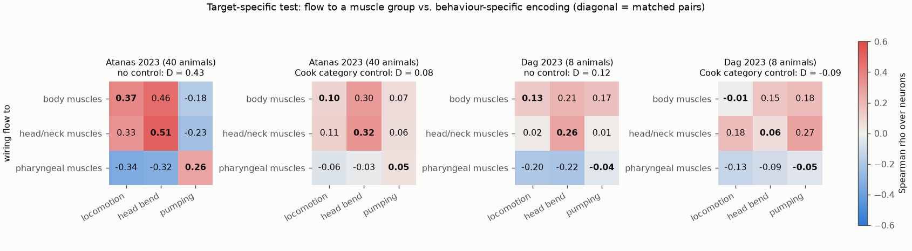
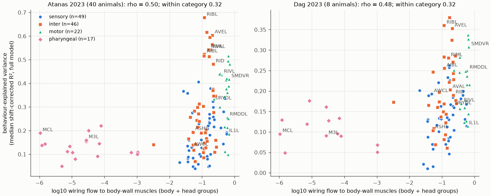
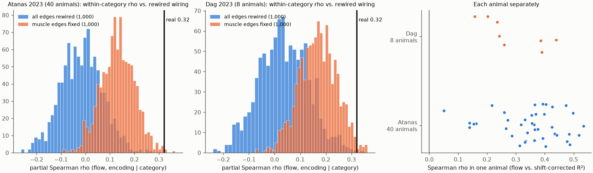

# In two freely moving C. elegans data sets, wiring flow to body-wall muscles predicts how much behaviour explains head neuron activity, but not which body behaviour is encoded

## Summary

We asked whether the position of a head neuron in the C. elegans wiring diagram tells which ongoing behaviour its calcium activity encodes. We used the Cook et al. (2019) hermaphrodite connectome and whole-brain activity of NeuroPAL-identified neurons in freely moving worms. We used two data sets from one laboratory: Atanas, Kim et al. (2023; 40 animals) and Dag et al. (2023; 8 labelled animals). For each neuron, we calculated a damped random-walk "flow" from the neuron to three muscle groups: body-wall muscles of the body, body-wall muscles of the head and neck, and pharyngeal muscles. We compared these flows with the variance of the neuron's activity that locomotion, head bending and pumping explain.

Main results:

1. **Pre-specified target-specific test: partly supported, mainly by the pharynx-versus-body-wall division.** In Atanas, the matched-minus-mismatched contrast D of the 3 × 3 flow-by-behaviour Spearman matrix is 0.43 (bootstrap 95% interval 0.28 to 0.56). It is larger than in 1,000 fully rewired connectomes (p = 0.001) and than in 1,000 rewirings that keep each neuron's muscle edges (p = 0.005). In Dag, D is 0.12 (interval 0.02 to 0.22; p = 0.009 against full rewiring, p = 0.72 against rewiring with muscle edges fixed). With a control for the Cook neuron category, D falls to 0.08 in Atanas (label permutation p = 0.06) and to −0.09 in Dag. **Among non-pharyngeal neurons, flow to head muscles versus body muscles does not separate head-bending encoding from locomotion encoding** (2 × 2 contrast 0.05, p = 0.18 in Atanas; 0.10, p = 0.11 in Dag; ≤ 0 with category control). Head-bending encoding is predicted equally by flow to either group (Figure 1).
2. **Exploratory gradient (not pre-specified): total flow to body-wall muscles predicts total behaviour encoding.** Spearman rho over neurons is 0.50 (134 neurons, Atanas) and 0.48 (110 neurons, Dag). With the category control, the partial rho is 0.32 in both data sets. In rewired connectomes that keep each neuron's direct muscle edges and all degrees, the mean partial rho is 0.13 (Atanas) and 0.17 (Dag), and the real values exceed them (p = 0.004 and 0.013). The gradient is present within interneurons (rho 0.36 and 0.42) and within sensory neurons (0.38 and 0.33), but not clearly within motor neurons. It is positive in each of the 40 Atanas animals and in each of the 8 Dag animals (Figures 2 and 3).
3. **Pre-specified reliability test: not supported.** Motor flow does not predict how similar the encoding vector of a neuron is across animals (rho 0.11, p = 0.21; and 0.01, p = 0.92). For neurons with the same encoding strength, the relation is negative (partial rho −0.34, p = 0.0002 in Atanas; −0.17, p = 0.07 in Dag).
4. **Limitation of size.** The gradient depends on the outcome measure. With plain in-sample R² or cross-validated R² in place of the shift-corrected R², rho is 0.21 to 0.38, and the category-controlled partial rho is 0.11 to 0.27. Its sign stays positive in all 120 tested combinations of data set, flow definition, outcome and inclusion threshold, but some partial values are near zero (minimum 0.003).

## Question and hypotheses

The pre-specified plan is in `files/PLAN.md`. The deviations from it are listed at the end of that file and in "Deviations" below.

- H1: the flow from a neuron to a motor target group predicts the encoding of the behaviour that this group produces (body muscles → locomotion; head and neck muscles → head bending; pharyngeal muscles → pumping).
- H2: the H1 contrast with the real connectome is larger than with degree-preserving rewired connectomes.
- H3: total motor flow predicts how reliably the encoding of a neuron repeats across animals.

## Data

| Item | Value |
|---|---|
| Activity data set A | Atanas, Kim et al. 2023, Zenodo 19388374. 40 NeuroPAL-labelled animals, 1.7 volumes per second. 19 recordings have a heat stimulus; for these we used only the frames before the stimulus (about 800). Other recordings have 1,600 to 1,615 frames. |
| Activity data set B | Dag et al. 2023, Zenodo 19414639. The 8 NeuroPAL-labelled recordings, 799 to 800 frames each. We did not separate them by experimental condition. |
| Labels | NeuroPAL confidence ≥ 3; labels with "?" and duplicate labels removed. 51 to 111 labelled neurons per animal. |
| Neurons analysed | Atanas: 134 (seen in ≥ 5 animals; median 28 animals). Dag: 110 (seen in ≥ 3 animals; median 6). |
| Connectome | Cook et al. 2019, SI 5, corrected July 2020: hermaphrodite chemical (EM sections) and symmetric gap junction sheets; 300 neurons, 149 end organs, 4,841 chemical and 2,297 gap entries from neurons. |

Paths, versions and SHA-256 values are in `files/PROVENANCE.md` and `files/derived/used_h5_sha256.csv`.

## Methods

**Flow** (`files/code/01_connectome.py`). W = chemical sections (i → j) + gap junction sections (i ↔ j) for each neuron source. P is W normalised by the total output of each neuron. End organs absorb the walk. Groups: body = body-wall muscle rows 9 to 24 (63 cells); head = rows 1 to 8 (32 cells); pharynx = pm and mc cells (21); other end organs (33) absorb without a group. Flow_g(i) = Σ_{k=1..8} a^(k−1) × P(first absorption in group g at step k), with a = 0.5. The predictor is log10(flow + 10⁻⁶). Robustness: a = 0.8, chemical synapses only, and hop distance.

**Rewired connectomes.** "All": directed target swaps of all chemical edges (including edges to muscles) and undirected swaps of gap junctions; this keeps in-degree, out-degree and out-strength. "Muscle edges fixed": the same swaps only for neuron-to-neuron edges. 5 successful swaps per edge, 1,000 connectomes for each null. About 7–8% of edges stay in place.

**Encoding** (`files/code/02_activity.py`). For each animal, we z-scored the traces. Each behaviour variable was z-scored and passed through causal exponential filters (τ = 1, 5, 15 and 50 frames). Groups: locomotion = velocity and reversal state; head bending = head angle and angular velocity; pumping = pumping rate; full model = all of these and body curvature. The primary outcome is the shift-corrected R²: in-sample R² of the group model minus its mean over 20 circular shifts of the behaviour design (shift between T/5 and 4T/5). This subtracts the R² that slow, autocorrelated signals give by chance. The neuron value is the median over animals. Encoding vector: the correlations of the trace with the τ = 5 filtered velocity, head angle and pumping. Reliability: mean cosine similarity of this vector over pairs of animals.

The known neurons give expected values in Atanas. Locomotion R² is 0.64 to 0.75 for AVA, AVE, AIB and RIB. Head-bending R² is 0.37 for SMDVR and 0.43 for RIVL. Pumping R² is 0.15 to 0.21 for M3, MC and I2. All other neurons have lower values (`files/results/analysis/neurons_atanas.csv`).

**Tests** (`files/code/03_analysis.py`). S is the 3 × 3 Spearman matrix over neurons. D = mean(diagonal) − mean(off-diagonal). D2 is the same contrast for the 2 × 2 body/head sub-matrix in non-pharyngeal neurons. Category control: ranks residualised on Cook category (pharyngeal, sensory, inter, motor). Nulls: 10,000 label permutations (within category for the controlled version), and the two sets of 1,000 rewired connectomes. Per-animal tests use each animal's own neurons and R² values (sign test). Robustness (`files/code/04_robustness.py`) covers flow definitions, outcomes and inclusion thresholds.

## Results

### Figure 1. Target-specific test

Spearman rho between flow to each muscle group (rows) and each behaviour-group R² (columns). The diagonal is the matched pair. Left two panels: Atanas without and with category control. Right two panels: Dag.

| Data set | Control | D | p (labels) | p (all rewired) | p (muscle edges fixed) | D2 (non-pharyngeal) | p (labels) |
|---|---|---|---|---|---|---|---|
| Atanas | none | 0.43 | 0.0001 | 0.001 | 0.005 | 0.05 | 0.18 |
| Atanas | category | 0.08 | 0.06 | 0.023 | 0.13 | −0.01 | 0.57 |
| Dag | none | 0.12 | 0.014 | 0.009 | 0.72 | 0.10 | 0.11 |
| Dag | category | −0.09 | 0.98 | 0.93 | 0.90 | −0.15 | 0.97 |

The mean D of the rewired connectomes with muscle edges fixed is 0.35 (Atanas) and 0.14 (Dag) without control. Thus, the direct muscle edges alone give most of the uncontrolled contrast. Per animal, D > 0 in 39 of 40 Atanas animals and in 7 of 8 Dag animals; D2 > 0 in 26 of 40 (sign test p = 0.08) and 6 of 8. With a = 0.8 or chemical-only flow, the values are similar (Atanas D 0.42 and 0.44; category-controlled 0.07 and 0.09; `files/results/analysis/results.json`).

### Figure 2. Motor-flow gradient

Each point is one neuron. Horizontal: log10 flow to body-wall muscles (body + head groups). Vertical: median shift-corrected R² of the full behaviour model. Colour and marker show the Cook category.

| | Atanas | Dag |
|---|---|---|
| Neurons | 134 | 110 |
| Spearman rho | 0.50 (p = 1 × 10⁻⁹) | 0.48 (p = 1 × 10⁻⁷) |
| Partial rho, category control | 0.32 | 0.32 |
| Null, all rewired (mean ± SD, partial) | −0.02 ± 0.08; p = 0.001 | 0.04 ± 0.10; p = 0.002 |
| Null, muscle edges fixed (mean ± SD, no control) | 0.36 ± 0.04; p = 0.002 | 0.37 ± 0.04; p = 0.004 |
| Null, muscle edges fixed (mean ± SD, partial) | 0.13 ± 0.07; p = 0.004 | 0.17 ± 0.07; p = 0.013 |
| Partial rho, category + out-degree | 0.32 | 0.32 |
| Partial rho, category + direct muscle weight | 0.28 | 0.21 |
| Partial rho, category + minimum hop count | 0.32 | 0.21 |
| Partial rho, category + data quality (number of animals, lag-1 autocorrelation) | 0.35 | 0.25 |
| Within interneurons | 0.36 (n = 46, p = 0.014) | 0.42 (n = 33, p = 0.016) |
| Within sensory neurons | 0.38 (n = 49, p = 0.008) | 0.33 (n = 44, p = 0.027) |
| Within motor neurons | 0.05 (n = 22, p = 0.82) | 0.19 (n = 20, p = 0.41) |
| Animals with rho > 0 | 40 of 40 (median 0.36) | 8 of 8 (median 0.25) |

### Figure 3. Nulls and single animals

Left and middle: category-controlled partial rho of the real connectome (black line) and of 1,000 rewired connectomes of each type. Right: rho in each animal.

### Robustness of the gradient

`files/results/analysis/robustness.csv` gives 120 values (2 data sets × 2 inclusion thresholds × 5 flow definitions × 6 outcomes). All 120 rho values are positive (0.06 to 0.60). For the primary flow, rho is 0.32 (Atanas) and 0.38 (Dag) with plain in-sample R², and 0.26 and 0.21 with cross-validated R². The category-controlled values for these outcomes are 0.11 to 0.27. The hop-count version gives rho 0.38 and 0.45, with category-controlled values 0.12 and 0.25. When we use only neurons seen in at least twice the minimum number of animals, the gradient stays at 0.48 (Atanas, 119 neurons) and 0.45 (Dag, 76 neurons). In Dag, the gradient comes from head-bending encoding more than from locomotion encoding (rho 0.33 versus 0.08).

### Reliability (H3)

| | Atanas | Dag |
|---|---|---|
| rho (motor flow, cross-animal reliability) | 0.11 (p = 0.21) | 0.01 (p = 0.92) |
| partial rho given encoding strength | −0.34 (permutation p = 0.0002) | −0.17 (p = 0.07) |

## Interpretation

The flow measure captures one main axis: how directly a neuron feeds body-wall muscles. Neurons high on this axis (premotor interneurons and head motor neurons) have more behaviour-explained activity. This is also true among sensory neurons and among interneurons. Its prediction is better than that of rewired connectomes with the same degrees and the same direct muscle edges. Thus the multi-step routing in the real wiring diagram adds to the prediction. But the specific muscle group that a somatic neuron feeds (head versus body) does not tell which body behaviour it encodes. The pharyngeal versus somatic division gives most of the pre-specified target-specific result, and the neuron category explains this division.

A mouse study in this campaign (`sci:sha256:19f7eb8e…`) found that a distance-from-input gradient of visual response reliability was predicted equally well by distance-preserving rewired connectomes. Here, in the worm, the real routing to the output side gave a better prediction than rewired wiring. The two studies use different species, measures and nulls, so this is not a direct comparison.

## Deviations from the plan

1. The pre-specified cross-validated R² was negative for most neurons (slow drift), so we replaced it by the shift-corrected R² before we calculated any flow–encoding relation. The cross-validated values are reported in the robustness table.
2. We added the second rewiring null (muscle edges fixed). We used 5 swaps per edge.
3. The motor-flow gradient (result 2) was defined after we saw the H1 result. It is exploratory.

## Limitations

- The connectome is from one animal (Cook 2019, hermaphrodite) and the activity is from other animals. We did not repeat the analysis with the Witvliet 2021 nerve-ring connectomes, because they do not include muscles.
- Both data sets are from one laboratory and use the same pipeline. The Dag set has only 8 labelled animals of about 8 minutes each. We did not separate its recordings by condition.
- Only head neurons are imaged. Ventral cord motor neurons, which carry most of the flow to body muscles, are not in the activity data.
- The shift-corrected R² is a heuristic correction for autocorrelation. It is not a calibrated test of encoding in each neuron. The size of the gradient depends on the outcome definition (see Robustness).
- Behaviour variables are correlated (for example, pumping and locomotion state), especially in Dag. Group-specific R² values are therefore not independent.
- The flow measure is a linear, unsigned random walk. It ignores synapse sign, neuromodulation and extrasynaptic signalling.
- Correlations over neurons are not causal. The p values are not corrected over the many secondary tests.

## Reproduction

`files/code/run_all.sh` runs all steps (data extraction, flows and 2 × 1,000 rewirings, encoding, tests, robustness, figures). It needs Python 3.12 with the packages in `files/code/requirements.txt`. With single-threaded BLAS on 8 cores, the full run takes about 30 minutes; it takes longer on a loaded machine. Derived tables: `files/results/connectome/` (flows, rewired flows), `files/results/activity/` (one row per neuron and animal), `files/results/analysis/` (neuron tables, test results, null distributions, per-animal values).

## Provenance

Job sci-1107-hp-neural-structure-and-computation-55aab758f623, campaign 11_07_2026, topic neural-structure-and-computation, machine hp, model Claude Opus 5.5 (claude-opus-5-5). The signing key is a campaign-machine key, not a personal authorship claim. Data sources and hashes: `files/PROVENANCE.md`.
