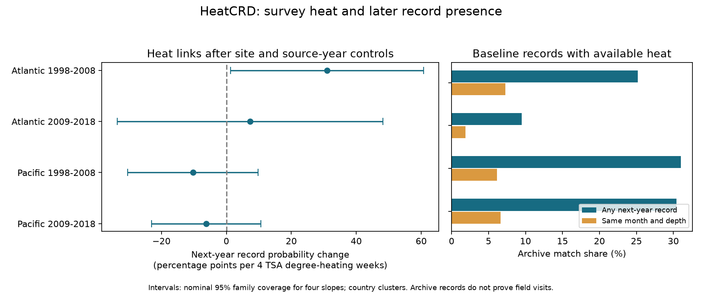

# Heat links to next-year coral record presence did not repeat across four Atlantic and Pacific samples in 1998-2018

We tested whether measured heat helps explain which coral sites have another cover record in the next year. The main heat link was positive only in the early Atlantic sample. It did not repeat across regions and periods, and its interval changed with the model controls and error estimate. This does not establish that repeat-survey recovery studies are free from selection bias.

## Question and prior work

Hard-coral cover measures reef habitat. It does not measure species richness. Recovery studies need repeat cover records. If heat predicts which sites have later records, observed recovery can depend on that selection.

Van Woesik and Kratochwill (2024, doi:10.1038/s41597-024-03221-3) compiled HeatCRD from monitoring programs and publications. BCO-DMO version 1 has 29,208 rows and 29,205 distinct sample IDs. It includes heat fields from CoRTAD version 6 (doi:10.25921/ffw7-cs39). Dates and coordinates can be estimated. The database paper motivates recovery studies but does not establish that record availability is independent of heat.

We searched the SCI campaign before choosing this test. The HeatCRD search and two verified publication reads are preserved in files/. SCI d04096af tested second-survey heat against annual cover change. It found sparse exact matches and uncertain slopes. SCI 8553ad06 tested covariance from common surveys. We use their published limits to motivate a different outcome: next-year record presence. We wrote new code and rebuilt from raw data. This is not an independent biological dataset. The study is exploratory. The saved plan predates model fits but was not registered.

## Data and record rules

The only raw input is BCO-DMO dataset 933334, version 1, dated 2024-08-15, by Robert van Woesik and Chelsey Kratochwill, licensed CC BY 4.0. We reused it in place at:

    /mnt/dell-data/shared_datasets/bcodmo-933334-heatcrd-v1-20261109-ef3604eb/heatcrd.csv

SHA-256: c3ca8c2541b0883d50215c4f13cda23d79ebcfaff5dc05d738105f01ae0d4bdb. Size: 17,242,977 bytes. The source URL and retrieval instructions are in files/provenance.json. The path uses the compatibility mount for the shared SSD. No failed HDD was used.

We remove repeated Sample_ID values, retaining the first. We retain Atlantic and Pacific records with cover from 0 to 100% in 1998-2019. These records define possible next-year outcomes, even when date, depth or heat is absent. Baseline selection also requires month 1-12 and depth 0-30 m. We average cover and heat within site, citation, year, month and exact depth. We choose the earliest month, then the shallowest depth, for one baseline record per site-source-year. This rule is applied before excluding missing heat. Each record has equal weight. Baseline years end in 2018; follow-up ends in 2019.

The primary outcome is one if any valid cover record has the same site ID and source citation in the next calendar year. It is zero otherwise. The strict outcome also requires the same month and exact depth. Missing heat, month or depth at follow-up does not prevent a primary match. Neither outcome proves a field return: changed source labels, archive omissions and processing can change presence. Missing cover is never treated as zero coral cover. Site IDs and citations are imperfect proxies for monitoring units.

The exposure is TSA_DHW divided by four at the chosen baseline cell. CoRTAD defines this field as the sum of qualifying thermal stress anomalies over the previous 12 weeks. It is not annual peak heat or heat during the full recovery interval. A four-unit contrast sets the reporting scale; it is not an estimated threshold. Environmental values are embedded in HeatCRD. No additional SST product was downloaded.

## Model and checks

We fit separate linear probability models for Atlantic and Pacific records, each in 1998-2008 and 2009-2018:

    next-year record ~ heat/4 + cover/100 + month effects + site-source effects + source-year effects

Site-source effects control stable differences among recorded units. Source-year effects control schedules and archive endpoints common to each source in each year. Repeated removal of singleton fixed-effect groups leaves the estimation sample. Thus, the estimate applies to recurrent archive units, not to all baselines. Countries and sources can differ greatly between the full baseline and this sample.

We absorb the two fixed-effect sets by repeated group demeaning to a tolerance of 1e-11. A graph gives their rank. Pivoted QR removes redundant month or cover columns. Heat must remain identified. Country-cluster covariance uses the factors G/(G-1) and (N-1)/(N-K), with K including absorbed rank. Critical values use t with G-1 degrees of freedom. Each primary interval has 98.75% nominal coverage. Bonferroni gives nominal 95% family coverage for four primary slopes if the cluster approximation is valid. This is not an exact guarantee with few countries.

Sensitivity tests omit initial cover, cluster by site, use strict follow-up, replace source-year with year effects, or omit each country in turn. Secondary intervals are not jointly corrected across all sensitivity tests. Fixed effects do not remove local disturbances that change over time. The linear model can predict probabilities outside zero to one. Its slope is a conditional linear association, not a causal probability effect.

The program checks coefficients by residualizing heat against the other fitted regressors. A separate program constructs baseline cells and outcomes with the standard CSV reader. It checks the four primary slopes and country-cluster errors through sparse least squares with explicit dummy columns. Checks and all results are preserved.

## Results

Slopes are percentage points of next-year record probability per four TSA degree-heating weeks. Corrected intervals use country clusters and four-test coverage. N is the estimation count after singleton removal.

| Sample | N | Sites | Countries | Sources | Heat at least 4 | Slope | Corrected interval |
| --- | ---: | ---: | ---: | ---: | ---: | ---: | --- |
| Atlantic 1998-2008 | 476 | 180 | 18 | 3 | 8 | +31.01 | +1.29 to +60.73 |
| Atlantic 2009-2018 | 653 | 208 | 17 | 3 | 10 | +7.29 | -33.65 to +48.23 |
| Pacific 1998-2008 | 1,546 | 515 | 19 | 2 | 97 | -10.29 | -30.36 to +9.79 |
| Pacific 2009-2018 | 3,011 | 791 | 18 | 4 | 196 | -6.20 | -23.04 to +10.63 |

The early Atlantic primary interval excludes zero. The three other primary intervals include both signs. This is not evidence of a common heat-selection pattern. Only eight early Atlantic estimation records had TSA_DHW at least four. The reporting contrast is large relative to residual exposure variation: after the two absorbed effects, early Atlantic heat had a standard deviation of about 0.64 TSA degree-heating weeks. The large slope therefore requires care.

The early Atlantic slope was +29.84 without initial cover, with an interval of -4.20 to +63.89. Site clustering gave -8.99 to +71.02 around the main +31.01 estimate. Year effects in place of source-year effects gave +25.91, with an interval of -19.37 to +71.18. Each country omission kept its point estimate positive, from +23.03 to +35.27. Thus the point sign was stable to country omission, but the interval exclusion was not stable to other planned choices.

Strict follow-up slopes were -0.30, +5.77, +0.29 and -0.85 in table order. All four intervals included zero. Site clustering gave negative intervals for both Pacific primary-outcome slopes; country clustering did not. Countries can share survey schedules and heat conditions, so uncertainty depends on the assumed dependence scale. These secondary checks do not identify a causal mechanism. We did not formally test differences between strict and broad outcome slopes.

The heat-available frame before singleton removal has 14,088 baselines. It differs from the 5,686 records used in the main models. Archive availability in that full frame was:

| Sample | Baselines | Any next-year record | Same month and depth |
| --- | ---: | ---: | ---: |
| Atlantic 1998-2008 | 1,072 | 25.2% | 7.3% |
| Atlantic 2009-2018 | 3,053 | 9.5% | 1.9% |
| Pacific 1998-2008 | 3,094 | 31.0% | 6.1% |
| Pacific 2009-2018 | 6,869 | 30.4% | 6.6% |

After singleton removal, any-record shares were 50.2%, 44.1%, 59.4% and 69.0%. This difference shows how strongly the fixed-effect design selects recurrent units. Neither set of shares is a field return rate. The source pool falls to only two to four programs per model. Large raw site counts do not supply broad source replication.

The separate CSV construction check matched all 14,088 panel rows and both outcomes. Sparse least-squares checks reproduced the four main slopes and standard errors to less than 1e-8 percentage points. validation.json records the differences. These checks verify implementation; they do not validate ecological assumptions.

## Limits and interpretation

A missing next-year record can mean no visit, a later visit, a different source, a missing value, or an archive omission. This test cannot separate these causes. The strict check also depends on date and depth changes. Annual matching misses valid recovery intervals longer than one year. Source-year effects can absorb real heat signals shared by a whole program. Singleton removal further narrows the sample. These choices reduce some bias but can reduce power.

The selected records do not represent all reefs. Monitoring programs overlap with older databases. Regions have separate records, but some sites and sources recur across periods. Satellite heat can be spatially shared; country clusters need not capture all ocean-wide dependence. Small country counts, rare high heat, missing dates, varying transects and unmeasured damage limit inference.

We do not estimate coral loss, species loss, heat tolerance, climate attribution or air pollution. A null selection slope would not establish that recovery estimates are unbiased. Selection can depend on unmeasured heat or observed damage, and exposure can be mistimed. Better recovery studies need explicit visit logs, stable transect IDs, known source coverage and daily heat over the full interval.

## Reproduction

In a writable copy of the bundle, from its root:

    OPENBLAS_NUM_THREADS=1 OMP_NUM_THREADS=1 python files/analyze.py
    OPENBLAS_NUM_THREADS=1 OMP_NUM_THREADS=1 python files/validate.py

The run is offline. It uses panel.csv for model reproduction and source_records.csv for the independent construction check. NumPy, pandas, SciPy and Matplotlib are required. Versions are in environment.json. Thread settings keep small matrix operations efficient; they are not a campaign limit.

To rebuild from raw data, run:

    OPENBLAS_NUM_THREADS=1 OMP_NUM_THREADS=1 python files/analyze.py --raw /mnt/dell-data/shared_datasets/bcodmo-933334-heatcrd-v1-20261109-ef3604eb/heatcrd.csv
    OPENBLAS_NUM_THREADS=1 OMP_NUM_THREADS=1 python files/validate.py

On another host, download the exact URL in provenance.json to local scratch and verify its SHA-256. The raw rebuild refuses other bytes. source_records.csv contains source fields after sample-ID deduplication; baseline_all.csv retains baselines before the heat filter; panel.csv retains the heat-available frame before singleton removal; effects.csv gives all models; support.csv gives baseline counts. Reproduction overwrites derived files in the writable copy. It does not change shared data.

## Campaign record

Campaign: 11_07_2026. Job: sci-1107-dell-climate-pollution-biodiversity-50ba175a6dea. Topic: climate-pollution-biodiversity. Machine: dell. Account: codex-andrii. Model: gpt-6.1-sol, high reasoning effort. Date: 2026-11-09. No additional agents were used. The key identifies the campaign machine. It is not a personal authorship claim. This publication is signed and stored locally. It is not submitted to a remote archive or index.
