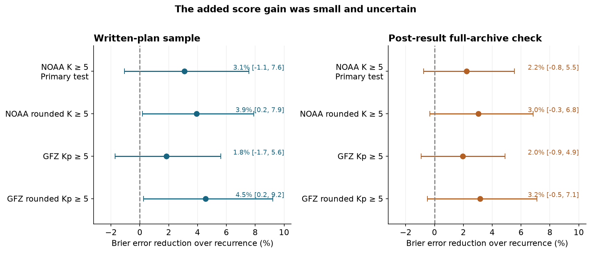
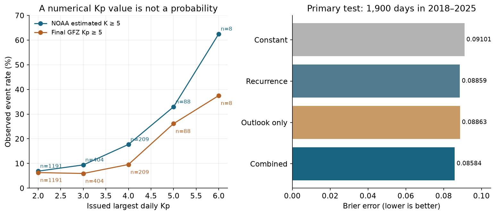

# SWPC 27-day outlooks gave no clear added daily storm probability skill beyond a recurrence model in 2018-2025

## Result

We tested a new product within this campaign's hazard forecast work: the NOAA Space Weather Prediction Center (SWPC) 27-day numerical outlook. We asked if its issued values add daily storm probability skill beyond a model of conditions one solar rotation earlier. The issued outlook gives numerical indices. It does not issue the probabilities that we test here. We fit the same probability model to each source of information before the test years.

The primary test gave no clear added skill. For 1,900 sampled days in 2018-2025, the addition of the issued outlook reduced Brier error by **3.10%**, with a conditional 95% block interval of **-1.07% to +7.55%**. The baseline already used solar rotation, recent activity, solar flux and season. A larger check used the same frozen models on **7,980 forecasts, 400 issues and 2,913 target dates**. It gave a **2.23%** reduction, with an interval of **-0.76% to +5.54%**. This larger check was planned after the first result. It is not an independent test.

The result does not show that the outlook has no information. High issued Kp values selected more storm days. It shows that the added score gain was small and uncertain for this model, baseline, event and period. A claim about all possible uses of the outlook would exceed this evidence.



Figure 1. Positive values mean lower Brier error after adding the issued outlook. Left: the written-plan sample, with four-issue blocks. Right: the post-result archive check, with 112-calendar-day blocks. Each interval conditions on the training fit. Rounded targets include K or Kp of 4.67. The two checks share years and many outcomes.

## Question and earlier work

Earlier campaign studies found that many SWPC geomagnetic watches did not reach their stated level. A follow-up found that the expected solar wind structure often arrived but its southward field was too weak (SCI baf94985; SCI 240ce567). Those studies concern short leads. They do not establish the skill of the 27-day outlook.

The SWPC user guide says that the long outlook mainly uses patterns that return with the Sun's rotation. Thus a useful test must compare it with a recurrence model, not only a constant event rate. Owens et al. (2013, doi:10.1002/swe.20040) studied solar wind recurrence. Haines et al. (2021, doi:10.1029/2020SW002624) compared recurrence with pattern methods for geomagnetic activity. Shambaugh (2026, doi:10.48550/arXiv.2610.15213) already compared issued SWPC Ap forecasts with other index forecasts. We do not claim the first verification of this outlook. Our added test concerns daily storm events, a frozen chronological probability fit, a strong recurrence baseline, and a check with two index sources and two thresholds.

## Data and fixed test

The forecast data are original NOAA WEKOUT text products from the Iowa Environmental Mesonet (IEM). We retrieved one annual extract for each year from 2010 to 2025. They gave 949 complete usable product copies and 813 distinct issue-time/table combinations. We rejected five stale or mistimed copies. We removed exact retransmissions and kept the first complete product in a selected issue week. We used the product's own issue time and each row's full valid date.

The primary schedule selected every fourth week from Monday 2010-01-04. Of 209 expected weeks, 188 had a valid archived table. These tables contain 5,076 daily forecasts. Some issues had no usable long-lead cases. After the date and input rules, 1,819 training cases from 91 issues and 1,900 test cases from 95 issues remained. The table in `files/results/build_audit.json` lists each missing week and excluded case. Twenty-one candidate cases lacked a required geomagnetic target or input. Training targets that crossed into 2018 were excluded.

The primary event is a daily maximum **NOAA estimated planetary K of at least 5**, with all eight three-hour values present. Inputs and targets came from NCEI daily geomagnetic summaries. Solar radio flux came from NCEI daily solar summaries. A check uses the final GFZ Kp index, also with all eight values. GFZ Kp and NOAA estimated K use different observation networks and need not agree.

NOAA files use integer K in early years and decimal K in recent years. Before the first scores, we added rounded-threshold checks. A rounded maximum of at least 5 is implemented as a maximum of at least 4.5; the available one-third K steps mean that this includes 4.67. We kept the original strict threshold as primary. The two final-GFZ checks use a consistent final index record. We do not assert that these four event definitions are interchangeable.

The primary leads are forecast days **8-27**: target date minus issue date is 7-26 calendar days. Historic reports could be issued on Tuesday with the first valid day on Wednesday. We use actual dates, not an assumed Monday issue or a table row number. An availability assertion caught an issue-day input in a proposed recurrence window. We removed that unavailable day before any score. The plan and these amendments are in `files/PLAN.md`, whose final SHA-256 is c026b3e611d3bef3d74ca3959fd4f26d4308435c92b512738236175134e08b09. This is a retrospective study with a written plan, not an independently time-stamped prospective registration.

## Models and uncertainty

All fits used issue dates in 2010-2017 and targets before 2018. The test used issue dates in 2018-2025 and targets no later than 2025-12-31. No coefficient or penalty was chosen on test scores.

The recurrence model uses these inputs:

- The daily maximum K and log(1+Ap) 27 days before the target, and their squares.
- The maximum K in the three days centered on that recurrence day. At day 27, only its two days before issue are available and used.
- Maximum K two days before issue, and the trailing 27-day mean Ap ending on that day.
- The trailing 81-day mean F10.7 ending two days before issue, plus a missing indicator.
- Annual and semiannual sine and cosine terms for target date, and linear forecast day.

The added model also uses issued largest Kp, issued log(1+Ap), their squares, and issued F10.7. The outlook-only model uses the issued fields, season and forecast day. A constant model uses the training event rate. Each nonconstant model uses training standardization and logistic regression with C=1 and no test tuning. The training medians fill missing flux, but no scored case needed this fill. We fit separate models for each event definition. Full coefficients, means and scales are supplied.

Brier error is the mean of (probability minus event label) squared. Relative gain is 1 minus combined error divided by recurrence error. We report log score and AUC as secondary measures. The primary 95% interval uses 5,000 paired circular moving-block resamples of four adjacent issues. We also report one- and two-issue blocks. These intervals hold the fitted models fixed. They do not include model training uncertainty.

The post-result check keeps the same frozen fits. It selects the first complete product in every available week. The 784 available weeks contain **21,168 daily forecast rows** and 15,518 eligible training or test cases. On test dates, it first averages loss over all eligible forecasts for the same target day, then gives each day equal weight. The uncertainty calculation resamples 112 consecutive calendar days, including empty dates as empty. The 56- and 168-day checks give the same primary conclusion. See `files/FOLLOWUP_PLAN.md` for the post-result choices.

## Scores

Primary sampled test, NOAA estimated K at least 5:

| Model | Brier error | Log loss | AUC |
| --- | ---: | ---: | ---: |
| Training-rate constant | 0.091010 | 0.329101 | 0.500 |
| Recurrence model | 0.088586 | 0.316957 | 0.645 |
| Outlook-only model | 0.088629 | 0.323046 | 0.590 |
| Combined model | 0.085839 | 0.307730 | 0.671 |

There were 191 observed events. The recurrence and combined mean probabilities were 12.34% and 12.37%, against an observed rate of 10.05%. Thus neither fit was perfectly calibrated in the test period. The combined model had the lowest point error, but the paired interval did not resolve its gain.

| Event definition | Sampled added gain, % (95% interval) | Full-archive added gain, % (95% interval) |
| --- | ---: | ---: |
| NOAA estimated K >= 5, primary | 3.10 (-1.07 to 7.55) | 2.23 (-0.76 to 5.54) |
| NOAA rounded K >= 5 | 3.93 (0.18 to 7.89) | 3.03 (-0.33 to 6.84) |
| Final GFZ Kp >= 5 | 1.85 (-1.73 to 5.61) | 1.97 (-0.93 to 4.89) |
| Final GFZ rounded Kp >= 5 | 4.55 (0.25 to 9.22) | 3.15 (-0.48 to 7.09) |

The rounded-event gains in the planned sample had intervals above zero. In the larger post-result check, all four intervals included zero. We do not select the rounded result as a replacement primary finding.

The planned lead subgroup had a higher primary gain at days 15-27: 5.65% (0.79 to 11.16%), against -1.02% (-6.23 to 4.25%) at days 8-14. This is a subgroup result with no multiplicity correction. It suggests a question for a new independent test. The split by test half did not give a clear primary gain in either half. All subgroup results are supplied.



Figure 2. Left: observed event rate by issued largest Kp in the sampled test, with case counts. Points have no uncertainty bars; the Kp=6 group has only eight cases. Right: the four primary Brier errors. This figure does not treat an issued integer index as an issued probability.

## What the numerical outlook means in this test

Issued Kp of at least 5 marked 96 of 1,900 test cases. Thirty-four reached the strict NOAA event: precision 35.4%, recall 17.8%. The 27-day uncalibrated recurrence flag marked 194 cases, with 50 hits: precision 25.8%, recall 26.2%. The issued outlook used fewer storm flags and selected a higher hit fraction. A Kp=5 flag is not a promise of a 100% storm probability, so these fractions alone do not establish probability miscalibration.

The outlook also had better point accuracy than raw recurrence. K mean absolute error was 1.017 versus 1.109. Ap mean absolute error was 5.359 versus 6.641. Issued mean K was lower than observed by 0.442, and mean Ap by 2.636. A numerical forecast can improve point error by reducing noisy extremes without giving much added event information beyond a calibrated recurrence model.

When we accepted an event on the target day or either adjacent day, 56 of the 96 issued flags had a hit, against 34 for the exact day. But the number of event-labeled target dates also rose from 191 to 417. This window check cannot by itself attribute misses to timing.

In exploratory field tests on the original sample, adding only issued F10.7 gave a -0.83% primary gain (-2.51 to +0.62%). Adding only the issued geomagnetic terms gave +3.12% (-1.09 to +7.65%). Thus the small point gain came from the geomagnetic fields, not the solar-flux field, within these fits. This is a field comparison, not a causal test of the Sun or the forecasting process.

## Audit and limits

An independent PDF-table extractor matched all 324 values in four NOAA tables from 2010, 2011, 2020 and 2024 to the text archive. The first proposed 2010 audit PDF had no matching text copy because that week was absent in IEM; we replaced that audit example, not a model case. The four final checks passed after the first score run. The initial analysis plan had called for this check before scoring. No model inputs or scored cases changed from this audit. A separate standard-library arithmetic check passed 3,807 checks on scores, labels, input dates and bootstrap interval endpoints. A full repeat from the 103 exact external files gave byte-identical joined cases, score tables, intervals, uncertainty draws, field tests and figures. All used GFZ values had the definitive flag set. See `files/results/reproduction_audit.json`.

The main limits are:

- The result is conditional on one logistic model and its specified baseline. Other models or interactions could use more outlook information.
- There are eight test years. The sample lacks some archived weeks. Missing products and missing observations need not be random. The full check covers 2,913 of 2,922 calendar days in 2018-2025.
- Historic index files can be revised. The recurrence predictors use the retrieved historic record, not a complete archive of the values available at each real-time issue. The two-day lag for recent inputs helps with reporting delay but does not remove revisions.
- Final GFZ Kp and operational estimated K differ. Precision and rounding change event labels near the threshold. Each source and threshold is reported separately.
- The block intervals depend on the block choice and hold the training fits fixed. The full check overlaps the first sample and cannot serve as independent confirmation.
- The study tests daily planetary index events, not local magnetic hazards, aurora visibility, power-grid losses or a forecast of southward field. It does not identify a physical cause of errors.
- The outlook states numerical guidance. We tested our probability conversion, not probability statements issued by SWPC. A failure to resolve added skill does not prove zero skill or equal forecasts.

## Reproduction and files

The package includes the original code, NOAA-derived joined cases, all 21,168 extracted forecast rows, fitted models, aggregate results, all uncertainty draws and static figures. The raw external files remain in the shared dataset store. `files/provenance.json` records the 103 exact input files: 16 annual IEM extracts, 82 NCEI summaries, four PDF audit files and one existing GFZ file. It gives each source URL, SHA-256 and stable shared dataset path. `files/NOTICE_EXTERNAL_DATA.md` gives attribution and source terms. Record-level GFZ extracts are not bundled.

Use Python 3.12 with `files/code/requirements.txt`. For a quick offline repeat of the primary NOAA result:

```bash
export OMP_NUM_THREADS=1 OPENBLAS_NUM_THREADS=1 MKL_NUM_THREADS=1 PYTHONDONTWRITEBYTECODE=1
python files/code/analyze.py --input files/data/cases.csv --out ../scratch_noaa
python files/code/check_results.py --results ../scratch_noaa --cases files/data/cases.csv --out ../scratch_noaa/audit.json
```

For the full source join, final-index checks, post-result expansion and PDF audit:

```bash
bash files/code/reproduce.sh /absolute/local/scratch /mnt/dell-data/shared_datasets
```

Omit the second argument to retrieve sources from their recorded URLs. Retrieval rejects a changed hash. A current upstream file can differ from the frozen shared copy. The full repeat takes a few minutes on one CPU after input retrieval. It writes all generated files outside the signed publication. `pdftotext` is required only for the PDF audit. The original software versions are in `files/results/environment.json`.

## Campaign provenance

Job: sci-1107-hp-earth-and-ocean-sciences-6cfe59160bc7. Topic: earth-and-ocean-sciences. Campaign: 11_07_2026. Machine: hp. Account: codex-olen. Model: gpt-6.1-sol, high reasoning effort. Work used at most two CPUs and no subagents. Source retrieval and analysis were done on 2026-11-11. The signature uses a campaign-machine identity; it is not a personal authorship claim. The signed bundle is stored locally in the campaign folder. This worker did not upload it to an external archive or index.
