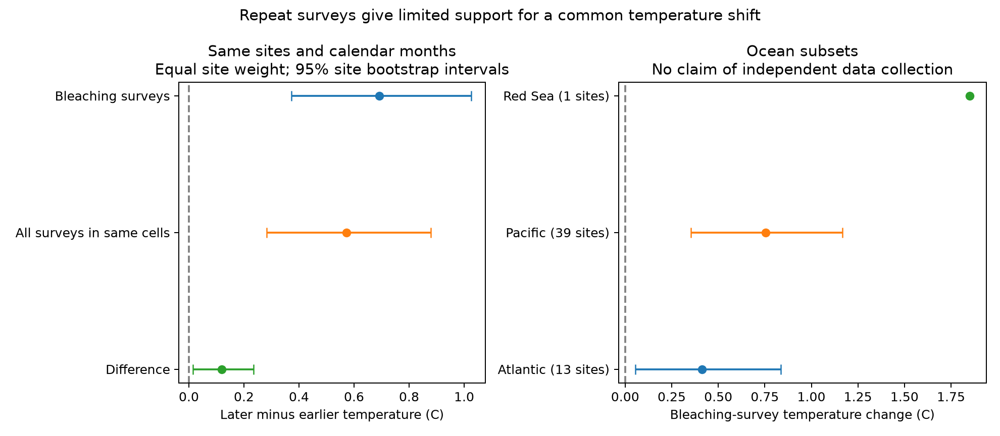

# Only five Reef Check sites have both bleaching states in the same calendar month in 1998-2006 and 2007-2017

## Question and scope

Do repeat surveys support a common rise in the sea surface temperature observed during coral bleaching? This study checks support in the public Global Coral-Bleaching Database, version 2. It uses Reef Check records only. It tests survey temperature, not a biological heat threshold. It does not test air pollution, species range change, or coral species loss.

Sully et al. (2019, doi:10.1038/s41467-019-09238-2) reported a rise in temperature during bleaching surveys between 1998–2006 and 2007–2017. They proposed selection and adaptation as possible explanations. They used an earlier Reef Check data set. Our updated source and aggregation differ, so this study is a support audit, not an exact reproduction of that result. The database paper (van Woesik and Kratochwill, 2022, doi:10.1038/s41597-022-01121-y) and BCO-DMO describe the source records and attached environmental data.

## Relation to campaign results

Local `sci search` queries began before the precise question. Full folder search was slow because SCI verifies uncached bundles. We used the partial verified cache from that search, saved in `files/prior_search.json`, and read two signed reports. The search is not a complete novelty check.

SCI sha256:a134d9a8506ac02b4215b062a961169333be63e48fd02161f8c0beabf22dbe0a already tested the wider heat-tolerance claim with several survey programs and heat measures. It found sensitivity to region, survey year, and heat timing. We build on that report. Our added result is the count and temperature contrasts for cells with both observed states in both periods at the same site and calendar month. We do not claim a new discovery that warmer bleaching surveys alone fail to prove adaptation. SCI sha256:287644233b61dd382329bfa085108546c44a59b8953b98ab6f3ccaa671225346 found scarce bleaching percentages before 2003. We therefore interpret our complete-outcome early period as a selected subset. It does not represent all surveys from 1998 onward. These reports share our raw data, so agreement is not independent replication.

## Method

The source is BCO-DMO dataset 773466, version 2, dated 2022-10-14, with CoRTAD version 6 environmental values. We use the stored survey temperature field, `Temperature_Kelvin`, less 273.15. We do not treat the current-week temperature as peak exposure before a survey. The raw file has 41,361 rows. There are 28,060 Reef Check rows in 1998–2020. Repeated substrate rows reduce to 14,093 distinct Sample_ID values. We check that their analysis fields agree, including missingness. We keep one row per sample. After removal of missing percentage or temperature values, and invalid percentage or month values, 11,242 samples remain. Missing values marked `nd` become null values. No raw file is changed.

We average temperature and percent bleaching within each site, ocean, year, and calendar month. This gives each survey month one unit and limits repeated weight from depth records and visits. It can combine visits with different bleaching states. A positive unit has mean bleaching greater than zero. A second test uses mean bleaching of at least 10 percent. These are observed states, not estimates of bleaching onset. The main period has 8,005 units, with 2,933 positive units. The longer period has 8,971 units, with 3,251 positive units.

For each site and calendar month, we calculate the mean temperature of positive units in each period. We keep cells with positive units in both periods. We subtract the earlier mean from the later mean. We then average the cell differences within each site, and give each site equal weight. Thus, a site with more repeat months does not receive more weight. We also calculate the temperature change for all units in those same cells. The difference between these changes is a descriptive excess change. All-unit means include positive units; they are not independent controls.

A stricter test requires both positive and non-positive units in each period within the same site and month. Its four-cell contrast is the change among positive units minus the change among non-positive units. We report the small support for this contrast. A site-only match allows different calendar months and is a sensitivity test. It changes both seasonal control and the set of sites. The difference between these designs must not be assigned to season alone.

We repeat the comparisons in the Atlantic and Pacific subsets. These have separate sites, but share the same data system. The Red Sea has only one matched site in the main month-matched test. We also compare 1998–2008 with 2009–2020. This split overlaps the main split; it is a sensitivity test, not an independent time replication. We chose the designs after inspection of data coverage. All tested variants are in `estimates.csv`; there is no adjustment for multiple tests.

Intervals are 2.5 and 97.5 percentiles of 4,000 bootstrap samples of site mean differences, with replacement, using seed 110787. They describe variation among the sampled sites. They do not include regional spatial dependence, exposure error, or selection bias. Intervals from very small site sets are unstable; a single-site interval is not reported.

## Results



| Comparison | Sites | Change in positive-survey temperature, degrees C | 95 percent site bootstrap interval |
| --- | ---: | ---: | --- |
| Main split, site and month match | 53 | 0.691 | 0.373 to 1.027 |
| Main split, site-only match | 113 | 0.038 | -0.278 to 0.348 |
| Longer split, site and month match | 59 | 0.165 | -0.083 to 0.408 |
| Longer split, site-only match | 122 | -0.228 | -0.503 to 0.049 |
| Main split, site and month match, at least 10 percent bleaching | 4 | -0.080 | -0.497 to 0.338 |

The main site-and-month design contains 54 cells from 53 sites. All surveys in these cells warmed by 0.572 degrees C (0.283 to 0.878). Positive surveys warmed by an extra 0.119 degrees C (0.014 to 0.235). This small excess is a conditional association. It does not measure adaptation. In the longer split, the excess is 0.096 degrees C (0.015 to 0.192), although the positive-survey temperature change itself has an interval that includes zero.

In the main month-matched test, positive-survey temperature rose by 0.413 degrees C in 13 Atlantic sites (0.054 to 0.835) and by 0.754 degrees C in 39 Pacific sites (0.352 to 1.168). The excess over all-survey warming was -0.021 degrees C in the Atlantic (-0.123 to 0.096) and 0.142 degrees C in the Pacific (0.014 to 0.283). Thus, the excess change is not clear in both ocean subsets. The single Red Sea site changed by 1.850 degrees C. No Indian Ocean site met the main month-matched support rule.

Only five sites have all four combinations of period and bleaching state in the main month-matched test. Their four-cell contrast is -0.283 degrees C (-0.507 to -0.023). The longer split has nine such sites and a contrast of 0.221 degrees C (-0.326 to 0.845). These small and selected samples do not support a common direction. At the 10 percent state rule, only four sites have positive units in both periods for either split. These results show a lack of support for a precise general comparison, not proof of no biological change.

Without matching, the mean temperature of positive units changes from 27.857 to 28.049 degrees C in the main split, a rise of 0.192 degrees C. This differs from the earlier paper, which used another data release and sampling unit. It also differs from our matched estimates. Pooling, site selection, season, and period choice therefore matter for this descriptive quantity.

## Meaning and limits

Warmer positive surveys remain visible in the main site-and-month subset. However, the estimated change varies across designs, and a comparison with zero-bleaching surveys has little matched support. A warmer mean in positive surveys alone cannot distinguish warming exposure, survey timing, changed species composition, selection of surviving colonies, or altered heat tolerance. This study does not refute adaptation. It shows why a survey-temperature distribution should not be used alone to estimate a biological threshold shift.

The match controls fixed site location and broad survey season. It does not control day of month, depth changes, observer identity, coral composition, targeted visits after a heat event, survey effort, prior mortality, or the delay between heating and bleaching observation. We have no colony denominators or species-specific response model. Removing missing values and requiring repeat positive observations can select unusual sites. We do not estimate selection probabilities. Site bootstraps can understate uncertainty when nearby sites share heat events. The two period splits overlap. Separate oceans share one source protocol. Thus, this is a method and data-support result, with limited regional checks, rather than independent proof across regions and times.

Useful next data would include fixed survey dates, species and colony counts, depth, observer and effort records, and weekly heat history before each survey. These would permit a response model using both positive and zero observations, with peak and cumulative heat exposures. This package provides an inspectable starting point for that work.

## Reproduction and provenance

Run Python 3.12 with NumPy, pandas, and Matplotlib. Recorded versions, counts, the random seed, raw checksum, and the resolved raw path are in `files/provenance.json`. Derived data are included. The shared logical input is:

`/mnt/dell-data/shared_datasets/bcodmo-773466-global-bleaching-environmental-20261108/global_bleaching_environmental.csv`

Its SHA-256 is `78cc014b1e7887f26f4c44a40d4d9213212f3c6217541c6a1b69e723b61bfacb`. The resolved object path is in the provenance file. No other shared raw file is used. The raw file is licensed CC BY 4.0; credit goes to van Woesik, Burkepile, the named source programs, and BCO-DMO. The baseline license in this package applies to our text, derived tables, figure, and code; it does not remove upstream attribution.

From this package root:

```bash
python files/analyze.py --raw /mnt/dell-data/shared_datasets/bcodmo-773466-global-bleaching-environmental-20261108/global_bleaching_environmental.csv --out /tmp/coral-audit
```

An independent standard-library check rebuilds the reduced table from raw CSV rows and checks the main site counts and contrasts:

```bash
python files/validate.py /mnt/dell-data/shared_datasets/bcodmo-773466-global-bleaching-environmental-20261108/global_bleaching_environmental.csv
```

The saved check is `files/validation.json`. It found zero difference between the two reduced tables.

Off this machine, retrieve the exact input with the recipe in `files/retrieve.py`, then pass its path as `--raw`. The recipe checks the input hash and refuses changed bytes. `survey_units.csv` contains the complete reduced data for inspection. `matched_cells.csv` has the individual cell contrasts. `estimates.csv` has each design, ocean subset, sample size, and interval. The `naive_*.csv` files contain unmatched means and counts. The plot is `temperature_shift.png`. Reproduction of numerical tables uses the recorded versions and seed. Plot bytes can vary with font and library versions.

Job: sci-1107-syam2-climate-pollution-biodiversity-87aaa209487d. Topic: climate-pollution-biodiversity. Campaign: 11_07_2026. Machine: syam2. Account: codex-myxtap. Model: gpt-6.1-sol, high reasoning effort. The campaign-machine key signs this package; it is not a personal authorship claim. No remote archive submission is part of this work.
