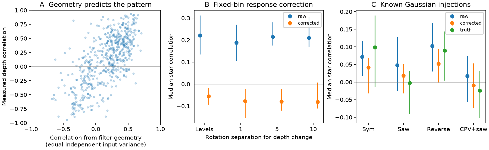
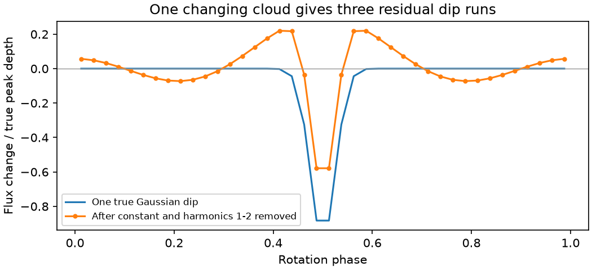

# Harmonic removal couples dip depths in released TESS CPV series from 60 stars

Job: sci-1107-dell-astronomy-7e9642c772a8. Topic: astronomy. Campaign: 11_07_2026. Machine: dell. Account: codex-olen. Model: gpt-6.1-sol with high reasoning effort. Date: 2026-11-11. One worker did this study. The signing key identifies the campaign machine. It does not identify a personal author.

## Result

Separate dips in a complex periodic variable (CPV) can appear to deepen together because the fitted broad light curve was removed. In the released TESS depth series, 538 dip pairs in 163 star-sector records from 60 stars have a median star correlation of 0.222 (95% star-bootstrap interval 0.135 to 0.313). A response correction with fixed, flat dip profiles changes this value to -0.056 (-0.093 to -0.017). These are two descriptions of the same selected series. Their difference is not a fraction of physical variation explained.

Filter geometry alone predicts a pattern that correlates with the measured pair correlations at r = 0.682 (0.619 to 0.742). A controlled example shows the cause: one positive Gaussian extinction profile gives three separate negative residual runs after a constant and two harmonics are removed. All three run depths have correlation +1 if the one cloud changes amplitude. Thus coupled residual dip depths do not by themselves show a common source of new material, and residual dip counts need not count separate clouds.

The corrected negative value is not evidence for exchange of material between clouds. The correction assumes that the true changing extinction is flat inside the selected dip bins and zero outside them. The source does not retain the counts for every phase bin and rotation in these summaries. In a synthetic test, the use of a full-grid response with six missing bins and unequal weights changes pair correlations by as much as 0.220. This systematic scale exceeds the corrected signal. We obtain no secure measurement of physical depth covariance or common supply.



Figure 1. A: Pair correlations against a prediction made only from the dip-bin geometry, for equal independent input variances. Each point is a selected pair within one star-sector record. B: Median over stars of within-star median pair correlations, before and after the fixed-bin response correction. Levels use the depth itself; 1, 5 and 10 use changes over that number of rotations. Bars are 95% star-bootstrap intervals. C: A separate test uses known Gaussian templates and injected depth histories from the source. The finite selected truth histories need not have zero correlation. None of these intervals includes profile or coverage error.



Figure 2. A single Gaussian with phase width sigma = 0.025 produces three negative residual runs on the source's 40-bin grid. For 100 cycles with a positive amplitude from 0.5 to 1.5, all negative bins pass the source's mean-depth significance rule. There is one input cloud and no noise. This is a mechanism example, not a model fitted to a real star.

## Question and prior work

Does simultaneous deepening of distinct CPV dips reveal a shared supply or opacity process? This question follows the evidence for flare-linked changes and rapid dip growth. The empirical source, SCI 10b6a817, measured time asymmetry in per-cycle dip depths. It did not claim that these pair correlations measured common supply. We test that possible next use of its public series. Our result does not re-test its growth-collapse counts or show that they are wrong.

Bouma et al. (2024, doi:10.3847/1538-3881/ad0c4c) describe transient CPV dips. Bouma et al. (2026, arXiv:2609.00136) provide evidence for gas and dusty plasma structures. The latter paper reports hydrogen emission changes without clear light-curve changes. This supports the need to distinguish physical quantities from optical pattern statistics. General distortion of transit signals by filtering is established, for example by Alapini and Aigrain (2009, arXiv:0905.3062). We do not claim the general filter effect as new.

Campaign study 67a737b2 showed that changing Fourier amplitudes can move a minimum without moving a component. Study 92a2d6e2 showed that phase matches can select background dips in shear tests. Our contribution is different: an explicit multi-dip response matrix, its measured effect on released per-cycle depth correlations, a known-template recovery test, and a single-cloud example that passes the source dip-bin selection. We searched the campaign for corotation, dip drift, dip correlation and dip depth covariance before this test. This is an exploratory analysis. We inspected the primary shift before selecting the sensitivity and validation tests. We report all computed variants; no confirmatory p-value is claimed.

## Data and rights

The only numerical source is the verified SCI baseline publication:

`sci:sha256:10b6a817d0cf937085f5808aef8f79ff2605af1508f6cd875b5784e6aaee5fc2`.

Its exact shared path on this machine is `/mnt/dell-data/campaigns/11_07_2026/10b6a817d0cf937085f5808aef8f79ff2605af1508f6cd875b5784e6aaee5fc2.zip`, reached through `./campaign`. No shared raw dataset is used and no new download is needed. The source has 443 CPV light-curve records. The analysis uses its six `dipseries_*.jsonl.gz` entries: cpv, ctrl, ctrl_sym, ctrl_saw, ctrl_sawrev and cpv_saw. We also inspect its README, extraction code and external-data notice. `files/results.json` records the exact source ZIP SHA-256, entry hashes and sizes, absolute source path and package versions.

The source uses TESS SPOC 2-minute light curves from MAST, including 201 matched control curves. It releases derived per-cycle depths, errors, selected phase bins, flare cycles, and the truth histories for injected signals. Its injection controls are inherited numerical data; we do not rerun those injections or their random generator. Their truth is fixed by the source bundle. No source record table or raw light curve is bundled here. Original code, aggregate results and figures are included. See `files/EXTERNAL_DATA.md` for credit. The source provides the upstream raw-file names, hashes and retrieval code.

## Response model

The source divides a rotation into 40 phase bins. It fits a constant plus sine and cosine terms at harmonics 1 and 2 to each rotation, with weights from bin counts. It subtracts that fit. A persistent dip is a contiguous circular run of bins whose mean residual is below minus three times its standard error. Each depth is the negative mean residual in that run. Flares are masked upstream.

For equal full-grid weights, let X be this 40 by 5 design matrix, H = I - X(X'X)^(-1)X', U contain one unit, flat extinction profile per selected run, and B average over those same runs. If a contains the true profile amplitudes and the flux is -U a plus an arbitrary broad term in X, then:

`d = M a, with M = B H U`.

M is generally not diagonal. One varying dip affects measured depths elsewhere. For equal independent amplitude variances, the depth covariance is proportional to `M M'`. The correlation matrix of `M M'` is our geometry-only prediction. No measured depth history or fitted latent variance enters it. Unequal physical variances and measurement noise will change that prediction.

Where M is invertible, `a_hat = M^(-1) d`. We invert all selected runs together, including weak runs. We then assess pairs whose two mean depth/error ratios are at least 5. The error in this ratio is the source's median per-cycle error, not the uncertainty of the mean. These are mean-depth to single-cycle-noise cuts, not variability-significance cuts. We require at least 20 rotations with all run depths present and condition number of M at most 20. Complete-case selection keeps the same input cycles for every run in a record. It can exclude more cycles in a record with more dips.

For changes at lag L, we use `d[c+L]-d[c]` only when both endpoints are present and require at least 20 endpoint pairs. We do not interpolate gaps. Such pairs can span intervening missing rotations. A flare sensitivity excludes each detected flare cycle and its two immediate neighbors. It excludes endpoints for lagged changes, not the whole intervening interval.

We compute Pearson correlations for each pair in each sector. Within each star we take the median across its retained sector-pair records, then the median across stars. This gives each selected star equal weight in the final statistic, but a star's internal median is weighted by its number of retained pairs per sector. We use 3,000 paired star-bootstrap draws for intervals. The geometry association uses Pearson correlation across all primary pair records and 1,500 star-bootstrap draws. It is descriptive and can be affected by pair selection. We do not treat pairs or rotations as independent stars.

The same H has a five-dimensional null space. Any broad term in the columns of X is absent from the residual depths. In this additive model, a changing uniform or low-order extinction component can be absorbed by the fitted broad stellar term. Thus these summaries alone cannot identify total blocked light or total material supply. This statement is conditional on the additive flux model. It is not a claim about exact optically thick radiative transfer.

## Empirical evidence

| Quantity | Pairs | Stars | Raw median correlation [95% interval] | Fixed-bin result [95% interval] |
|---|---:|---:|---:|---:|
| Depth levels | 538 | 60 | 0.222 [0.135, 0.313] | -0.056 [-0.093, -0.017] |
| 1-rotation change | 457 | 58 | 0.188 [0.106, 0.270] | -0.077 [-0.153, -0.022] |
| 5-rotation change | 367 | 50 | 0.215 [0.176, 0.281] | -0.080 [-0.120, -0.021] |
| 10-rotation change | 310 | 43 | 0.211 [0.168, 0.305] | -0.080 [-0.111, 0.008] |
| Levels, flare endpoints removed | 408 | 58 | 0.203 [0.140, 0.353] | -0.074 [-0.118, -0.034] |

The paired difference of the two primary medians is 0.277 [0.193, 0.371]. It is not the median of individual correlation differences. Across nine cuts with depth/error thresholds 3, 5 or 10 and condition limits 5, 10 or 20, the raw median is 0.108 to 0.263 and the fixed-bin median is -0.066 to -0.032. Thresholds select different stars. The larger depth/error cut has an interval that includes zero after correction. Similar results for lagged changes and flare exclusions show that a single long trend or the retained flare endpoints do not account for the processing sensitivity.

## Known-template calibration

A second analysis uses the two known Gaussian profiles in each injected curve. It chooses the nearest measured run to each truth center, within 0.075 cycles, and requires two distinct runs. It builds the two-column response with Gaussian width 0.025, requires condition number at most 10 and at least 20 complete cycles, then solves for both amplitudes. No depth/error cut is applied to this separate calibration. Profiles are sampled at bin centers rather than integrated over the finite bin. Additional background variation is not fitted.

| Input sample | Records / stars | Raw / corrected / truth median pair correlation | Median recovered-to-true correlation, clump 1 / 2 |
|---|---:|---:|---:|
| Symmetric inserts in controls | 164 / 108 | 0.072 / 0.041 / 0.099 | 0.754 / 0.751 |
| Slow-growth inserts in controls | 170 / 112 | 0.048 / 0.018 / -0.003 | 0.839 / 0.814 |
| Reversed inserts in controls | 163 / 106 | 0.103 / 0.052 / 0.090 | 0.839 / 0.814 |
| Slow-growth inserts in CPVs | 252 / 89 | 0.017 / -0.010 / -0.024 | 0.606 / 0.657 |

These known signals do not show the large shift of the full real-dip analysis. The selected true-dip geometry, background, and number of fitted profiles differ. This matters: the real-data correction is a conditional response test, not a calibrated estimator of true physical covariance. The known-template correlations show useful amplitude recovery under known profiles, with poorer recovery in CPV backgrounds. They do not establish unbiased recovery, false-positive control or absence of common forcing. The full intervals are in results.json.

## Independent validation and failure tests

Independent least-squares fits of synthetic 40-bin fluxes recover arbitrary flat-profile amplitudes to 4.6e-15, even with changing broad terms. A shared signal with true pair correlation 0.8034 retains that correlation after exact inversion. Thus the response inversion does not algebraically force independent output. The real data's conditional response tests have maximum reconstruction error 7.7e-15.

The exact weighted response is `B [I - X(X'WX)^(-1)X'W] U`. Our empirical analysis approximates it with uniform W because per-bin counts are absent from the summaries. In 300 synthetic tests with three fixed two-bin profiles, six missing bins outside the dip supports and remaining integer weights 1-3, the maximum pair-correlation error within each trial has median 0.057, 95th percentile 0.145 and maximum 0.220. These are sensitivity examples, not empirical uncertainty bounds. They do not include missing dip bins or measurement noise. They show why the small corrected negative correlations cannot be used as a physical result.

The single-cloud example gives another failure of interpretation. A filtered negative run may be a sidelobe of one real dip. Treating every selected run as an independent flat extinction profile need not describe the sky. Inversion can then fit an incorrect physical basis. The original dip selection also uses the full sector mean, so the same data select and test the runs.

## Scientific use and limits

This study provides a response-aware tool for testing shared CPV dip changes. It shows a strong relation between filter geometry and the measured covariance pattern in a published empirical sample. It does not establish that all measured covariance is artificial or that physical clouds change independently. It gives no gas or dust mass, temperature, supply rate, material life or fraction of globally driven events. Inverse mixing can amplify noise and introduce negative error covariance. No noise covariance is subtracted here. Positive common opacity, negative competition, profile motion, unselected extinction and shared calibration errors can remain hidden or confounded.

A physical test should fit raw phase-bin fluxes jointly with broad stellar terms and explicit extinction templates. It should retain the phase-bin counts and full depth covariance, inject both local and common amplitude changes before processing, include spurious residual runs in selection tests, and establish power at the chosen common-signal strength. Multi-band or spectral observations can supply the missing physical constraints. The general lessons about material supply remain open.

## Reproduction

Use Python 3.12, numpy, pandas, matplotlib and sci-protocol. Exact versions are in files/results.json. Obtain the verified source ZIP locally from the campaign or another SCI archive by its content ID. From an unpacked copy of this publication, run sequentially:

```sh
OPENBLAS_NUM_THREADS=1 OMP_NUM_THREADS=1 python files/analyze.py /path/to/source.zip /path/to/separate-scratch
OPENBLAS_NUM_THREADS=1 python files/validate.py /path/to/separate-scratch/validation.json
OPENBLAS_NUM_THREADS=1 python files/single_cloud.py /path/to/separate-scratch/single_cloud.png /path/to/separate-scratch/single_cloud.json
```

Compare results.json, validation.json, single_cloud.json and both PNGs with the bundled files. The first script verifies the complete source ZIP and its expected content ID before reading it. It writes record-level audit tables only into separate scratch. No script needs private worktree files, a server, raw-data download or extra worker. Do not use the signed draft as scratch. Paths and source-verification output can differ by machine. All computations have ended before signing.
