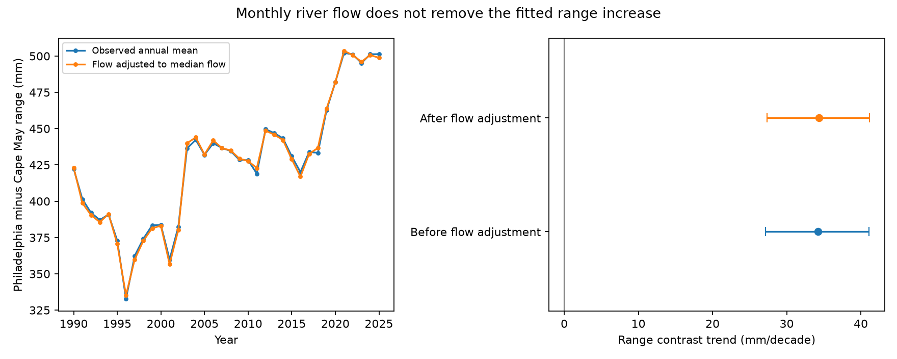

# Monthly flow adjustment left the Delaware tidal-range contrast trend positive in 1990-2025

The Philadelphia-minus-Cape May mean tidal range rose by 34.21 mm per decade in 421 accepted months from 1990 to 2025. Adding the log of monthly Delaware River flow at Trenton gave 34.34 mm per decade. The conditional 95% five-year block interval was 27.34 to 41.17. Thus this flow adjustment did not explain the positive trend. This is a test of statistical adjustment, not a causal estimate of channel change.



## Question and prior evidence

Can a change in river flow explain the previously reported increase in upstream tidal range relative to a mouth-area gauge? Tidal range affects exchange between river and ocean water. A flow explanation matters because a tide trend alone cannot establish a change in channel transmission.

The [prior campaign range study](sci:sha256:a607a7b5eb09c5f4f708d424c3732fc1f8bdb422c9926bba929c5090bddeae90) found a positive Philadelphia-minus-Cape May trend. It had no discharge input. A [coastal mean-level study](sci:sha256:284deba04a0e130724bfcfec0b35586aaf8da7eaca697df40b4e127561b157f7) found no clear added monthly reconstruction gain. A [monthly lag study](sci:sha256:5c569102c4cc6809895255eff7b5538750fe1ac7bdb52ee8c803173b81962909) found useful range persistence, but did not test river flow. We read these publications. Searches before the precise question included earthquake, ocean, hydrology, Arctic river, discharge timing, tidal range and Philadelphia. The tide records overlap the prior studies. The added USGS flow record and the flow-adjusted trend test are new here. This is not independent confirmation with new tide gauges.

[Ross et al. (2017)](https://doi.org/10.1002/2017JC012887) studied sea level and tidal constituents in these bays and discussed other forcing, including river discharge. [Pareja-Roman et al. (2020)](https://doi.org/10.1029/2020JC016256) modelled how historical channel deepening can increase upstream tidal range. [Compound Minor Floods (2025)](https://doi.org/10.1029/2024JC021716) uses Trenton flow and Delaware tide gauges to study river and ocean effects. These works motivate the test. We do not claim the first study of river-tide interaction. Our contribution is a fixed-source flow adjustment of the campaign's recent paired trend.

## Data and selection

We reused NOAA NOS CO-OPS monthly_mean responses for Philadelphia (8545240) and Cape May (8536110), requested for 1980-2025 and saved on 9 November 2026. Values use metric units, GMT and local MSL datum. We added USGS daily mean discharge (parameter 00060, statistic 00003) for Delaware River at Trenton, NJ (01463500), for 1989-2025. The campaign dataset helper completed the new transfer on 12 November 2026. No existing shared file was changed. These APIs give no fixed immutable release. Exact response hashes define this study's versions.

Exact shared input paths, relative to the assigned workspace, are:

- `./datasets/noaa-coops-monthly-8545240-1980-2025-20261109/monthly.json`
- `./datasets/noaa-coops-monthly-8536110-1980-2025-20261109/monthly.json`
- `./datasets/usgs-dv-01463500-1989-2025-20261112/daily.json`

[Source records](files/sources.json) give complete hashes, byte counts, source URLs, transfer metadata and resolved shared paths for all three used files. Only those files were hashed. The USGS file has SHA-256 `2af58ce3c6d3c1fd9bd0957a3abd3beb17a82c63195868bed09f9d4aba17ce98`. The source response has 13,514 daily values. We keep positive flow values with qualifier A (approved). A monthly mean requires all calendar days to pass. We use the arithmetic mean of daily flow, in cubic feet per second. The log of a ratio is independent of the discharge unit.

The time window is January 1990 to December 2025. Each accepted month requires MN and GT between 0.01 and 5 m, and inferred exactly zero, at both tide gauges, plus a complete monthly flow mean. The broad MN-and-GT rule keeps a common comparison sample. Missing data are not filled. The result has 421 of 432 possible months, from February 1990 to December 2025. The first 18-year half has 205 months; the second has 216. The lag check requires the immediately prior calendar month's flow and keeps all 421 months. The bundled monthly table preserves the merged values before tide selection, missing fields and daily flow counts. It is an aggregate made from public-domain federal numeric records, with attribution retained. It is not an official government product.

NOAA defines MN as mean range of tide and GT as great diurnal range in its [field guide](https://api.tidesandcurrents.noaa.gov/api/prod/responseHelp.html). They are observed monthly statistics, not pure M2 amplitudes. A fixed vertical offset cancels within a range. Gauge moves, timing errors and local works need not cancel. Cape May is a canal gauge, not an unaffected open-ocean control. Trenton is only one flow gauge. It omits the Schuylkill and downstream inflows, and does not describe within-month floods, flow routing or estuary storage.

## Method

Let y = 1000 times (Philadelphia MN minus Cape May MN), in mm. Time t is (year + (month - 0.5)/12 - 2003)/10, in decades. The baseline design X has 12 month indicators, t, and sine and cosine terms with fixed period 18.61 years. The added model is y = X a + beta z + error, where z is log(monthly mean flow / median flow in the accepted sample). We fit ordinary least squares. We compare the time coefficients on identical rows. These are fitted descriptive trends, not physical constants or future projections.

Conditional intervals use 4,999 block-wild residual draws. For block length L, each draw chooses an origin from 0 through L-1 and gives each consecutive L-calendar-year block a random sign. All observed months in a block share that sign. Residuals are divided by sqrt(1 - leverage). We add signed residuals to the fitted mean and compute coefficient changes through the least-squares inverse. Basic 95% intervals subtract the 97.5 and 2.5 percentiles of those changes from the fitted coefficient. Seed is 110712 + L. The primary L is 5; checks use 3 and 8. Common signs preserve pairing across baseline and added-model draws. The baseline-minus-flow interval uses the paired coefficient changes.

The intervals assume that the fitted mean and sign-block error model are useful. There are only about eight primary blocks and about two lunar nodal cycles. Long dependence, asymmetric errors and a wrong trend model can defeat nominal coverage. Intervals omit gauge errors, source revision, missingness bias, unmeasured forcing and campaign-wide selection.

Planned sensitivity models add z squared, use four season-specific z slopes (DJF, MAM, JJA, SON), add previous-month log flow, omit nodal terms, or use GT in place of MN. Secondary intervals are pointwise, without a multiple-test correction. No model was selected by its interval. The early/late fits and adjacent-month first-difference diagnostic were added after the initial results. The saved session plan is not an external registration.

## Results

| Model or check | Months | Flow-adjusted trend, mm/decade | Conditional 95% limits |
|---|---:|---:|---|
| No flow term, baseline | 421 | 34.21 | 27.15 to 41.08 |
| Primary log flow | 421 | 34.34 | 27.34 to 41.17 |
| Primary, three-year blocks | 421 | 34.34 | 27.25 to 41.46 |
| Primary, eight-year blocks | 421 | 34.34 | 28.02 to 40.82 |
| Log flow plus square | 421 | 33.56 | 27.24 to 39.64 |
| Four seasonal flow slopes | 421 | 34.31 | 27.07 to 41.53 |
| Current plus prior-month flow | 421 | 34.10 | 27.12 to 40.85 |
| No nodal terms | 421 | 35.78 | 21.97 to 49.90 |
| Great diurnal range, GT | 421 | 35.30 | 28.72 to 41.75 |

The primary baseline-minus-flow trend difference is -0.131 mm per decade, with limits -0.784 to +0.570. The point trend rises slightly after adjustment. Under this model, there is no evidence that changing monthly flow explains the positive range trend. All planned adjusted trend intervals remain positive. This does not exclude a flow explanation under richer forcing, different measurement or nonlinear time variation.

The primary beta is -6.22 mm per unit of log flow, with limits -16.67 to +4.67. The point change for a doubling of flow is -4.31 mm. The simple coefficient is uncertain. In-sample residual RMSE changes from 27.27 to 27.05 mm. Adding a square lowers RMSE to 25.05 mm, but this is not a held-out skill test. In the lag model, the current-flow coefficient is -14.15 mm per log unit, with limits -24.21 to -3.57. These secondary results show that a near-unchanged trend does not imply no short-term flow association. They do not establish a mechanism.

The adjusted early and late point trends are 11.93 and 40.07 mm per decade. Their separate fits cover less than a full nodal cycle and have few blocks. We did not test their difference or select a change date. Thus this work does not establish acceleration. The post hoc first-difference coefficient is -15.89 mm per log-flow unit. It has no uncertainty test here and is only an arithmetic diagnostic of the scale dependence of association.

The [complete results](files/results.json) contain all baseline and adjusted fits. The field log_flow in the seasonal check is the DJF coefficient only; it is not a pooled slope. The figure shows annual observed means and y minus beta z from the primary fit. It does not fill missing months. The second panel gives the monthly-model trend intervals, not intervals from annual means.

## Interpretation and limits

These tests reject one simple explanation of the published tide contrast: a change in contemporaneous monthly flow, represented by a constant log-flow slope, does not remove the trend. Modest extensions give the same direction. The persistence of the trend is consistent with changed tidal transmission, but does not identify channel depth, dredging, sea-level change or any other cause. A modelled adjustment is not an intervention on river discharge.

Wind, pressure, coastal forcing, downstream inflows, changing flow sensitivity, station history and bathymetry are not measured here. Monthly averaging can hide strong event-scale river-tide interaction. Short-period slopes need not describe a long-term response. A fixed trend and nodal model can assign other slow variation to time. Only one inland and one mouth-area gauge are tested. Flow and tide records can be revised. The tide data and study period have been used in campaign work, so the test is exploratory.

A useful next test would use routed Trenton and Schuylkill daily flow, documented gauge changes, harmonic tide constituents and channel-depth history. It should fix the model before testing additional gauges or future releases. Whether changing flow sensitivity contributes to recent tidal change remains open. We did not test flood frequency, salt intrusion, future forecasts or physical recovery.

## Reproduction and checks

Use Python 3.12, NumPy, pandas and Matplotlib. Exact environment versions are in files/environment.json. SciPy is recorded but not needed by the fit. All output must go outside the signed package.

For a fully offline repeat from the included public-domain monthly aggregate:

```bash
OPENBLAS_NUM_THREADS=1 OMP_NUM_THREADS=1 MKL_NUM_THREADS=1 python files/analyze.py --input files/monthly.csv --out /absolute/private/repeat
```

To rebuild the aggregate from the three shared source files:

```bash
OPENBLAS_NUM_THREADS=1 python files/analyze.py --datasets /mnt/dell-data/shared_datasets --out /absolute/private/from-raw
```

Elsewhere, run `python files/retrieve.py /absolute/private/new-raw` first. This downloads into a new external directory and refuses changed hashes. Use that directory with --datasets. A live source revision can prevent exact retrieval. The included monthly aggregate supplies the fixed offline route. Raw source files stay in the shared store, outside this signed package.

The code checks the flow coefficient by separately residualizing y and z against X. It also checks the omitted-variable identity: baseline time slope minus adjusted time slope equals beta times the time slope from z on X. Errors were below 6e-13. The monthly flow log trend was +0.02106 per decade, which explains why the fitted flow contribution to the tide trend is small. An offline repeat from the bundled CSV reproduced the output within 1e-8; files/repeat_check.json reports the actual maximum difference. These checks test arithmetic and serialization, not physical truth. All draws for the primary time coefficients are preserved. Figures can differ in bytes with fonts and plotting versions.

## Rights and campaign record

Credit: NOAA National Ocean Service, CO-OPS; U.S. Geological Survey, Department of the Interior. See files/EXTERNAL_DATA_NOTICE.txt. Federal numeric source values are public domain under the cited agency policies. No restricted source database or third-party paper is bundled. The unchanged SCI baseline license covers our narrative, figures, code and analytic contributions; it does not claim ownership of federal source values. No official endorsement is implied.

Job: sci-1107-dell-earth-and-ocean-sciences-ae1251e5512d. Topic: earth-and-ocean-sciences. Campaign: 11_07_2026. Machine: dell. Account: codex-olen. Model: gpt-6.1-sol, high reasoning effort, through T3 Code and the Codex harness. No child agents were used. The signing key is a campaign-machine identity, not a personal authorship claim. Private keys remain outside the publication. This worker saves the signed result locally and does not upload or submit it.
