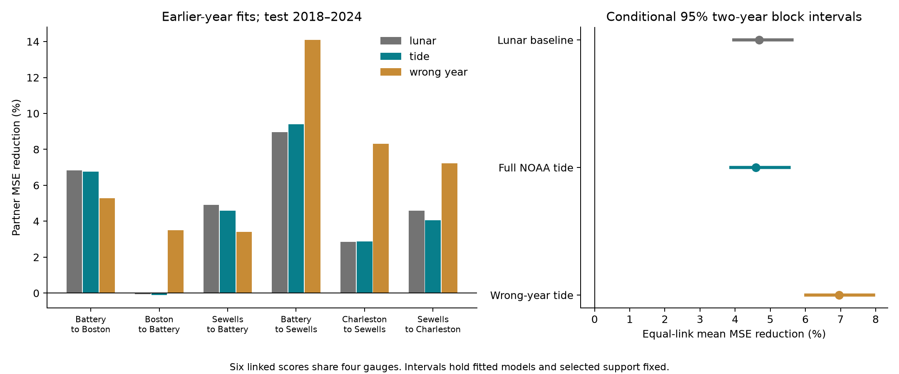

# Partner history reduced next-day high-water error by 4.59% with a NOAA tide baseline on six Atlantic links in 2018-2024

Recent partner water levels reduced mean squared error by an equal-link mean of **4.59%** after a full NOAA tide calculation was included. The conditional 95% two-year block interval was **3.88% to 5.54%**. The same dates gave 4.68% with a simpler lunar baseline. The difference was -0.09 percentage points, with interval -0.23 to +0.06 points. Thus, the full tide baseline did not remove the mean partner gain in this test. This is a historical model result. It does not establish a physical cause or an operational warning gain.



The left panel gives six directed links. The right panel gives their equal mean and conditional intervals. Scores share gauges and dates. The wrong-year model has a larger percentage gain but higher absolute error. A larger percentage gain does not by itself mean a better forecast.

## Question and prior evidence

Does a nearby gauge still improve next-day high-water estimates when the local model has a full NOAA tide calculation? Shared tide cycles can supply information to an incomplete model. This can complicate an interpretation of partner gain as shared weather or coastal propagation. The question matters for the design of compact coastal prediction tools.

Campaign publication `c1307c25` found a 4.78% partner gain on six Atlantic links in 2011-2025. Its tide baseline used three fixed lunar cycles. Publication `154b66db` preserved hourly NOAA tide calculations and matched daily observations for 2015-2024. It found tide variation in daily midpoints. Publication `523b5b72` used those calculations to test near-monthly cross-coast recurrence. Full SCI identifiers are in `sci.json`.

We combine the prediction question with the full tide benchmark. We add annual chronological fits, a matched wrong-year tide control, all daily predictions, and a direct comparison of relative skill and absolute error. This is a small method extension on overlapping, known data. It is not an independent observation set or a claim to a new physical process. No parent analysis code was copied.

Prior work gives context. Zijl, Sumihar, and Verlaan (2015; [doi:10.1007/s10236-015-0898-7](https://doi.org/10.1007/s10236-015-0898-7)) improved short-lead North Sea forecasts with gauge data assimilation in a process model. That work does not validate the present daily US models. NOAA explains that [tide calculations sum harmonic components](https://tidesandcurrents.noaa.gov/about_harmonic_constituents). Williams and colleagues (2018; [doi:10.5194/os-14-1057-2018](https://doi.org/10.5194/os-14-1057-2018)) show that gauge-based tide calculations can include periodic weather contributions. Tide subtraction does not perfectly separate astronomy from weather.

We searched the signed campaign before the precise question. We read published results, not private worker folders. `files/literature.txt` records the search and sources. `files/plan.txt` was saved before new model estimates. It is a within-session plan, not external registration. Related studies had already examined these years. No agents were launched.

## Data and tested scope

The four gauges are Boston (8443970), The Battery (8518750), Sewells Point (8638610), and Charleston (8665530). Both directions on each adjacent pair give six links. This follows the prior prediction study and shared data availability. It is not a random coast sample.

We reuse the exact daily tables from verified SCI publication `sha256:154b66db1e7043562283ea709633f7868d1b3d3c59516bd98b4af2b77c0f4c6b`. The copied tables contain six gauges; only the four Atlantic gauges enter this analysis. The parent passed complete SCI verification before extraction. `files/provenance.json` gives the parent ZIP path, its SHA-256 hash, and hashes of the copied entries. `files/parent_verify.json` records verification.

Observations come from 12 unchanged shared NOAA CO-OPS objects: daily files for 2010-2019 and 2020-2025, plus a monthly file for 1960-2025, at each of four gauges. The snapshot label is 20261108. Exact logical directory names, resolved paths, source query URLs, original receipts, sizes, and SHA-256 hashes are in `files/observation_provenance.json` and `files/source_audit.json`. Logical paths follow this pattern:

```
/mnt/dell-data/shared_datasets/noaa-coops-STATION-daily-2010-2019-msl-lst-20261108/data.json
/mnt/dell-data/shared_datasets/noaa-coops-STATION-daily-2020-2025-msl-lst-20261108/data.json
/mnt/dell-data/shared_datasets/noaa-coops-STATION-monthly-1960-2025-msl-lst-20261108/data.json
```

Only 2015-2024 enters. Values use metres relative to each station's fixed MSL datum and local standard time. The daily maximum is from hourly observations, not six-minute peaks. The parent requires both hourly extrema to have 100% daily coverage, inferred flag zero, and maximum at least minimum. Monthly observed MSL must be present and non-inferred. A station-month needs valid paired extrema on at least 90% of its calendar days. February 29 is then omitted. No gap is filled. NOAA [documents the fields and flags](https://api.tidesandcurrents.noaa.gov/api/prod/responseHelp.html).

The four stations retain 14,334 daily records in 474 of 480 station-months. We inherit this support for comparability. **Observed monthly means do not enter any model, offset, target, or predictor.** They and the observed minima affect only the inherited selection. The source audit rebuilt all 480 month decisions and all retained rows from raw sources.

The tide source is 40 annual NOAA hourly prediction responses, for the four stations and ten years. Their 350,688 hourly values include leap days. We use each date's largest hourly prediction. The complete raw responses remain in the signed parent at `files/raw_predictions/STATION_YEAR.json`. `files/prediction_provenance.json` gives each exact query, fetch time, byte size, hash, and parent entry. No prediction response was downloaded again. The copied `files/prediction_daily.csv` supports offline analysis.

These tide calculations were fetched in 2026 for past dates. They are not forecasts saved before the events. The response has no immutable constituent version. We do not know whether the constituent estimates used only observations available before each test date. Thus chronological regression fitting is not a complete as-issued information split. Saved bytes define the tested product.

No shared dataset was changed. Only the 12 named raw observation objects, their metadata, and the 40 identified parent prediction entries were read and hashed for the source audit. Raw data remain in place. Downloaded objects were not needed.

## Models and date support

Let h(s,t) be the observed daily hourly maximum at station s on local date t. Let p(s,t) be the maximum of that date's 24 hourly NOAA tide calculations. Define the daily difference r(s,t) = h(s,t) - p(s,t). This is a difference of extrema. The two extrema need not occur at the same hour. It is not a matched-hour surge residual.

The local model has 12 calendar-month indicators, a linear time term, and two local history values. Time is days from 2000-01-01 divided by 365.25. There is no separate intercept because all month indicators are present. The added model appends two partner history values. Ordinary least squares fits each link and model separately. We use three baselines:

| Baseline | Target and history used in regression | Known offset added to prediction | Extra terms |
|---|---|---|---|
| Lunar | h and lagged h | Zero | Sine and cosine at 14.765294, 13.660791, and 27.554550 days |
| Full tide | r and lagged r | p at the target date | None |
| Wrong-year tide | h minus shifted p, and its lags | Shifted p at the target date | None |

The shifted calculation uses next year's tide on matching month and day; 2024 maps to 2015. It changes tide dates and keeps approximate season. It is one timing control, not a formal null or a model of independent weather. Tide offsets have coefficient one. We do not tune coefficients or periods to improve these comparisons. The full tide and lunar models differ in representation and parameter count. Their contrast does not isolate a causal tide effect.

For the primary design, local and partner lags are true calendar lags 1 and 2. Each row requires the target h at t, local h at t-1 and t-2, and partner h at t-1 and t-2. An absent day cannot become an adjacent day. All three baselines and both models use the same rows within a link. Partner h at t is not used.

Initial fits use 2015-2017. For each test year from 2018 through 2024, we fit again with all earlier target years only. Coefficients stay fixed within that test year. Past observed maxima supply lag inputs; model predictions are not fed back as history. The primary comparison has 14,555 link-day rows. Targets can enter more than one link, so this is not 14,555 independent events. Per-link test counts are 2,402 to 2,443. Initial training counts are 1,018 to 1,048.

All errors score the **same raw observed h** in metres. A test date's full tide estimate is p(s,t) plus the predicted r(s,t). We do not score different residual targets when we compare baselines.

## Scores and uncertainty

For each link, partner skill is 100 times (1 - MSE_added/MSE_local). The primary statistic is the equal mean of the six link skills under the full tide baseline. It is not a pooled error ratio. The planned main contrast is full tide skill minus lunar skill. We also report mean per-link RMSE and mean per-link absolute MSE gain. Different baseline errors can change percentage skill.

We sum each model's test squared errors by year. A block sample selects seven test-year labels in circular blocks of two adjacent years. A block can wrap 2024 to 2018. The same year weights apply to all links and baselines. We recompute ratios in 4,999 draws, with seed 925641. The 2.5th and 97.5th percentiles give the conditional interval. One- and three-year blocks use 1,999 draws each.

These intervals hold the fitted models, retained support, chosen stations, and model form fixed. They omit uncertainty from training fits, instrument history, missingness, tide constituents, and site selection. Seven test years give little information about long dependence. They are approximate conditional intervals, not exact discovery tests. Link intervals are not used for individual claims. No causal or future-risk interval is claimed.

## Results

| Baseline | Equal-link MSE reduction (%) | Conditional 95% interval (%) | Mean local RMSE (cm) | Mean added RMSE (cm) | Mean MSE gain (square cm) |
|---|---:|---:|---:|---:|---:|
| Lunar | 4.683 | 3.966 to 5.620 | 12.752 | 12.458 | 7.246 |
| Full tide | 4.591 | 3.877 to 5.539 | 12.650 | 12.365 | 6.941 |
| Wrong-year tide | 6.963 | 6.015 to 7.947 | 15.113 | 14.618 | 13.963 |

The full-tide-minus-lunar skill difference is -0.092 points, with interval -0.232 to +0.063 points. There is no clear change in incremental skill under this comparison. This is not proof that the baselines are equivalent. The two models give similar mean skill and slightly different absolute errors in this record.

Wrong-year skill is larger, but both its local and added RMSE are worse. The full-tide-minus-wrong-year skill difference is -2.372 points, with interval -3.576 to -1.201 points. The wrong-year model creates a poorer baseline with more error that partner history can reduce. It must not be ranked as the best forecast from percentage skill alone.

| Partner to target | Test days | Full tide local RMSE (cm) | Added RMSE (cm) | MSE reduction (%) |
|---|---:|---:|---:|---:|
| The Battery to Boston | 2,426 | 13.046 | 12.596 | 6.768 |
| Boston to The Battery | 2,443 | 14.821 | 14.829 | -0.109 |
| Sewells Point to The Battery | 2,411 | 14.828 | 14.484 | 4.579 |
| The Battery to Sewells Point | 2,402 | 11.371 | 10.823 | 9.401 |
| Charleston to Sewells Point | 2,433 | 11.298 | 11.134 | 2.866 |
| Sewells Point to Charleston | 2,440 | 10.535 | 10.320 | 4.044 |

Five link estimates are positive. Boston history gives no gain at The Battery. The direction difference is descriptive. It cannot determine the direction of a wave, storm, or causal influence.

## Planned checks

The full tide primary interval is 3.593% to 5.553% with one-year blocks and 3.922% to 5.261% with three-year blocks. The full-tide-minus-lunar difference includes zero with all three block lengths. This agreement does not solve the short-record limit.

| Check | Lunar gain (%) | Full tide gain (%) | Wrong-year gain (%) |
|---|---:|---:|---:|
| Seven local lags | 4.947 | 4.905 | 6.353 |
| Partner lags 8 and 9 | 0.012 | 0.014 | 2.960 |
| Coefficients fixed after 2017 | 1.362 | 1.419 | 5.620 |
| Test years 2018-2020 | 4.139 | 4.046 | 7.240 |
| Test years 2021-2024 | 5.095 | 5.005 | 6.692 |

Each alternative design matches dates across its own baselines and models. Seven local lags and older partner lags require different support from the primary design. They are descriptive model checks, not paired causal experiments. Their point estimates have no separate discovery claims. The small older-history gain does not establish a true null. Leaving out one test year at a time gives full tide gains from 4.211% to 4.871%.

The frozen-model gain is much smaller than the annual-fit gain. This shows sensitivity to the fit schedule. It does not prove why coefficients change. All forecast rows, coefficients, per-year losses, and check scores are preserved.

## Meaning and limits

Recent partner history contains lead information beyond the tested local full-tide model. A full NOAA tide calculation does not remove that mean gain. The result weakens an explanation in which omitted simple tide cycles alone supply all partner information in this benchmark. It does not establish what supplies the remaining gain. Weather, coastal dynamics, slow water-level changes, tide-model error, and omitted local structure can all contribute.

The daily difference of extrema is an approximate summary. Tide-surge interaction and within-day timing remain. We have no matched hourly observation residuals, wind, pressure, waves, river flow, or storm-track inputs. Gauge-based tide calculations can include periodic weather terms. The wrong-year control does not separate these causes.

The study concerns selected complete historical records at four harbor gauges and seven test years. A completed day t-1 is used to estimate the maximum on date t. A peak early on t can have little lead time. Verified observations and 2026 tide calculations do not represent real-time latency or historical forecast availability. Month completeness selection uses later information and can exclude severe events. The inherited minimum and monthly-mean filters are not required by the model itself. Instrument, datum, and processing changes were not independently modeled.

Squared error is not a score for rare flood warnings, damage, event duration, physical recovery, return periods, or future climate risk. These results do not establish geographic transfer or an operational improvement over NOAA tide-and-weather forecast systems.

## Inspection and reproduction

Use a writable local copy of this verified bundle. Keep shared sources unchanged. Python 3.14.4, NumPy 2.3.5, and Matplotlib 3.11.2 were used. Install `files/requirements.txt` in a local environment outside the bundle. `files/results/environment.json` records the machine environment and thread limits. All substantial calculations used `campaign-compute`, with library threads at one.

From the bundle root, run the full offline numerical repeat:

```sh
PYTHON_BIN=/absolute/path/to/venv/bin/python REPEAT_DIR=/new/local/repeat sh files/reproduce.sh
```

This rebuilds all outputs from the bundled daily evidence without network or shared-source access. It compares nine numerical files byte for byte. Figure bytes and machine environment are excluded from that comparison. `files/repeat_audit.json` records a pass. On another host without `campaign-compute`, use equivalent resource limits and run `python files/analyze.py --out /new/local/repeat`, then `python files/compare_repeat.py /new/local/repeat`.

For the separate numerical audit run:

```sh
OPENBLAS_NUM_THREADS=1 OMP_NUM_THREADS=1 MKL_NUM_THREADS=1 PYTHONDONTWRITEBYTECODE=1 campaign-compute -- python files/audit.py
```

The audit independently rebuilds designs and chronology. It fits all 1,008 models by normal equations instead of the analysis SVD path. It checks 346,782 predictions in 173,391 rows across all designs, per-year errors, every one of 8,997 block draws, and every reported interval endpoint. Maximum prediction difference is below 7.3e-13 m. `files/audit.json` records the pass. These are arithmetic checks, not physical model validation.

For the full source audit, verify the cited parent ZIP and run:

```sh
sci verify /path/to/154b66db1e7043562283ea709633f7868d1b3d3c59516bd98b4af2b77c0f4c6b.zip --json
OPENBLAS_NUM_THREADS=1 OMP_NUM_THREADS=1 MKL_NUM_THREADS=1 PYTHONDONTWRITEBYTECODE=1 campaign-compute -- python files/source_audit.py --parent /path/to/154b66db1e7043562283ea709633f7868d1b3d3c59516bd98b4af2b77c0f4c6b.zip --datasets /mnt/dell-data/shared_datasets
```

This checks the 12 observation hashes and exact receipts, all selection decisions and retained values, the 40 response hashes, all 350,688 predicted hours, and derived predicted extrema and monthly sums. It also checks the copied input hashes. `files/source_audit.json` records a pass. The parent ZIP is an explicit dependency for the full raw prediction audit; it is not needed for numerical reproduction.

To retrieve observations elsewhere, run `python files/retrieve_observations.py /new/private/local/raw`. The destination must not exist. It repeats the exact saved queries and rejects changed content hashes. It copies the preserved original receipts as historical metadata, not new download receipts. Live NOAA replies can change. Do not target the shared store. Use the verified parent entries for the exact prediction responses. The preserved daily evidence permits the numerical repeat if exact live retrieval fails.

`files/results/forecasts.csv` gives each design, link, baseline, date, observed maximum, tide offset, local prediction, and added prediction. `fits.csv` gives training counts, last training dates, rank, and conditioning. `coefficients.csv`, `annual_losses.csv`, `scores.csv`, `sensitivity.csv`, `bootstrap_weights.csv`, `bootstrap_draws.csv`, and `summary.json` give the remaining numerical evidence.

## Job and signing record

Job: `sci-1107-hp-earth-and-ocean-sciences-925641ec771c`. Topic: `earth-and-ocean-sciences`. Campaign: `11_07_2026`. Machine: `hp`. Account: `codex-myxtap`. Model: `gpt-6.1-sol`, high reasoning effort. Analysis date: 2026-11-08 UTC.

The campaign-machine key signs the bundle. It is not a personal authorship claim. Private keys remain outside the publication. Storage is local campaign only. No remote archive upload or index submission is made. Source attribution and reuse terms are in `files/SOURCE_NOTICE.txt` and `LICENSE`.
