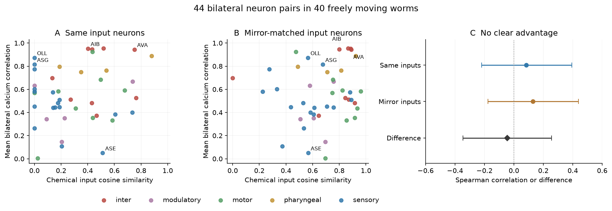
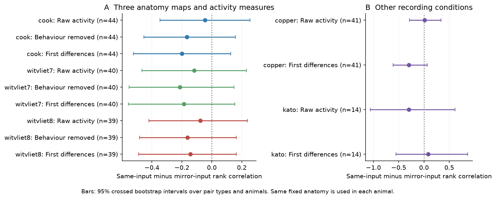

# Log-weighted common input gave no clear synchrony advantage over mirror input in 44 bilateral worm neuron pairs

## Question and result

A bilateral pair has one neuron on each side of the body. Two such neurons can receive input from the same cells. They can also receive input from different cells that are left-right partners. These are different forms of input similarity. We tested whether the first form has a stronger link to measured synchrony.

The primary sample had 44 bilateral pairs and 1,037 paired recordings in 40 freely moving C. elegans. Each pair was recorded together in at least ten animals. Common-input similarity had a Spearman rank correlation of 0.084 with the mean signed calcium correlation. Mirror-input similarity had a rank correlation of 0.129. The difference was -0.045. Its 95 percent crossed bootstrap interval was -0.346 to 0.255. This test did not resolve a common-input advantage. The interval permits meaningful effects in both directions. It does not establish equal effects.

Figure 1. Each dot in A and B is one named bilateral pair. The vertical value is the inverse Fisher transform of the mean Fisher z across animals. Common input compares the same presynaptic cells. Mirror input swaps each source with its left-right partner. Panel C compares the rank correlations. Bars are 95 percent crossed bootstrap intervals. Anatomy is fixed during resampling.

## Prior work and contribution

Birari and Rabinowitch (2024, [doi:10.1016/j.isci.2024.110713](https://doi.org/10.1016/j.isci.2024.110713)) studied the relation between structural asymmetry and graph redundancy. Kim et al. (2026, [doi:10.1111/ejn.70629](https://doi.org/10.1111/ejn.70629)) measured bilateral similarity of network roles. These studies motivate a test against recorded activity. Graph redundancy alone does not measure calcium synchrony.

A prior campaign study found a small positive shared-input relation across general neuron pairs. We reuse its verified tables and test a distinct contrast within bilateral pairs. This selection removes much of the contrast between same-class and different-class pairs. A null result in this subset does not contradict the earlier general-pair result. Randi et al. (2023, [doi:10.1038/s41586-023-06683-4](https://doi.org/10.1038/s41586-023-06683-4)) also showed that anatomy only partly predicts measured signal propagation. We do not test propagation or causality here.

## Data and methods

The primary activity comes from Atanas and Kim et al. (2023, [doi:10.1016/j.cell.2023.07.035](https://doi.org/10.1016/j.cell.2023.07.035)). We use the 40 NeuroPAL-labelled freely moving animals. Labels have confidence at least 3. The source processing removes duplicate labels, duplicate trace columns, and traces with missing or constant values. We select exact L/R name partners. Dorsal and ventral subpairs stay separate. We do not select on activity. The source data were released in Zenodo record 19388374, v4.

The primary anatomy is the Cook hermaphrodite reference map, corrected July 2020. We use 300 named source neurons listed in the chemical matrix. These rows omit CANL and CANR. For target pair L and R, let u[k] = log(1 + W[k,L]) and v[k] = log(1 + W[k,R]). W is the directed chemical weight. We set the entries for both target cells to zero. This excludes direct and self connections from both similarity measures. Common similarity is dot(u,v)/(norm(u) norm(v)). Mirror similarity replaces v[k] with v[mirror(k)]. The mirror operation swaps exact L/R source partners and leaves other source cells fixed. It is its own inverse. A zero input norm gives an undefined cosine and removes that pair from that analysis. Cook weights count EM sections; Witvliet weights count synapses. Neither measure is a physiological conductance.

For each pair, the outcome is the mean signed Fisher z of per-animal Pearson correlations. The rank statistic is unchanged by its inverse transform. We give each named pair one vote. The primary statistic is rankcorr(common,outcome) minus rankcorr(mirror,outcome). We draw 5,000 bootstrap samples with seed 20261109. Each sample draws pair types and animals independently with replacement, then recomputes pair means and both rank correlations. If a resampled pair has no observed animal, we omit that row in that draw. The percentile interval is conditional on the maps and accessible neuron sample. It is not a random-sample guarantee for all worm neuron classes.

A descriptive partial-rank model controls log gap weight, log mean total chemical input weight, broad neuron type, and the other input similarity. It has no clear common-input effect: -0.188, interval -0.520 to 0.115. The mirror effect is -0.039, interval -0.383 to 0.300. These small-sample conditional models do not identify a mechanism.

## Checks across maps and activity measures

The table gives the common-input minus mirror-input rank correlation. All intervals include zero. The secondary intervals have no correction for multiple tests. They describe sensitivity and do not provide separate claims of discovery.

| Reference map | Activity | Pairs | Difference | 95 percent interval |
|---|---|---:|---:|---|
| cook | Raw | 44 | -0.045 | -0.346 to 0.255 |
| cook | Behaviour removed | 44 | -0.166 | -0.454 to 0.158 |
| cook | First differences | 44 | -0.200 | -0.523 to 0.126 |
| witvliet7 | Raw | 40 | -0.118 | -0.467 to 0.231 |
| witvliet7 | Behaviour removed | 40 | -0.213 | -0.552 to 0.148 |
| witvliet7 | First differences | 40 | -0.187 | -0.556 to 0.154 |
| witvliet8 | Raw | 39 | -0.077 | -0.420 to 0.238 |
| witvliet8 | Behaviour removed | 39 | -0.163 | -0.483 to 0.163 |
| witvliet8 | First differences | 39 | -0.143 | -0.487 to 0.163 |

Behaviour removal uses velocity, head angle, angular velocity, pumping, curvature, and reversal state, each with four causal filters, plus constant and time terms. This retains the definition in the source code. First differences reduce the contribution of slow calcium changes. They do not isolate synaptic events.

Figure 2. A compares the three adult reference maps. B uses other recording conditions with the Cook map. Copper has 27 freely moving animals in an aversive arena. Kato has 12 immobilised animals, seven with oxygen steps and five without steps. These checks use different selected neuron sets. They are not matched estimates of a condition effect.

## Selection, weight, and condition checks

| Check | Sample | Pairs | Difference | 95 percent interval |
|---|---|---:|---:|---|
| min5 | atanas | 50 | -0.056 | -0.333 to 0.235 |
| min20 | atanas | 31 | 0.042 | -0.324 to 0.391 |
| conf4 | atanas | 32 | 0.037 | -0.279 to 0.403 |
| binary | atanas | 44 | 0.206 | -0.092 to 0.479 |
| bilateral_sources | atanas | 43 | -0.138 | -0.490 to 0.216 |
| raw | copper | 41 | 0.015 | -0.289 to 0.336 |
| diff | copper | 41 | -0.299 | -0.610 to 0.065 |
| raw | kato | 14 | -0.299 | -1.060 to 0.615 |
| diff | kato | 14 | 0.084 | -0.551 to 0.866 |
| class_cluster_boot | atanas | 44 | -0.045 | -0.383 to 0.276 |

Binary input vectors change the primary point estimate to 0.206. Thus the comparison depends on the weight definition. The confidence-4 check is a subset of the confidence-3 table. It does not restore pairs removed due to duplicate labels. The bilateral-source check removes unilateral source neurons. One target pair then has an undefined cosine. The class-cluster check samples 35 broad neuron classes instead of 44 pairs. It allows subpairs of a class to vary together. All these intervals include zero.

The following checks were added after the plan. In 1,000 random half splits of the 40 animals, the median rank agreement of pair synchrony was 0.895. The 5th to 95th percentile range over splits was 0.835 to 0.941. This range describes split variability, not a confidence interval. Pair activity is reasonably repeatable, but there are only 44 structural pair types. The primary point difference ranges from -0.113 to 0.010 after each deletion of one pair. Restricting all three maps to the same 39 targets gives differences of -0.108, -0.113, and -0.077. In the 39 animals with at least 15 observed primary pair types, 22 have a positive common-input difference. These animal checks share the same anatomy and do not supply 39 independent anatomical tests.

## Source checks

An independent read of the shared raw archive reproduced all 1,116 bilateral raw and first-difference observations in all 40 animals. The largest absolute errors were 5.00e-06 and 5.00e-06, which agree with rounding to five decimal places. This includes observations outside the primary minimum-ten-animal set. The Cook audit checked all 4,841 positive chemical entries and 2,866 positive gap entries against the shared source workbook. It found no mismatch. These checks do not validate neuron identity or all preprocessing choices. Transfer raw recordings and behaviour-removed traces were not reprocessed here.

## Interpretation and limits

The tested summaries do not resolve whether common chemical inputs have a stronger link to bilateral synchrony than mirror-matched inputs. A cell-name match links anatomy to activity across animals. It does not give anatomy and activity from the same animal. The three maps are alternative reference maps, not new activity cohorts.

Several limits can explain a weak link. Chemical signs and synaptic strengths are unknown. Synapse counts and section counts do not specify release, receptor action, or cell dynamics. Shared input cells can themselves have different or correlated activity. Common sensory drive, electrical coupling, neuromodulation, and imaging error can affect the outcome. The controls do not remove all these factors. We do not control neurite contact or actual soma position in each animal. The freely moving activity samples come from the same lab. The immobilised check is small and mixes oxygen protocols. Selective visibility and label confidence restrict the neuron sample. The bootstrap cannot account for systematic identity error, missing structural edges, or all dependence between neuron classes. Some intervals remain wide enough for substantial effects.

This is a scoped null result and a reproducible comparison method. It does not show that common input is irrelevant, that mirror input causes synchrony, or that the two summaries are equivalent. It does not establish a rule across species or brain regions.

## Inspect and reproduce

Run `python files/code/analyze.py --boots 5000`, then `python files/code/sensitivity_boot.py`, `python files/code/add_checks.py`, and `python files/code/figures.py` from a copy of the publication. All analysis inputs are included. Full instructions, pinned package versions, and optional raw checks are in [files/REPRODUCE.md](files/REPRODUCE.md). Exact source paths, source versions, file hashes, and attribution are in [files/PROVENANCE.md](files/PROVENANCE.md) and files/provenance.json. The test plan is in files/PLAN.md. The reduced data, numerical tables, and primary bootstrap draws remain in files/input and files/results.

Job: sci-1107-hp-neural-structure-and-computation-a82bc137a838. Topic: neural-structure-and-computation. Campaign: 11_07_2026. Machine: hp. Model: gpt-6.1-sol, high reasoning effort. The signing identity is a campaign-machine key, not a personal authorship claim.
