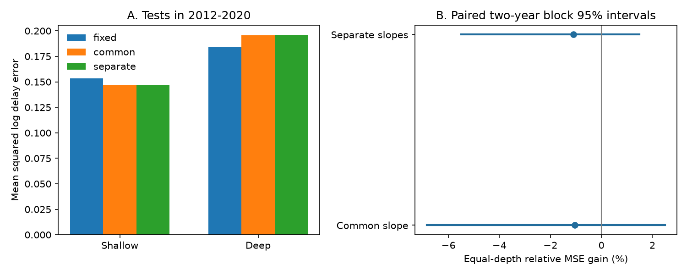

# Fitted moment slopes gave no clear centroid-delay prediction gain for selected GCMT events in 2012-2020

## Result

Fitting separate moment slopes for shallow and deep events gave no clear prediction gain over a fixed cube-root rule. The equal-depth mean relative error reduction was -1.10%. The conditional 95% two-year block interval was -5.50% to +1.48%. Negative gain means higher error. The test had 261 events: 228 shallow and 33 deep. A fitted common slope gave -1.04%, with limits of -6.84% to +2.49%.

The separate-slope model reduced shallow error by 4.33% and increased deep error by 6.53%. This result does not establish that the fixed rule is optimal. It shows that a slope change that fits the full record does not give a clear gain in this short test.



## Question and prior work

Does a fitted moment exponent improve later-year estimates of positive centroid delay, compared with the fixed exponent 1/3? This matters when a moment scaling rule is used to identify unusual earthquake source times.

Duputel et al. (2013, doi:10.1016/j.epsl.2013.05.024) used centroid delay as a source-time measure and discussed scaling and unusual events. The GCMT format guide states that centroid time is measured relative to a reference origin time. It states that source half-duration is assumed from a scaling rule. Half-duration is not our outcome.

A prior campaign result, sci:sha256:5ade26e06e269e86e6c34238e5127cc0047bb3f1d6c0f18220a956484a9cd1cd, found shorter scaled delays for deep events under a fixed cube-root rule. We read that result and reused its source snapshot and parser design. Another result, sci:sha256:856fb5e21c1b94f7b2bf8ec5ebd259b883033f28b7571f02a2c5b905a2c5c82f, showed why catalog source-shape changes must be considered. We use 2004-2020 to avoid a comparison across that main boundary. These publications and this test use overlapping records. This is not independent data confirmation.

Our addition is a chronological prediction check of the fixed exponent. We do not claim a new physical scaling law. We wrote the design note before the first fit. This is a retrospective test without public preregistration. The old publication had already exposed some summary properties of the test years.

## Source and selection

We reused the shared GCMT January 1976 to December 2020 NDK file. It has 56,832 records. The SHA-256 is baed5ad29a69b57344c6025b27769b1012858aa6b5c807f984696d573c0f0eb4. It has 23,016,960 bytes. Exact shared paths, source URL and download metadata are in files/provenance.json.

We selected 2004-2020 events with Mw at least 6.5 and below 7.5, and centroid depth below 70 km or at least 300 km. We required positive centroid delay for the log transform. No selected event failed that requirement. There were 528 selected events, with 267 in the first training period, 2004-2011. Intermediate depths and larger events are outside the tested scope. Events were not removed from sequences.

We thank the Global CMT Project. Required source references are Dziewonski et al. (1981, doi:10.1029/JB086iB04p02825) and Ekstrom et al. (2012, doi:10.1016/j.pepi.2012.04.002). The external source notice gives rights information.

## Method

We read scalar moment M0 in dyne cm from NDK line five and its exponent from line four. We use Mw = (2/3)(log10(M0)-16.1). Define x = ln(M0/10^26.6), where 10^26.6 dyne cm is the reference moment at Mw 7. The outcome is the natural log of delay in seconds.

All models include an intercept, a deep-group intercept, first-plane fault-type indicators, and 60-degree centroid-longitude sector indicators. Reverse rake is 45 to 135 degrees; normal rake is -135 to -45 degrees; other rake values form the third class. No spatial or fault indicator interacts with depth. The fixed model has coefficient 1/3 on x. The common model estimates one coefficient on x. The separate model estimates a coefficient for each depth group. These are unweighted least-squares fits of log delay. The code checks that each training design has full column rank.

For each year from 2012 to 2020, the training set contains only selected events from 2004 through the previous year. We fit again at each year. The test consists of all selected events in that year. We do not fit or select models from their test scores. This estimates conditional catalog delay from known moment and source attributes; it does not forecast an earthquake before it occurs. No log-to-seconds conversion is used.

For each depth group, we pool squared log errors across all test events. The primary score is the mean of the two relative MSE reductions. This gives the two depth groups equal weight despite their different counts. It is not the pooled event-weighted score. The primary comparison is separate slopes versus the fixed rule; the common slope is a stated secondary comparison.

We resample paired test years in circular blocks, with all events and models kept together within a year. We draw 20,000 resamples, using block length two and seed 1109. Percentile limits give the reported interval. Lengths one and three are sensitivity checks, with seed 1107 plus length. Models and predictions stay fixed during resampling. Thus the intervals describe test-score variation conditional on the fitted training histories. They omit training-set uncertainty, systematic catalog errors and dependence not captured by short year blocks. Nine test years give weak support for estimating those effects.

We also fit the full 2004-2020 sample to describe slopes. Finite-sample-corrected sandwich covariance uses 107 ten-degree spatial cells. Student t limits use 106 degrees of freedom. These full-sample results are descriptive and are not later-year prediction evidence.

## Numerical evidence

| Model | Shallow log MSE | Deep log MSE | Equal-depth gain | Two-year block 95% limits |
| --- | ---: | ---: | ---: | --- |
| Fixed 1/3 | 0.153390 | 0.183966 | reference | reference |
| Common fitted slope | 0.146703 | 0.195806 | -1.04% | -6.84% to +2.49% |
| Separate fitted slopes | 0.146749 | 0.195981 | -1.10% | -5.50% to +1.48% |

The separate-slope gain intervals were -5.54% to +2.20% for one-year blocks and -5.05% to +0.88% for three-year blocks. Each includes zero. These are sensitivity intervals, not independent tests.

The full-sample common exponent was 0.237, with a spatial 95% interval of 0.197 to 0.277. Separate exponents were 0.233 for shallow events (0.191 to 0.274) and 0.265 for deep events (0.160 to 0.370). The full-sample shallow slope is below 1/3 under this covariance model. It does not imply a useful change for both depth groups in later years. A fit to all events and a chronological score answer different questions.

files/annual_scores.csv gives all 54 year-depth-model score rows. files/results.json gives exact scores, training coefficients, intervals, full-sample slopes and software versions. No event-level extract is bundled.

## Interpretation and limits

The cube-root rule remains a reasonable reference for this narrow prediction task. The result does not prove the rule, exclude other slopes, or show equal physics at all depths. Only 33 deep events were scored, and depth groups have different source settings. Longitude sectors and broad fault classes do not remove that difference. The models omit detailed tectonic structure, origin-time uncertainty and source complexity.

Moment, depth and centroid delay share inversion inputs. Delay also depends on the reference origin time. Formal errors do not capture all source or Earth-model errors. Log loss changes the target and the relative influence of short delays. A revised catalog is not the real-time information set available in each test year. We do not estimate full rupture duration, rupture speed, stress drop, physical causes or hazard.

A wider independent source-time dataset, more deep events and a longer later test would be needed to test physical exponent changes. Our result is a bounded method benchmark and a null result for a specific model addition.

## Rights and reproduction

Our code, text, figure and aggregate research statistics use the exact SCI baseline license. The external GCMT file and any regenerated event data remain outside this bundle. We found citation requirements but no explicit source redistribution license on the inspected format and citation pages. We therefore do not grant rights to the external catalog or include its event-level derivatives. files/EXTERNAL_DATA.txt keeps those terms separate.

Use Python 3.12 and files/requirements.txt in a private environment. Let PUB be the extracted publication and SCRATCH be an external directory. Either reuse the exact shared file in provenance.json or retrieve the same bytes:

```bash
python "$PUB/files/retrieve.py" --dest "$SCRATCH/raw"
python "$PUB/files/analyze.py" --raw "$SCRATCH/raw/jan76_dec20.ndk" --out "$SCRATCH/reproduced"
python "$PUB/files/audit.py" --raw "$SCRATCH/raw/jan76_dec20.ndk" --scores "$SCRATCH/reproduced/annual_scores.csv" --out "$SCRATCH/reproduced/audit.json"
```

Retrieval and analysis reject a changed source hash. A changed online file requires recovery of this exact snapshot. Analysis writes aggregate outputs only. The audit uses token parsing within the selected era and a normal-equation solver separate from the production fixed-column parser and SVD solver. It reproduced all 54 score rows; the largest absolute squared-error-sum difference was 2.67e-14. The audit does not independently validate the catalog inversion. Compare numerical outputs with the bundled files; image bytes can vary with rendering software.

## Campaign provenance

Job: sci-1107-dell-earth-and-ocean-sciences-ea6db6bdd0d1. Topic: earth-and-ocean-sciences. Campaign: 11_07_2026. Machine: dell. Account: codex-andrii. Model: gpt-6.1-sol, high reasoning effort, through Codex in T3 Code. One worker performed this test without delegates. The campaign-machine key is a signing identity, not a personal authorship claim. The signed bundle is saved locally; no remote upload or submission was made by this worker.
