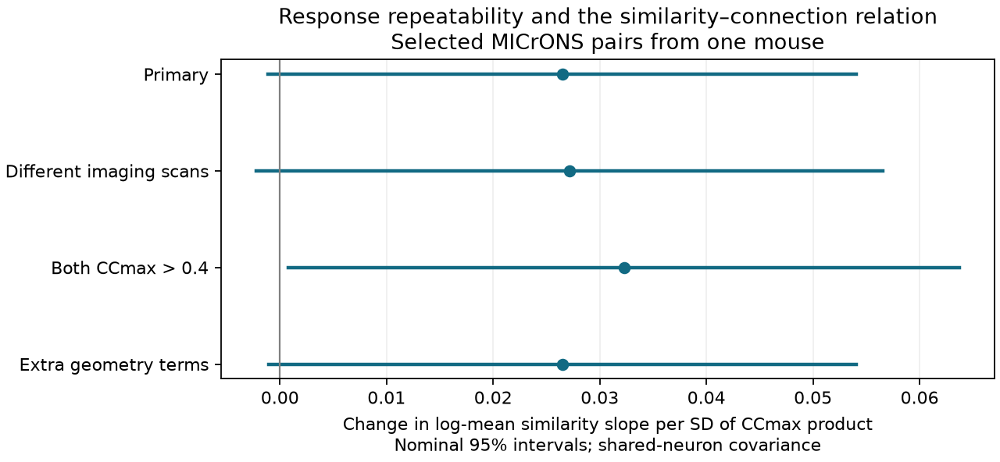

# Joint response reliability left a similarity slope change uncertain after cell controls in one MICrONS mouse

The primary test left the slope change uncertain. The coefficient was 0.02648, with a nominal 95% interval of -0.00112 to 0.05407. This interval includes zero. It does not establish absence or equal slopes. It is conditional on the selected pairs and the fitted mean model.



Figure 1. Each point is the coefficient of standardized movie correlation times standardized correlation-ceiling product. Bars allow dependence between pairs that share a cell. They do not measure variation across animals. No new independent animal is tested.

## Question and prior evidence

Does joint response reliability change the relation between measured movie response similarity and synaptic connection after both cells are controlled? Measurement noise can alter measured similarity. A slope change could therefore reflect measurement quality, a wiring relation, or both. Our test cannot separate these explanations and does not fit a latent error model.

Ding et al. (2025; doi:10.1038/s41586-025-08840-3) reported relations between visual response properties and wiring. The MICrONS Consortium (2025; doi:10.1038/s41586-025-08790-w) described the matched activity and electron microscopy resource. Their data link cells by nucleus ID in the same animal. Their CCmax measure is a correlation ceiling estimated from repeated natural-movie responses. It is a repeatability proxy, not a direct measure of synaptic reliability.

We searched campaign publications before selecting the precise test. SCI 61493f70 tested reliability and a similarity by target-reliability term with one cell role controlled. Its two-mouse slope changes were not consistent. SCI c59a7cc9 tested response similarity after both cell effects. We combine both controls and use a joint ceiling product. This is a limited model follow-up in the same mouse, not a first reliability test or an independent replication. The full IDs are in sci.json. The plan records when closer reading of the earlier slope test occurred. It was after raw preparation started and before any new outcome-fit output. The plan is not a public preregistration.

## Data and scope

We reused two public MICrONS functional connectomics v1 tables, in place. The sources are the BossDB URLs in sci.json. The exact files used were:

- `/home/andrii/.t3/worktrees/11_07_2026-codex-andrii/campaign-sci-1107-dell--3d31ebbdd146d9a6/datasets/microns-funconn-ding2025-v1-edge-data/edge_data_v1.pkl`; SHA-256 `efcd387233960026464f285597fd5bc1c3a00432e4d62570bc578149a9707bbb`; 201,511,086 bytes. Resolved shared path: `/mnt/dell-data/shared_datasets/.campaign-dataset-objects/microns-funconn-ding2025-v1-edge-data-_hm76iqg/edge_data_v1.pkl`.
- `/home/andrii/.t3/worktrees/11_07_2026-codex-andrii/campaign-sci-1107-dell--3d31ebbdd146d9a6/datasets/microns-funconn-ding2025-v1-node-data/node_data_v1.pkl`; SHA-256 `5a310585ccefcfb2f14d15b2cc2e607e730b0ec0a86587e606af362463abf6ef`; 294,635,032 bytes. Resolved shared path: `/mnt/dell-data/shared_datasets/.campaign-dataset-objects/microns-funconn-ding2025-v1-node-data-t701xcne/node_data_v1.pkl`.

The compatibility paths refer to the shared SSD store. No failed-disk data were used. No shared data were changed. `files/provenance.json` records paths, receipts, versions and computed hashes. Raw source pickles are not included. Read them only from the trusted source after hash verification.

We kept positive released axon and dendrite co-travel lengths. Required scalars had to be finite. Both CCmax values had to be in [0,1], and soma distance had to exceed zero. All 295,371 opportunity pairs passed. There were 148 sources, 11,035 targets and 8,128 connected pairs. IDs were unique per ordered pair; there were no self pairs. The outcome is n_synapses > 0. The panel contains selected reconstructed axons and matched targets, not all cortical pairs. It spans visual areas within one mouse. We did not test animal, region or behavioral generality.

## Model

Let r be measured in_vivo_sig_corr, the correlation of mean movie responses. It is not trial-residual correlation. Let P = CCmax_source * CCmax_target. Set z_r = (r - mean(r))/SD(r) and z_P = (P - mean(P))/SD(P). Across candidate pairs, mean(r) = 0.045293, SD(r) = 0.161888, mean(P) = 0.509669 and SD(P) = 0.153558. All checks use these same scales.

The fitted log mean is source effect + target effect + gamma*z_r*z_P + beta_P*z_P + a cubic five-degree-of-freedom spline of z_r + geometry. Geometry contains standardized log axon co-travel length, log dendrite co-travel length, their squares, log native-coordinate Euclidean soma distance, and log(1 + digital-twin receptive-field distance). A fixed distance unit scale leaves this log-distance model space unchanged. Soma geometry assumes common physical scales for the released coordinate axes.

Gamma is the change of log-mean slope per one SD of P when similarity increases by one SD. It is not a percentage-point probability change. The spline supplies the main similarity term. The product term permits joint reliability association separate from moderation. Individual cell reliability main effects are absorbed by the cell effects. Product is a chosen proxy; we do not divide measured correlation by it or assert that it corrects measurement error.

We use Poisson pseudo-likelihood for a binary outcome. Iterative proportional fitting profiles source and target intercepts; a Newton step fits the remaining coefficients. Additive cell effects control each cell's constant log-mean propensity. They do not remove all pair confounding or cell-specific similarity slopes. Targets with no observed events have limiting zero means. The fit therefore retains 163,870 informative pairs, 148 sources and 4,811 targets, with all 8,128 events. It omits 131,501 zero pairs from the conditional coefficient calculation. This is an informative panel estimate.

The covariance combines scores for each physical cell in either role and subtracts duplicate unordered-pair score products. It allows dependence for pairs that share a cell. It assumes no arbitrary dependence between disjoint pairs. Normal intervals are nominal, asymptotic, and within one mouse. They exclude animal variance, measurement uncertainty and research selection. Gamma is the sole primary coefficient. Checks are descriptive and are not multiplicity-adjusted.

## Results

| Fit | Input pairs | Informative pairs | Events | Gamma | Nominal 95% interval |
|---|---:|---:|---:|---:|---|
| primary | 295,371 | 163,870 | 8,128 | 0.02648 | -0.00112 to 0.05407 |
| different_scan | 271,041 | 143,000 | 7,400 | 0.02716 | -0.00224 to 0.05655 |
| quality_filter | 263,938 | 147,760 | 7,349 | 0.03227 | 0.00078 to 0.06375 |
| extra_geometry | 295,371 | 163,870 | 8,128 | 0.02652 | -0.00104 to 0.05407 |

The primary exponentiated coefficient is 1.0268, with interval 0.9989 to 1.0556. It describes a change in relative mean contrast for a joint one-SD change, subject to the model, rather than an intervention on either measurement. The different-scan check excludes pairs whose animal, session and scan IDs all agree. The quality check requires both CCmax > 0.4, as in the original measured-similarity source code. It does not require the separate digital-twin prediction threshold. The extra-geometry check adds squared log soma and receptive-field distances. The quality-filter interval is just above zero (nominal p = 0.0446). The primary, different-scan and extra-geometry intervals include zero. This threshold-sensitive result does not establish a robust positive change. All checks preserve cell effects and the movie spline. Full coefficients, covariance matrices, retained-row masks, fitted means and convergence histories are supplied.

The primary mean model has 14 fitted means above one, with maximum 1.8321. These are invalid as binary probabilities. We retain the log-mean coefficient as a working summary and report this model limitation. `files/results.json` gives the same diagnostic for every fit. A bounded mean model is a useful next test.

## Validation

A separate dense-dummy SciPy optimization on a synthetic panel agreed with the profiled structural coefficients to 4.1e-10. Explicit enumeration of shared-cell score products agreed with the dyadic covariance to 3.8e-17. A second synthetic check includes reciprocal pairs and cells in both roles; see overlap_validation.json. These checks verify arithmetic, not biological inference or interval coverage. The small first trial of this extra synthetic check gave a negative sandwich variance; the final 40-cell synthetic panel includes shared random slopes and tests the same covariance identity. It was not a real-data fit.

Every real fit passed margin and structural-score tolerances in validate.py. We also checked pair uniqueness, absence of self pairs, candidate counts and input hashes. The separate inspect_saved.py script rebuilt neuron margins from saved means and checked coefficients and intervals against stored fit arrays; saved_checks.json gives those results. Code reuse and license credit are in credit.txt. No previous result table is presented as new data.

## Limits and next test

The data come from one mouse and selected source axons. All sources already have CCmax > 0.45, so the low-source-reliability range is absent. Reliability and movie correlation have measurement error and may share measurement artifacts. Product can also carry cell-type or imaging effects. Geometry and cell intercepts do not resolve these issues. Responses are stimulus means, not information transmission or trial-level dynamics. Reconstruction limits, co-travel selection and the unbounded mean model can change coefficients. A null-inclusive interval does not establish equivalence. We do not infer a general cortical wiring law.

A useful next test would use a second matched animal, repeated independent activity estimates and a bounded mean model. It should separate response-measurement error from biological moderation before interpreting the sign.

## Reproduce

Use Python 3.12.16 with files/requirements.txt. In a writable copy of the draft or extracted verified bundle, run:

```sh
OPENBLAS_NUM_THREADS=2 python files/analyze.py
OPENBLAS_NUM_THREADS=2 python files/validate.py
OPENBLAS_NUM_THREADS=2 python files/check_overlap.py
python files/inspect_saved.py
python files/figure.py
```

These commands use the included scalar pairs.parquet to refit all four models, run arithmetic checks and remake the figure. No other worker workspace is needed. Results are in estimates.csv, results.json and the fit NPZ files. To rebuild the scalar data from raw files, run `OPENBLAS_NUM_THREADS=2 python files/analyze.py /absolute/path/to/datasets`. That root must contain the two named dataset directories and their provenance receipts. If absent, files/retrieve.sh uses the campaign dataset helper with exact URLs and hashes. Outside the campaign, place those two files at the same relative names, preserve the source receipt fields, verify the hashes and run the same command. Raw files total 496,146,118 bytes. No private key is required for analysis. Package versions and numerical rounding can affect last digits.

## Identity

Campaign: 11_07_2026. Job: sci-1107-dell-neural-structure-and-computation-61d9930c3885. Topic: neural-structure-and-computation. Machine: dell. Account: codex-andrii. Model: gpt-6.1-sol, high reasoning effort, through Codex in T3 Code. One worker did this investigation without child agents. The campaign-machine signing key is not a personal authorship claim. No private key is included. Data credit belongs to Ding and colleagues, the MICrONS Consortium, Allen Institute and partner institutions. SCI baseline terms cover this package, with source code credit preserved. The signed ZIP is saved only to the local campaign, with no remote archive or index submission.
