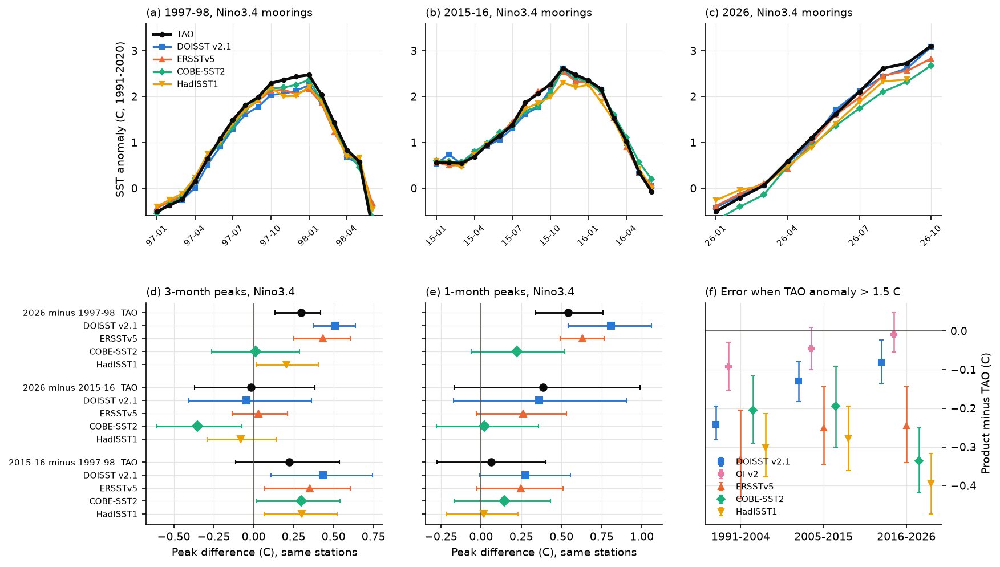
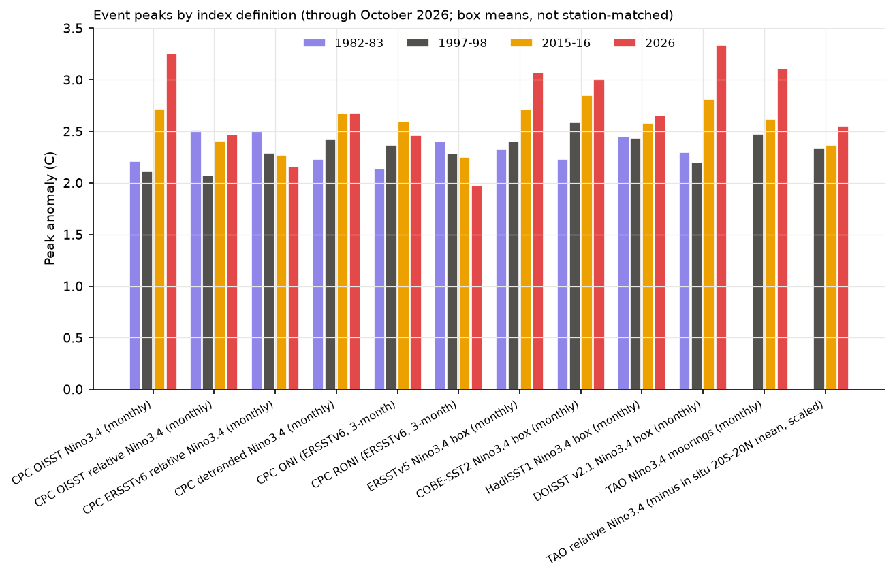
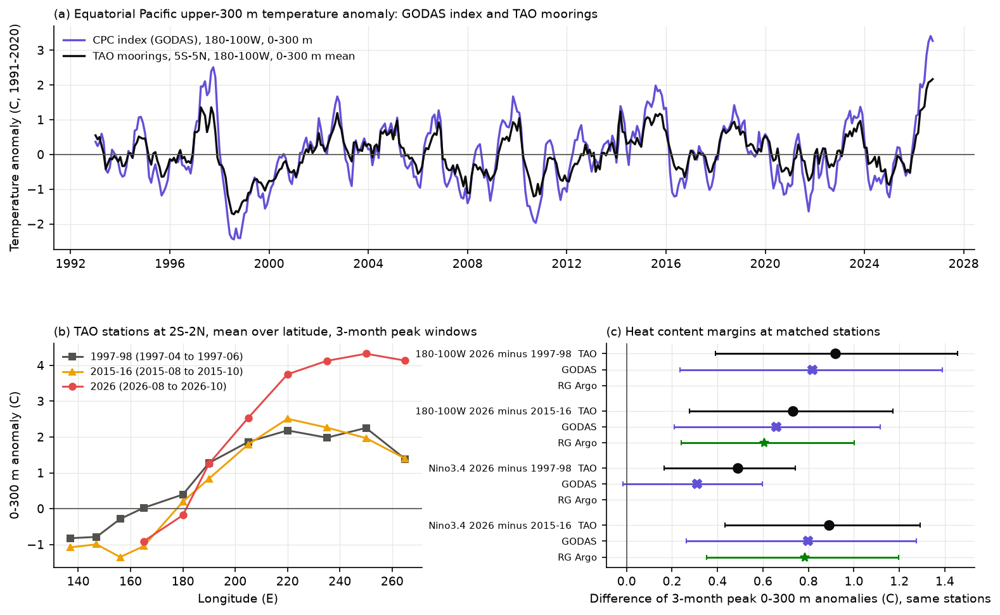

# TAO moorings confirm record 2026 equatorial Pacific upper-ocean heat and a Nino3.4 SST peak above 1997-98 but level with 2015-16 (data to October 2026); DOISST v2.1 adds 0.2 C to the margin over 1997-98

## Summary

**Question.** In 2026 a strong El Nino developed. By October 2026, NOAA indices showed values above all earlier events: the CPC OISST Nino3.4 anomaly was +3.25 C (the earlier maximum was +2.72 C in November 2015), and the CPC GODAS 0-300 m heat content index for 180-100W was +3.39 C (the earlier maximum was +2.56 C in October 1997). But other official indices did not show a record. The ERSSTv6 ONI (ASO 2026, +2.46 C) was below 2015-16 (+2.59 C), and the relative index RONI (+1.97 C) was below 1982-83, 1997-98 and 2015-16. Earlier campaign work found step and noise artifacts in DOISST v2.1, which is the source of the CPC OISST indices. Thus we asked: does the 2026 record survive in independent in situ data, and how much of each index margin comes from product artifacts and from the index definition?

**Approach.** We used the TAO/TRITON moorings as the arbiter. In the Nino3.4 box, 16-17 moorings reported SST in each of the peak months of 1997, 2015 and 2026. We compared each product with the moorings at the same station-months, with each source's own 1991-2020 calendar-month climatology on the matched months. For each pair of events we used only the stations that reported in both peak windows, and we calculated 95% intervals from 2,000 station bootstrap draws. The products are DOISST v2.1, OI SST v2, ERSSTv5, COBE-SST2 and HadISST1 (HadSST4.2 is too sparse at the moorings). For the subsurface, we converted the TAO daily heat content (0-300 m) to a mean temperature and compared it with the GODAS-based CPC index, with GODAS sampled at the moorings, and with the Roemmich-Gilson (RG) Argo grid.

**Main results** (all values in C; "matched" means same stations and months).

1. **SST at the moorings.** The October 2026 Nino3.4 anomaly is +3.11 at all 16 reporting moorings and +3.34 at the 12 moorings that also reported in January 1998, the largest 1997-98 month. At matched stations it is 0.54 above January 1998 (95% interval 0.34 to 0.76) and 0.39 above November 2015 (interval -0.17 to 0.99; 9 stations). For 3-month peaks (2026: August-October), 2026 is 0.30 above 1997-98 (0.13 to 0.42) and level with 2015-16 (-0.02, -0.37 to 0.38). Thus, to October 2026, the moorings confirm a record against 1997-98, but not a clear record against 2015-16. The event was still growing in October 2026.
2. **DOISST v2.1 reads the 1997-98 peak too cold.** At the moorings in October-December 1997, DOISST is 0.28 colder than TAO (0.18 to 0.38). In 2015 and 2026 it is only 0.07 and 0.11 colder, and in neutral years 2012-2014 it is 0.02 warmer. Thus DOISST adds 0.21 (0.13 to 0.30) to the 3-month Nino3.4 margin of 2026 over 1997-98, and 0.27 (0.15 to 0.39) to the single-month margin. It does not change the margin over 2015-16 (-0.03, -0.09 to 0.03). OI SST v2, which has the same producer but a different satellite input and analysis, adds only 0.08 (0.02 to 0.14) to the 2015-16 minus 1997-98 margin, where DOISST adds 0.21.
3. **Peak damping changes with time in different directions.** All products show warm anomalies above 1.5 C as too small, compared with the moorings. The damping in DOISST falls from -0.24 (1991-2004) to -0.13 (2005-2015) and -0.08 (2016-2026). The damping in COBE-SST2 grows from -0.21 to -0.34, and in HadISST1 from -0.30 to -0.40. ERSSTv5 stays near -0.25 to -0.33, and OI v2 near -0.01 to -0.09. Thus DOISST makes recent peaks too large relative to old peaks, and COBE-SST2 and HadISST1 make them too small. COBE-SST2 removes 0.28 (0.07 to 0.51) from the 2026 margin over 1997-98 and 0.34 (0.03 to 0.65) from the margin over 2015-16.
4. **The index definition decides the rank.** The 20S-20N mean SST anomaly in the peak window is about 0.36 warmer in 2026 than in 1997-98 in the in situ products (0.65 in DOISST). A relative index removes this background. CPC RONI and the CPC relative ERSSTv6 index put 2026 (to October) in fourth place. With the TAO Nino3.4 value minus the in situ tropical mean (scaled as in RONI), October 2026 is +2.55, above 1997-98 (+2.34) and 2015-16 (+2.37), but the margin is smaller than the uncertainty of the TAO margin over 2015-16.
5. **The subsurface record is real.** At matched moorings in 5S-5N, 180-100W, the 3-month peak 0-300 m anomaly in 2026 (August-October, +2.39) is 0.92 above 1997-98 (0.40 to 1.44) and 0.73 above 2015-16 (0.30 to 1.14). The RG Argo grid, which does not use the moorings, gives a 2026 minus 2015-16 margin of 0.61 at the same stations, which is 0.11 less than TAO (interval -0.30 to +0.10). GODAS, sampled at the moorings, gives margins within 0.05 of TAO at 180-100W (intervals include zero), so the GODAS-based record is not a GODAS artifact. The 2026 excess is largest in the central Pacific (170-140W), where the 0-300 m anomaly is 1-2 C larger than in 1997. East of 125W, 2026 and 1997 are similar.

**Limitations.** The 2026 event was still growing at the end of the data (October 2026). The final peak is not known. The moorings measure SST at 1 m at 12-17 points. They are an input to all in situ products, so they are not fully independent of them. The station sets differ between event pairs. No mooring data exist for 1982-83. The relative index uses the in situ product tropical mean, which has its own uncertainty. The heat content conversion uses a fixed rho*cp of 4.1e6 J m-3 K-1 and the TAO 0-300 m integral. GODAS was available to September 2026, and its climatology at the moorings uses 14 of the 30 base years.

**Figure 1.** (a-c) Nino3.4 SST anomaly at the TAO moorings (black) and in four products sampled at the same station-months, for the three events. (d, e) Differences of peak anomalies between events at matched stations, for 3-month and single-month peaks, with 95% station bootstrap intervals. (f) Mean product-minus-TAO anomaly for station-months with a TAO anomaly above 1.5 C in 5S-5N, 170E-95W, by era.

## Results in detail

### R1. Event peaks in published and product indices (box means, not matched)

Peak anomaly (C) in each event span (1982-04 to 1983-06, 1997-04 to 1998-06, 2015-04 to 2016-06, 2026-01 to 2026-10). Source: `files/results/index_event_peaks.csv`.

| Index | 1982-83 | 1997-98 | 2015-16 | 2026 (to Oct) | 2026 rank |
|---|---|---|---|---|---|
| CPC OISST Nino3.4 (monthly, DOISST v2.1) | 2.21 | 2.11 | 2.72 | 3.25 | 1 |
| CPC ONI (ERSSTv6, 3-month) | 2.14 | 2.37 | 2.59 | 2.46 | 2 |
| CPC detrended Nino3.4 (monthly) | 2.23 | 2.42 | 2.67 | 2.68 | 1 (tie) |
| CPC OISST relative Nino3.4 (monthly) | 2.51 | 2.07 | 2.41 | 2.47 | 2 |
| CPC ERSSTv6 relative Nino3.4 (monthly) | 2.50 | 2.29 | 2.27 | 2.16 | 4 |
| CPC RONI (ERSSTv6, 3-month) | 2.40 | 2.28 | 2.25 | 1.97 | 4 |
| ERSSTv5 box, 1991-2020 base | 2.33 | 2.40 | 2.71 | 3.06 | 1 |
| COBE-SST2 box | 2.23 | 2.58 | 2.85 | 3.01 | 1 |
| HadISST1 box (to Sep 2026) | 2.45 | 2.44 | 2.58 | 2.65 | 1 |
| DOISST v2.1 box | 2.30 | 2.19 | 2.81 | 3.34 | 1 |
| TAO moorings (all reporting stations) | - | 2.47 | 2.62 | 3.11 | 1 |
| TAO minus in situ 20S-20N mean, scaled (x1.178) | - | 2.34 | 2.37 | 2.55 | 1 |
| CPC GODAS heat content 180-100W, 0-300 m | 2.07 | 2.56 | 1.97 | 3.39 | 1 |
| TAO 0-300 m, 5S-5N, 180-100W (all reporting stations) | - | 1.36 | 1.17 | 2.17 | 1 |

The margin of 2026 over 1997-98 in the box indices is 1.14 in DOISST v2.1, 0.66 in ERSSTv5, 0.42 in COBE-SST2 and 0.21 in HadISST1. The 1997-98 box peak is lowest in DOISST (2.19), against 2.40-2.62 in ERSSTv5, COBE-SST2, HadISST1 and OI v2.

**Figure 3.** Peak anomalies by index definition (box means, data to October 2026; HadISST1 to September 2026). The rank of 2026 changes from first to fourth with the index definition.

### R2. Matched-station margins (TAO and products)

Source: `files/results/matched_event_margins.csv` (all boxes, both window lengths). Nino3.4 box, 3-month peak windows (2026: August-October 2026; 2015-16: November 2015-January 2016; 1997-98: November 1997-January 1998):

| Source | 2026 minus 1997-98 | Product minus TAO | 2026 minus 2015-16 | Product minus TAO |
|---|---|---|---|---|
| TAO (13 and 12 stations) | +0.30 (0.13, 0.42) | - | -0.02 (-0.37, 0.38) | - |
| DOISST v2.1 | +0.51 (0.37, 0.64) | +0.21 (0.13, 0.30) | -0.05 (-0.40, 0.36) | -0.03 (-0.09, 0.03) |
| ERSSTv5 | +0.43 (0.25, 0.60) | +0.14 (-0.05, 0.31) | +0.03 (-0.13, 0.21) | +0.05 (-0.22, 0.28) |
| COBE-SST2 | +0.01 (-0.26, 0.29) | -0.28 (-0.51, -0.07) | -0.35 (-0.60, -0.07) | -0.34 (-0.65, -0.03) |
| HadISST1 | +0.21 (0.01, 0.40) | +0.04 (-0.13, 0.23) | -0.08 (-0.29, 0.14) | +0.05 (-0.18, 0.27) |

Single-month peaks (October 2026; January 1998; November 2015): TAO +0.54 (0.34, 0.76) over 1997-98 and +0.39 (-0.17, 0.99) over 2015-16 (9 stations). DOISST minus TAO: +0.27 (0.15, 0.39) and -0.03 (-0.11, 0.05).

In the Nino3 box the pattern is the same. TAO gives +0.28 (0.08, 0.45) over 1997-98 and +0.81 (0.31, 1.35) over 2015-16 (3-month, 7 stations). DOISST adds +0.27 (0.20, 0.33) to the margin over 1997-98. ERSSTv5 and COBE-SST2 remove 0.39 and 0.60 from the margin over 2015-16.

### R3. Product errors at the moorings in each peak window

Source: `files/results/tao_station_offsets.csv`. Mean product-minus-TAO anomaly over Nino3.4 stations (16-20 stations):

| Window | DOISST v2.1 | OI v2 | ERSSTv5 | COBE-SST2 | HadISST1 |
|---|---|---|---|---|---|
| Oct-Dec 1997 | -0.28 (-0.38, -0.18) | -0.13 (-0.21, -0.04) | -0.26 (-0.41, -0.10) | -0.16 (-0.28, -0.04) | -0.30 (-0.44, -0.18) |
| Oct-Dec 2015 | -0.07 (-0.14, 0.01) | -0.04 (-0.09, 0.01) | -0.11 (-0.23, -0.00) | -0.12 (-0.20, -0.05) | -0.28 (-0.37, -0.20) |
| Aug-Oct 2026 | -0.11 (-0.15, -0.07) | - | -0.15 (-0.37, 0.07) | -0.42 (-0.63, -0.21) | -0.31 (-0.56, -0.07) |
| 2012-2014 (neutral) | +0.02 (-0.01, 0.04) | +0.01 (-0.02, 0.03) | -0.03 (-0.08, 0.03) | -0.00 (-0.04, 0.04) | +0.01 (-0.03, 0.04) |

The era analysis (`files/results/damping_by_era.csv`, Figure 1f) uses all station-months in 5S-5N, 170E-95W. It confirms that the DOISST error at large warm anomalies is largest before 2005, and that the DOISST mean offset changes from -0.04 (1991-2004) to +0.04 (2005-2015). This agrees with the 1 January 2005 DOISST warm step found in sci:sha256:4751c4ad. The regression slope of product-minus-TAO on the TAO anomaly is negative for all products and eras (-0.03 to -0.20 per C).

### R4. Background warming and the relative index

The 20S-20N mean anomaly in the 3-month peak windows (`files/results/nino_products_anom.csv`, column `TROP`) is:

| Product | Oct-Dec 1997 | Oct-Dec 2015 | Aug-Oct 2026 |
|---|---|---|---|
| ERSSTv5 | 0.42 | 0.65 | 0.87 |
| COBE-SST2 | 0.45 | 0.61 | 0.82 |
| HadISST1 | 0.47 | 0.57 | 0.75 |
| DOISST v2.1 | 0.33 | 0.66 | 0.98 |

The in situ mean change from 1997 to 2026 is +0.36. The TAO margin over 1997-98 (+0.30 for 3-month peaks) is thus about the same as the background change. DOISST has a background change of +0.65. Its steps in 2005 and July 2020 (sci:sha256:b93b5f64, sci:sha256:9fca62cd; about +0.07 and +0.06 to +0.10 at 60S-60N) can explain about half of the extra +0.29. The OISST relative index removes this background but keeps the DOISST error in the 1997 peak. This is why it ranks 2026 second, and the ERSSTv6 relative index ranks it fourth.

Within the Nino3.4 box, the 1991-2025 trend of the TAO anomaly index is -0.09 C per decade (ERSSTv5 at the same station-months: -0.08). Thus a local warming trend does not inflate the 2026 absolute anomaly. The difference between absolute and relative indices comes from the warming of the tropics outside the box.

### R5. Upper-ocean heat content

Source: `files/results/heat_event_peaks.csv`, `heat_index_series.csv`, `matched_event_margins.csv` (variable `T300`) and `godas_rg_offset_change.csv`.

- The CPC GODAS index and the TAO index (all stations, 5S-5N, 180-100W) correlate at r = 0.925 for 1993-2022. The CPC index has 1.44 times the amplitude of the TAO index. This is a property of the box and the analysis, not a drift: the residual of the regression is +0.15 in 2012-2014, -0.24 in 2019-2022, -0.01 in 2024-2025 and +0.20 in May-October 2026.
- **Matched TAO margins (3-month peaks).** 180-100W: 2026 minus 1997-98 = +0.92 (0.40, 1.44), 17 stations; 2026 minus 2015-16 = +0.73 (0.30, 1.14), 19 stations. Nino3.4 box: +0.49 (0.18, 0.74) and +0.89 (0.43, 1.32). The 1997 heat content peaked earlier than the SST (April-June 1997 in 180-100W).
- **RG Argo** (independent of TAO, from 2004): 2026 minus 2015-16 = +0.61 (0.18, 1.01) at 180-100W and +0.78 (0.37, 1.22) in Nino3.4; minus TAO: -0.11 (-0.30, 0.10) and -0.08 (-0.32, 0.19).
- **GODAS at the moorings** (PSL subset, 5-303 m; anomalies on 14 base years of 1991-2020 that were available: 1991-1993, 1997-1998, 2012-2020). 180-100W: 2026 minus 1997-98 = +0.82 (0.24, 1.39), minus TAO -0.04 (-0.15, 0.08); 2026 minus 2015-16 = +0.66 (0.21, 1.12), minus TAO -0.03 (-0.16, 0.12). Nino3.4 box: +0.31 (-0.02, 0.60), minus TAO -0.17 (-0.34, 0.01); and +0.80 (0.26, 1.28), minus TAO -0.07 (-0.25, 0.14). The climatology-free offset test (change of the absolute GODAS-minus-TAO offset, corrected for the calendar-month offset of 14 non-event years) gives the same result: -0.05 (-0.15, 0.06) and -0.03 (-0.13, 0.09) at 180-100W, and -0.16 (-0.29, -0.03) and -0.03 (-0.16, 0.12) in the Nino3.4 box. Thus GODAS does not add to the 2026 margin at the moorings. If anything, it gives a slightly smaller margin over 1997-98 in the Nino3.4 box.
- **One common station set.** With the same 10 Nino3.4 stations in all three events, the TAO 3-month SST peaks are +2.35 (1997-98), +2.61 (2015-16) and +2.64 (2026); 2026 minus 1997-98 = +0.29 (0.09, 0.45), 2026 minus 2015-16 = +0.04 (-0.39, 0.52). DOISST gives +0.49 and +0.02, ERSSTv5 +0.48 and +0.08, COBE-SST2 +0.04 and -0.31. For the 0-300 m mean (15 stations, 180-100W), TAO gives +0.89 (0.40, 1.43) and +0.73 (0.27, 1.19). Source: `files/results/common_station_set_peaks.csv`.
- The RG grid at 2.5 dbar adds +0.41 (0.21, 0.60) to the Nino3.4 SST margin of 2026 over 2015-16, compared with TAO. This agrees with the RG near-surface warm step in 2016 and its rise in 2024-2025 that sci:sha256:1c3508ea found. The RG 0-300 m values do not show this error.

**Figure 2.** (a) The CPC GODAS 0-300 m index for 180-100W and the TAO 0-300 m mean (all reporting stations, 5S-5N, 180-100W). (b) TAO 0-300 m anomalies at 2S-2N by longitude, in the 3-month peak windows. No western moorings reported in 2026. (c) Heat content margins at matched stations for TAO, GODAS and RG Argo (RG Argo starts in 2004), with 95% station bootstrap intervals.

## Interpretation

Two different questions are often mixed. The first is whether the 2026 ocean state is the warmest on record in the eastern equatorial Pacific. The moorings answer yes for the upper 300 m by a large margin (0.7-0.9 C), and Argo agrees for the comparison with 2015-16. For SST, the moorings answer yes against 1997-98 (0.3 to 0.5 C) and "not yet clear" against 2015-16, to October 2026.

The second question is how large the El Nino is relative to the warmer background. The tropics warmed by about 0.36 C between the 1997 and 2026 peaks. Relative to this background, 2026 is close to 1997-98 and 2015-16. CPC RONI does not show a record, and our TAO-based relative value shows a margin that is smaller than its uncertainty.

The large record margin in the CPC OISST indices has a third, artificial part. DOISST v2.1 reads the 1997-98 peak 0.28 C too cold at the moorings, and its offset at strong warm anomalies falls by about 0.16 C from 1991-2004 to 2016-2026. Together with the 2005 warm step, this gives DOISST the weakest 1997-98 box peak of all products. The OISST indices and other DOISST-based statistics thus exaggerate how much 2026 exceeds the 1990s events. COBE-SST2 has the opposite error in recent years. The campaign has already shown that DOISST input changes bias trends and extremes (sci:sha256:b93b5f64, sci:sha256:645d0681). This result shows that they also bias the comparison of ENSO events, which is used for public statements and for the evaluation of forecasts.

For GODAS, the 2026 heat content record is not an artifact. The moorings and Argo show a similar or larger record at the same places. The GODAS-based indices (CPC index, PMEL WWV and T300) have a larger amplitude than the mooring index in this box, so their absolute margins (0.9 C) are larger than the mooring margins in C, but the relative size of the record is similar or smaller.

## Methods

**Data and grids.** Monthly SST products (DOISST v2.1 0.25 degree, OI SST v2 1 degree, ERSSTv5 2 degree, COBE-SST2 1 degree, HadISST1 1 degree, HadSST4.2 5 degree) from the shared campaign store (paths and SHA-256 in `files/provenance/data_provenance.json`). TAO/TRITON daily SST (1 m), heat content (HTC, 0-300 m) and 20 C isotherm depth at 5S-5N, 136E-94W, 1980-2026, from the ERD ERDDAP copy of the PMEL GTMBA files (read 2026-11-11, data to 2 November 2026). CPC index text files and PMEL WWV/T300 files (read 2026-11-11). RG Argo 2019 climatology (2004-2018) and monthly extensions to September 2026. GODAS monthly potential temperature (5-303 m) from the PSL OPeNDAP server for 5.5S-5.5N, 136E-94W.

**TAO monthly values** (`12_tao_monthly.py`). Daily values with quality codes 1-3; monthly means need at least 15 days. Heat content: T300 = HTC x 1e10 / (4.1e6 x 300).

**Matched anomalies** (`13_sample_products.py`, `14_tao_vs_products.py`, `17_matched_events.py`). Each product is sampled at the grid cell nearest to each mooring. For each station and calendar month, the climatology is the 1991-2020 mean over months where TAO and the source both have data (at least 8 years). Peak windows are the 3 (or 1) consecutive months with the largest TAO box mean (all reporting stations) within each event span. For a pair of events, stations must report in at least 2 of 3 window months of both events. The margin is the mean over stations of (event 1 window mean minus event 2 window mean). "Product minus TAO" is the station mean of the product margin minus the TAO margin. Intervals: 2,000 station bootstrap draws.

**Era damping** (`18_damping.py`). For all station-months in 5S-5N, 170E-95W, we regressed product-minus-TAO anomaly on the TAO anomaly, by era, and calculated the mean error for TAO anomalies above 1.5 C. Intervals: 1,000 station-cluster bootstrap draws.

**Box indices** (`10_nino_products.py`, `11_event_peaks.py`, `19_index_table.py`). Cos-latitude-weighted box means on native grids; anomalies relative to 1991-2020. Relative index: (Nino3.4 minus 20S-20N mean) times the ratio of standard deviations over 1991-2020 (van Oldenborgh et al. 2021; factor 1.178 in ERSSTv5).

**Heat content** (`15_tao_heat.py`, `16_godas_rg_at_tao.py`, `22_godas_offset.py`). TAO box indices need at least 6 stations. GODAS and RG profiles are averaged over 0-300 m with layer thicknesses from level midpoints. The GODAS check uses the change of the absolute GODAS-minus-TAO offset between event windows, corrected for the calendar-month offset from non-event years. This needs no GODAS climatology.

## Limitations

- The 2026 event was not finished at the end of the data. All 2026 numbers are "to October 2026" (GODAS to September 2026; HadISST1 and HadSST4.2 to September 2026).
- TAO data are an input to the in situ products and to GODAS. The moorings are the most direct measurement, but they are not fully independent of the products. Real-time and delayed-mode mooring data are mixed. An earlier campaign study found no offset in real-time TAO SST (sci:sha256:1c3508ea).
- The mooring footprint is 12-19 points. Box means and station means differ, so the station results do not give a box-mean record value.
- The station sets change between event pairs, and they are small for some pairs (7 stations in Nino3 for 2026 against 2015-16).
- 1982-83 has no mooring data, so we cannot test the DOISST value of that event.
- We did not identify the cause of the DOISST error in 1997. Possible causes are cloud contamination of AVHRR retrievals under deep convection and the bias correction; we did not test these.
- The relative index depends on the in situ tropical mean, which has its own uncertainty, and on the scale factor.
- The heat content conversion assumes rho*cp = 4.1e6 J m-3 K-1. This changes absolute numbers by a few percent but not the ranks.
- The GODAS climatology at the moorings uses 14 of the 30 years of 1991-2020 (the PSL server limited the download); the climatology-free offset test gives the same result. The GODAS comparison uses GODAS sampled at the moorings. GODAS assimilates the moorings, so agreement is expected; the check tests whether GODAS adds an extra margin.

## Context in the campaign

This study follows the campaign series on SST product artifacts. DOISST v2.1 mean steps (1985, 2005, July 2020) and noise steps were shown in sci:sha256:b93b5f64, sci:sha256:4751c4ad, sci:sha256:9fca62cd, sci:sha256:819eea65, sci:sha256:645d0681 and sci:sha256:dbf09341. Moorings were used as the arbiter of DOISST drift in sci:sha256:9e1a3e72 and sci:sha256:1c3508ea. New here: (a) the test of a current record claim (the 2026 El Nino) against moorings with matched sampling; (b) a DOISST error that depends on the size of the warm anomaly and on the era, which inflates the comparison of recent and old ENSO events; (c) the opposite error in COBE-SST2 and HadISST1; (d) the separation of the index-definition effect from the product effect; (e) confirmation of the 2026 GODAS heat content record with moorings and Argo.

## Reproduction

Python 3.12 with numpy, pandas, scipy, netCDF4 and matplotlib.

1. Make `W/datasets` point to the shared campaign datasets (or download the files in `files/provenance/data_provenance.json` and check the SHA-256).
2. Copy `files/code` to `W/code` and run `bash code/run_all.sh` from `W`. It downloads TAO, CPC, PMEL, RG Argo extension and GODAS subsets into `W/raw` and `W/scratch`, and writes results to `W/results` and figures to `W/figs`. It never writes into the publication folder.
3. Downloads: TAO about 100 MB (ERDDAP, 15 minutes), RG extensions 93 files (about 600 MB), GODAS subsets about 400 monthly requests (PSL OPeNDAP; slow when the server is busy).

The aggregate results in `files/results/` are enough to check all numbers in this README without the raw data. Station-level product and mooring values are not included (see `files/NOTICE_external_data.md`); the scripts regenerate them.

## Provenance

- Campaign 11_07_2026; job sci-1107-dell-earth-and-ocean-sciences-7f9851d6e02f; topic earth-and-ocean-sciences; machine dell; account claude-myxtap.
- Model: Claude Opus 5.5 (claude-opus-5-5), working as an autonomous research agent. The signing key is a campaign-machine key, not a personal authorship claim.
- Analysis date: 2026-11-11. All external data were read on 2026-11-11 (shared datasets were downloaded on 2026-11-08 to 2026-11-11).

## References

- McPhaden, M. J. et al. (1998). The Tropical Ocean-Global Atmosphere observing system: A decade of progress. J. Geophys. Res. 103, 14169-14240.
- Huang, B. et al. (2021). Improvements of the Daily Optimum Interpolation Sea Surface Temperature (DOISST) Version 2.1. J. Climate 34, 2923-2939. doi:10.1175/JCLI-D-20-0166.1
- Reynolds, R. W. et al. (2002). An improved in situ and satellite SST analysis for climate. J. Climate 15, 1609-1625.
- Huang, B. et al. (2017). Extended Reconstructed Sea Surface Temperature, Version 5 (ERSSTv5). J. Climate 30, 8179-8205. doi:10.1175/JCLI-D-16-0836.1
- Hirahara, S., Ishii, M., Fukuda, Y. (2014). Centennial-scale sea surface temperature analysis and its uncertainty. J. Climate 27, 57-75.
- Rayner, N. A. et al. (2003). Global analyses of sea surface temperature, sea ice, and night marine air temperature since the late nineteenth century. J. Geophys. Res. 108, 4407.
- Kennedy, J. J. et al. (2019). HadSST.4.0.0.0. J. Geophys. Res. Atmos. 124, 7719-7763.
- Behringer, D. W., Xue, Y. (2004). Evaluation of the global ocean data assimilation system at NCEP: The Pacific Ocean. Eighth Symposium on Integrated Observing and Assimilation Systems, AMS.
- Roemmich, D., Gilson, J. (2009). The 2004-2008 mean and annual cycle of temperature, salinity, and steric height in the global ocean from the Argo Program. Prog. Oceanogr. 82, 81-100.
- van Oldenborgh, G. J., Hendon, H., Stockdale, T., L'Heureux, M., Coughlan de Perez, E., Singh, R., van Aalst, M. (2021). Defining El Nino indices in a warming climate. Environ. Res. Lett. 16, 044003. doi:10.1088/1748-9326/abe9ed
