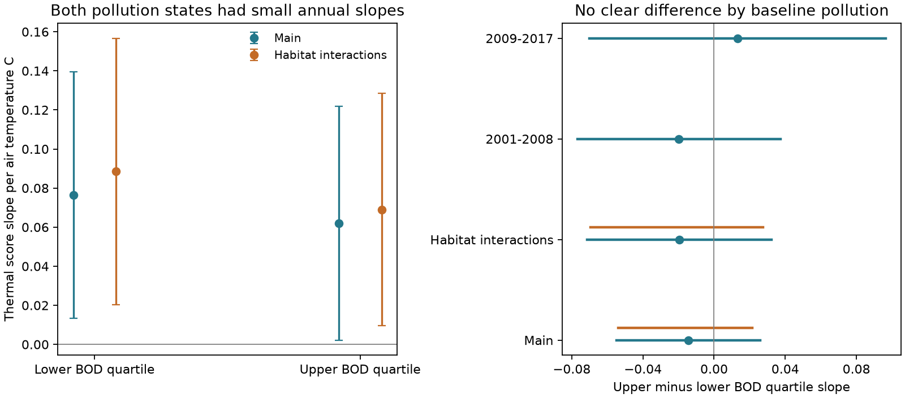

# Baseline organic pollution had no clear link to later annual thermal response at 217 English river sites

## Result

Early organic pollution did not give a clear difference in later annual thermal response in this selected river cohort. The upper-minus-lower pollution quartile difference was -0.0145 thermal-score units per air temperature C. The conditional 95% interval was -0.0550 to +0.0260. Habitat interactions gave -0.0195, with an interval of -0.0713 to +0.0324. These results do not establish an absence of interaction or an effect of pollution control.

At the lower and upper pollution quartiles, the fitted annual slopes were 0.0765 and 0.0621. Thus the point fits do not show a much larger response at the cleaner sites. These are slopes on a fixed early spatial direction. They are not fractions of national warming followed. We do not divide them by a new spatial denominator.



Blue lines show conditional cluster intervals. Orange lines in the right panel show central 95% site-bootstrap ranges with axis refitting. The bootstrap fixes years and baseline means. The two interval types address different sources of uncertainty and neither is a complete confidence procedure. Time-half results are exploratory stability checks.

## Question and relation to earlier work

The campaign found weak transfer from spatial temperature gradients to temporal community change. River analyses found weak annual transfer after additive pollution controls (SCI ab21b52e), weak BOD transfer (0bfafb93), and a much smaller spatial benchmark after habitat adjustment (d0562ea4). Other river studies tested flow moderation (9b01d7d0), finer taxon labels (71127c5e), and response directions outside the thermal axis (7b394515). These results do not test whether early pollution status predicts the later thermal slope.

Additive adjustment and interaction answer different questions. Pollution can shift the mean community state without changing its temperature slope. It can also change the slope. We test the second possibility with pollution measured before the response window. This adds a time-ordered effect-modification test to the existing river work. It is a new analysis of the same source network, not an independent monitoring replication.

Vaughan and Gotelli (2019, DOI 10.1038/s41467-019-09736-3) studied water-quality recovery and climatic debt with a community-state model. Oxygen demand gives a biological reason to test pollution-dependent thermal response. The review DOI 10.1088/1748-9326/ab9b42 links oxygen supply, temperature and freshwater invertebrates. Our outcome is a spatial composition score, not thermal mortality or oxygen stress. A weaker or stronger score response cannot on its own show ecological harm. This test neither replicates nor rejects the earlier environmental-credit result.

## Data

We used ChemPop version 2.0, Bachiller-Jareno et al. (2025), DOI 10.5285/23f194b0-1e21-4f14-be9c-6eabdcc1feb7. Contains data supplied by UK Centre for Ecology & Hydrology. Environment Agency records and CHESS-met air temperature are matched in this product. The source page states an Open Government Licence. Raw records and all derived site- and sample-level tables remain outside the signed publication.

We retained the published cohort: September-November samples in 1991-2017, one sample per site-year nearest 15 October, then sample ID as tie rule. Temperature, biochemical oxygen demand (BOD) and ammonia had to be present. A site needed at least three samples in 1991-2000 and eight in 2001-2017. There were 217 sites, 1,397 baseline samples and 2,318 later samples. This is a selected subset of 1,519 source sites.

Positive abundance defines family presence. Repeated family records use their union. We retained 79 family or broader operational labels found at at least 30 baseline sites. Each community entry is sqrt(presence / retained richness). Family resolution cannot detect replacement within a family. Sorting, detection and richness can change this score.

BOD and ammonia are log(1 + source LOQ3 concentration). Exposures are source six-month pre-sample means. Temperature is air temperature, not benthic or water temperature. The baseline pollution moderator is the site mean of transformed BOD in 1991-2000. Its median is subtracted and its interquartile range is the scale. The reported difference thus compares the 75th and 25th percentiles of baseline BOD. It is a continuous interaction, not a fitted group split. Exact quartiles and cohort counts are in files/diagnostics.json.

## Method

We retain the early chemistry-trained thermal direction from prior work. Baseline climate is a site term after year-month adjustment of air temperatures. Baseline site-mean composition is regressed on baseline climate, BOD and ammonia. Two folds are balanced within region with seed 810. For each site, the thermal family-coefficient vector g is trained in the other fold. The sample score is Y dot g / (g dot g). Vocabulary selection uses all baseline sites. A unit slope exists in spatial training by construction; validation in prior work was separate. This score is not a direct species tolerance measure.

In later data the regression is:

S_it = site effect + month effect + region-by-year effect + beta*T_it + delta*T_it*M_i + controls.

Controls are current log BOD, current log ammonia, linear survey day and baseline moderator by year terms. The last terms remove common year shocks that differ with early pollution status, including moderator-specific trends. Baseline moderator main effects are absorbed by site effects. Delta is the upper-minus-lower baseline pollution quartile slope difference. Beta is the slope at median baseline pollution. Separate temperature effects by site are not fitted.

The habitat sensitivity adds temperature interactions with baseline ammonia and ten static descriptors: altitude; log(1 + slope, source distance, width and depth); boulder/cobble and silt/clay shares; upstream woodland, arable and urban shares. They are standardised over sites. All 217 sites have these covariates. Main static effects are absorbed by site effects. Land cover is from 2015 and physical descriptors have mixed dates. These controls can overadjust pathways and are descriptive.

The fixed-effect projection uses weighted alternating demeaning. The conditional covariance is clustered separately by site and year, with finite-count and fixed-effect degrees-of-freedom corrections. Each contrast uses the larger of the two standard errors and a t critical value with years minus one degrees of freedom (16 in the full period). Taking the maximum is a conservative diagnostic, not a proved substitute for multiway dependence or basin clustering. Both component standard errors are supplied.

The site bootstrap samples sites within each region, uses the same weights in axis training and temporal regression, and refits the thermal axes. It keeps the original folds, baseline community means, baseline environmental coordinates, moderator scaling, vocabulary and years fixed. It therefore tests a restricted source of training uncertainty. It does not include common year shocks, baseline-mean error, spatial basin dependence or all exposure error. We use 199 draws with a fixed seed. The percentile ranges are sensitivity ranges; they are not used as a full-coverage claim. Repeated records are represented by weights.

## Estimates and sensitivity

| Model | Lower BOD slope | Upper BOD slope | Upper minus lower | Conditional 95% interval for difference |
|---|---:|---:|---:|---:|
| Main, 2001-2017 | 0.0765 | 0.0621 | -0.0145 | -0.0550 to +0.0260 |
| Habitat interactions | 0.0885 | 0.0690 | -0.0195 | -0.0713 to +0.0324 |
| 2001-2008 | 0.0788 | 0.0591 | -0.0197 | -0.0767 to +0.0373 |
| 2009-2017 | 0.0919 | 0.1051 | +0.0132 | -0.0702 to +0.0965 |

The baseline log-BOD quartiles were 0.8909 and 1.1716. Their back-transformed values were 1.437 and 2.227 in source concentration units; these are not quartiles of arithmetic raw BOD means. The refitted-axis site-bootstrap range for the main difference was -0.0538 to +0.0215. The habitat range was -0.0694 to +0.0276. Both include zero. Across five alternative fold seeds, main difference estimates ranged from -0.0222 to -0.0128. Omitting one region at a time gave -0.0403 to -0.0032. These point checks do not supply independent interval evidence.

The late half has 921 records at 211 sites. The early half has 1,397 records at 217 sites. The sign changes between halves and both intervals include zero. These are exploratory checks, not independent replications. Full coefficients, interval components, design rank and sample counts are in files/estimates.csv. Fold and region checks are in files/checks.csv. Bootstrap draws and summaries are bundled as aggregate statistical outputs.

The main analysis plan was saved before fitting the interaction. No outcome-based threshold, species screen or favourable region was selected. The independent solver audit matched an explicit dummy-variable weighted regression to 2.50e-15 and recovered a planted -0.2 interaction to 4.17e-17 on an unbalanced synthetic panel. All temporal designs had full column rank. The audit checks implementation, not field identification.

## Meaning and limits

This study finds no clear evidence that the measured baseline pollution gradient sets the later annual thermal response in these records. The point fits are small at both quartiles. This is a constraint on one candidate modifier, not a solution to the community tracking gap. We do not claim an equivalence margin, a pollution-attributable gap fraction or a causal intervention benefit.

A site's baseline pollution can proxy habitat, river size, species pool, geography or earlier ecological damage. The chemistry-trained outcome still carries spatial ecological structure. Air-to-water buffering, short annual response, family resolution, changing detection, unmeasured flow and nonlinear interactions can all hide effects. BOD is not dissolved oxygen or total chemical pressure. Baseline status is not a measure of each site's later pollution recovery. Acute interaction with current pollution and effects on extreme thermal tolerance remain untested.

Region-year and moderator-year effects remove shared change. The result concerns local annual departures, not a national long-term warming response. Earlier work showed no clear warming trend in this exact later exposure panel. A claim about national climatic debt from these slopes would be unsupported. Source overlap with earlier river studies also limits independent confirmation.

## Reproduce

Use Python 3.12 with numpy, pandas, scipy, statsmodels, pyarrow and matplotlib. Numerical library threads are fixed to one in the scripts. The exact used package versions are in files/diagnostics.json and files/environment.json. Use a scratch directory outside the extracted publication. No private workspace file is needed.

Use the exact shared archive documented in files/provenance.json and files/EXTERNAL_DATA.md, or retrieve it as follows:

```bash
python files/retrieve.py /absolute/path/to/external
python files/build.py --archive /absolute/path/to/external/chempop.zip --out /absolute/path/to/input
python files/analyze.py --input /absolute/path/to/input --archive /absolute/path/to/external/chempop.zip --out /absolute/path/to/analysis --boot 199
python files/report.py --analysis /absolute/path/to/analysis --out /absolute/path/to/report
python files/audit.py --out /absolute/path/to/audit
```

Compare estimates.csv, checks.csv, bootstrap.csv, diagnostics.json, bootstrap_summary.csv, sensitivity.json, pollution.png and audit.json. The archive SHA256 is 06ff765e64667a9af38cf0ae44bdd8d797480f5058a5963b5ad9a567c32a0b9e. The 35 used CSV hashes are the strict checks if server-generated ZIP metadata changes. The builder reads 28 biology/exposure CSVs; the analysis reads seven site-variable CSVs. External databases and regenerated record-level tables must stay outside this bundle.

Campaign 11_07_2026. Job sci-1107-dell-climate-pollution-biodiversity-cd8e0d0b7d92. Topic climate-pollution-biodiversity. Machine dell. Account codex-olen. Model gpt-6.1-sol, high reasoning effort. One finite worker did this investigation; no subagents were used. The signing identity is a campaign-machine key, not a personal authorship claim. Code reused from earlier SCI publications is attributed in files/EXTERNAL_DATA.md. Only our code, text, original figure and aggregate statistical evidence are licensed in this bundle.
