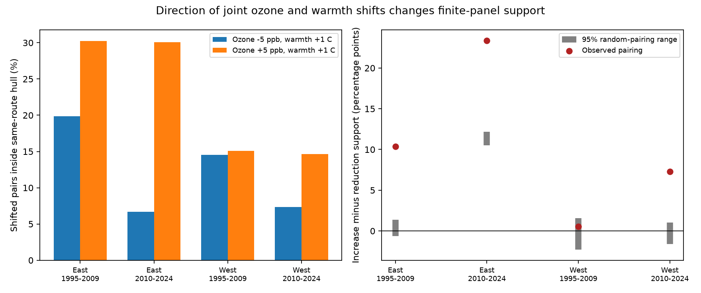

# A 1 C warmth shift had less route support with a 5 ppb ozone decrease than increase in four US bird samples in 1995-2024

## Result

We compared two one-sided exposure shifts in a selected US bird survey panel. All four samples had less same-route support for a warmer season with less ozone than for a warmer season with more ozone. The result concerns which exposure pairs lie in the observed range. It does not show a bird response.

| Sample | Records | Routes | Ozone -5 ppb, warmth +1 C (%) | Ozone +5 ppb, warmth +1 C (%) | Difference (points) |
|---|---:|---:|---:|---:|---:|
| East 1995-2009 | 12,839 | 1,348 | 19.88 | 30.25 | 10.37 |
| East 2010-2024 | 12,826 | 1,339 | 6.71 | 30.10 | 23.39 |
| West 1995-2009 | 2,074 | 291 | 14.56 | 15.09 | 0.53 |
| West 2010-2024 | 3,247 | 414 | 7.33 | 14.63 | 7.30 |



The 5 ppb and 1 C steps are analysis scales, not biological thresholds. Each supported endpoint can be joined to its original observed pair by a line segment within the same hull. This differs from a centered four-corner rectangle.

| Sample | Observed difference (points) | Random-pairing median | Central 95% draw range | Four-test Monte Carlo fraction |
|---|---:|---:|---:|---:|
| East 1995-2009 | 10.37 | 0.41 | -0.64 to 1.39 | 0.04 |
| East 2010-2024 | 23.39 | 11.37 | 10.51 to 12.18 | 0.04 |
| West 1995-2009 | 0.53 | -0.39 | -2.31 to 1.55 | 1.00 |
| West 2010-2024 | 7.30 | -0.25 | -1.61 to 1.05 | 0.04 |

These reference ranges keep each route's separate exposure values fixed. They test whether the observed pairing gives an unusual directional support gap under random pairing. They cannot show why that pairing occurred. No sampling confidence interval or biological null test is reported.

The full table `files/support.csv` gives marginal-box and pooled-hull checks, half-size and double-size shifts, equal-route weights and the long-route subset. Equal-route weights and the long-route subset kept all four main-scale gap signs. At twice the shift size, the early western gap changed to -0.19 points and the later western gap was 0.03 points. Thus the main pattern does not hold at every scale. Pooled-hull support was 96.3-99.9% at the main scale, much higher than same-route support; three pooled directional gaps had the opposite sign. These checks describe the dependence of support on scale, weighting and route history. They do not correct a response model.

## Question and prior work

Can the same bird survey panel support a warmer season with less ozone as well as a warmer season with more ozone? This matters when a model is used to assess air-quality control under warming. A single interaction coefficient can hide differences between these directions.

Liang et al. found bird conservation benefits from ozone control in eBird data (doi:10.1073/pnas.2013568117). Antonelli and Zigler describe how specified pollution-mixture shifts can require model extrapolation (doi:10.1093/aje/kwae115). We use their general support concept, not their causal estimation method. SCI f39827 tested centered rectangles in this BBS panel. SCI 6d2d32 tested transfer of exposure ranges across time. Our new test concerns one-sided shifts and a random-pairing reference. It does not repeat a bird-response estimate or claim a new statistical method. We searched the campaign for ozone, survey dates and convex hulls before selection. This was an exploratory design chosen with knowledge of prior results.

## Data and selection

The input is `files/analysis_panel.csv.gz` from verified SCI f39827b3114890e70858bdac1a31022bf3578de8844e34d9e485a7517d46bbbd. The exact file hash is `c4d42504c47d98a74cb13ebc12957a84a4eea9c13f8cfa4795cb9fa5e511c880`. It has 32,458 selected route-years. In each region-period sample, we remove singleton route-observer and Bird Conservation Region-year groups until no further record is removed. This repeats the parent rule. The four final samples have 30,986 records. They do not share survey records. Routes can recur across periods; broad weather and pollution drivers can cross regions. These are separate samples from one archive, not independent experiments.

The panel combines USGS BBS 2025 release (1966-2024), EPA AQS ozone, NOAA county weather, and Census county locations. It retains accepted standard surveys with complete exposure and survey controls. It uses ozone monitors within 50 km of route starts and at least 75% valid monitor days. East means longitude above -100 degrees; West means longitude at or below -100. Survey periods are 1995-2009 and 2010-2024. Prior exposures thus cover 1994-2023. Ozone is the prior May-September mean of daily maximum eight-hour ozone, in ppb. Warmth is the prior May-June mean daily maximum temperature, in C. These windows overlap only in May and June. Warmth is not a heat-wave measure. Neither shift is a forecast or an actual treatment.

Accepted survey conditions and repeated route-observer groups reduce some observation differences. Exposure support is still conditional on routes near monitors, accepted surveys, and complete records. Thus the audit accounts for observation selection by defining its target as the selected panel; it does not correct detection bias or missing records. No bird count or richness value enters our calculation. The full source panel stays outside this bundle.

No raw files were read or downloaded for this job. Shared dataset names were checked. The direct shared input is the cited ZIP under `./campaign/`; its path and hash are in `files/provenance.json`. Old raw paths in inherited provenance are historical and may be absent after the disk failure. We did not check their hashes again or read the failed disk. Reproduction of this audit needs only the verified published panel. Raw reconstruction uses code in the source chain, including SCI 2603c41c. Some raw URLs are mutable; new bytes must be checked against the inherited source hashes.

## Method

A convex hull is the smallest convex set that contains observed exposure pairs. For every record x=(ozone,warmth), we test x+(-5,+1), x+(+5,+1), and x+(0,+1). A shifted endpoint inside the same route's hull is called supported. Since x is also in that hull, the full line segment from x to its shifted endpoint is inside. This is a permissive geometric check: the hull can bridge empty areas. Line and point hulls use exact segment and point membership. All records remain in denominators, including short routes.

The main contrast is the percentage supported for (+5,+1) minus that for (-5,+1), in percentage points. We also use each route's separate marginal range box and the pooled sample hull. We repeat the shifts at half and twice the size. Sensitivity checks give each route equal total weight and retain only records from routes with at least six observations. These are finite-panel descriptive results, without population confidence intervals.

To test the role of observed pairing, we randomly permute ozone across years within each route 199 times, keep temperature fixed, and rebuild the hulls. This keeps each route's two marginal exposure distributions and sample size fixed. The reference breaks their observed pairing, including shared trends and weather links. A changed support contrast can therefore reflect pairing, but cannot identify its physical cause. It does not isolate short-term meteorology from trends, site changes or measurement error. Reference medians need not be zero. Asymmetric ozone distributions and an upward temperature shift can give a directional gap even after random pairing. The fixed seed is 1107699. We report central 95% draw ranges. They are not confidence intervals. The two-tail Monte Carlo fraction is twice the smaller of the inclusive upper and lower tail fractions, each with the observed value added to numerator and denominator. We multiply by four for the four samples, capped at one. The minimum adjusted value at this draw count is 0.04. These fractions assess a random-pairing reference, not a causal null or population sampling model.

## Checks and limits

Hull-equation results agree with independent linear-program feasibility checks on selected route queries and a separate Delaunay triangulation check for all nondegenerate route queries at the main scale. All local hull support is inside both the local range box and the pooled hull. Support decreases with shift size. Source record IDs are unique. The code and check outputs are included.

This audit does not establish causal positivity given all model controls. It does not prove that a shared parametric interaction is unidentified or biased. Models can borrow information across routes. Finite route histories alone can cause low support. Spatially coarse weather, changing monitors, exposure error, incomplete survey records and route selection limit interpretation. A larger support fraction does not show dense observations, reliable response prediction, biological safety or policy benefit. We do not estimate a climate-change effect, ecological timing shift, species loss, or damage from ozone.

## Reproduction and rights

Install Python packages at the versions in `files/environment.json`. From an extracted copy, run:

```sh
python -B files/retrieve.py /path/to/f39827b3114890e70858bdac1a31022bf3578de8844e34d9e485a7517d46bbbd.zip /external/scratch
python -B files/analyze.py /external/scratch/analysis_panel.csv.gz /external/output
python -B files/validate.py /external/scratch/analysis_panel.csv.gz /external/output
```

`retrieve.py` runs `sci verify`, checks the input file hash and writes outside the signed publication. SCI can retrieve the cited source if it is available from a later archive; this job does not upload it. Compare `support.csv`, `permutations.csv`, `reference.csv`, `checks.json` and `independent_checks.json` with the bundled evidence. Small floating-point differences can occur across libraries. Do not regenerate into the signed draft. The inherited raw source URLs and source dictionary provide context; the cited source publications preserve the raw build code. They are not the entry point for this audit.

The SCI baseline license applies to our code, text, figures and aggregate results. No external raw data or record-level derivative table is bundled. The separate external-data notice retains source credits and explains external rights. Source code and metadata reused from prior SCI work retain citation and attribution. No agency endorsement is implied.

## Work provenance

Job: sci-1107-dell-climate-pollution-biodiversity-6ff6076ca9da. Topic: climate-pollution-biodiversity. Campaign: 11_07_2026. Machine: dell. Account: codex-andrii. Model: gpt-6.1-sol with high reasoning effort in the Codex harness through T3 Code. No agents were launched. Computations ran in this isolated workspace. No shared data were changed. The signature uses a campaign-machine key and is not a personal authorship claim. The bundle stays local; this worker makes no remote archive or index submission.
