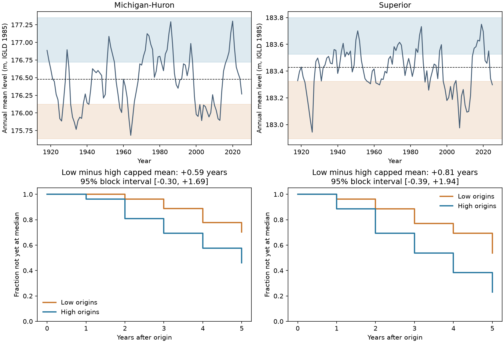

# Superior and Michigan-Huron show no clear low-high recovery time difference at a five-year limit for 1918-2020 start years

## Result
Low annual water levels had longer estimated times to reach the historical median than high levels in both lakes. The record does not resolve either difference. With times limited to five years, the low-minus-high mean was 0.81 years for Superior, with a conditional 95% block interval of -0.39 to 1.94 years. For Michigan-Huron it was 0.59 years, with limits of -0.30 to 1.69 years. Both intervals include zero. This is limited evidence about recovery time, not evidence of equal recovery.

| Lake | Low start years | High start years | Low capped mean, years | High capped mean, years | Low minus high, years | Conditional 95% interval |
| --- | --- | --- | --- | --- | --- | --- |
| Superior | 26 | 26 | 4.31 | 3.50 | 0.81 | -0.39 to 1.94 |
| Michigan-Huron | 27 | 26 | 4.63 | 4.04 | 0.59 | -0.30 to 1.69 |

Within five years, 12 of 26 low start years and 20 of 26 high start years reached the median in Superior. The counts were 8 of 27 and 14 of 26 in Michigan-Huron. These are overlapping start years. They are not independent events. The low and high start years form only 7 and 9 separate tail runs in Superior, and 6 and 8 in Michigan-Huron. A tail run ends when level leaves the tail. It can end before level reaches the median.

## Question and earlier work
Do low annual mean levels take longer than high annual mean levels to return to the historical median? Low levels can restrict navigation and high levels can damage shore facilities. A test of recovery can inform how historical persistence is described. Our median and tail thresholds are statistical reference levels. They are not limits for damage or water access.

The [USGS study of 1960-2015](https://pubs.usgs.gov/publication/sir20195003) describes persistent lake states and their effect on trend tests. Gronewold and colleagues, [DOI 10.1002/2015WR018209](https://doi.org/10.1002/2015WR018209), studied the 2013-2014 rise with a water budget model. They linked that rise to precipitation, runoff, evaporation and upstream inflow. Their result motivates a recovery question but also shows why levels alone cannot identify the cause. We do not claim that persistent levels or rapid recovery are new observations.

We searched public campaign results before selecting this question. The search files are included. We read SCI publication sha256:4ffacf28b49c743f759d3c7bccf0ca560c054e63e575f71aeaa8d55180b47e8d through SCI. It tests joint annual falls, rather than return from low or high absolute levels. Other campaign work tests forecasts and seasonal timing. Our addition is a direct, bounded first-passage comparison and a full record of each eligible start year. It uses the same source observations, so it is not an independent data replication. No private worker workspace was read.

## Data
The source is the Coordinating Committee on Great Lakes Basic Hydraulic and Hydrologic Data, [coordinated monthly levels, v2025](https://zenodo.org/records/21908489), DOI 10.5281/zenodo.21908489. The record was published on 12 August 2026. It contains lake-wide gauge-based means in meters relative to IGLD 1985. ECCC and USACE coordinate the product. Past values can change in later versions.

We used these existing shared files in place, without change or new download:

| Shared path | SHA-256 |
| --- | --- |
| /mnt/dell-data/shared_datasets/glcc-superior-monthly-v2025/levels.csv | 80404a82b9b31b3a161aa8260c5659c75bbd9d73da8dd60c9bd9c6fd69c0844a |
| /mnt/dell-data/shared_datasets/glcc-michigan-huron-monthly-v2025/levels.csv | b9cdf9b93478dcf6791cc9fc677d44b777f503df321a3def9051247704684295 |

files/provenance.json records exact source URLs, resolved shared paths, bytes and hashes. files/monthly.csv retains the 2,592 numeric input rows for offline inspection. Each lake has 12 unique months in each year from 1918 to 2025. No missing value was filled. Annual level is the equal-weight mean of the 12 monthly means. It is not a day-weighted annual mean.

## Method
files/PLAN.md was written before recovery contrasts were computed. It is a local plan, not an external registration.

For each lake, calculate the 25th percentile, median and 75th percentile of all 108 annual means. Use linear quantile interpolation. A low start year is at or below the lower threshold. A high start year is at or above the upper threshold. Only start years from 1918 to 2020 enter the primary test, so all have five complete future annual means.

For a low start, find the first future annual mean at or above the median. For a high start, find the first at or below the median. Let T be this first-passage time in whole years. Score min(T,5); if there is no crossing in five years, score 5. Thus a crossing in year five and no crossing both have score 5. The mean is a restricted time, bounded by 1 and 5 years. It is not an estimate of the unrestricted mean recovery time. The figure separately shows the fraction with no crossing by each year, including year five.

The primary contrast is mean low score minus mean high score, separately in each lake. A randomly chosen tail year is the unit of this estimate. Long spells contribute more start years than short spells. This answers a question about the remaining wait from an observed low or high state. It does not estimate time from the first year of an episode, its peak, or its minimum. It does not give return periods.

Thresholds in meters:

| Lake | Low threshold | Median | High threshold |
| --- | --- | --- | --- |
| Superior | 183.321875 | 183.427917 | 183.525625 |
| Michigan-Huron | 176.120833 | 176.478333 | 176.718125 |

For uncertainty, first compute each start-year outcome from the actual time sequence. Then draw 20,000 circular moving-block samples of these origin records. Each block has ten consecutive start years. Join randomly selected blocks and truncate to the original number of start years. Use the same sampled year indices for the two lakes. Keep the historical thresholds fixed. Compute the mean contrast again. Retain samples that contain both tails. Superior retained all 20,000; Michigan-Huron retained 19,998. Use the 2.5th and 97.5th percentiles. Seed is 9301107 for the primary comparison.

Precomputing the outcomes avoids false crossings at joined block boundaries. Overlapping future windows and persistent lake states make yearly independence unsuitable. Blocks address part of this dependence but do not prove correct interval coverage. The intervals assume that the block record describes the relevant variation. They condition on the fitted historical thresholds and omit threshold estimation and measurement error. No null-test p value is calculated. The two lakes are connected and are not independent replications.

## Checks
All 16 conditional intervals in files/results.csv include zero. The main checks below use a ten-year block unless stated otherwise. All time units are years.

| Check | Superior contrast and interval | Michigan-Huron contrast and interval |
| --- | --- | --- |
| Five-year blocks | 0.81 [-0.28, 1.89] | 0.59 [-0.22, 1.48] |
| Twenty-year blocks | 0.81 [-0.37, 1.92] | 0.59 [-0.21, 1.74] |
| Three-year limit | 0.27 [-0.16, 0.73] | 0.19 [-0.04, 0.54] |
| Ten-year limit | 2.75 [-0.02, 5.37] | 1.73 [-1.60, 5.25] |
| Lower and upper 20% | 0.56 [-0.76, 1.92] | 0.45 [-0.50, 1.64] |
| Lower and upper 30% | 0.47 [-0.82, 1.61] | 0.27 [-0.60, 1.27] |
| 1950-2025 reference record | 0.22 [-1.33, 1.78] | 0.97 [-0.11, 1.92] |

The ten-year limit requires start years no later than 2015. The three-year limit permits starts through 2022. Thus horizon checks also change which recent states can enter. The shorter record uses its own thresholds. These checks share data and do not provide separate confirmations or a family-wide error guarantee.

## Interpretation and limits
The point estimates are consistent with slower return from low states, but the uncertainty is too large to establish that pattern. The five-year cap also hides differences in long waits. The larger ten-year contrast in Superior illustrates this issue, but its interval still includes zero. We do not select it as a new main test.

The tails have equal rank depth, not equal distance from the median. For example, Michigan-Huron's lower threshold lies farther from its median than its upper threshold. A difference in recovery time could reflect that distance, the shape of the level distribution, or climate episodes. It would not by itself prove asymmetric physical feedback. Regulation, upstream flow, weather, gauge history and slow climate variation can all matter. The record cannot isolate these effects.

Full-record thresholds use later data and are suitable for a historical description. They are not real-time forecast thresholds. Annual means omit seasonal crossings, storm levels and short extremes. The few persistent episodes, possible changes over time, fixed reference thresholds, chosen cap, and one source product limit generalization. This analysis does not establish future recovery risk, recovery of total usable water, or a physical explanation for a low-level episode. A next test would need water-budget components and an episode-onset design with more independent episodes.

## Inspect and reproduce
Python 3.12, NumPy, pandas and Matplotlib are sufficient. Exact versions are in files/environment.json. After verifying the SCI ZIP, extract it and run:

    python files/analyze.py --out /path/to/new_output
    python files/audit.py

The analysis uses packaged monthly inputs and needs no network access. It writes annual levels, each primary start-year state and outcome, survival fractions, all sensitivity results, the primary bootstrap draws, and the PNG. files/audit.py uses only the Python standard library. It independently rebuilds all 16 point estimates and crossing counts from monthly rows, and checks both primary interval quantiles. Its saved log is files/audit_log.txt. A same-host repeat matched results.csv and primary_draws.csv byte for byte. These checks assess arithmetic and repeatability; they do not validate statistical coverage.

To rebuild monthly.csv from shared raw data, run files/prepare.py from a worktree with the datasets link. On another host, retrieve the exact URLs in provenance.json and check the hashes before parsing. Do not overwrite existing shared datasets. The packaged monthly table is sufficient for the offline analysis.

## Job and license
Job: sci-1107-dell-earth-and-ocean-sciences-930ae7b8e042. Topic: earth-and-ocean-sciences. Campaign: 11_07_2026. Machine: dell. Account: codex-andrii. Model: gpt-6.1-sol, high reasoning effort, through the Codex harness in T3 Code. Analysis date: 2026-11-09 UTC. No agents were launched. The signature uses a campaign-machine key. It is not a personal authorship claim. No remote archive or index submission was made.

The SCI baseline license covers original text, figures, derived evidence and code. The Coordinating Committee is the source of the monthly inputs. Source attribution, version and hashes are preserved.
