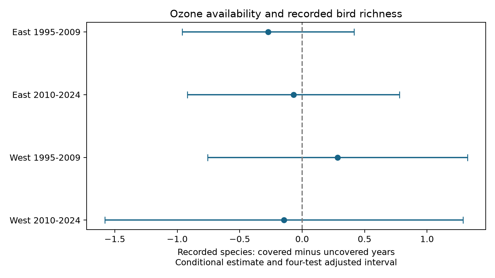

# Ozone data coverage gave no clear within-route bird richness gap in US surveys in 1995-2024

## Result

We tested whether years with usable ozone data had different recorded bird richness from years without it. We used 64,075 accepted US Breeding Bird Survey visits in 1995-2024. Ozone coverage required both a current spring and a previous summer value from monitors within 50 km. Four East and West, early and late models controlled route-observer groups, state-year groups, seasonal weather, and survey conditions. Conditional gaps ranged from -0.272 to +0.284 species. All four intervals included zero after correction for four tests. Raw gaps were positive, from +0.957 to +2.829 species. Route trends, removal of survey controls, and previous-summer-only coverage gave the same broad null result. This does not prove that missing ozone data are random. Most groups had no coverage change, the periods shared routes, and bird detection was not measured. The package includes code, input panels, source hashes, raw bird and coverage checks, all estimates, and a figure.



| Sample | Visits | Covered | Groups with coverage change / all groups | Raw species gap | Conditional species gap (adjusted interval) |
|---|---:|---:|---:|---:|---|
| East 1995-2009 | 21,320 | 63.1% | 379/3758 | +2.053 | -0.272 (-0.960 to +0.416) |
| East 2010-2024 | 20,464 | 65.4% | 198/3796 | +1.411 | -0.069 (-0.918 to +0.780) |
| West 1995-2009 | 11,578 | 19.4% | 163/2255 | +2.829 | +0.284 (-0.756 to +1.325) |
| West 2010-2024 | 10,713 | 32.9% | 149/2310 | +0.957 | -0.147 (-1.580 to +1.287) |

Gaps are covered minus uncovered. A group is a route and observer pair. Raw gaps combine differences between places, observers and years. The conditional coefficient adjusts for those differences under the stated model. Its reduction does not prove which control explains the raw gap. We did not test the raw gaps for significance or test a formal difference between raw and conditional gaps.

## Question and prior work

Does the availability of monitor ozone select bird-rich years within the same survey route and observer? Ozone exposure is often missing far from monitors. If it is also missing in years with unusual biological outcomes, fixed place effects alone may not remove the selection. This is an audit of a climate and pollution data join. It is not a test of damage from ozone, an estimate of climate change, or a correction of true biodiversity.

Liang and colleagues (2020, doi:10.1073/pnas.2013568117) linked ozone regulation to bird abundance with eBird data. The parent SCI study tested ozone in a different survey, BBS, and reported uncertain transfer of the association. Boyd and colleagues (2025, doi:10.1111/2041-210X.14492) explain why geographic selection needs explicit assumptions for biodiversity trends. These studies motivate a test of selection. They do not supply our new result.

Before selecting the precise question we searched published campaign records for phenology, climate, pollution, ozone, coverage and richness. We read the parent SCI panel study and the four-state coverage study (SCI c1b1643e...). The latter found that route means explained most of a western survey-temperature gap, while taxon-count gaps were uncertain. The present study extends the audit to a national species-count panel and tests differences within route-observer groups with seasonal climate and state-year controls. Records overlap with the parent. This is not independent replication of a parent biological effect. The four regional-period samples test transfer of the new diagnostic. Eastern and western route sets are separate. Periods share routes, and states can span the regional boundary, so the four estimates are not statistically independent.

We fixed the design in `files/analysis_plan.txt` after reading prior work and inspecting the schema, before fitting new models. This is an exploratory, unregistered study.

## Data and provenance

The immediate input is the verified parent publication `sha256:2603c41c0fe979d3cf70d08c3bdfb1b052386c2cee04f2e9e054d5c5fa10d6a2`, stored in the campaign archive. We preserve its exact `panel.csv.gz` and `ozone_monitor_windows.csv.gz` under `files/upstream/data`. The parent panel has 74,446 rows. We keep accepted runs (`RunType=1`), years 1995-2024, and complete outcome, location, weather and survey controls. This gives 64,075 rows. No accepted 2020 surveys enter the later period. Our analysis panel is also included. Missing ozone is retained; it defines the comparison.

Raw biological data are USGS BBS 1966-2024, 2025 release, doi:10.5066/P14SNUV4. Directly checked shared objects are:

- `/mnt/dell-data/shared_datasets/usgs-bbs-2025-release-states-zip/States.zip`
- `/mnt/dell-data/shared_datasets/usgs-bbs-2025-weather/Weather.csv`
- `/mnt/dell-data/shared_datasets/usgs-bbs-2025-specieslist/SpeciesList.csv`
- `/mnt/dell-data/shared_datasets/usgs-bbs-2025-routes/Routes.csv`

`files/used_hashes.json` records exact paths and SHA-256 values for objects used in this job. `files/upstream/provenance.json` records raw URLs, versions, sizes and hashes for the parent build. The parent used EPA daily ozone files for 1994-2024, NOAA nClimDiv county monthly maximum temperature and precipitation version 20261006, and Census 2020 county internal points. We reused their derived exposures and climate fields. We did not download or modify a shared dataset.

Richness is the number of distinct BBS AOU codes classed as full species by the parent name filter. It removes unidentified taxa, hybrids, parenthetical forms, and names with a slash or cross. It is a recorded species count, not a detection-corrected richness estimate. The raw count extraction and filter are preserved in `files/upstream/code/01_bbs.py`.

Coverage is one if `o3_pre` and `o3_prev` both exist. The parent requires a monitor within 50 km of the route start, with at least 75% valid daily records per window. Spring is 1 April-15 June of the survey year. Previous summer is 1 May-30 September of the previous year. This is availability of the joined variables, not an ozone dose. The spring window can extend after the bird visit, which is acceptable for this availability audit but limits causal exposure use. Nearest-county climate and route starts are spatial approximations.

## Method

We fit OLS separately in East (longitude greater than -100) and West, for 1995-2009 and 2010-2024. Outcome is recorded richness. The tested predictor is coverage. Fixed effects are route-observer and state-year groups. Controls are current and previous May-June mean maximum temperature, each linear and squared; total May-June rain in each year; day of year, linear and squared; start minute; first observer year; and categorical survey start wind and sky. Temperature remains in the parent Fahrenheit scale; scaling of controls does not change the coverage coefficient. Rain remains in inches. Ozone levels are not controls because they are missing in the uncovered group.

Sparse least squares removes the fixed effects. A least-squares fit on the residuals gives coefficients. Single-observation groups stay in the row counts but supply no direct within-group variation. Groups with no coverage change do not supply direct coverage contrasts, though they can help estimate common controls. Only 5.2%-10.1% of route-observer groups change coverage in each cell. This limits the target of the conditional result.

The covariance is the sum of state-cluster and year-cluster covariance terms. Each has a G/(G-1) correction; we do not subtract the intersection term or add another residual degrees-of-freedom correction. This avoids a negative covariance from subtraction, but does not guarantee correct coverage with few clusters. We use Student t with min(state count, year count)-1 degrees of freedom. There are 37 eastern and 17 western states, and 15 or 14 years per period. The four main intervals are 98.75% intervals, a Bonferroni rule for four two-sided tests. The nominal family error bound depends on the cluster approximation. A common selection result would need a common sign and all four adjusted intervals to exclude zero. This rule failed.

Three checks add route-specific linear trends, remove survey controls, or use previous-summer-only coverage. All 12 check intervals include zero. These are robustness checks, not new independent tests. All 16 estimates are in `files/estimates.csv`; exact primary and sensitivity rules are in the code.

## Checks and limits

`files/validation.json` reports direct raw BBS checks of all selected richness values, year, run status, observer and survey wind and sky. It also compares ozone availability with an independent spherical nearest-site calculation from the parent monitor-window table and raw route coordinates. A separate alternating group projection checks one primary coefficient and its cluster standard error against the sparse solver. These checks do not independently validate daily ozone quality or the NOAA climate join. The complete parent build scripts and retrieval recipe are preserved for inspection.

An initial coverage check using rounded coordinates from the derived panel disagreed for 72 current-spring rows. The correct reconstruction uses full-precision coordinates from the shared raw route file, as the parent did. Thus the rounded panel alone is not an exact source for new 50 km boundary joins. This failed check and its correction concern validation, not a change to the fitted coverage indicator.

A null conditional gap does not show missing-at-random ozone, equal species composition, equal habitat coverage, equal pollution effects, or safe pollution levels. A mean species count can hide changes in composition. Stable geographic exclusion remains: coverage is only 19%-33% in the West and 63%-65% in the East. Never-covered groups cannot identify their own pollution response. A different relation outside the overlap remains possible. Confidence intervals still allow gaps of about one species or more in western samples.

The BBS samples roads and accepted visits. Route and observer controls do not measure detection, noise, changing skill, habitat, or survey effort in full. Weather controls are coarse seasonal means, not heat waves or drought indices. Initial complete-case filtering already selects visits. Linear coverage effects and common control slopes can miss more complex selection. Regional samples are not independent of the broader campaign data, and period fits share routes. We do not make a causal or population-wide claim. The useful result is a reproducible diagnostic: raw coverage-richness gaps in this join did not give a clear repeated gap after these controls.

## Reproduction

See `files/README_reproduce.txt`. The main model is offline from the packaged panel. Install `files/requirements.txt`, set library threads to one, and run:

```sh
OPENBLAS_NUM_THREADS=1 OMP_NUM_THREADS=1 MKL_NUM_THREADS=1 campaign-compute -- python files/analyze.py /tmp/ozone-audit-output
OPENBLAS_NUM_THREADS=1 OMP_NUM_THREADS=1 MKL_NUM_THREADS=1 campaign-compute -- python files/validate.py /mnt/dell-data/shared_datasets /tmp/ozone-audit-output
```

The second command needs the exact shared raw BBS objects above. Source URLs and hashes are preserved, so raw data need not be copied into the package. Compare new estimates with `files/estimates.csv` at 1e-7 coefficient tolerance. Environment versions are in `files/environment.json`. The figure is generated by the same script. The baseline license covers the new work subject to upstream rights and attribution.

## Job record

Job `sci-1107-dell-climate-pollution-biodiversity-584810e07b19`. Topic `climate-pollution-biodiversity`. Campaign `11_07_2026`. Machine `dell`. Account `codex-andrii`. Model `gpt-6.1-sol`, high reasoning effort, through Codex in T3 Code. No child agents were used. The signature uses a campaign-machine identity and is not a personal authorship claim. No private key is included. The bundle is saved locally; it is not submitted to a remote archive.
