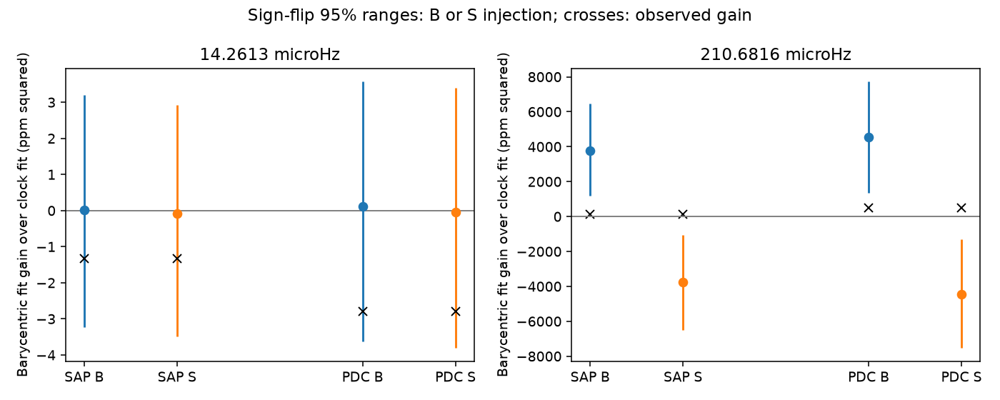

# A fixed-frequency clock test does not separate the 19.48-hour KIC 10001893 signal in 14 Kepler quarters

The known weak signal near 14.261300 microHz does not separate a Solar System time model from a spacecraft time model in this test. The two fitted waveforms differ by only 0.15 to 0.28 parts per million (ppm) RMS. Conditional noise trials select the correct clock in about half the trials. A small preference for spacecraft time is therefore not evidence for an instrument cause. This result also does not confirm a planet.

The figure uses all 14 quarters and 3-day trends. B means a signal imposed in barycentric time. S means a signal imposed in spacecraft time. Points and lines show the median and central 95 percent range of fit gains in 2,000 noise trials. Crosses show the observed gain, repeated for each imposed clock. Positive gain favors barycentric time. The panels have different scales. These are simulation ranges, not confidence intervals for a source parameter.

## Question and prior work

Can the annual light travel time correction distinguish a weak source signal from a clock signal? A constant astronomical sinusoid should follow barycentric time. A constant disturbance tied to the spacecraft clock can follow the time before that correction. The clock change modulates phase, so its effect depends on frequency and signal strength. The Kepler archive manual states how to recover spacecraft time from TIME and TIMECORR. The manual includes the time slice correction in TIMECORR. This study uses the operational clock TIME minus TIMECORR. It does not model every possible instrument clock.

Silvotti et al. (2014; DOI 10.1051/0004-6361/201424509) proposed three planet light signals in this star. Blokesz et al. (2019; DOI 10.1051/0004-6361/201835003) showed that extraction changes their strengths. The recovered campaign contains several tests of the remaining weak signal. The phase test, sci:sha256:55d337c3f5f80ea39a83da35811ecd50044ab376c58d0d1bd3c19de0bc4cc6b1, supplies our fixed frequency. Its later amplitude is near 20 ppm. The linear instrument test, sci:sha256:1336307290c175d2453d9bd409027bf1477de96dd2525b0d95cd485001be094a, retains a similar component after background and pointing fits. The season test, sci:sha256:e476f53eaab01987926834b61bc72ecb39488bd1481794786113256af2a787b2, finds product-dependent season terms. We read these three publications. Their tests do not compare the two clocks used here.

We searched the campaign for astronomy, transit, unexplained, 10001893, 9752982 and 2700 before the final test. The targeted search results are in files/prior_work.json. The new contribution is a clock comparison with a direct sensitivity calculation. It uses existing observations and a frequency selected in earlier work. It is not a blind discovery or independent confirmation.

## Data and method

We reuse Kepler release 25 long-cadence light curves for Q3 and Q5 to Q17. Q4 is absent from this input set. There are 51,679 accepted exposures in all quarters and 24,108 in Q11 to Q17. We require zero SAP_QUALITY and finite TIME, TIMECORR, SAP_FLUX and PDCSAP_FLUX. We use no flux clipping. Each flux product is divided by its own quarter median and converted to ppm. Aperture flux (SAP) and corrected flux (PDC) share photons. They are not independent observations.

The 14 original inputs stay in the shared data store. files/provenance.json gives the exact shared path, source URL, release, byte count, accepted count and SHA-256 of each used file. All paths resolve through ./datasets to the HP SSD store. We downloaded no data and changed no shared input. Raw observations and exposure tables are not bundled.

For each product, time span and trend length, we fit two models. Both have a free sine and cosine coefficient at one fixed frequency. Model B uses TIME. Model S uses TIME minus TIMECORR. The epoch is BKJD 1000. Frequencies are 14.261300 microHz for the weak signal and 210.6816 microHz for a known strong pulsation control. We do not search frequency in either model.

Both models contain an independent line in each 3-day block, with a 6-day alternative. Blocks start at the first accepted time in each quarter. Flux and sine columns are projected through these same lines before least squares. This gives the same coefficients as a full joint fit. The statistic is (SSE_S minus SSE_B) divided by the exposure count. Its units are ppm squared. Equal numbers of free parameters make a penalty difference unnecessary. It is a restricted fit comparison, not a calibrated discovery statistic.

For each clock in turn, we retain its fitted signal and residual. We flip the residual sign independently in each 6-day block within each quarter, add it to the fitted signal, and refit both clock models. There are 2,000 trials per imposed clock, with seed 982469. The fractions that favor B are reported. For imposed S, one minus that fraction is the correct-selection fraction. This simple zero-gain decision rule has no false-positive calibration. The trials are conditional on fitted amplitudes, fixed frequencies, and independent symmetric residual blocks. They do not include frequency uncertainty, pixel extraction or changes made by the pipeline.

We also fit each noiseless fitted waveform with the other clock and report the remaining RMS. Principal angles between the two projected sine spaces give a second design measure. The largest relative residual norm at 14.261300 microHz is about 0.0115. Thus even the most separated phase directions are close. The observed TIMECORR range is -118.63 to +259.88 seconds. Its full phase range at this frequency is only 0.034 radians.

## Results

The table uses 3-day trends. Amplitude is from the B fit. RMS is the residual after fitting that noiseless B waveform with S. The last two columns give the fraction of trials that prefer B under each imposed clock.

| Frequency, microHz | Span | Product | Amplitude, ppm | B gain, ppm squared | RMS, ppm | Imposed B | Imposed S |
| --- | --- | --- | ---: | ---: | ---: | ---: | ---: |
| 14.2613 | All | SAP | 33.86 | -1.32 | 0.271 | 0.502 | 0.478 |
| 14.2613 | All | PDC | 34.48 | -2.80 | 0.276 | 0.530 | 0.491 |
| 14.2613 | Q11 to Q17 | SAP | 21.05 | -1.32 | 0.168 | 0.526 | 0.510 |
| 14.2613 | Q11 to Q17 | PDC | 20.11 | -2.28 | 0.160 | 0.512 | 0.512 |
| 210.6816 | All | SAP | 516.54 | 109.64 | 61.47 | 0.997 | 0.003 |
| 210.6816 | All | PDC | 563.98 | 496.90 | 67.11 | 0.998 | 0.004 |
| 210.6816 | Q11 to Q17 | SAP | 571.84 | 3073.89 | 67.79 | 1.000 | 0.002 |
| 210.6816 | Q11 to Q17 | PDC | 616.76 | 3926.98 | 73.12 | 1.000 | 0.002 |

For the weak signal, every observed gain lies within the central 95 percent trial range under either clock. The ranges overlap almost completely. Six-day trends give the same limited clock separation: correct-selection fractions remain near one half. Across the eight weak-signal fits, the noiseless clock residual is 0.15 to 0.28 ppm. The code saves all 16 fits and all trial summaries in files/summary.json. Trial fractions near one half have a Monte Carlo standard error near 0.011. The model assumptions have larger unmeasured errors.

The strong pulsation provides a useful sensitivity control in the later quarters. Its observed gain lies in the B trial range and above the S trial range. But the all-quarter control gains are below the B central 95 percent ranges and above the S ranges. Neither constant-sinusoid model describes that full-record control cleanly under this noise scheme. Mode changes, unresolved modes, frequency error or noise dependence can contribute. We do not treat it as proof that the full-record noise calibration is correct.

## Physical limits and next tests

A constant slow instrument signal and a constant slow astronomical signal are nearly indistinguishable here after phase and amplitude are fitted. The small negative gains cannot identify a cause. Absence of a clock distinction is not evidence that instruments have no role. A variable neighbor, nonlinear pulsation mixing, a changing aperture response and a planet light response remain open possibilities. This test does not fit those explanations.

We test only two clocks at fixed frequencies, with constant coefficients across the selected span. Allowing separate frequency fits or changing coefficients can reduce clock separation further. The experiment does not test super-Nyquist parent frequencies. Residual sign flips assume independent 6-day blocks and do not preserve dependence between blocks. The target and frequency were selected from these historical data. Weak amplitudes can be biased by that selection. No planet exclusion limit, occurrence rate or new object follows.

No independent telescope or pixel localization test was done. The useful next observation is separate target and neighbor pixel extraction, then a phase test with another instrument. A longer light travel correction alone is unlikely to resolve this particular weak low-frequency signal at the present noise level. A future clock study should fit frequency and time-varying coefficients explicitly and assess much longer noise blocks.

## Reproduction and checks

Verify and extract the SCI ZIP. Use Python 3.12 with NumPy, Astropy, Matplotlib and Pillow. files/environment.json records the versions used. From outside the extracted publication run:

    python publication/files/retrieve.py external_raw
    OPENBLAS_NUM_THREADS=1 OMP_NUM_THREADS=1 MKL_NUM_THREADS=1 python publication/files/analyze.py --data external_raw --out reproduced
    OPENBLAS_NUM_THREADS=1 python publication/files/validate.py

On this campaign machine replace external_raw with ./datasets to reuse inputs. The retrieval script verifies hashes, refuses changed existing files and writes outside the signed draft. Analysis also checks expected input hashes when bundled provenance is present. Outputs must be outside the publication. No private scratch or credentials are needed. Compare regenerated numeric results with floating-point tolerance; path strings can differ.

Independent algebra checks confirm joint baseline equivalence and exact recovery of a noiseless signal. Package checks confirm 16 fits, 14 inputs and PNG display limits. All checks passed. The PNG was decoded and inspected. No per-exposure source database is in the signed package.

## Rights and job record

Only original code, text, figures, retrieval metadata and aggregate model results are bundled under the exact SCI baseline license. files/EXTERNAL_NOTICE.txt records external data status and attribution. This work uses data collected by the Kepler mission. Funding for the Kepler mission is provided by the NASA Science Mission Directorate. We credit MAST, STScI and the AWS public mirror for access.

Campaign: 11_07_2026. Job: sci-1107-dell-astronomy-982c469bdbdf. Topic: astronomy. Machine: dell. Account: codex-olen. Model: gpt-6.1-sol with high reasoning effort. Date: 2026-11-11. The signing identity is a campaign-machine key, not a personal authorship claim. This job saves a signed bundle locally. It does not upload or submit it to a remote archive or index.
