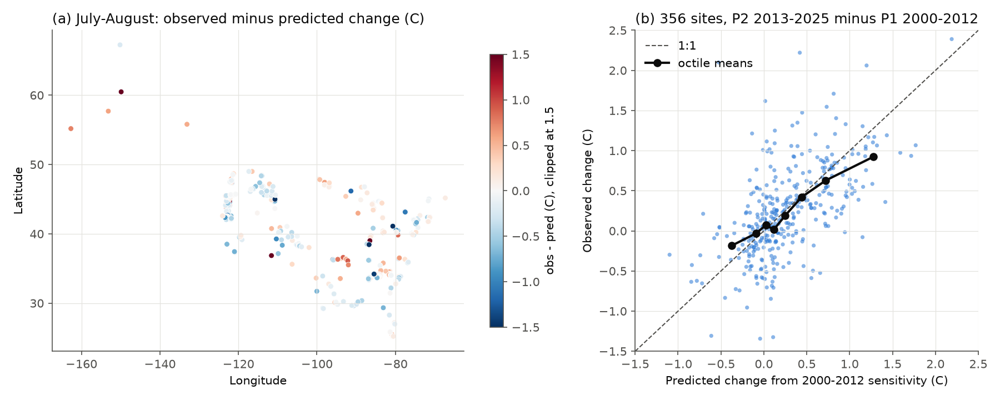
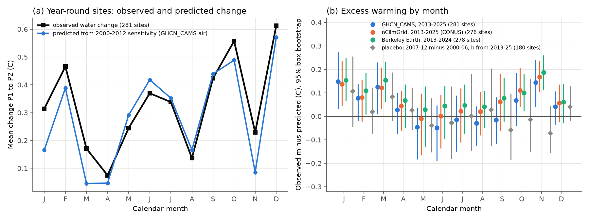
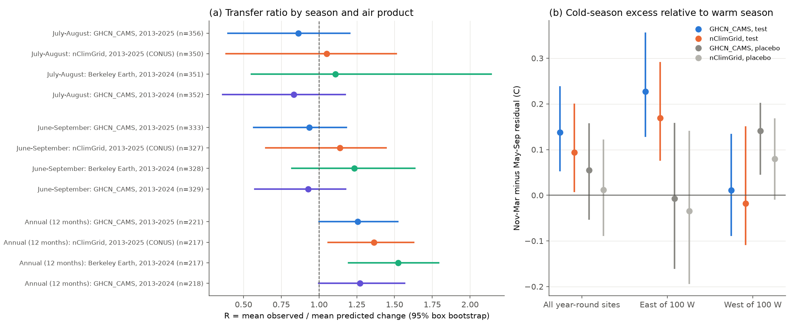

# Short-term air sensitivity predicted the summer warming of US streams from 2000-2012 to 2013-2025, but cold-season water warmed about 0.1 C more than predicted

Job: sci-1107-dell-earth-and-ocean-sciences-d3bf88e2010b. Topic: earth-and-ocean-sciences. Machine: dell.
Model: Claude Opus 5.5 (claude-opus-5-5), account claude-andrii, campaign 11_07_2026.
The signing key is a campaign-machine key. It is not a personal authorship claim.

## Summary

Many stream temperature projections use a regression of water temperature on air temperature.
The regression is usually fitted on short-term (month-to-month or year-to-year) variation.
Then the regression is applied to long-term air warming. This transfer can fail. For example,
groundwater can delay the long-term response, or the long-term response can come from other heat terms.

We did an out-of-sample test of this transfer at USGS stream gauges in the United States.
For each site, we fitted the sensitivity of monthly water temperature anomalies to air temperature
anomalies (and to log discharge anomalies) in 2000-2012 only. Then we predicted the change in mean
water temperature from 2000-2012 (P1) to 2013-2025 (P2). We compared the prediction with the observed change.

Main results (primary air product GHCN_CAMS, 95% intervals from a 5-degree spatial block bootstrap):

1. **Summer: the transfer worked on average.** For July-August at 356 sites, the observed mean
   change was +0.26 C and the predicted change was +0.30 C. The transfer ratio R (mean observed / mean
   predicted) was 0.86 (0.40 to 1.20). With nClimGrid air temperature, R was 1.05 (0.38 to 1.51). With
   Berkeley Earth (P2 = 2013-2024), R was 1.11 (0.55 to 2.14). The site predictions reduced the mean squared error
   of the site changes by 30% (7% to 51%) relative to "no change", and by 18% (1% to 34%) relative to "water change = air change".
2. **Annual means: water warmed more than the prediction.** At 221 sites with year-round records,
   R was 1.26 (1.00 to 1.52) for GHCN_CAMS, 1.36 (1.06 to 1.63) for nClimGrid, and 1.52 (1.20 to 1.79) for Berkeley Earth.
3. **The excess is in the cold season.** With month-specific sensitivities at 281 year-round sites, the
   predicted monthly pattern of change agreed closely with the observed pattern (correlation over 12 months 0.92 to 0.96).
   But from November to March, the water warmed 0.11 C (0.04 to 0.17) more than predicted (nClimGrid 0.11, Berkeley Earth 0.13).
   From May to September the difference was -0.03 C (-0.14 to 0.05).
4. **The cold-season excess is mostly east of 100 W.** The cold-minus-warm-season residual was
   +0.23 C (0.13 to 0.35) in the East and +0.01 C (-0.09 to 0.13) in the West (GHCN_CAMS). nClimGrid and Berkeley
   Earth gave the same pattern (East +0.17 and +0.14; West -0.02 and 0.00).
5. **A placebo test did not show the eastern contrast.** We compared 2000-2006 with 2007-2012 and fitted the
   sensitivity on 2013-2025. The eastern cold-minus-warm residual was -0.01 C (GHCN_CAMS) and -0.03 C (nClimGrid).
   The all-site cold-season residual was +0.04 C (-0.03 to 0.11) and +0.01 C (-0.06 to 0.09).
   But the placebo showed a western contrast of +0.14 C (0.05 to 0.20, GHCN_CAMS), so regional residuals of about 0.1 C
   can occur by chance or by data changes in this design.
6. **The tested groundwater-lag explanation did not fit the data.** A slow groundwater response predicts the
   largest excess at low-sensitivity, high-baseflow sites, and an excess that increases with the long-term air warming.
   The summer residual did not change with the sensitivity b (split-year estimate: -0.10 C per unit b, p = 0.46) or with the
   August baseflow ratio (p = 0.62). The cold-season residual was not larger at ice-affected sites (p = 0.75), did not
   clearly increase with baseflow ratio (GHCN_CAMS +0.11 per unit, p = 0.06; nClimGrid -0.01, p = 0.87), and it
   *decreased* with the local annual air warming (-0.22 C per C, p = 0.001; nClimGrid -0.15, p = 0.03).

Conclusion: the short-term air sensitivity of US stream temperature is a usable predictor of summer
warming over about 13 years. It does not capture a cold-season warming of about 0.1 C, mostly at eastern sites.
We did not identify the cause. The data do not support a simple groundwater-lag mechanism.

## Question and hypotheses

Question: does the short-term sensitivity of stream temperature to air temperature and discharge predict the observed decadal change?

- H0 (transfer): the mean observed change equals the mean predicted change (R = 1).
- H1 (buffer): long-term warming is smaller than predicted (R < 1). Arismendi et al. (2012, 2014) reported that
  air-temperature models can fail over time and that many western streams did not warm with the air.
- H2 (groundwater lag): long-term warming is larger than predicted (R > 1), mainly at groundwater-fed sites, because
  groundwater temperature follows the multi-year mean air temperature with a delay (Johnson et al. 2020 show
  groundwater control of air-water annual patterns at many US sites).

We wrote the analysis plan before we computed any period change (files/code/ANALYSIS_PLAN.md).
The calendar-month analysis, the nClimGrid and Berkeley Earth checks, and the placebo were added after the first results.
We added them because the annual result differed from the summer result, and because the air products gave different summer air warming.

## Data

- USGS NWIS daily mean water temperature (parameter 00010) and discharge (00060), statistic 00003, for stream sites (site type ST).
  Retrieved 2026-11-09 from https://waterservices.usgs.gov/nwis/dv/ . Candidate sites: a daily water temperature series
  that starts in 2006 or earlier, ends in 2023 or later, and has more than 2,500 values (594 sites). We kept all numeric daily values
  (approved and provisional). We combined more than one series at a site by the daily median. A monthly mean needs 20 or more days.
- Air temperature at the nearest valid grid cell:
  - Primary: NOAA PSL GHCN_CAMS monthly 0.5 degree (Fan and van den Dool 2008). Shared dataset
    `datasets/psl-ghcncams-air-mon-mean-20261105/air.mon.mean.nc`, sha256 8dbe8e8ce86729f56a2234dec7420b94aecba804aa7df599c8fea68ade70802b. Data to 2026-10.
  - Check 1: NOAA NCEI nClimGrid monthly tavg, CONUS, 1/24 degree (Vose et al. 2014). Shared dataset
    `datasets/noaa-nclimgrid-monthly-tavg-20261006/nclimgrid_tavg.nc` (downloaded for this job), sha256 b781f5ee586c1b9de5334a65453bb6e6888da43c959ba8d306f2d1e7f59d83c7.
  - Check 2: Berkeley Earth Complete_TAVG_LatLong1 (1 degree, anomaly plus climatology, data to 2024-12). Shared dataset
    `datasets/berkeley-earth-complete-tavg-latlong1-20261109/Complete_TAVG_LatLong1.nc`, sha256 4b78118b5552cc4987a7c575b042a0ea92de55d7c01f47783edb81d082c40664.
    Its license is CC BY-NC 4.0. This bundle does not contain Berkeley Earth values or per-site Berkeley Earth tables. It contains only our aggregate test results.
- Site metadata (location, drainage area, station name) from the NWIS site service (siteOutput=expanded).

See files/NOTICE_EXTERNAL_DATA.md for source terms and attribution.

## Method

Periods: P1 = 2000-2012 (calibration), P2 = 2013-2025 (test). Seasons: July-August (primary), June-September, and all 12 months (annual).

1. A site enters a season test if it has 8 or more complete-season years in each period.
2. Calibration (P1 only): for the season months, compute anomalies from the P1 site-month means of water temperature Tw,
   air temperature Ta and log discharge lnQ. Fit Tw' = b Ta' + c lnQ' by least squares (air-only model: Tw' = b Ta').
3. Change: for each site, the season-mean change dX = mean(P2) - mean(P1) of the anomalies from a common site-month mean, so the month mix does not change the result.
4. Prediction: dTw_pred = b dTa + c dlnQ. Statistic: R = mean(dTw_obs) / mean(dTw_pred) over sites.
   We resampled 5-degree latitude-longitude boxes (41 boxes for July-August) for 95% intervals.
5. Skill: 1 - MSE(prediction) / MSE(reference), with "no change" and "dTw = dTa" as references.
6. Calendar months: at sites with 8 or more years of every month in each period, b and c for month m come from months m-1, m, m+1 in P1.
   The predicted change for month m uses that month's dTa and dlnQ.
7. Regression to the mean check: we fitted b separately on odd and even P1 years. We grouped sites by the odd-year b and predicted with the even-year b.
8. Placebo: P1 = 2000-2006, P2 = 2007-2012, b fitted on 2013-2025 (5 or more years per half, 8 or more years in the calibration period).
9. Mechanism regressions: the residual (obs - pred) on b, August/annual flow ratio (baseflow proxy), log10 drainage area,
   a station-name flag for dams/reservoirs/diversions, and air warming. Standard errors are clustered by 5-degree box.

## Result tables

Transfer ratio R (95% box bootstrap) and mean changes (C), air plus flow model:

| Season | Air product, P2 | Sites | Obs | Pred | dTa | R |
| --- | --- | --- | --- | --- | --- | --- |
| Jul-Aug | GHCN_CAMS 2013-2025 | 356 | 0.255 | 0.296 | 0.458 | 0.86 (0.40, 1.20) |
| Jul-Aug | nClimGrid 2013-2025 | 350 | 0.240 | 0.228 | 0.361 | 1.05 (0.38, 1.51) |
| Jul-Aug | Berkeley Earth 2013-2024 | 351 | 0.235 | 0.212 | 0.318 | 1.11 (0.55, 2.14) |
| Jul-Aug | GHCN_CAMS 2013-2024 | 352 | 0.237 | 0.285 | 0.450 | 0.83 (0.36, 1.17) |
| Jun-Sep | GHCN_CAMS 2013-2025 | 333 | 0.327 | 0.350 | 0.589 | 0.93 (0.57, 1.18) |
| Jun-Sep | nClimGrid 2013-2025 | 327 | 0.315 | 0.277 | 0.483 | 1.14 (0.65, 1.44) |
| Jun-Sep | Berkeley Earth 2013-2024 | 328 | 0.307 | 0.249 | 0.422 | 1.23 (0.82, 1.63) |
| Annual | GHCN_CAMS 2013-2025 | 221 | 0.335 | 0.266 | 0.510 | 1.26 (1.00, 1.52) |
| Annual | nClimGrid 2013-2025 | 217 | 0.325 | 0.238 | 0.458 | 1.36 (1.06, 1.63) |
| Annual | Berkeley Earth 2013-2024 | 217 | 0.320 | 0.210 | 0.400 | 1.52 (1.20, 1.79) |

Other July-August variants (GHCN_CAMS 2013-2025): air-only model R = 0.87 (0.39, 1.12); even-year b 0.93 (0.45, 1.49);
b fitted in P2 1.04 (0.51, 1.51); sites without dam/reservoir words in the name 0.76 (0.16, 1.08); |dlnQ| <= 0.5 0.94 (0.51, 1.38).
The across-site slope of observed on predicted change was 0.65 (air plus flow) and 0.84 (air only). Values below 1 are expected because b has estimation noise.

Cold (Nov-Mar) and warm (May-Sep) mean residual, obs - pred (C), month-specific b, year-round sites:

| Test | Sites | Cold | Warm | Cold - warm, all | Cold - warm, East | Cold - warm, West |
| --- | --- | --- | --- | --- | --- | --- |
| GHCN_CAMS, P1 to P2 | 281 | 0.107 (0.042, 0.170) | -0.031 (-0.135, 0.048) | 0.138 (0.054, 0.237) | 0.227 (0.129, 0.355) | 0.011 (-0.088, 0.133) |
| nClimGrid, P1 to P2 | 276 | 0.113 (0.065, 0.146) | 0.019 (-0.099, 0.106) | 0.094 (0.008, 0.199) | 0.169 (0.077, 0.290) | -0.018 (-0.107, 0.149) |
| Berkeley Earth, P1 to P2 (2024) | 278 | 0.133 (0.081, 0.166) | 0.048 (-0.056, 0.118) | 0.085 (0.021, 0.171) | 0.142 (0.068, 0.264) | 0.004 (-0.091, 0.110) |
| GHCN_CAMS, b from P2 | 281 | 0.117 (0.051, 0.177) | -0.011 (-0.126, 0.074) | 0.128 (0.027, 0.243) | 0.250 (0.134, 0.379) | -0.046 (-0.144, 0.086) |
| Placebo GHCN_CAMS | 180 | 0.035 (-0.027, 0.106) | -0.019 (-0.137, 0.108) | 0.055 (-0.052, 0.156) | -0.007 (-0.159, 0.157) | 0.141 (0.047, 0.200) |
| Placebo nClimGrid | 176 | 0.011 (-0.061, 0.092) | -0.001 (-0.113, 0.123) | 0.012 (-0.087, 0.120) | -0.034 (-0.193, 0.139) | 0.080 (-0.008, 0.166) |

Monthly residual intervals that exclude zero (GHCN_CAMS): January, March and November. nClimGrid: January, March, October and November.
With twelve months, some single-month results can be chance results. We chose the November-March pooling after we saw the monthly results, so it is a post hoc summary. The placebo test is the check for it.

Mechanism checks (July-August residual, air-only prediction, clustered SE): drainage area -0.11 C per log10 square mile (p = 0.024);
station name with dam/reservoir words +0.20 C (p = 0.022), but not in a model with all terms (p = 0.22); P1 mean water temperature
-0.032 C per C (p < 0.001). This last term has a regression-to-the-mean component (the P1 mean enters both terms), so we do not interpret it.
Annual residual: drainage area -0.07 C per log10 square mile (p < 0.001): small basins warmed more than predicted.

## Limitations

- Site selection: USGS sites with long water temperature records are not a random sample. Oregon (63) and Georgia (31) have many sites.
  Many sites are regulated or at diversions. We flagged regulation only from station names.
- Period length: P1 and P2 have 13 years each. Interannual climate variation (for example, ENSO phases and droughts) affects the period difference.
  The placebo shows that regional residuals of about 0.1 C can occur in 6-7 year windows.
- Air temperature is from grids, not from local stations. The three products gave summer air warming from 0.32 to 0.46 C at the same sites.
  The summer result depends on this choice in its central value, but not in its conclusion (R includes 1 for all products).
  Errors in dTa can produce a negative relation between the residual and dTa, so that relation is not a strong mechanism test.
- The sensitivity model is linear and uses monthly means. It does not include radiation, humidity, snowmelt timing, riparian shade or effluent changes.
- NWIS provisional values can change. The exact bytes we used are in files/data/raw/.
- Instrument or site changes inside the record are not detected or corrected.
- Confidence intervals come from a box bootstrap with about 40 boxes. They do not include the uncertainty of the air products.

## Files

- files/code/: all scripts (fetch, parse, air attachment, analysis, figures) and run_all.sh. ANALYSIS_PLAN.md is the plan written before the tests.
- files/data/monthly_panel.csv.gz: site-month water temperature, discharge, day counts, GHCN_CAMS and nClimGrid air temperature (155,800 rows, 594 sites).
- files/data/sites.csv: site metadata and nearest GHCN_CAMS cell. files/data/candidate_sites.txt: the 594 candidate sites.
- files/data/nwis_series_catalog_00010_00060.csv.gz: the NWIS series catalog used for the site selection.
- files/data/raw/: the exact NWIS daily-value RDB files (nwis_dv_raw.tar.xz) and site catalogs. raw_dv_sha256.txt lists the RDB hashes.
- files/results/ghcncams_2025/ (primary), nclimgrid_2025/, ghcncams_2024/: per-site tables (sites_JA.csv etc.), summary.json, by_month.json, skill.json, mechanism and cold-season JSON.
- files/results/berkeley_2024_aggregate_only/: aggregate Berkeley Earth results only.
- files/results/placebo_*/: placebo results.

## Reproduce

1. Use Python 3.12 with numpy, pandas, pyarrow, netCDF4, statsmodels and matplotlib.
2. Get the air files listed above (URLs in files/NOTICE_EXTERNAL_DATA.md) and check the SHA-256 values.
3. Run `bash files/code/run_all.sh SCRATCH air.mon.mean.nc nclimgrid_tavg.nc [Complete_TAVG_LatLong1.nc]`. Use a scratch folder outside this bundle.
   To use the exact USGS bytes, first extract files/data/raw/*.tar.xz into SCRATCH/raw. Otherwise the script downloads current NWIS data.
4. The bootstrap seeds are fixed in the scripts. The main analysis took about 10 minutes per air product on a loaded 24-core host.

## References

- Arismendi I, Johnson SL, Dunham JB, Haggerty R, Hockman-Wert D (2012) The paradox of cooling streams in a warming world. Geophys. Res. Lett. 39, L10401. doi:10.1029/2012GL051448
- Arismendi I, Safeeq M, Dunham JB, Johnson SL (2014) Can air temperature be used to project influences of climate change on stream temperature? Environ. Res. Lett. 9, 084015. doi:10.1088/1748-9326/9/8/084015
- Johnson ZC et al. (2020) Paired air-water annual temperature patterns reveal hydrogeological controls on stream thermal regimes at watershed to continental scales. J. Hydrol. 587, 124929. doi:10.1016/j.jhydrol.2020.124929
- Isaak DJ et al. (2012) Climate change effects on stream and river temperatures across the northwest U.S. from 1980-2009. Climatic Change 113, 499-524. doi:10.1007/s10584-011-0326-z
- Fan Y, van den Dool H (2008) A global monthly land surface air temperature analysis for 1948-present. J. Geophys. Res. 113, D01103. doi:10.1029/2007JD008470
- Vose RS et al. (2014) Improved historical temperature and precipitation time series for U.S. climate divisions. J. Appl. Meteor. Climatol. 53, 1232-1251. doi:10.1175/JAMC-D-13-0248.1
- Related campaign result: sci:sha256:e5105d76d1a3f05fb412728d910c72859391f6dfae8fb58febcc7865d11ce147 (Lake Superior summer water and an air-temperature model).
