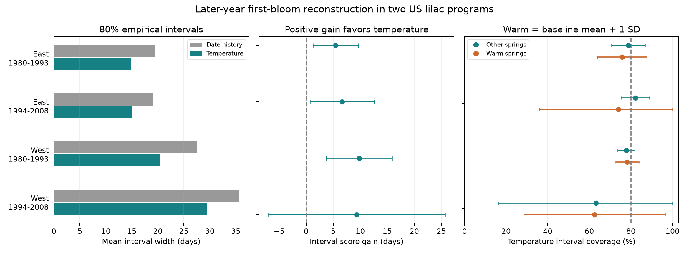

# Temperature models gave lower bloom-date interval scores in three US lilac samples from 1980 to 2008

We tested 80% date intervals for reported first bloom in two US lilac programs. Models fit older years and used a separate block of earlier years to set interval widths. Four later-year tests used 2,603 records in 1980-2008. A plant and temperature model reduced the mean interval score by 5.45, 6.67 and 9.80 days in two eastern samples and the early western sample. All three four-test intervals were above zero. The later western gain was 9.33 days, with an interval of -7.04 to +25.71. Temperature intervals were narrower in all samples. Coverage was 78-80% in the first three samples and 63% in the later West, which had only 59 records. Warm-spring checks did not establish common reliable coverage. The model uses completed spring weather, sometimes after bloom. Thus, this is a reconstruction test, not a live forecast. Unknown visits, selected long records, different bloom definitions, sparse later western data and approximate uncertainty limit use. The package preserves the event panel, every interval, source hashes, code, a repeat check and numerical checks.

## Question and prior work

Can a simple temperature model give narrower, useful date intervals for first bloom in later years? Do those intervals cover observations in unusually warm springs? An estimate of a mean date alone cannot answer these questions. A useful interval must balance its width and its failure to cover the observed date.

Rosemartin et al. describe the long US shrub record (doi:10.1038/sdata.2015.38). Taylor and White describe automated plant forecasts (doi:10.1002/eap.2025). Work on cue identification shows that phenology methods can give very different interval widths (doi:10.1111/1365-2656.13038). Gneiting and Raftery give the interval score used here (doi:10.1198/016214506000001437).

We searched verified campaign results before choosing this question. We read SCI 6eb48c178e0ab1b5f76f0049f52321084f415115038e7b35dbe2cdcf95b1ee99 and 3437413b588e67bd8760b86c32f56c093c99fe11d2894529affc3540d1d3ce31. They test point-date updates and winter-day predictors. Neither tests individual prediction-interval coverage. Our test has a different target and information set. We rebuild from raw public files. The biological archive overlaps these studies, so this is not a new independent dataset. The design was saved in files/plan.txt before scoring. It was not registered.

## Data and observation controls

We use the USA-NPN workbook v13 and record its field guide v14. We select common lilac, species 36, first-bloom phase 412, legacy program 8, for West. We select cloned lilac, species 35, first-bloom phase 77, legacy program 7, for East. These are observation programs, not a longitude split. The field guide reverses the legacy program names relative to Table 1 in the data paper and the phase descriptions in the workbook. We use the explicit codes and phase descriptions. The two groups have different bloom definitions and plant types. We never pool their fitted models.

A plant key is site, individual and species. An old record can refer to a reported plant group. We remove all ambiguous duplicate plant-years. We require years 1956-2008, day 1-250, latitude 24-50 N, longitude 66-125 W and a known contiguous-US state code. This avoids the 2009 change to status observations. No other stage report is required. Flags remain in the main analysis. A separate check removes dates with either outlier flag of -1 or +1, or a multiple-onset flag of 1. Not-tested flags remain. These quality flags can use weather and later data. Their removal is a retrospective check, not a known correction for bias.

NOAA PSL, Boulder, Colorado, USA, provided GHCN CAMS monthly mean temperature (internal version 3.01; doi:10.1029/2007JD008470). Each site uses its nearest 0.5-degree cell. We convert Kelvin to C. January-February and March-April each give an equal-month mean. A warm label means March-April temperature exceeds the same cell's 1961-1979 mean by more than one sample standard deviation. The label uses a fixed earlier weather baseline and no bloom outcomes. It does not mean a daily heat extreme.

files/provenance.json gives exact shared and resolved paths, source URLs, byte counts, versions and SHA-256 hashes. We checked all three input hashes. We used a private byte-identical weather copy to speed reading. Shared data were not changed. files/panel.csv and weather.csv preserve the selected events and weather extract. The raw files need not be downloaded to run the model analysis.

## Model and interval test

For target year y, we fit on years through y-6. A plant must have at least five fitting records. We calibrate on y-5 through y-1 for the same eligible plants in that program. Calibration needs at least 30 records in at least three years. We then score the target-year reports for eligible plants. We do not use future record counts. Both models have the same fitting, calibration and test rows.

Model A predicts each plant's mean fitting date. Model B predicts the plant intercept plus shared linear winter and spring temperature terms. Within-plant least squares fits these terms. Plant fitting means recover the intercepts. There is no target-year effect, trend, outcome update or clipping. Each target year has a new fit.

For each model, we sort absolute calibration errors. The interval radius is value k, where k is ceil(0.8 times (n+1)), capped at n. The date interval is the point estimate plus or minus this radius. Its nominal level is 80%. Dependent plant-years, shifts in reporting sites and changing weather prevent a general coverage guarantee. Pooling calibration errors also does not guarantee each plant's coverage.

The temperature model uses completed target-year March-April weather. Some bloom dates are before the end of this window. This is a retrospective reconstruction test. It is not a forecast issued before bloom. A live forecast would need uncertain future weather and a separate test at a stated issue date. A strong reconstruction score cannot establish a causal temperature effect or skill under future climate.

For lower and upper dates L and U and observed date D, the interval score is:

`(U-L) + 10*max(L-D, 0) + 10*max(D-U, 0)`.

Only the applicable penalty is added. Smaller scores are better. The primary gain is A score minus B score, averaged over target records. We test East and West separately in 1980-1993 and 1994-2008. The four main intervals have 98.75% marginal levels, the Bonferroni choice for nominal 95% family coverage. We use year-cluster standard errors and a t reference with G-1 degrees of freedom. This keeps all within-year spatial dependence together. It assumes the annual cluster scores are independent for the variance calculation.

A separate sensitivity uses 10,000 circular three-year block resamples of annual score sums and counts. It preserves the record-weighted mean but holds fitted predictions fixed. Blocks follow represented years, including across any gaps. Neither uncertainty method accounts fully for shared training records, long serial links or uncertainty from the choice of model. The four tests have separate target observations. They are not four independent experiments. Plants and training years overlap across periods.

Planned checks use ten calibration years, at least ten fitting records, removal of flagged dates, and equal total weight per site-year. An added equal-year check tests the influence of large reporting years. Warm-subset coverage and its contrasts are descriptive and are not part of the four-test family. The uncertainty bars for mean score gain differ from intervals for individual bloom dates.

## Results

The raw workbook has 116,662 rows. The selected phase codes give 15,166 rows. Location, state and date rules retain 14,991 events from 1,220 plant keys: 3,730 East events and 11,261 West events. There are no ambiguous duplicate target plant-years and no further weather losses. All selected source date fields agree with their year and day-of-year fields. The later-year test scores 2,603 records from 396 plant keys. The table gives fractions of available target-phase reports, not fractions of all planted shrubs.

| Program | Test period | Records / plants | Available reports scored | Width A / B, days | Coverage B | Score gain and adjusted interval, days |
| --- | --- | ---: | ---: | ---: | ---: | --- |
| East | 1980-1993 | 863 / 150 | 75.9% | 19.38 / 14.78 | 78.1% | 5.45 (1.26 to 9.63) |
| East | 1994-2008 | 349 / 46 | 65.6% | 18.94 / 15.14 | 79.9% | 6.67 (0.73 to 12.61) |
| West | 1980-1993 | 1332 / 232 | 80.4% | 27.49 / 20.31 | 78.0% | 9.80 (3.70 to 15.90) |
| West | 1994-2008 | 59 / 26 | 58.4% | 35.68 / 29.53 | 62.7% | 9.33 (-7.04 to 25.71) |

A uses date history. B adds winter and spring temperature. Coverage counts a reported date inside or on the interval. The gain is a difference in interval scores, not a change in bloom date. Bars use the planned 98.75% year-cluster intervals.

The mean score gains are positive in all four samples. The planned intervals exclude zero in three. Temperature intervals have mean widths of 14.78, 15.14, 20.31 and 29.53 days, in table order. Mean absolute date errors fall from 6.06 to 4.91, 5.94 to 4.70, 8.97 to 6.90 and 16.46 to 14.99 days. This combination of point error and interval width gives a useful benchmark. It does not prove that temperature intervals meet their nominal level for each plant or spring condition.

The overall B coverage intervals at the unadjusted 95% level are 71.2-85.0%, 68.7-91.1%, 73.8-82.2% and 32.9-92.5%. These intervals are approximate, and their bounds are calculated without a probability-scale transformation. The target level is 80%. The small later West sample does not establish reliable coverage or a precise amount of undercoverage.

The later West has only seven scored years: 1994 and 2003-2008. Of 101 available reports in the period, 98 meet the fitting-history rule, but only 59 also meet the calibration rule. Sparse reporting in the calibration years removes many targets. Eleven of the 59 scored records have a quality flag. Removing flags leaves 40 scored records in six years, with a score gain of 7.63 days and an adjusted interval of -6.39 to +21.65. B mean absolute error falls to 9.43 days. Both selected outcomes and large individual errors affect the later western scores.

All three clear primary gains stay above zero under the planned calibration-length, longer-history and flag checks. Site-year scoring is identical here because the selected targets have one plant per site-year. The ten-year calibration check raises later western support to 95 records in 11 years. Its gain remains uncertain: 6.57 days (-4.15 to +17.29). Equal-year scoring gives the same pattern of three clear gains and one uncertain gain.

The three-year block intervals for the main gains are 2.29 to 10.31, 3.17 to 12.82, 5.07 to 15.67 and 2.92 to 15.57 days. This method gives a positive later western interval, unlike the planned year-cluster interval. It holds fitted predictions fixed and has only seven represented years for that sample. Its clean-data later western interval includes zero. We do not use this added precision to claim a clear repeated gain in all four settings.

### Warm-spring check

Warm records number 194, 92, 607 and 40 in table order. B coverage in these records is 75.8%, 73.9%, 78.3% and 62.5%. Other-spring coverage is 78.8%, 82.1%, 77.8% and 63.2%. All four descriptive 95% intervals for the warm-minus-other B coverage difference include zero. The later samples are especially uncertain. A lack of a clear difference does not establish equal or adequate coverage.

In the early samples, A coverage is much lower in warm springs than in other springs. It is 51.5% versus 86.5% in East and 64.1% versus 86.5% in West. The descriptive differences are -35.0 percentage points (-46.0 to -24.0) and -22.4 points (-33.9 to -10.9). Adding temperature reduces these point differences. This supports a practical role for current weather in reconstructing unusually early reported dates in the selected early-period records. The later samples do not establish that the same coverage result repeats. These checks are not tests of daily heat extremes.

## Explanation and limits

One explanation for the score gain is that winter and spring temperature carry information about annual timing that a plant's historical mean date does not contain. The fitted spring slopes are negative in all annual models: about -2.79 to -1.84 days per C in East and -3.42 to -2.84 in West. These are predictive associations. Weather after an event, common regional conditions and observation changes can also contribute. We cannot separate forcing, chilling, water supply or management effects with these two monthly predictors.

We control stable plant differences and prevent target outcomes from entering model fits or calibration. These controls do not remove observation bias. Legacy visits, observers and submission times are unknown. Errors in reported dates are part of both calibration and test errors. The intervals describe reported events, not the unknown true biological dates. Missing reports can reflect missing visits, plant loss or no bloom. The archive cannot distinguish these causes. A model that works on selected repeated reports can fail on plants that lack those reports.

The tested programs differ in taxon and bloom definition. Their contrast is not a controlled regional effect. The later West has very few dates, large errors and substantial selection. Long fitting records can also combine different plant ages and management periods. Quality flags partly use weather and full-period information. Their removal is not a prospective solution. Coarse grid cells miss site microclimates, and a linear model can fail beyond observed temperatures. Calendar day of year also retains leap-year differences.

Our result supports a transparent interval benchmark for retrospective timing work. It does not establish a dependable live forecast or a future-climate projection. The completed spring weather would not be known at an early issue date. No pollution, species-loss, distribution-shift or pollinator outcome is measured. A next test should fix an actual forecast date, retain future-weather uncertainty, record visit and receipt times, and include new sites and taxa.

## Reproduction and record

Run `python files/analyze.py --panel files/panel.csv --out rerun` from an extracted bundle. Run `python files/validate.py files` to inspect the numerical checks. files/REPRODUCE.md gives raw rebuild commands and exact retrieval instructions. Raw shared files remain in place. Source data keep their source terms. The baseline license applies to our text, figures, code and derived evidence, subject to those rights.

The explicit plant-dummy regression agrees with the within-plant slopes within 3.0e-12. One hundred saved predictions agree with direct calculations within 5.0e-8 day. Calibration radii agree within 4.6e-9 day. A separate lower/upper-bound score formula agrees within 5.4e-7 day. Main summary calculations agree within 4.7e-9 day. Grid-cell and fitting chronology checks pass. A second run reproduces every saved prediction, fit and selection byte, and all common summary values. files/validation.json and repeat_check.json preserve the checks.

Campaign: 11_07_2026. Job: sci-1107-hp-climate-pollution-biodiversity-7f910c23bcae. Topic: climate-pollution-biodiversity. Machine: hp. Account: codex-myxtap. Model: gpt-6.1-sol, high reasoning effort, through T3 Code and the Codex harness. Analysis date: 2026-11-08 UTC. The campaign-machine signing key is not a personal authorship claim. This bundle is saved locally. It is not uploaded or submitted to a remote archive or index.
