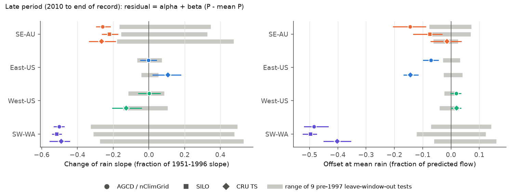
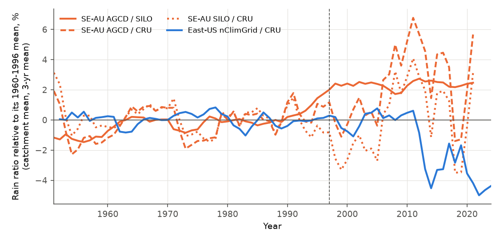
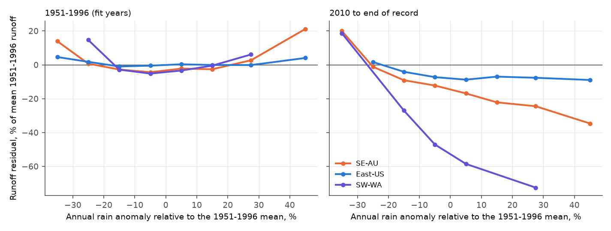

# After 1997, 175 south-east Australian catchments lost one fifth to one quarter of their runoff response to rain in three rain products; eastern US runoff had a constant offset instead

Job `sci-1107-dell-earth-and-ocean-sciences-37e70ab7111c`, campaign 11_07_2026, topic
earth-and-ocean-sciences, machine dell, account claude-olen. Model: Claude Opus 5.5
(`claude-opus-5-5`) in Claude Code (T3 Code). The signing key is a campaign-machine key. It is
not a personal authorship claim.

## Summary

**Question.** Many catchments in south-east Australia (SE-AU) stayed in a low-runoff state after
the Millennium Drought (1997-2009), also in the wet years 2010-2011, 2016 and 2020-2022 (campaign
bundles 36d145c1, 996e7776). US reference catchments, US wells and global GRACE storage did not
stay low after droughts (bundles 664b208c, 03b9bf62, d124c3f7, 363ebf38). Two later bundles
(7dedc5bb, df943002) found that the SE-AU deficit is a regional change that started in 1997-1999,
and that the eastern US (East-US, HUC-02 regions 01-08) had a deficit of similar size in standard
deviation units without a drought. These studies used annual totals. They did not ask *which part
of the flow regime* carries the deficit, or *how* the rainfall-runoff relation changed. These
questions can separate physical explanations. We asked:

1. Is the SE-AU deficit carried by baseflow (slow flow), as a loss of groundwater or other slow
   storage would predict? Does the East-US deficit have the same flow signature?
2. Is the deficit a constant offset, or a loss of runoff sensitivity to rain?
3. How much of the deficit depends on the rainfall product?

**Data and method.** We used 175 SE-AU catchments (CAMELS-AUS v2.03, calendar years 1951-2021),
260 East-US and 279 West-US CAMELS catchments (USGS daily flow, water years 1951-2025), plus 25
south-west Western Australia (SW-WA) and 64 northern Australian catchments. We separated daily
flow into baseflow and quickflow with three methods (Lyne-Hollick filter with alpha 0.98 or
0.925, and UKIH smoothed minima). For each catchment and flow component, we fitted
X = a + b P + c P(t-1) + d T on 1951-1996 only. Here X is annual flow in mm, P is annual rain and
T is mean temperature. The same regressors make the residuals additive: total deficit = baseflow
deficit + quickflow deficit. We used three rain products in Australia (AGCD, SILO, CRU TS 4.09) and
two in the US (nClimGrid, CRU TS 4.09). Intervals are 95% cluster-bootstrap intervals over 2 x 2
degree cells. The plan (`files/ANALYSIS_PLAN.md`) was written before any component result was
calculated. Three addenda are post hoc, and we mark their results as post hoc.

**Main results.**

1. **Baseflow and quickflow lost the same fraction (planned primary endpoint).** In 2010-2021,
   SE-AU baseflow was 13.9% below the 1951-1996 relation (95% CI 9.8-19.5%) and quickflow was 14.3%
   below it (7.3-21.1%). The difference was +0.4 percentage points (-5.7 to +5.0). The baseflow
   share of the deficit (25.4%) was close to the calibration baseflow index (23.4%) and to the
   marginal share of extra rain that goes to baseflow (20.9%). The same was true with alpha 0.925
   (difference -0.8 points, -5.6 to +2.9) and with the UKIH method (+0.8, -5.8 to +5.7). East-US
   also lost the same fraction from both components (baseflow -5.5%, quickflow -6.8%; difference
   +1.3 points, -0.5 to +3.4). Thus, the flow partition does not support a deficit that is
   specific to baseflow, in either region. SW-WA, the known case of groundwater decline, was the
   only group where baseflow lost more than quickflow with alpha 0.98 (-57% vs -45%; difference
   -12.6 points, -19.2 to -1.7). This difference became smaller and uncertain with alpha 0.925
   and UKIH.
2. **SE-AU lost runoff sensitivity to rain; East-US did not (post hoc).** We regressed the
   late-period residual on the rain anomaly. In SE-AU (2010-2021), the rain slope of runoff
   was 26% lower than in 1951-1996 with AGCD rain (95% CI 22-29%), 22% lower with SILO (17-26%) and
   26% lower with CRU (19-33%). For 91% of SE-AU catchments the residual slope was negative. With a
   quadratic rain term to allow for the curved 1951-1996 relation, the loss was 26% with AGCD
   (22-29%), 19% with SILO (14-23%) and 20% with CRU (9-30%). In all six cases, the value was below all
   nine leave-12-year-window-out values from 1951-1996 (the null range). In East-US the slope did
   not decrease (nClimGrid: -0.3%, CI -4.7 to +4.1%, inside the null range). The East-US deficit
   was a constant offset of -7.1% of predicted flow (-9.7 to -4.5%) at the mean rain. Figure 4
   shows the result directly: in 2010-2021 the SE-AU runoff deficit was about 1% of mean runoff in
   years with 25% less rain than normal, but about 25% in years with 25% more rain. The East-US
   deficit was 4-9% in all rain classes.
3. **The deficit was largest in wet years.** In SE-AU 2010-2021 years with rain more than 10%
   above the 1951-1996 mean, runoff was 16.3% below the relation (11.5-21.3%). In dry years (rain
   more than 10% below the mean) it was 2.1% below (-7.2 to +10.1%). Thus, wet years did not bring
   recovery, because the relation changed most in wet years.
4. **A rain-product step at 1997 explains much of the SE-AU level deficit, but not the slope loss
   (post hoc).** Relative to 1960-1996, AGCD rain in SE-AU catchments increased by 2.3% relative to
   SILO (1.8-2.8%) and by 2.3% relative to CRU (1.1-3.6%) in 1997-2021. SILO and CRU agreed with
   each other (-0.05%, -0.9 to +1.1%). Thus, the AGCD series has a step of about +2.3% near 1997
   relative to two other products. The offset at mean rain was -14.5% with AGCD, -7.5% with SILO
   and -1.4% with CRU (-7.1 to +3.6%). The slope loss stayed at 22-26% with all three products. In
   the US, nClimGrid decreased by 1.5% relative to CRU (1.1-2.0%). This step has the wrong sign to
   cause the East-US deficit.
5. **SE-AU had more zero-flow days.** Relative to the 1951-1996 relation, SE-AU had 14.6 more days
   per year with no flow in 2010-2021 (2.5-31.6). East-US had no change (0.0, -0.4 to +0.4).

**Conclusion.** The persistent SE-AU deficit and the East-US deficit are different in kind. The
East-US deficit is a constant offset, about the same in dry and wet years. The SE-AU deficit is a
loss of about one fifth to one quarter of the runoff response to rain. It is small in dry years and large in wet
years. This explains why the wet years after 2010 did not return SE-AU catchments to the
pre-1997 relation. Wet years are the years in which the relation changed most. The loss is the
same fraction of baseflow and quickflow. Thus, a simple loss of groundwater discharge to streams
does not describe it. The data agree better with a change that takes the same fraction of all
flow pathways when rain is above normal, for example a larger storage deficit that each wet year
must fill before flow starts, or higher water use by vegetation in wet years. We did not test
these causes. The size of the SE-AU deficit at mean rain depends strongly on the rain product. A
step of +2.3% in AGCD near 1997 accounts for about half of the AGCD-based deficit. For water
planning, a rule based on an offset (for example "subtract x% from expected flow") will
overestimate SE-AU flow most in wet years. The rain product used to calibrate the relation must be
checked for steps near 1997.

## Figures

**Figure 1.** Annual residual of baseflow (solid) and quickflow (dashed) relative to the
1951-1996 relation, as a percentage of the mean 1951-1996 component flow (3-year running mean).
Grey: 1997-2009. In SE-AU and East-US the two components move together. In SW-WA the baseflow
residual is lower than the quickflow residual after about 1995. Years with fewer than half of the
group's catchments are not shown.

**Figure 2.** Late period (2010 to end of record). Left: change of the rain slope of runoff
relative to the 1951-1996 slope (0 = no change; -0.25 = one quarter of the slope lost). Right:
offset at the 1951-1996 mean rain, as a fraction of predicted flow. Markers show the rain product.
Coloured bars are 95% cluster-bootstrap intervals. Grey bars show the range of the nine
leave-12-year-window-out tests in 1951-1996 for the same product (no shift expected). Linear model
(Addendum 1). The quadratic-model values are in Table 2.

**Figure 3.** Ratios of annual rain products, catchment means, relative to their 1960-1996 mean
(3-year running mean). The AGCD/SILO and AGCD/CRU ratios in SE-AU increase by about 2% near 1997.
The SILO/CRU ratio does not. CRU is from the 0.5-degree cell at the catchment centroid (AU) or
gauge (US), so it is noisier.

**Figure 4.** Annual runoff residual (sum over catchment-years in each rain bin, as a percentage
of the mean 1951-1996 runoff) against the annual rain anomaly. AGCD and nClimGrid rain. Left: fit
years 1951-1996; the convex shape shows that the linear relation under-predicts very dry and very
wet years. Right: 2010 to end of record. Bins with fewer than 30 catchment-years are not shown.

## Tables

**Table 1. Planned endpoints (Lyne-Hollick alpha 0.98, AGCD/nClimGrid rain).** f = mean
residual / mean predicted flow. s_B = baseflow share of the deficit. BFI0 = calibration baseflow
index. m_B = marginal baseflow share. 95% cluster-bootstrap intervals in brackets.

| Group, period | n | Total f | Baseflow f | Quickflow f | Baseflow f - quickflow f | s_B | BFI0 | m_B |
| --- | ---: | --- | --- | --- | --- | ---: | ---: | ---: |
| SE-AU 1997-2009 | 175 | -12.4% [-20.5, -6.4] | -12.6% [-19.7, -6.9] | -12.3% [-21.0, -5.8] | -0.4 [-5.3, +4.7] | 0.27 | 0.23 | 0.21 |
| SE-AU 2010-2021 | 175 | -14.2% [-20.3, -8.4] | -13.9% [-19.5, -9.8] | -14.3% [-21.1, -7.3] | +0.4 [-5.7, +5.0] | 0.25 | 0.23 | 0.21 |
| East-US 1997-2009 | 260 | -4.9% [-6.7, -3.1] | -4.6% [-6.4, -3.0] | -5.0% [-6.9, -2.9] | +0.3 [-1.3, +1.7] | 0.28 | 0.28 | 0.27 |
| East-US 2010-2025 | 260 | -6.4% [-8.8, -3.9] | -5.5% [-8.4, -2.4] | -6.8% [-9.1, -4.3] | +1.3 [-0.5, +3.4] | 0.26 | 0.28 | 0.27 |
| West-US 2010-2025 | 279 | +2.2% [+0.4, +3.7] | +2.0% [-0.3, +3.9] | +2.3% [+0.4, +3.9] | -0.3 [-2.4, +1.6] | 0.26 | 0.25 | 0.22 |
| SW-WA 2010-2021 | 25 | -47.2% [-50.9, -41.4] | -57.4% [-64.0, -46.2] | -44.8% [-49.2, -39.2] | -12.6 [-19.2, -1.7] | 0.23 | 0.16 | 0.15 |
| SE-AU placebo 1981-1996 (fit 1951-1980) | 85 | -6.6% [-12.7, -2.7] | -2.6% [-6.7, +0.4] | -8.2% [-14.9, -3.4] | +5.6 [+1.5, +11.0] | - | 0.26 | 0.24 |
| East-US placebo 1981-1996 | 214 | -0.7% [-1.8, +0.3] | -0.1% [-1.9, +1.7] | -1.0% [-2.4, +0.2] | +0.8 [-1.3, +3.2] | - | 0.28 | 0.28 |

The SE-AU minus East-US difference in "baseflow f - quickflow f" was -0.9 points in 2010-end
(-7.5 to +4.1). The SE-AU fractional deficit was larger than the East-US deficit in both components
(baseflow -8.4 points, -14.7 to -3.1; quickflow -7.5 points, -14.7 to 0.0). Other variants
(alpha 0.925, UKIH, SILO rain) are in `files/results/endpoints.csv` and `differences.csv`.

**Table 2. Slope change r and offset o in 2010 to end of record (post hoc).** r = mean
residual slope on rain / mean calibration rain slope. o = mean residual at the calibration mean
rain / mean predicted flow. Null = minimum and maximum over nine 12-year windows in 1951-1996.

| Group | Rain | Model | r [95% CI] | r null range | o [95% CI] | o null range |
| --- | --- | --- | --- | --- | --- | --- |
| SE-AU | AGCD | linear | -0.258 [-0.293, -0.218] | -0.166 to +0.347 | -0.145 [-0.204, -0.090] | -0.077 to +0.072 |
| SE-AU | SILO | linear | -0.221 [-0.260, -0.174] | -0.155 to +0.327 | -0.075 [-0.133, -0.032] | -0.079 to +0.069 |
| SE-AU | CRU | linear | -0.264 [-0.334, -0.188] | -0.179 to +0.474 | -0.014 [-0.071, +0.036] | -0.062 to +0.024 |
| SE-AU | AGCD | quadratic | -0.259 [-0.293, -0.215] | -0.133 to +0.235 | -0.141 [-0.206, -0.086] | -0.049 to +0.082 |
| SE-AU | SILO | quadratic | -0.191 [-0.234, -0.142] | -0.106 to +0.216 | -0.064 [-0.125, -0.018] | -0.057 to +0.077 |
| SE-AU | CRU | quadratic | -0.202 [-0.298, -0.093] | -0.152 to +0.265 | +0.019 [-0.035, +0.070] | -0.034 to +0.025 |
| East-US | nClimGrid | linear | -0.003 [-0.047, +0.041] | -0.066 to +0.072 | -0.071 [-0.097, -0.045] | -0.029 to +0.032 |
| East-US | nClimGrid | quadratic | +0.016 [-0.048, +0.077] | -0.065 to +0.064 | -0.073 [-0.102, -0.044] | -0.027 to +0.035 |
| East-US | CRU | linear | +0.106 [+0.023, +0.177] | -0.043 to +0.053 | -0.144 [-0.167, -0.117] | -0.026 to +0.041 |
| East-US | CRU | quadratic | +0.127 [+0.012, +0.237] | -0.046 to +0.071 | -0.147 [-0.172, -0.118] | -0.026 to +0.045 |
| West-US | nClimGrid | linear | +0.001 [-0.057, +0.062] | -0.116 to +0.085 | +0.018 [-0.000, +0.034] | -0.024 to +0.013 |
| West-US | CRU | linear | -0.126 [-0.203, -0.043] | -0.144 to +0.104 | +0.019 [-0.000, +0.034] | -0.040 to +0.027 |
| SW-WA | AGCD | linear | -0.502 [-0.532, -0.475] | -0.325 to +0.496 | -0.484 [-0.518, -0.435] | -0.071 to +0.142 |

In 1997-2009 (P1) the SE-AU slope loss was -0.29 (AGCD), -0.27 (SILO) and -0.33 (CRU) with the
linear model, and -0.15 (AGCD), -0.12 (SILO) and -0.18 (CRU) with the quadratic model. P1
was dry (rain 13-15% below the 1951-1996 mean). Thus, the curved relation explains a part of the
P1 linear slope loss. The P2 period had near-normal rain (rain ratio 0.93-0.98), so this effect is
small there. All slope results are in `files/results/slope*.csv`.

**Table 3. Rain-product steps (1997-end minus 1960-1996, post hoc).**

| Pair | Group | n | Step | 95% CI | Share of catchments with a positive step |
| --- | --- | ---: | ---: | --- | ---: |
| AGCD/SILO | SE-AU | 363 | +2.3% | +1.8 to +2.8 | 81% |
| AGCD/CRU | SE-AU | 363 | +2.3% | +1.1 to +3.6 | 72% |
| SILO/CRU | SE-AU | 363 | -0.1% | -0.9 to +1.1 | 45% |
| nClimGrid/CRU | East-US | 332 | -1.5% | -2.0 to -1.1 | 24% |
| nClimGrid/CRU | West-US | 338 | -1.2% | -1.8 to -0.5 | 33% |

The rain-step test uses all catchments with 25 or more complete rain years in 1960-1996 and 10 in
1997-end. It does not need flow data, so n is larger than in Tables 1 and 2.

## Relation to prior work

- Saft et al. (2015, doi:10.1002/2014WR015348; 2016, doi:10.1002/2016WR019525) and Peterson et al.
  (2021, doi:10.1126/science.abd5085) describe shifts in the rainfall-runoff relation in SE-AU
  during and after the Millennium Drought. Fowler et al. (2022, doi:10.5194/hess-26-6073-2022)
  review possible causes (storage, vegetation, rain timing, groundwater). Our new contributions
  are: the component partition with three references (proportional, rain-like, slow-store), the
  slope-versus-offset test on both continents with three rain products and a window null, and
  the AGCD step relative to SILO and CRU near 1997.
- Campaign bundle 7dedc5bb found an East-US deficit of similar size in SD units (-0.47 SD). Our
  results agree on the sign. But in units of flow the East-US deficit is less than half of the
  SE-AU deficit (-6.4% vs -14.2% with AGCD), and it has a different form (offset, not slope).
- Campaign bundle 7dedc5bb also reported that SILO gives about half of the AGCD-based SE-AU
  deficit. Our Table 3 identifies AGCD (not SILO) as the product that differs from a third,
  independent product (CRU).
- CAMELS-AUS v2 (Fowler et al. 2025) notes that the quality of gridded rain changes with gauge
  network density and compares AGCD with SILO. We did not find a published report of the 1997
  AGCD step relative to SILO and CRU for these catchments. This does not prove that no such report
  exists.

## Limitations

- **Post hoc.** The slope test, the rain-step test, the window null and the quadratic check were
  added after we saw the first results. The planned primary endpoint (component partition) is a
  null result for the baseflow-specific hypothesis.
- **Placebo drift before 1997.** With a 1951-1980 fit, SE-AU runoff in 1981-1996 was already 6.6%
  below the relation (CI 2.7-12.7%; 85 catchments), and the slope test gave -0.09 (AGCD) to
  -0.19 (CRU) with the linear model and -0.02 (AGCD) to -0.07 (CRU) with the quadratic model. Part
  of the change can have started before 1997, or the method can have a small negative bias in
  SE-AU.
- **Null range.** The window null uses nine overlapping windows from one 46-year period. It gives
  a range, not an exact p-value. The bootstrap intervals hold the fitted models fixed and resample
  space, not time. Shared weather makes them too narrow for time-related uncertainty. The window
  null partly covers this.
- **Rain products.** We do not know which product is correct. CRU at one 0.5-degree cell is a
  poor estimate of catchment rain, and the number of CRU stations in SE-AU cells decreased
  slightly (mean 8.0 to 7.5, capped at 8 by CRU). The SILO/CRU agreement makes an AGCD step more
  likely, but it does not prove that AGCD is wrong. With CRU rain, East-US had a slope increase and
  a larger offset, and West-US had a slope decrease at the edge of its null range. Thus, the US
  slope results depend on the rain product. The East-US offset is negative with both products.
- **Baseflow separation** is a signal-processing method. It does not measure groundwater. The
  SW-WA positive control passed with one of three methods only.
- **Annual linear models.** Temperature is the only evaporative term. We did not test vegetation,
  farm dams, groundwater pumping, rain intensity or seasonality here. Earlier campaign bundles
  tested seasonality and memory terms for SE-AU totals.
- **Records.** Australian records end in 2014, 2020 or early 2022, depending on the source. The
  wet year 2022 is not covered. US data after 2024 include provisional values.
- **Samples.** CAMELS catchments are selected for long records and small human effect. They are
  not random samples. Nested catchments and shared weather reduce the effective sample size.

## Data and provenance

See `files/DATA_NOTICE.md` for terms and credit. Inputs:

| Input | Path or URL | Hash record |
| --- | --- | --- |
| CAMELS-AUS v2.03 streamflow, hydrometeorology, master table (Zenodo 14289037) | `/mnt/dell-data/shared_datasets/camels-aus-v2.03-zenodo14289037-{streamflow,hydrometeorology,mastertable}` (used in place) | `files/provenance/archive_sha256.txt` (archives match the shared records), `camels_aus_members_sha256.txt` |
| USGS NWIS daily discharge, 671 gauges | `https://waterservices.usgs.gov/nwis/dv/` (retrieved 2026-11-09 with `fetch_nwis.py`) | `files/provenance/nwis_rdb_sha256.txt` |
| CAMELS-US camels_name.txt, camels_topo.txt (Zenodo 15529996) | Zenodo API (MD5 values match the record) | `files/provenance/scratch_downloads_sha256.txt` |
| nClimGrid basin water-year P and T | bundle sci:sha256:664b208c..., `files/data/climate_wy.csv` | `files/provenance/scratch_downloads_sha256.txt` |
| CRU TS 4.09 precipitation | `/mnt/dell-data/shared_datasets/cru-ts-4.09-pre-<decade>-complete-297` (1951-2020) and a new download of 2021-2024 | `files/provenance/shared_dataset_records.txt`, `scratch_downloads_sha256.txt` |

Our annual US runoff totals agree with those of bundle 664b208c for all 43,139 gauge-years
(median ratio 1.000).

Bundled derived data (CC BY 4.0 derivatives or public-domain derivatives; see the notice):
`files/data/annual_AU.csv.gz`, `climate_AU.csv.gz`, `annual_US.csv.gz`, `years_primary.csv.gz`.
No CRU values are bundled.

## Reproduce

1. Use Python 3.12 with the packages in `files/environment.txt`.
2. Run `bash files/code/reproduce.sh <scratch_dir>` with a scratch directory outside this folder.
   It downloads the sources, builds the annual tables and runs all analyses and figures. Put
   `climate_wy.csv` from bundle 664b208c in `<scratch_dir>/bundle664b/` first (for example with
   `sci read <bundle.zip> --file files/data/climate_wy.csv --output ...`).
3. To check the analyses without the raw downloads, the bundled annual tables in `files/data/`
   are the inputs of `analyze.py`, `secondary.py` and `slope.py` with AGCD, SILO and nClimGrid
   rain. The CRU parts need step 2.
4. Compare the new `results/` with `files/results/`. Bootstrap seeds are fixed (20261109 to
   20261112).

Files: `files/code/` (all code), `files/results/` (all result tables, bootstrap draws for the
primary endpoints), `files/figures/`, `files/ANALYSIS_PLAN.md`, `files/provenance/`.
