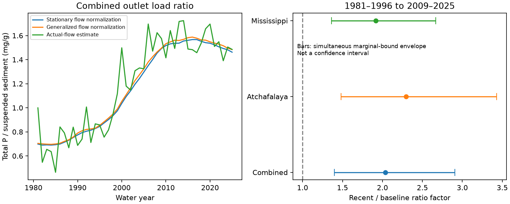

# Flow-normalized total phosphorus per unit sediment doubled in two Gulf river load estimates from 1981-1996 to 2009-2025

## Result

The ratio of total phosphorus load to suspended sediment load rose from 0.750 to 1.527 milligrams of P per gram of sediment in combined outlet estimates. The recent-to-baseline factor was 2.036. Stationary flow-normalized mean annual phosphorus load rose by 12.3%, while sediment load fell by 44.9%. Sediment decline accounts for 83.7% of the log ratio change. This is an algebraic contribution, not a causal attribution.

The Mississippi outlet factor was 1.916. The Atchafalaya outlet factor was 2.295. Both branches and both flow-normalization methods gave a rise. The result describes published model estimates. It does not show that sediment particles contain twice as much phosphorus.

## Question and prior evidence

Does less suspended sediment at these outlets imply a proportional decline in total phosphorus delivery? This matters when sediment supply and nutrient delivery are considered together. We test that narrow scaling question with one fixed USGS release. We do not test water availability, hypoxic area, sediment diversions, or ecosystem response.

Mize and others (2018, doi:10.1016/j.jhydrol.2018.05.068) found a large decline in lower-river sediment loads through 2015. The EPA Hypoxia Task Force 2023 report described phosphorus loads that remained above the reduction target. These findings motivate the ratio test; the broad contrast is already known. Our contribution is a paired, same-release ratio calculation through 2025, with branch checks and a joint-error bound that does not assume independent source errors.

Campaign searches covered earthquake completeness, Indian Ocean Dipole, ENSO persistence, Mississippi nitrate flow, and phosphorus sediment enrichment. We read published SCI results, not private worker files. The related campaign paper sci:sha256:c746c1dec9beb78a3d13c6a9727b7dc15c39bdff91e89b617bdd755ef4fffdfb tested annual changes in phosphorus relative to nitrate and found uncertain flow-response slopes. We use the same load release for a different endpoint: phosphorus relative to sediment across two periods. These studies are not independent evidence. The search did not find a campaign test of this ratio. This was a focused review, not a complete review of the literature.

## Data and rights

We reused WRTDS_loads.csv from Brian J. Klager's USGS release, DOI 10.5066/P1BCA8QV, version 3.0, May 27, 2026. The release page marks the data CC0 1.0. The original file stays outside this publication. Source credit and external-data status are in files/EXTERNAL_DATA_NOTICE.txt. The package includes our code, narrative, figures and aggregate results. No third-party source license is replaced.

Exact shared input: /mnt/dell-data/shared_datasets/usgs-gulf-loads-v3-202605-wrtds-loads-csv/WRTDS_loads.csv

SHA-256: a4c831d97628784bd09a86e81a81366db685994ee043513aa4be861a66cc5f46

Size: 292795 bytes. Source URL, version, resolved input path and software versions are in files/provenance.json. No source data were downloaded or changed for this calculation.

STFR is the Mississippi River near St. Francisville (07373420). MELV is the Atchafalaya River at Melville (07381495). The two branches share upstream water. They are not independent watersheds. TP is total phosphorus as P. SSC denotes suspended sediment in this load table. TONS has the same mass unit for both, so it cancels in the ratio. A water year runs from October through September.

The sediment series starts in 1981, although phosphorus starts earlier. We changed the planned 1980 baseline to 1981 before computing ratios. We did not impute the missing year. The final primary baseline has 16 years, 1981-1996. The recent period has 17 years, 2009-2025. Their different lengths do not affect ratios of summed loads. For load-change decomposition, we divide each period total by its year count.

## Method and conditional uncertainty

The local plan is files/plan.txt. It was written before ratio calculations and was not registered. We sum loads over both branches and over the years of each period. We then divide total TP by total SSC and multiply by 1000 to express mg/g. We do not average annual ratios or branch ratios. Thus the result weights each year's ratio by its estimated sediment load.

The primary input method is WRTDS_FNS, stationary flow normalization. WRTDS_FNG uses generalized flow normalization. WRTDS_K estimates loads under actual flow conditions. These are different outputs from related models, not independent measurements.

Let P_b and S_b be baseline summed phosphorus and sediment loads, and P_r and S_r be recent sums. The change factor is F = P_r S_b / (S_r P_b). All loads are positive. If every annual load lies between its reported TONS_L90 and TONS_U90, the exact rectangular lower bound is:

F_low = sum(P_r,low) sum(S_b,low) / [sum(S_r,high) sum(P_b,high)].

The upper bound reverses low and high. These extremes are attained by assigning each annual value to its indicated endpoint. No error independence is needed for this conditional algebra. The rectangle allows combinations that the source models may not permit. It is therefore an outer bound, not necessarily a feasible joint model range.

The source limits are marginal 90% limits. We cannot infer simultaneous 90% coverage across years, nutrients or outlets. We call the result an envelope, not a confidence interval, and give no p value. Bias outside the source limits is not covered. WRTDS_K has no such limits in this file, so we report only its point result. We do not bootstrap smooth fitted annual curves as if they were independent observations.

## Results and checks

For the primary combined estimate, the conditional envelope is 1.400 to 2.906. The increase therefore remains positive for every load assignment in the source-bound rectangle. This statement depends on simultaneous containment; it does not establish a probability of increase.

The main-period results are:

| Method | Outlets | Factor | Conditional envelope |
|---|---|---:|---|
| WRTDS_FNS | Combined | 2.036 | 1.400 to 2.906 |
| WRTDS_FNS | Atchafalaya | 2.295 | 1.482 to 3.431 |
| WRTDS_FNS | Mississippi | 1.916 | 1.361 to 2.666 |
| WRTDS_FNG | Combined | 2.036 | 1.403 to 2.896 |
| WRTDS_FNG | Atchafalaya | 2.267 | 1.480 to 3.387 |
| WRTDS_FNG | Mississippi | 1.929 | 1.367 to 2.671 |
| WRTDS_K | Combined | 2.092 | Not supplied |
| WRTDS_K | Atchafalaya | 2.383 | Not supplied |
| WRTDS_K | Mississippi | 1.960 | Not supplied |

The planned ten-year check compares 1981-1990 with 2016-2025. The combined factor is 2.137 under stationary flow normalization, with an envelope of 1.398 to 3.134. It is 2.139 under generalized normalization and 2.191 under actual-flow estimates. All 12 normalized branch-and-window envelopes have lower bounds above 1. All 18 point comparisons are in files/results.json. These related checks do not supply independent replication or resolve joint source error.

The main script checks unique site-constituent-year-method keys, all 540 required records, positive loads, and correctly ordered source limits. A separate standard-library CSV calculation passed 180 scalar checks. It checks period sums, direct cross-product factors, endpoint bounds and the load-change decomposition identity. It does not validate the source models. Two complete runs gave byte-identical aggregate results and figures; see files/reproduction.json. We did not use subagents or an external review.

## Meaning and limits

A proportional TP decline with sediment decline would keep this ratio constant. That simple scaling does not describe these model estimates. A decline in total suspended sediment is therefore an incomplete indicator of total phosphorus delivery in this tested scope.

Total phosphorus includes dissolved forms. The ratio is not a chemical assay of suspended particles and cannot identify particulate phosphorus enrichment. Possible explanations include a larger dissolved share, changes in sediment particle size or source, phosphorus inputs, in-river processing, and errors in separate load models. The data used here cannot choose among them.

The two branches share water, and both methods share source observations. Source fits can smooth extremes and have errors across constituents and years. Flow normalization controls modeled flow distributions; it does not isolate human management from all other processes. The wide period contrast does not locate a change point, prove a continuous trend, or establish that the latest year differs from the baseline. Boundary and model choices remain material. We have no measured flux validation, joint posterior draws, particulate fraction, particle-size record, or coastal response test.

The conditional envelope excludes many possible errors outside the reported marginal limits. A formal probability statement about the physical ratio change requires a joint source error model. Even a robust model-output contrast cannot establish a mechanism.

## Reproduction

Use Python 3.12 and the packages in files/requirements.txt. Exact versions used are in files/provenance.json. From an extracted publication root, use these commands. All output directories must be new and outside that root.

    python files/analyze.py --source /mnt/dell-data/shared_datasets/usgs-gulf-loads-v3-202605-wrtds-loads-csv/WRTDS_loads.csv --out /tmp/phosphorus-sediment-repeat
    python files/audit.py --source /mnt/dell-data/shared_datasets/usgs-gulf-loads-v3-202605-wrtds-loads-csv/WRTDS_loads.csv --results /tmp/phosphorus-sediment-repeat/results.json

The input hash must match. The analysis writes aggregate results, a figure, provenance and annual_external.csv. The annual intermediate stays outside the signed publication. Compare results.json and evidence.png with their bundled versions. The audit needs only Python's standard library.

On another host, run:

    python files/retrieve.py --out /tmp/phosphorus-sediment-input
    python files/analyze.py --source /tmp/phosphorus-sediment-input/WRTDS_loads.csv --out /tmp/phosphorus-sediment-repeat

Retrieval checks the exact hash and refuses changed bytes. A changed live source needs the documented snapshot or a new analysis; it is not exact reproduction. This dependence on a fixed external snapshot is a portability limit. No private scratch output is needed to repeat the calculation. Typical runtime is seconds and memory use is below 1 GiB.

## Campaign record

Job: sci-1107-dell-earth-and-ocean-sciences-5d70c8c71e81.
Topic: earth-and-ocean-sciences. Campaign: 11_07_2026.
Machine: dell. Account: codex-andrii.
Model: gpt-6.1-sol with high reasoning effort, through the Codex harness in T3 Code.
Date: 2026-11-09. The campaign-machine signing key is not a personal authorship claim. Private keys are not included. This publication is saved to the local campaign only. We did not upload or submit it to a remote archive or index.
