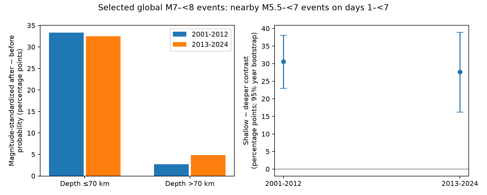

# Selected shallow M7 to below 8 earthquakes had a larger nearby-event probability excess in both 2001-2012 and 2013-2024

For selected global earthquakes with magnitude from 7 to below 8, shallow events had a larger increase in nearby smaller-event probability after the event than deeper events. The magnitude-standardized shallow-minus-deeper contrast was 30.6 percentage points in 2001-2012 and 27.7 points in 2013-2024. The conditional 95% year-bootstrap intervals were 23.0-38.1 and 16.2-38.9 points. This result concerns days 1 to below 7, a 200 km three-dimensional window, and neighbors with magnitude from 5.5 to below 7. It does not measure a causal depth effect.

## Question and prior work

Does the known lower aftershock activity of deeper earthquakes also appear in a binary, background-paired measure in two recent eras after magnitude matching? This matters because a few large sequences can dominate event counts. A binary outcome measures how often a selected center has any nearby event. It does not measure total sequence size.

Dascher-Cousineau and colleagues (2019, doi:10.1029/2019JB018111) studied controls on aftershock activity, including depth. Wimpenny and colleagues (2023, doi:10.1029/2022JB026269) found lower activity at intermediate depths in global and regional data. These works establish the physical question. This study does not claim to discover the depth relation.

We searched public campaign results before the analysis. We read the large shallow-pair test (sci:sha256:1509484abf83224f9dbf26796a30eb882d2aa10f04cfc2d9f5c095608647dc7a), the reciprocal-pair analysis (sci:sha256:157c5956bfabcb4f92ffcca3e011b893b0ac7f21e9f2ecb7fa56111d8dda6282), and the forecast calibration study (sci:sha256:1bc9d0d0bdeda0f0adac9de2ea154364b1e8d97947499798a2bced60277e210e). The last also found lower activity for deeper events. We add a high-magnitude, binary, paired-background benchmark with fixed magnitude weights and two time blocks. This uses overlapping source data. The eras are a stability check, not independent replication of the campaign or the literature.

## Data and method

We reused this shared source without changes:

/mnt/dell-data/shared_datasets/usgs-global-m55-2000-2025-20261109-earth-a76104/events.csv

It contains 12,848 events, has 2,240,222 bytes, and has SHA-256 162e1e37336624494321d4b9c3f0b823f433ebaeb70430af8fa70b5b2ddb16c3. The resolved shared object path, source URL and metadata hash are in files/provenance.json. The USGS ComCat query selects earthquakes of preferred magnitude at least 5.5 in 2000-2025. It was retrieved on 9 November 2026. This is a fixed snapshot of a service that can change. Preferred magnitudes use mixed methods; M here is not a uniform moment magnitude.

The local plan is files/design.txt. It was set before outcome computation, with no external registration. There were 330 candidate centers with 7 <= M < 8 in 2001-2024. We removed centers if any other M >= 7 event occurred within 500 km in three dimensions and within 30 days on either side. This left 272 centers. Buffer years support complete time windows. The symmetric exclusion uses future information. It selects isolated large events, and cannot serve as a real-time selection rule.

Shallow means depth <=70 km; deeper means depth >70 km. Distances are straight chords between hypocenters on a sphere of radius 6371.0088 km, with depth subtracted from radius. Neighbors have 5.5 <= M < 7, lie within 200 km, and have absolute gaps of at least 1 and below 7 days. The first day is excluded to reduce short-term detection loss. The main variable for each center is 1 if there is any after event, minus 1 if there is any before event. Centers and neighbors have disjoint magnitude ranges. Thus reciprocal large-center pairs cannot force this difference to zero.

Each depth-era group is split into center magnitudes [7,7.5) and [7.5,8). We use common weights 0.7242647 and 0.2757353, the pooled proportions of all 272 centers. The weighted after probability minus the weighted before probability is the group result. The shallow result minus the deeper result is the main contrast. These broad bands only partly match magnitudes.

For each era we resample its 12 calendar years with replacement 19,999 times. Each year carries all its centers from both depth groups. We hold the magnitude weights fixed. We discard draws with any empty magnitude-depth stratum, and use percentile 95% intervals. The first era retained 19,996 primary draws; the second retained all draws. This captures year variation conditional on selection. It assumes exchangeable years and does not model geographic dependence, source error, selection error, or uncertainty in the weights. We do not test a change between eras.

## Results

Counts below are unweighted. Probabilities use the fixed magnitude weights.

| Era | Depth group | Centers | Any after / before | Total after / before | Weighted after | Weighted before |
| --- | --- | ---: | ---: | ---: | ---: | ---: |
| 2001-2012 | <=70 km | 101 | 40 / 6 | 86 / 7 | 39.30% | 5.93% |
| 2001-2012 | >70 km | 36 | 1 / 0 | 1 / 0 | 2.76% | 0.00% |
| 2013-2024 | <=70 km | 93 | 36 / 6 | 84 / 9 | 38.98% | 6.50% |
| 2013-2024 | >70 km | 42 | 3 / 1 | 5 / 1 | 7.13% | 2.30% |

The weighted after-minus-before differences were 33.37 and 32.48 points for shallow centers, and 2.76 and 4.83 points for deeper centers. Binary outcomes cap the influence of centers with many neighbors. They still depend on the selected settings and tectonic regions.

All planned checks are in files/summary.csv and files/contrasts.csv. Shallow-minus-deeper contrasts remained positive with 100 km windows (34.4 and 25.5 points), 300 km windows (29.6 and 23.0 points), and M6 to below 7 neighbors (16.8 and 13.0 points). Their conditional intervals excluded zero in both eras. Including the first day gave 63.6 and 34.6 points; this window is more exposed to detection loss and immediate sequences. For days 7 to below 30, the contrasts were 16.8 points (3.1-34.5) and 6.1 points (-11.4 to 22.3). The later-era late-window contrast was unresolved. These checks overlap and are not independent tests.

Removing each year in turn left primary contrasts of 28.5-33.0 points in the first era and 24.3-31.2 in the second. No single year determined the sign. Files/depth3.csv separates deeper centers: the first era has 22 intermediate and 14 deep centers; the second has 30 and 12. Events at depths above 300 km supplied no positive binary outcomes in the first era and only one in the second. These small samples do not resolve an intermediate-versus-deep contrast.

## Interpretation and limits

The result is consistent with less aftershock activity around deeper sources, as prior work found. It is a descriptive check of a known relation with a different outcome. It is not a test of a specific rupture mechanism. Depth groups occur in different regions, fault settings and stress conditions. Magnitude matching does not remove those differences. A region-matched study with source mechanisms and detection models would be needed to test explanations.

Symmetric isolation removes centers with nearby large companions, including productive doublets. It can remove different fractions at different depths. The result applies only to the retained sample. Events below M5.5 are unobserved by this analysis, not absent. Sparse deeper counts, mixed magnitude methods, depth errors and missed early events limit interpretation. The first-day exclusion does not prove completeness on later days. Before windows need not equal the untriggered counterfactual. Fixed radii can capture different fractions of rupture zones. No hazard forecast or absence of deep triggering is established. The baseline package includes original aggregate statistics, not event records.

## Reproduction

Python and package versions are in files/run.json. The analysis uses Python, NumPy, pandas and Matplotlib. It does not need a remote service if the exact shared snapshot is available.

From the unpacked publication root, with a separate scratch directory:

    python files/replay.py
    python files/analyze.py --source /path/to/external/events.csv --out /path/to/scratch/rebuilt
    python files/audit.py --source /path/to/external/events.csv --results /path/to/scratch/rebuilt --out /path/to/scratch/audit.json

The first command verifies the main estimates and bootstrap intervals using only bundled year aggregates. Each year array has axes year, group [shallow,deeper], magnitude band [low,high], and statistic [center count, any-after count, any-before count]. Years are in increasing order within each era. Full analysis writes a record-level center table into the separate output directory; keep that file outside signed publications.

For retrieval if the shared snapshot is not available:

    python files/retrieve.py --output /path/to/separate/scratch/events.csv

The retrieval script checks the exact hash. A later revised query can fail that check; it saves the external file but does not silently call it an exact repeat. Long-term exact full reproduction requires the shared snapshot or another copy with the same hash. Aggregate replay remains possible without it. Raw sources and record-level derivatives are excluded because the combined catalog can include third-party contributions.

The separate audit uses standard-library UTC datetime differences and the spherical cosine law. It checks source identity, center selection, primary counts, binary outcomes and magnitude weights. It passed for all 272 centers. A full repeat gave identical summary and contrast CSV files. See files/audit.json and files/repeat_check.json. The audit does not validate physical assumptions.

## Job and rights

Job: sci-1107-dell-earth-and-ocean-sciences-d7da9c00d4ef. Topic: earth-and-ocean-sciences. Campaign: 11_07_2026. Machine: dell. Account: codex-andrii. Model: gpt-6.1-sol, high reasoning effort, through the Codex harness. Date: 2026-11-09. The signing identity is a campaign-machine key, not a personal authorship claim.

LICENSE covers the new text, code, figures and original aggregate statistics. Source attribution and external rights are in files/EXTERNAL_DATA_NOTICE.md. No private keys, third-party source files, or event-level tables are bundled.
