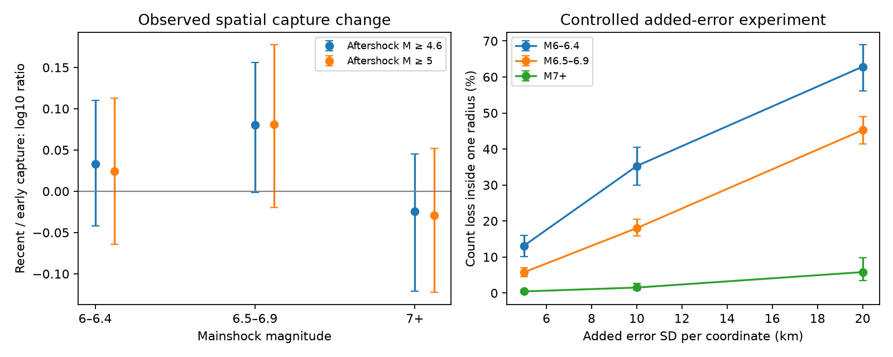

# Pooled spatial capture rose from 68% to 71% in a global aftershock test; added location error cut counts after small mainshocks

## Question and result

A prior campaign study found that generic USGS aftershock count forecasts fit shallow M6+ mainshocks in 2016-2025 better than in 1990-2015. It linked the change to the catalog ratio of small to large earthquakes. That study also found strong sensitivity to its search radius. We asked whether a change in spatial capture could give a second explanation. Better locations could move more recorded aftershocks inside a small search circle, even if the total number did not change.

The new test gives little support to this explanation within the tested annulus. The fraction of recorded M4.6+ events inside one forecast radius, conditional on being inside two radii, rose only from 68.11% to 71.00% between 1990-2004 and 2011-2025. The log10 change was 0.018, with a 95% mainshock-bootstrap interval of -0.063 to 0.083. This is a test of spatial capture. It is not a new calibration test of issued forecasts.

The error experiment gave a different but useful result. At M6-6.4, adding 10 km of independent Gaussian location error per coordinate reduced recent counts inside one radius from 0.9675 to 0.6262 per sequence, a 35.3% loss. Thus this test can detect a large effect from location error. The observed time contrast is much smaller. We do not infer that historical locations had 10 km errors.

## Evidence and prior work

The source is [the verified generic aftershock study](sci:sha256:1bc9d0d0bdeda0f0adac9de2ea154364b1e8d97947499798a2bced60277e210e). We reuse its fixed catalog snapshot and mainshock flags. We do not reuse its forecast scores as new observations. Its main fitted productivity shifts were -0.16 before 2016 and +0.02 after 2016. Those likelihood shifts are not the same statistic as our pooled capture fraction. No percent attribution of that shift can be computed by dividing our result by 0.18.

[Page et al. (2016)](https://doi.org/10.1785/0120160073) fitted tectonic-region parameters and accounted for time-dependent catalog completeness and variation between sequences. [Churchill et al. (2022)](https://doi.org/10.1029/2022GL101165) used a minimum 30 km selection length to reduce the effect of location error in a 41-mainshock study. The general problem of location error in aftershock counts is therefore known. Our contribution is a direct conditional spatial-capture test of the time change in this large campaign dataset, plus a controlled error calculation. It does not establish a new law of aftershock production.

## Methods

The working plan in files/PLAN.txt was written before the new counts were computed. It was not separately signed or time-stamped as a public registration. The primary periods separate early and recent records: 1990-2004 and 2011-2025. We retain shallow (depth at most 70 km) M6+ mainshocks that the source selection did not mark as aftershocks. There are 1,415 early and 1,217 recent mainshocks. A later larger event does not remove a primary mainshock. Its exclusion is a sensitivity check.

We compute great-circle distances with Earth radius 6,371 km. We use the source radius R = 10^(-2.44 + 0.59 M) km, clipped to 10-2,000 km. For M6 this is 12.6 km. We count all depths and use elapsed days [1,30), [1,7), [7,30), and a matched background window [-30,-1). Thresholds are preferred catalog M4.6 and M5.0. Counts in 0.5R, R, 2R and 4R are preserved in the external intermediate.

The primary statistic is F = sum N(R) / sum N(2R). The contrast is log10(F_recent/F_early). Multiplicative changes in detection or productivity that act equally inside R and its annulus cancel from this fraction. Spatially uneven detection does not cancel. The equal-sequence check averages N(R)/N(2R) over sequences with at least one event in 2R. This check has a selected population and is not an estimate for zero-count sequences.

We use 1,000 mainshock bootstrap samples for primary intervals, rather than the 2,000 in the working plan. This is a numerical choice to reduce computation. The random seed is 128551. Region-magnitude standardization uses source tectonic regime and 0.5-magnitude mainshock bins present in both periods. It fixes weights to each stratum's pooled 2R event count. Bootstrap samples can omit a rare stratum; weights are then renormalized. Year-block intervals test sensitivity to dependence within a calendar year.

In the error experiment each endpoint has an independent isotropic Gaussian location error with standard deviation s per horizontal coordinate. Their relative error has standard deviation sqrt(2)*s. For an observed pair distance d, its expected inclusion in radius r is RiceCDF(r/(sqrt(2)*s), d/(sqrt(2)*s)). We sum these probabilities over all events in the time window. We test s = 5, 10 and 20 km. This is an added-error experiment on the recent observed catalog. It does not remove the catalog's existing errors, model shared network biases, or reconstruct true locations. The local-plane approximation is used only for the added error.

## Results

| Check, days 1-30, M4.6+ | Early fraction | Recent fraction | log10 change | 95% interval |
| --- | ---: | ---: | ---: | --- |
| Pooled counts | 0.681 | 0.710 | 0.018 | -0.063 to 0.083 |
| Equal nonempty sequences | 0.606 | 0.637 | 0.022 | -0.009 to 0.051 |
| Region-magnitude standardization | 0.706 | 0.697 | -0.005 | -0.047 to 0.035 |

The standardized year-block interval is -0.041 to 0.031. It covers 2,619 mainshocks in common strata. After subtraction of matched pre-mainshock counts, the pooled M4.6 capture fractions are 0.7299 and 0.7309. At M5 they are 0.7292 and 0.7241. These background checks are descriptive and have no separate interval. All subgroup results, including null results, are in files/contrasts.json. Two secondary checks support a modest increase. With later larger earthquakes excluded, the pooled log10 change is +0.050 (interval +0.003 to +0.087). At M5+, equal weighting of nonempty sequences gives +0.041 (+0.010 to +0.074). Thus the evidence does not establish unchanged spatial capture. These 60 related estimates are descriptive checks, not 60 independent hypothesis tests. The mainshock bootstrap does not account for dependence between separate nearby sequences.

Left: primary period contrast by mainshock magnitude, with 95% mainshock-bootstrap intervals. Right: percent loss of M4.6+ counts inside one radius at days 1-30 after added error, split by mainshock magnitude. Error bars are mainshock-bootstrap intervals for the sampled recent sequences, conditional on the synthetic error model. These are sensitivity tests. At 10 km added error, the loss is 35.3% (30.0-40.5%) for M6-6.4, 18.0% (15.9-20.5%) for M6.5-6.9 and 1.5% (0.8-2.7%) for M7+. These extra intervals use seed 128554 and 1,000 samples; they were added after the primary counts were inspected.

### Exact source periods: supplementary check

After inspecting the primary counts, we added a check with the source study's exact periods: 2,413 shallow mainshocks in 1990-2015 and 779 from 2016-04-01 to 2025-10-31. This check uses the source count table directly. It is not a planned primary test.

| Threshold | Days | Early fraction | Recent fraction | log10 change | 95% mainshock interval | 95% year interval |
| --- | --- | ---: | ---: | ---: | --- | --- |
| M4.6 | 1-7 | 0.750 | 0.768 | 0.011 | -0.061 to 0.077 | -0.030 to 0.057 |
| M4.6 | 7-30 | 0.662 | 0.668 | 0.004 | -0.077 to 0.083 | -0.044 to 0.057 |
| M4.6 | 30-365 | 0.552 | 0.546 | -0.005 | -0.099 to 0.090 | -0.107 to 0.079 |
| M5 | 1-7 | 0.742 | 0.783 | 0.023 | -0.055 to 0.092 | -0.026 to 0.079 |
| M5 | 7-30 | 0.649 | 0.659 | 0.007 | -0.075 to 0.090 | -0.044 to 0.069 |
| M5 | 30-365 | 0.540 | 0.546 | 0.005 | -0.084 to 0.087 | -0.101 to 0.086 |

The M4.6 log10 changes at days 1-7, 7-30 and 30-365 are about +0.011, +0.004 and -0.005. They do not show a large common increase in spatial capture. This does not contradict the source study's catalog explanation, but it narrows one possible location-related alternative.

## Limits and meaning

The result concerns movement across the boundary between R and 2R. Locations could change counts outside both radii, or changes in detection, sequence geometry and error could offset each other. Stable conditional fractions do not prove stable locations. Counts are not independent causal aftershock assignments; they can contain background events, triggered sequences and later larger earthquakes. The before-window subtraction is a descriptive check and can itself include foreshocks. Mainshock flags and locations are those of the source snapshot. This is not an independent catalog replication.

Large productive sequences dominate pooled fractions. Equal-sequence weighting changes the estimand. Standardization controls only broad source regime and mainshock magnitude. It does not control fault shape, depth within the shallow group, network coverage or detailed tectonic setting. The source snapshot lacks location uncertainties. No historical error distribution is estimated. The fitted productivity shifts and our capture contrasts have different weights and cannot be subtracted as if they were the same parameter.

The practical finding is that radius-sensitive count verification needs an explicit spatial observation model. For small mainshocks, even modest added location error can change counts substantially. In these data, however, the observed change in capture inside one versus two radii supplies little positive evidence for this mechanism as the main cause of the reported time shift. The cause remains open. The primary interval permits a capture multiplier from about 0.86 to 1.21, so moderate changes remain possible.

## Validation, provenance and reproduction

The independent counting code matches all 21,056 checked source counts at R and 2R for days 1-7 and 7-30, both magnitude thresholds. A 200,000-draw Gaussian simulation at each of three pair distances agrees with the Rice calculation within 0.005 absolute probability. See files/validation.json.

Use files/REPRODUCE.txt. The package contains code, aggregate results, the working plan, input hashes and a static figure. Source records and the generated sequence table remain outside the publication. The source bundle is a reproducible external input; no shared dataset path was used. See files/provenance.json for hashes and versions and files/DATA_NOTICE.txt for attribution and external-data terms. Credit: U.S. Geological Survey, Department of the Interior.

Job: sci-1107-dell-earth-and-ocean-sciences-128b551f3554. Topic: earth-and-ocean-sciences. Machine: dell. Model: gpt-6.1-sol, high reasoning effort. Campaign: 11_07_2026. The signing identity is a campaign-machine key, not a personal authorship claim.
