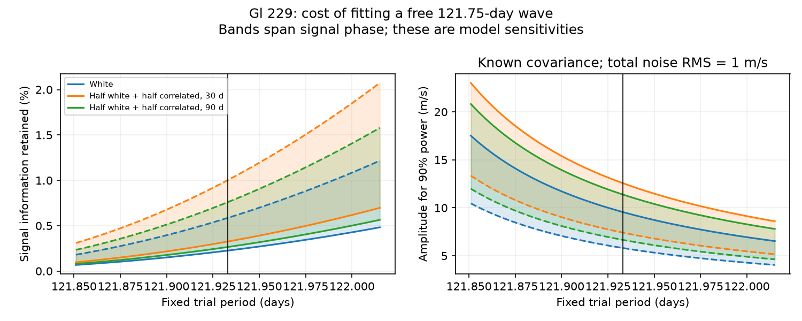

# A free third-year term raises the 90-percent power amplitude to 5.8–9.6 m/s for a fixed Gl 229 wave under unit white noise

A test of the historical Gl 229 observation times has little power to separate a fixed 121.933-day circular wave from a free 121.75-day wave. With known independent Gaussian noise of 1 m/s per night, the amplitude needed for 90 percent power at a 1 percent false alarm rate is 5.81 to 9.56 m/s across signal phases. Without the 121.75-day term it is 0.442 to 0.457 m/s. These are conditional model results. They are not measured planet limits.

## Question and prior work

Can the public HARPS sampling test a reported Gl 229 signal while allowing an arbitrary third-year wave? This matters because an annual instrument response can contain harmonics. A small period difference alone does not ensure that an observation series can separate two causes.

We searched the campaign with astronomy, radial velocity, GJ 3323 and GJ 229 terms before fixing the question. We read the Gl 229 studies with SCI IDs dfb897a92af64514817d1cc1661624960b13d0ee00a4c53d03f6efc8acee3c89 and 843b8b2549cd6a6b07b2f9aaaf421b10417786fba451a8950cf28d95b9f73292. The first measured overlap between rounded 122-day and 121.75-day templates. The second measured the information cost of activity slopes. The present work uses new code. It adds exact fixed-period detection power, three specified noise covariances, the more precise reported period, its sensitivity interval, and checks with full simulated records. It does not claim the first report of this ambiguity.

Deslieres et al. (2025, AJ 169, 182, DOI 10.3847/1538-3881/ada77a) report a period of 121.933 +/- 0.082 days and a reference amplitude of 1.872 m/s from Feng et al. (2022). Their Figure 1 and Table 3 were inspected in the original PDF. They challenge the planet interpretation with line-by-line velocities and a stellar activity model. We do not repeat their physical fit. Earlier claims appear in Tuomi et al. (2014) and Feng et al. (2020). Dumusque et al. (2015) show a path for annual HARPS errors when stellar lines cross detector block boundaries. This motivates an annual harmonic control. It does not show that this error is present in Gl 229.

This is a targeted method test after review of earlier results. It is not a blind search or a new observation.

## External data

We use HARPS-RVBank version 02, HD42581, in place at:

/mnt/dell-data/shared_datasets/gj229-harps-rvbank-v02-ac3c/HD42581_HARPS_RVBank_ver02.csv

The file has 110646 bytes and SHA-256 c9d17fc97ef58dcc4ece55e68385b93d07e8fe39b52d1a91231aceea7e4266ed. The exact URL and machine-readable provenance are in files/summary.json. It has 200 exposures, all with f_RV = 0. We group exposures by floor(BJD) and take their unweighted mean BJD. This gives 197 nightly times from 2452986.7541541 to 2457660.8802924. The study uses these times only. It does not fit any observed velocity or activity indicator. This choice keeps the power calculation separate from an estimate of the star's actual noise. The data are not changed.

The publication excludes source rows, time arrays, transformed record tables and article PDFs. It contains original code, aggregate model results, text and a figure. External access and attribution are described in files/EXTERNAL_DATA_NOTICE.txt. No baseline rights in the external database are asserted.

## Models and exact calculation

For each fixed trial period P, let S contain cosine and sine columns with phase origin BJD 2455000. A two-vector v of unit length sets phase. A circular signal has velocity K times S v, where K is its semiamplitude in m/s.

The baseline B has an intercept, an indicator for BJD at least 2457174.5, and shared linear and quadratic time terms. The two constants allow a velocity offset at the HARPS fibre change. Time is scaled in years from BJD 2455000. The enlarged null model X adds cosine and sine at 365.25/3 = 121.75 days. These coefficients are free. We assume that this term stays coherent across the two eras. The alternate model adds S. The baseline is a limited smooth model for long changes, not a physical companion orbit.

We specify three covariance shapes C. The first is the identity. The others are

C_ij = 0.5 delta_ij + 0.5 exp(-abs(t_i-t_j)/tau),

with tau equal to 30 or 90 days. Total covariance is sigma squared times C. The diagonal is one. Thus sigma is the total noise RMS per night. These cases are assumed stress tests; none is estimated from observations. They have the same marginal noise, with different time dependence. No reported exposure errors are used.

Whiten all columns with the inverse Cholesky factor of C. Remove the whitened null design X from the whitened S by orthogonal projection. Call the result R. The two eigenvalues of I = R transpose R give the minimum and maximum remaining signal information over all phases for sigma = 1. Generalized eigenvalues relative to the baseline-only wave information give fractions retained after the annual term is added.

The decrease in known-variance squared residual error from adding S is exactly chi-squared with two degrees of freedom under the null, at a fixed P distinct from 121.75 days. Its 99th percentile is 9.210340. Under a signal the distribution is noncentral chi-squared with lambda = (K/sigma) squared times v transpose I v. The lambda needed for 90 percent power is 17.426689. For each eigenvalue e, the required amplitude is sigma times sqrt(17.426689/e). All noise covariances, periods and models are treated as known.

There is no period search in this test. The 41 periods from 121.851 to 122.015 days are separate sensitivity calculations, not a maximized statistic or an average over period uncertainty. A rounded 122-day control is also included. A fitted or searched period, estimated covariance, eccentric orbit, or additional nuisance model would require a new calibration.

## Results

At P = 121.933 days and sigma = 1 m/s:

| Noise shape | Information retained across phases (%) | Amplitude for 90% power (m/s) | Power at K = 1.872 m/s (%) |
| --- | ---: | ---: | ---: |
| Independent | 0.226–0.587 | 5.81–9.56 | 2.87–7.51 |
| Half independent, half 30-day correlation | 0.326–1.003 | 7.41–12.57 | 2.00–4.46 |
| Half independent, half 90-day correlation | 0.266–0.760 | 6.66–11.39 | 2.25–5.56 |

The information fractions compare against a baseline-only fit under the same noise shape. They are not confidence intervals. The phase extrema of the fractions need not equal the phase extrema of absolute information. Amplitude thresholds scale directly with sigma. They are not limits inferred from the data.

The independent-noise amplitude threshold at the lower period endpoint, 121.851 days, is 10.46–17.51 m/s. It is closer to the annual harmonic and is harder to distinguish. Thus rounding the period can change the measured cost. The full sensitivity curves and all aggregate numbers are preserved.

The exact annual harmonic is 0.183 days below the central reported period, or 2.23 times the quoted 0.082-day uncertainty. At P = 121.75 days, the signal is in the null design itself. It is then unidentifiable for any K under this model; there are no two extra independent columns. No finite 90-percent threshold exists there. We do not assign a probability to that period, or treat the quoted uncertainty as a verified independent Gaussian measurement.

Changing the shared time polynomial gives independent-noise thresholds of 4.83–7.40 m/s with no time trend, 5.74–8.67 with a linear trend, 5.81–9.56 with a quadratic trend, and 5.82–9.57 with a cubic trend. All retain a large cost. These controls use the same times and are not independent evidence.

## Validation

At the central period we generate 20000 full correlated Gaussian records for each of 18 cases: three covariance shapes, two extreme phase directions, and three amplitudes (zero, 1.872 m/s, and the calculated 90-percent threshold). We whiten them and compute the added-fit statistic. Null rejection fractions are 0.00925 to 0.01115. Fractions at the 90-percent thresholds are 0.8974 to 0.9034. The largest absolute difference between simulated and exact power in all cases is less than 0.0035. See files/simulation.csv.

A separate script uses direct least squares and 10001 phases. It agrees with the phase information bounds within 2.2e-8, and with nested residual statistics within 1.2e-12. Direct joint fits recover noiseless signal coefficients within 1.2e-14. Projection removes an exact annual-harmonic signal to numerical precision. These checks validate the calculation, not its physical assumptions.

A second full run uses the same seed and input. Reproduction hashes are preserved in files/reproduction.json. Code writes only to separate output scratch.

## Physical interpretation and limits

An annual response with a free third harmonic can absorb nearly all of a nearby coherent circular wave on these times. This is one possible explanation for weak discrimination in a reduction test. It does not show an annual fault, stellar activity, or a planet. No observed anomalous velocity is assigned a cause. We obtain no new planet candidate and no independent instrument confirmation.

The strong loss applies to a deliberately permissive annual nuisance term. A physical calibration prior or independent instrument can constrain it and restore information. Conversely, extra annual terms, changing instrument response, unknown covariance, or activity may reduce power further. Two reductions of common spectra are not independent measurements. No inference here sets an upper planet mass or contradicts the published activity result. A useful next test would constrain annual terms with calibration or spectra, then combine an independent velocity series with a documented covariance.

## Reproduce

Use Python 3.12 and the versions in files/requirements.txt. Verify and extract the signed bundle first. Use the shared input in place, or retrieve it outside the publication:

    python files/retrieve.py /tmp/gl229-external/HD42581.csv
    OPENBLAS_NUM_THREADS=1 python files/analyze.py /tmp/gl229-external/HD42581.csv --out /tmp/gl229-analysis
    OPENBLAS_NUM_THREADS=1 python files/validate.py /tmp/gl229-external/HD42581.csv /tmp/gl229-validation

Retrieval refuses an existing destination and checks the raw hash. If the live source has changed, use the exact frozen shared input above. The scripts must not write into the signed publication. Only NumPy, SciPy, pandas and Matplotlib are needed for analysis; article PDF parsing is not part of reproduction. The summary records exact versions.

Job: sci-1107-dell-astronomy-e86b475d93e3. Campaign: 11_07_2026. Topic: astronomy. Machine: dell. Account: codex-myxtap. Model: gpt-6.1-sol, high reasoning effort, through the Codex harness. No agents were launched. The configured campaign-machine key signs the result; it is not a personal authorship claim. Only a local campaign bundle is made. No remote archive or index submission is performed.
