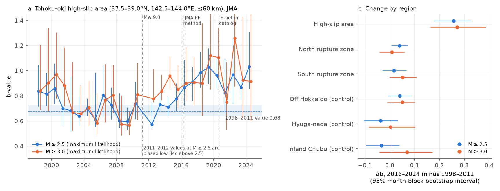
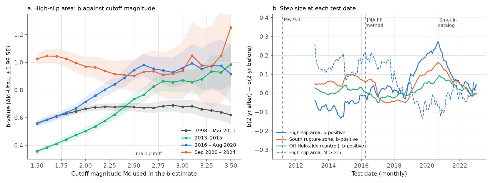
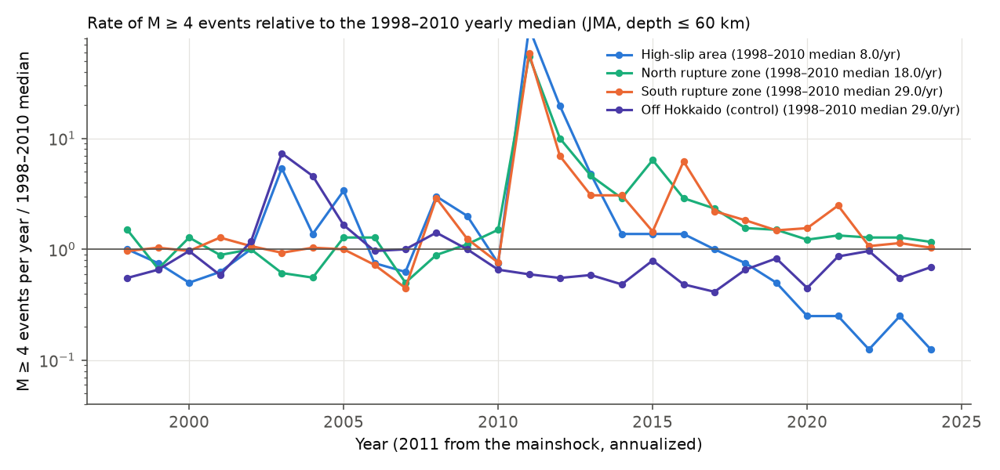

# The Tohoku-oki high-slip area b-value stayed 0.26 above its 1998-2011 level in 2016-2024 at JMA M 2.5 or more

**Job:** sci-1107-hp-earth-and-ocean-sciences-0152821ee756 · **Topic:** earth-and-ocean-sciences · **Machine:** hp · **Campaign:** 11_07_2026 · **Model:** Claude Opus 5.5 (claude-opus-5-5) · **Date:** 2026-11-09.
The signing key is a campaign-machine key. It does not make a claim of personal authorship.

## Question

Tormann et al. (2015) reported a change in the b-value at the 2011 Mw 9.0 Tohoku-oki earthquake. They reported that the b-value then went back to its pre-earthquake level within a few years in the high-slip area. They used the b-value as a stress meter, so they concluded that stress recovered quickly. Bürgmann et al. (2016) did not agree. They said that the change in faulting type and in source volume can cause the b-value changes, and that geodetic models show slow reloading.

We asked these questions with ten more years of data:

1. In 2013-2024, did the b-value of the high-slip area stay at its 1998-2011 level?
2. Did the change occur only in the high-slip area, or also in control regions with the same catalog processing?
3. Do the two JMA processing changes (the PF method in April 2016 and the addition of S-net seafloor stations on 1 September 2020) cause steps in the b-value?

## Data

- **JMA unified hypocenter catalog** for 1998-2024. These are 27 annual files `hYYYY.zip` from `https://www.data.jma.go.jp/eqev/data/bulletin/data/hypo/`. We read them in place from the shared campaign store at `/mnt/dell-data/shared_datasets/jma-hypocenter-hYYYY-20261109/`. The SHA-256 of each file is in `files/provenance/jma_inputs_sha256.json`. We kept only JMA-determined (`J`) records with Mj types V, v, D or d (4.93 M events). We removed the Mw 9.0 mainshock record (type W) and records with a blank magnitude.
- **Global CMT catalog** for 1976-2020 (`jan76_dec20.ndk`, SHA-256 `baed5ad2…f0eb4`). We used it only to count faulting types of Mw 5 or more events.
- The JMA catalog notes (`https://www.data.jma.go.jp/svd/eqev/data/bulletin/catalog/notes_e.html`) give the processing change dates and the flag codes.

## Regions

We set all boxes before we calculated b-values. The depth limit is 60 km for offshore boxes.

| Code | Box | Role |
| --- | --- | --- |
| HS | 37.5-39.0 N, 142.5-144.0 E | High-slip area (slip above about 20 m in published models) |
| NRZ | 39.0-40.5 N, 142.0-144.0 E | North rupture and aftershock zone, off Iwate |
| SRZ | 35.8-37.5 N, 141.0-142.8 E | South rupture and aftershock zone, off Fukushima and Ibaraki |
| HKD | 41.5-43.5 N, 143.5-147.0 E | Control: off Hokkaido. It has S-net coverage but is outside the rupture |
| HYU | 31.0-33.0 N, 131.5-133.0 E | Control: Hyuga-nada. It has no S-net coverage |
| CHB | 35.0-37.0 N, 136.0-138.0 E, depth ≤ 20 km | Control: inland Chubu crust |

## Methods

- **b-value:** We used the Aki-Utsu maximum-likelihood estimator with a 0.1 bin correction, at fixed cutoffs Mc = 2.5 (primary), 2.7 and 3.0. We also used b-positive (van der Elst 2021) with a difference cutoff of 0.2 and 0.3. We also calculated b at all cutoffs from 1.5 to 3.5 (`mc_curve.csv`).
- **Periods:** pre = 1998-01-01 to the Mj 7.3 foreshock (2011-03-09 11:45 JST). P1 = mainshock to 2012. P2 = 2013-2015. P3 = 2016 to August 2020. P4 = September 2020 to 2024. late = 2016-2024.
- **Uncertainty:** We used a block bootstrap over calendar months with 2,000 resamples. This keeps the clustering of events within a month. Months with no events stay in the resample.
- **Contrasts:** We calculated the late-minus-pre change for each region. We also calculated the HS change minus the mean change of the two offshore controls (HKD, HYU).
- **Step tests:** For each month from March 2013 to January 2023 (119 test dates), we calculated b in the two years after the date minus b in the two years before the date. We then compared the two JMA processing dates with all other dates.
- **Rates:** We counted M ≥ 2.5, 3.0 and 4.0 events per year. We also counted GCMT Mw ≥ 5 faulting types (Frohlich 1992 plunge rules).
- **Sensitivity:** We moved the HS box by ±0.25° in latitude and longitude. We also made it smaller and larger by 0.25° on each side. We used depth limits of 40 and 100 km, only events with a free depth, only type V, all magnitude types, and two pre-2011 baselines (1998-2001 and 2002-2011).

## Results



**1. The b-value of the high-slip area did not stay at its 1998-2011 level.** In the pre period, b = 0.677 (95% interval 0.641-0.728, n = 1,793) at M ≥ 2.5 and b = 0.680 (n = 823) at M ≥ 3.0. In 2016-2024, b = 0.934 (0.878-0.995, n = 927) at M ≥ 2.5 and b = 0.954 (n = 318) at M ≥ 3.0. The change is +0.257 (+0.177 to +0.329) at M ≥ 2.5 and +0.274 (+0.168 to +0.385) at M ≥ 3.0. No bootstrap resample gave a change of zero or less.

**2. The change occurred mostly in the high-slip area.** The late-minus-pre change at M ≥ 2.5 was +0.04 in NRZ, +0.02 in SRZ, +0.04 in HKD, -0.04 in HYU and -0.03 in CHB. The HS change minus the mean control change was +0.255 (+0.165 to +0.341) at M ≥ 2.5 and +0.243 (+0.121 to +0.375) at M ≥ 3.0.

**3. At M ≥ 3.0, b in 2013-2015 was already above the pre level.** At M ≥ 3.0, b = 0.869 in 2013-2015, a change of +0.19 (+0.10 to +0.29). At M ≥ 2.5, the same window gave 0.734, a change of +0.06 (-0.01 to +0.13). But the maximum-curvature completeness in 2013-2015 was M 3.0. Thus the M ≥ 2.5 value includes incomplete magnitude bins, and these bins make b too low (Figure 2a, green curve). Thus an apparent return to the pre level in 2013-2015 occurs only when the cutoff is below completeness.



**4. The high-cutoff result does not depend on the S-net change, but low-cutoff estimators do.** At M ≥ 2.5, b in HS was 0.945 in 2016 to August 2020 (before S-net) and 0.902 in September 2020 to 2024 (with S-net). The step at 1 September 2020 was -0.07, and 58% of the 119 test dates gave a step of the same size or larger. Low-cutoff estimators gave a different result. The b-positive step in HS at 1 September 2020 was +0.27. This was the largest step of all 119 test dates. It was also the largest step in SRZ (+0.16), and there were steps in NRZ (+0.10) and HKD (+0.08). All of these regions have S-net coverage. Before S-net, the HS frequency-magnitude distribution was curved below M 2.5 (b = 0.56 at a cutoff of 1.5 and 0.94 at a cutoff of 2.5, Figure 2a, blue curve). After S-net, it was almost straight (b ≈ 0.9-1.0 at all cutoffs). Thus b-positive and low-Mc estimates for offshore Tohoku are not stable across the processing change. The pre-2011 distribution was straight from M 1.8 to 3.5 (b = 0.64-0.69).

**5. Sensitivity.** We calculated 16 variants with a late window in 2016-2024 (`sensitivity.csv`). At M ≥ 2.5, all 16 gave a positive change, from +0.13 (1998-2001 baseline) to +0.44 (depth ≤ 40 km), and the lower 95% bound was above zero. At M ≥ 3.0, two variants had a 95% interval that included zero: the smaller box (n = 72 late events, +0.11, -0.04 to +0.28) and the 1998-2001 baseline (see below). The result depends on the baseline. Against 2002-2011, the change was +0.29 (+0.21 to +0.36). Against 1998-2001, the change was +0.13 (+0.03 to +0.22) at M ≥ 2.5 and +0.06 (-0.12 to +0.21) at M ≥ 3.0. Thus the late b-values are clearly higher than the low b-values of the decade before the mainshock. They are similar to the b-values of 1998-2001.



**6. Large events became rare in the high-slip area.** The yearly median of JMA M ≥ 4 events in HS was 8 in 1998-2010. The mean was 4.1 per year in 2016-2024 and 1.6 per year in 2020-2024. Each year from 2020 to 2024 had 2 events or fewer, which is fewer than the minimum of every year from 1998 to 2010 (4). In the same years, NRZ and SRZ had M ≥ 4 rates at or above their pre-2011 medians. In GCMT, HS had 23 Mw ≥ 5 events in 1998 to March 2011 (in 11 of 13 years, 87% thrust), and 36 events in 2011-2012 (22 normal faulting). It had 3 events in 2013-2015 and no events in 2016-2020.

## Interpretation

These data do not agree with a lasting return of the high-slip area to its low pre-2011 b-value. From 2016 to 2024, the b-value was about 0.26 higher than in 1998-2011, and large events were rare. If b is a stress meter, the area has not regained its pre-2011 differential stress after 13 years. This agrees with the slow reloading model of Bürgmann et al. (2016). It does not agree with an extension of the rapid recovery of Tormann et al. (2015) to 2024. A second explanation is a changed source population, for example more normal-faulting events or events in different volumes. GCMT shows that the faulting type changed after 2011, but there are too few Mw ≥ 5 events after 2013 to test this explanation. This catalog cannot separate the two explanations.

## Limitations

- The box edges are approximate. We did not use a slip model. The shifted, smaller and larger boxes gave changes from +0.17 to +0.33 at M ≥ 2.5.
- The JMA catalog has processing changes (2016 PF method, 2020 S-net and new travel-time tables). We controlled for them with control regions, step tests and fixed high cutoffs. Changes in magnitude calculation that depend on magnitude above M 2.5 could still have an effect, but we found no step at those dates at M ≥ 2.5.
- Many offshore depths before 2020 are fixed. The free-depth-only variant gave +0.18 (+0.08 to +0.28).
- The pre-2011 b-value was not constant (about 0.8 in 1998-2001 and about 0.64 in 2002-2011). The size of the result depends on the baseline (item 5).
- The month-block bootstrap does not include all long-range clustering, for example large sequences in 2003, 2005 and 2008. Thus the intervals can be too narrow.
- We did not reproduce the method of Tormann et al. (2015) exactly (their region, Mc method and catalog version). Our result is for the boxes and cutoffs given here.
- The V-only variant changes the pre-2011 b-value (0.77), because large events have type D. Its change (+0.19) is also positive.

## Reproduction

Run these commands from a campaign worktree with the `datasets/` link (Python 3.12, numpy 2.5.4, pandas 3.1.1, matplotlib 3.11.2, pyarrow 26.0.1):

```bash
mkdir -p work/data work/out work/code && cp files/code/*.py work/code/
python3 work/code/parse_jma.py datasets work/data/jma_1998_2024.parquet   # about 3 min, 4.93 M events
python3 work/code/analysis.py work/out        # period_b, did, yearly_b, mc_curve, steps, rates
python3 work/code/sensitivity.py work/out     # sensitivity.csv
python3 work/code/gcmt_mech.py work/out/gcmt_mech.csv
python3 work/code/figures.py work/out
```

If the shared store is not available, download `hYYYY.zip` for 1998-2024 from the JMA URL above. Then check the hashes in `files/provenance/jma_inputs_sha256.json`. A later JMA re-release can change the hashes and the results.

## Files

- `files/code/`: `parse_jma.py` (96-column parser), `blib.py` (estimators, regions), `analysis.py`, `sensitivity.py`, `gcmt_mech.py`, `figures.py`.
- `files/results/`: `period_b.csv`, `did.csv` (changes and control differences), `yearly_b.csv`, `mc_curve.csv`, `steps.csv` (119 test dates × 6 regions × 3 estimators), `sensitivity.csv`, `rates.csv`, `gcmt_mech.csv`.
- `files/data/region_events.csv.gz`: the 850,155 JMA events in the six boxes (all magnitude types), with time (JST), location, depth, fixed-depth flag, magnitude, magnitude type and JMA hypocenter flag.
- `files/provenance/`: input hashes, source URLs, job and software details.
- `files/figures/`: the three figures.

## References

- Tormann, T., Enescu, B., Woessner, J., Wiemer, S. (2015). Randomness of megathrust earthquakes implied by rapid stress recovery after the Japan earthquake. Nature Geoscience 8, 152-158. doi:10.1038/ngeo2343
- Bürgmann, R., Uchida, N., Hu, Y., Matsuzawa, T. (2016). Tohoku rupture reloaded? Nature Geoscience 9, 183. doi:10.1038/ngeo2649
- van der Elst, N. J. (2021). B-positive: a robust estimator of aftershock magnitude distribution in transiently incomplete catalogs. JGR Solid Earth 126, e2020JB021027. doi:10.1029/2020JB021027
- Frohlich, C. (1992). Triangle diagrams: ternary graphs to display similarity and diversity of earthquake focal mechanisms. Physics of the Earth and Planetary Interiors 75, 193-198.
- Ekström, G., Nettles, M., Dziewoński, A. M. (2012). The global CMT project 2004-2010. PEPI 200-201, 1-9. doi:10.1016/j.pepi.2012.04.002
- Schorlemmer, D., Wiemer, S., Wyss, M. (2005). Variations in earthquake-size distribution across different stress regimes. Nature 437, 539-542. doi:10.1038/nature04094
- Earlier campaign work on JMA b-values: sci:sha256:fa1ecaf76a35a728cb3a28a1681cf4de4583abd4d733a872948959bbb1f10eed and sci:sha256:b5cd81d20d9e2873c84b81ace2bdff56790bcd3d7d001813ce52d8c07ce9e43c.
