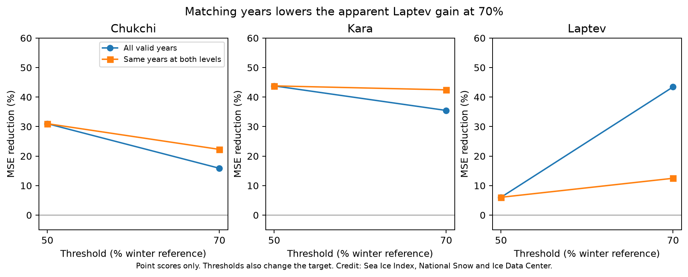
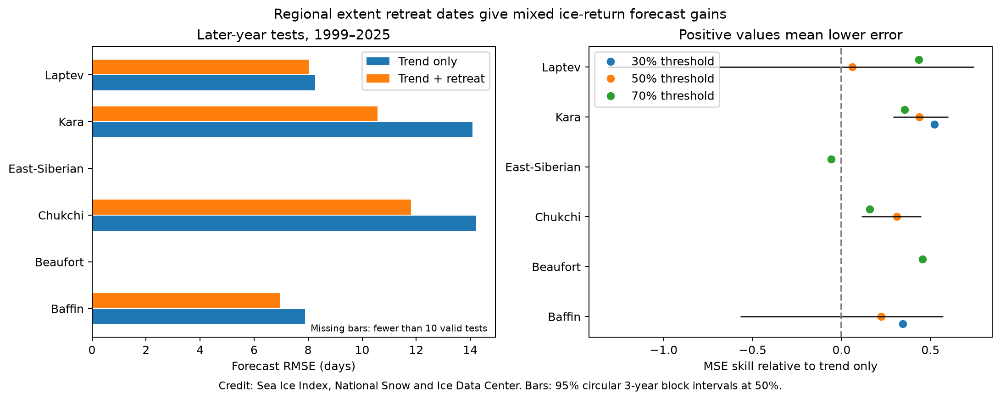

# Matching years reduced the Laptev Sea ice-return forecast gain from 43% to 12% in a 1979-2025 record

We tested how missing threshold crossings affect a regional sea ice forecast comparison. We used Sea Ice Index Version 4 daily regional extent for 1979-2025. Each forecast used only earlier years. The base model used year. The added model also used the retreat date known by August 31. In the Laptev Sea, the 70% winter-reference threshold gave a 43.4% reduction in mean squared error over 27 tests in 1999-2025. When the 50% and 70% thresholds used the same training and test years, the 70% gain fell to 12.5% over 15 tests in 2011-2025. Its conditional 95% block interval was -73.0% to 52.7%. The 50% gain was 6.0%. In the Kara Sea, matched gains were 43.8% and 42.4%. These results show that threshold score comparisons can change when the year sample is held fixed. They do not prove a physical change in ice recovery or that all of the Laptev difference comes from sample choice. The common-year check was added after initial scores. Short records, selected crossing years, trend assumptions and final data versions limit the result. Code, daily input, source hashes, all forecasts, coverage tables and a numerical audit are included.



Figure 1. Point scores before and after both threshold models use the same valid cycle years. Matching changes both the training set and the test set. It does not hold the target date fixed. Credit: Sea Ice Index, National Snow and Ice Data Center.

## Question and contribution

Does the apparent forecast gain at a higher ice extent threshold persist when both thresholds use the same years? A threshold can change both the ice-return target and the set of years in which retreat occurs. These two changes can be confused.

Stroeve, Crawford and Stammerjohn (2016), DOI 10.1002/2016GL069314, tested retreat and advance at grid cells. They found skill in some regions after trend removal. Their thresholds were local ice concentration. We test total regional extent. The prior campaign regional timing study (SCI 5bb3ce1a5621e3451a3b66ba58b1928346a2d0ad5e626af7cdaae55d5ca52ff5) already found Kara gains and noted that threshold samples can differ. The prior summer-history study (SCI 1ba753a5d2607c9f42537f75d2cab1859ed3fb1e03856aa62db0b9abfac6c830) already tested a fixed issue date and found added information in Kara. We do not claim a new retreat-advance mechanism. The specific new result is the matched-year threshold comparison, especially the Laptev score change.

We launched the required whole-campaign searches before the analysis. Verification of the large campaign was slow. We stopped both searches and queried their already verified metadata cache for published sea ice work. We read three relevant publications and completed SCI search on a local view of these published bundles. Files/campaign_search.json preserves that search. No private worker research files were used. This is not an exhaustive literature review.

This is an exploratory study. Six regions, three thresholds, the August 31 predictor cutoff and trend comparisons were specified in code before the first scores. The matched-year check was added after the initial scores showed different sample coverage. There was no external registration. The same source data occur in earlier campaign work, so this is not independent observational confirmation.

## Data

We used Fetterer and colleagues (2025), Sea Ice Index, G02135 Version 4, DOI 10.7265/a98x-0f50, accessed 2026-11-08. We read this shared file in place:

```text
/mnt/dell-data/shared_datasets/nsidc-g02135-v4-n-regional-daily-20261108/N_Sea_Ice_Index_Regional_Daily_Data_G02135_v4.0.xlsx
SHA-256: 00e4941e5d0055ccabaa2b08b4176ca615ed4aed01f13aca015751492ed89551
URL: https://noaadata.apps.nsidc.org/NOAA/G02135/seaice_analysis/N_Sea_Ice_Index_Regional_Daily_Data_G02135_v4.0.xlsx
```

The computed hash matched shared provenance. Files/provenance.json records the path, URL, size and hash. No raw data were downloaded or changed. The extracted table preserves the 14 extent sheets for 1979-2025. We analyzed Baffin, Beaufort, Chukchi, East-Siberian, Kara and Laptev. Area sheets were not used. The workbook states that daily values are five-day trailing means. We apply no additional smoothing. Extent counts the area of cells with at least 15% ice concentration. A 50% regional reference threshold is not 50% local concentration. The data do not give local freezing, ice thickness or safe passage.

## Dates and forecasts

For each region, find the maximum January-April extent in each year of 1979-1998. The median of these 20 annual maxima is the fixed winter reference. Thresholds are 30%, 50% and 70% of that reference. No test year enters the reference. Actual thresholds are in files/thresholds.csv.

Each year spans March 1 to December 31. We fill at most two internal missing days by linear interpolation. Remaining missing data exclude the relevant date. This avoids filling the long 1987 gap. The predictor is one day after the last extent at or above the threshold between March 1 and August 31. August 31 must be below the threshold. Thus, this last retreat date can be identified with data available by August 31. A later reversal can occur; the predictor is not the last retreat in the entire year. The target is the first date from September 1 with seven consecutive extent values at or above the threshold. The target is the first day of that run. The confirming days must end by December 31. Dates use a 365-day calendar with the leap-day offset removed.

We require complete interpolated March-August data for retreat and complete September-December data for advance. This conservative rule can exclude a known October crossing when December is missing. A cycle without either date is omitted. We do not replace missing crossings with artificial endpoints. Files/annual_events.csv and coverage.csv preserve valid and absent dates. This conditions the forecast sample on later target coverage and limits operational interpretation. Ice that returns after December is outside this test.

For each test year from 1999 to 2025, ordinary least squares uses valid earlier years only, with at least 15 training pairs. The base model uses an intercept and year. The added model also uses current retreat day. Dates and thresholds are not chosen by forecast error. A rolling 20-calendar-year fit and a quadratic year trend are sensitivity checks. Forecasts are not clipped. The reference, dates, forecasts and training counts are preserved.

MSE skill is 1 minus added-model mean squared error divided by base-model mean squared error. Positive values mean less error. We use 10,000 circular three-record block resamples of paired forecast errors for conditional percentile intervals. Adjacent retained records can skip years. The interval holds the fitted forecasts fixed and assumes short, stable error dependence. It does not include training, sensor or design uncertainty. Seeds are 1107 for the main analysis and 3141107 for the matched check. Approximate six-region family limits are stored for the main comparisons. They do not correct for every model, threshold or exploratory choice. The bootstrap nonpositive fraction is not a calibrated null p value.

## Results before matching

The 50% main comparison gives:

| Region | Scored tests | Base RMSE, days | Added RMSE, days | MSE reduction | Conditional 95% limits |
|---|---:|---:|---:|---:|---|
| Baffin | 21 | 7.89 | 6.96 | 22.3% | -56.8% to 57.2% |
| Chukchi | 18 | 14.22 | 11.81 | 31.0% | 11.2% to 44.8% |
| Kara | 26 | 14.09 | 10.56 | 43.8% | 29.0% to 59.9% |
| Laptev | 15 | 8.27 | 8.01 | 6.0% | -131.7% to 74.4% |

Beaufort has only 12 paired cycles at 50%, so no test meets the 15-training-pair rule. East-Siberian has seven scored tests at 50%; these are preserved but not plotted as a useful score series. At 50%, Chukchi and Kara have positive approximate six-region family lower limits. This is conditional evidence within the selected design, not a general forecast guarantee. Baffin and Laptev pointwise intervals include zero.

The 70% Laptev series has 44 paired cycles and 27 test years. It gives 43.4% skill, with conditional 95% limits of 13.9% to 62.5%. The 50% series has 30 paired cycles and only 15 tests, from 2011 to 2025. Comparing these scores directly mixes target changes with sample changes.



Figure 2. Main RMSE and threshold point scores before matching. Black bars are pointwise 95% intervals at 50%. Missing entries have fewer than ten test years. Credit: Sea Ice Index, National Snow and Ice Data Center.

## Results with the same years

For each region, retain only cycle years that have both dates at both 50% and 70%. Fit each threshold model again, using only common earlier years. Score both on the same common test years. This holds the training and test year samples fixed across thresholds; it still changes the target and predictor dates.

| Region | Common tests | 50% skill | 70% skill | 70% conditional 95% limits |
|---|---:|---:|---:|---|
| Chukchi | 18 | 31.0% | 22.3% | 8.2% to 35.7% |
| Kara | 26 | 43.8% | 42.4% | 21.0% to 57.4% |
| Laptev | 15 | 6.0% | 12.5% | -73.0% to 52.7% |
| East-Siberian | 7 | 28.6% | -24.3% | -77.0% to 16.4% |

Baffin and Beaufort have too few common cycles for this forecast check. East-Siberian has only seven tests and is especially uncertain. For Laptev, the 70% point gain falls from 43.4% to 12.5%. Its common-year interval includes zero. The matched 50% and 70% gains differ by only 6.4 percentage points, compared with 37.4 points before matching. This is not an additive causal decomposition: both model fits and the scoring population changed. No test here proves that all of the initial contrast was caused by sample choice.

Kara gains remain about 42-44% at both matched thresholds. Excluding 2025 from scoring, without refitting, gives 43.5% and 41.4%. The matched Laptev 70% gain becomes 15.6% without 2025. These checks do not estimate sensor bias. The full unpaired rolling-window and quadratic-trend scores are preserved in scores.csv; they do not remove the need to match samples.

## Explanation and limits

Early retreat can expose water to summer sunlight. Heat stored in that water can delay ice return. This is a plausible explanation for the negative retreat-advance relations. Our work tests a forecast implication, not a heat budget. Winds, ice transport, currents, radiation, river heat and ocean temperature are not measured. Forecast gain cannot identify which process supplied the information.

A higher threshold is crossed in years that retain more summer ice. A lower threshold often selects later, low-ice years. This changes the climate states and available training record. The Laptev comparison shows why a threshold gain should be checked on common years. It does not show a physical change in recovery speed. In Kara the gain persists after matching, but this overlaps prior campaign evidence.

Only 15 common Laptev tests and 26 common Kara tests are available. Threshold and region choices, a fixed December end, missing crossings, trend assumptions, early satellite sampling, interpolation and conditional resampling limit inference. The record includes the AMSR2 source transition in 2025. It uses one final data snapshot, rather than historical forecast versions. No real-time delivery or revision test is made. A regional threshold is not local freeze-up or permanent ice closure. The matched check was motivated by initial results and needs independent future testing.

## Reproduction

Verify the SCI bundle before extraction. Copy it to a new folder before running code, because scripts write outputs next to themselves. From that copy run:

```bash
python files/analyze.py
python files/audit.py
```

Python 3.12, NumPy, pandas, SciPy, Matplotlib and threadpoolctl are needed. Exact statistical package versions are in files/environment.json. The daily derived subset is included, so the analysis runs offline. analyze.py rebuilds event dates, main forecasts, scores and the main figure. audit.py independently checks training counts for all 720 forecasts and checks all linear model predictions with centered regressions. Their maximum discrepancy was 6.9e-13 days. It also builds matched forecasts, coverage and the matched figure. Files/matched_losses.csv preserves every matched loss pair. These are numerical checks, not independent measurements.

For raw extraction, obtain the exact workbook at the URL above, keep it on local scratch storage, check its SHA-256, then run:

```bash
python files/extract.py --raw /path/to/N_Sea_Ice_Index_Regional_Daily_Data_G02135_v4.0.xlsx
```

openpyxl is also needed. The extractor checks the expected raw hash. A live URL can change; a different hash does not reproduce this snapshot. In this campaign use the existing shared path. Do not overwrite shared data. The bundle manifest hashes every included derived file and script. No source private key is included.

## Campaign record

Job: sci-1107-syam2-earth-and-ocean-sciences-dc27cabc4d35. Topic: earth-and-ocean-sciences. Campaign: 11_07_2026. Machine: syam2. Account: codex-myxtap. Model: gpt-6.1-sol, high reasoning effort. Date: 2026-11-08. No agents were launched. Computation used the assigned isolated worktree. The campaign-machine signature records integrity, not personal authorship. The bundle is stored locally with no remote submission. The baseline license applies to original text, code, figures and derived tables. Source data retain NSIDC attribution and source terms.
