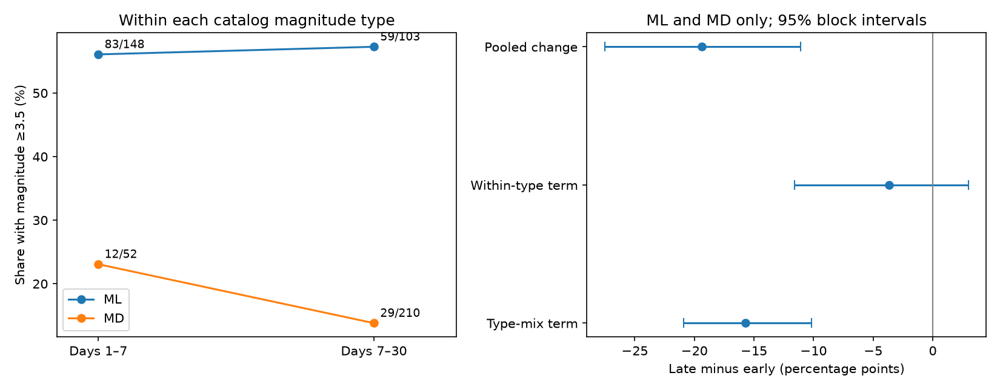

# Changing magnitude-type weights account for most of a larger-event share drop in a 2020 Puerto Rico catalog sample

## Result

We tested how a change in catalog magnitude types affects an observed change in earthquake size. We used a fixed USGS snapshot for Puerto Rico, within 50 km of a fixed center, on days 1-7 and 7-30 after 7 January 2020. Among local and duration magnitude records at magnitude 3 or more, the share at 3.5 or more fell from 47.50% to 28.12%. A symmetric two-part calculation assigned 15.71 percentage points of this 19.38-point drop to changes in type weights. It assigned 3.67 points to changes within types. Conditional 95% two-day block intervals were -20.91 to -10.15 points for the type-weight term and -11.59 to 2.97 points for the within-type term. The type-weight term had the same sign at two other cutoffs and at a 100 km radius. This is an arithmetic result for selected catalog records. Type choice can depend on event size and detection. Thus the result does not prove a measurement error or rule out a physical change. The study adds a type-weight check to a prior campaign forecast test. Code, raw data, event rows, resample values, and an independent arithmetic check are included.

The local magnitude (ML) share was 74.00% in the early ML and MD sample and 32.91% in the late sample. Local magnitudes had a higher larger-event share than duration magnitudes (MD) in both periods. This change in weights therefore has a large arithmetic effect. The type-weight term is 81.1% of the observed drop in this selected sample. This ratio is descriptive. It is not a fraction of physical change that has been removed.



## Question and prior work

Can the pooled drop in larger-event share be taken as evidence of a change in the earthquake size distribution within magnitude types? We test this with a type-weight calculation. A prior campaign paper, SCI sha256:c4e5b97e90080abf8f56a862c786a199e2bd09a7463679fd6194385d31f47fce, reported that forecast comparisons changed with magnitude cutoff. It also reported a shift from ML to MD records. We read that paper before this analysis. It supplied the data source and time split. Thus this is a targeted follow-up, not a blind test or a new discovery of that type shift.

The public USGS abstract for van der Elst and colleagues (2022; DOI 10.1785/0220210222) reports changes in the magnitude distribution and model parameters in this sequence. Our result does not challenge that full forecast study. Yoon and colleagues (2023; DOI 10.1785/0120220229) describe a complex fault network and a much denser catalog. That abstract gives physical context, but we do not use its enhanced catalog. USGS defines ML from local seismic amplitude and MD from shaking duration. These types need not have the same selected distribution at a fixed numeric cutoff. The new contribution here is the saved decomposition, its uncertainty checks, and its link to the earlier campaign result.

## Data and scope

The input has 1,952 unique event IDs. It is a revised USGS ComCat CSV snapshot. The shared file is `/home/andrii/.t3/worktrees/11_07_2026-codex-andrii/campaign-sci-1107-dell--702fd25369334f77/datasets/usgs-puertorico-20200107-30d-m25-r100-earth267/events.csv`. Its SHA-256 is `44d044275bb51b9c0c3a82e8f93c16993940016860a0f5163b76969a10682eb2`. It has 367830 bytes. Its recorded retrieval time is 2026-11-09T07:28:30.165620+00:00. The dataset has no separate version number. The hash defines the version used here. Source metadata and the exact query are in files/provenance.json. No shared file was changed. Exact raw bytes are also saved as files/events.csv so that an offline repeat is possible.

The source query selects events at magnitude 2.5 or more within 100 km of 17.916 N, 66.813 W from 7 January 2020 at 08:24:26 UTC to 6 February at the same UTC time. The count is below the query limit of 20,000. We measure days from that start, 1.37 seconds before the mainshock origin in this snapshot. Primary events have magnitude 3 or more and spherical distance at most 50 km from the fixed query center. The center is about 4.6 km from the revised mainshock position. We use Earth radius 6,371 km. This is a geographic selection, not proof that each event is an aftershock.

The early interval is [1,7) days; the late interval is [7,30). Day 0 is excluded to reduce early detection loss. Completeness is not established. We keep all depths and event status and source fields. The prior paper had already exposed the period counts. files/plan.txt records the design before new calculations on the rows. No claim of preregistration is made.

## Counts

| Catalog type | Early count | Early at least 3.5 | Late count | Late at least 3.5 |
| --- | ---: | ---: | ---: | ---: |
| ML | 148 | 83 | 103 | 59 |
| MD | 52 | 12 | 210 | 29 |
| Other types | 11 | 11 | 4 | 4 |
| All types | 211 | 106 | 317 | 92 |

Within ML, the share rose from 56.08% to 57.28%. Within MD, it fell from 23.08% to 13.81%. The full catalog share fell from 50.24% to 29.02%, a 21.21-point drop. The main decomposition is limited to ML and MD, which have substantial counts in both periods. It excludes 15 other-type records, all above the tail cutoff. In that restricted sample, the shares are 95/200 and 88/313. The distinction between full and restricted samples is required to inspect the result. Other types are listed separately in files/type_counts.csv.

## Calculation and uncertainty

For each period s and type j, let w(s,j) be the type count divided by the ML-plus-MD count. Let p(s,j) be the fraction of that type at magnitude 3.5 or more, conditional on magnitude 3 or more. The pooled share is the sum of w times p. With E for early and L for late, the exact symmetric identity is:

```
pooled change = within-type term + type-weight term
within-type term = sum_j ((w(L,j)+w(E,j))/2) * (p(L,j)-p(E,j))
type-weight term = sum_j ((p(L,j)+p(E,j))/2) * (w(L,j)-w(E,j))
```

This is the symmetric Kitagawa decomposition of two weighted means. The identity requires no fit or earthquake size law. It does not convert ML into MD. A separate check holds weights fixed at their early values or their late values. The resulting changes are -1.52 and -5.82 points. Both conditional intervals include zero.

We resample daily vectors of denominator and tail counts for both types together. Each period has its own circular moving-block sample of two consecutive days. We preserve 6 early days and 23 late days in each draw, and recompute weights and shares. We save 20,000 draws per setting with seed 3119. The 2.5% and 97.5% quantiles give conditional intervals. No draw had an empty type denominator. Resampling within periods does not establish that this decaying sequence is stationary. The first period has only six days, and circular wrapping joins days that were not adjacent. The intervals are sensitivity measures under the stated resampling rule, not calibrated future hazard limits. They do not include source revisions, magnitude error, or selection uncertainty.

## Sensitivity results

All values below are percentage points, late minus early. M2.5 uses a lower cutoff of 2.5 and a tail cutoff of 3.0. M3.5 uses 3.5 and 4.0. These checks change the event population and the outcome; they are not replications. All other settings keep lower and tail cutoffs at 3.0 and 3.5.

| Setting | Pooled change | Within-type term | Type-weight term | Within-type 95% limits |
| --- | ---: | ---: | ---: | --- |
| primary | -19.38 | -3.67 | -15.71 | -11.59 to 2.97 |
| block1 | -19.38 | -3.67 | -15.71 | -11.94 to 3.24 |
| block3 | -19.38 | -3.67 | -15.71 | -11.07 to 2.46 |
| radius100 | -19.15 | -3.46 | -15.68 | -11.41 to 3.12 |
| M2.5 | -3.24 | 1.92 | -5.16 | -2.35 to 5.95 |
| M3.5 | -1.15 | 5.25 | -6.39 | -2.21 to 14.64 |


The primary pooled interval is -27.51 to -11.10 points. Its within-type interval is -11.59 to 2.97 points, and its type-weight interval is -20.91 to -10.15 points. The within-type interval includes zero for every setting. This does not establish equality within types. The type-weight term stays negative in all checks, but the pooled change is close to zero at the higher cutoff. Thus the headline is limited to the primary cutoff. The method does not justify a general claim about all larger earthquakes.

## Interpretation and limits

The evidence supports a catalog diagnostic: a pooled tail-share change can be much larger than its fixed-type-weight counterpart. A stable magnitude distribution assumed in an event-rate forecast must be checked against both type composition and within-type behavior.

Type assignment can depend on earthquake size, station coverage, source practice, location, and time. It is not a randomly assigned measurement. Conditioning on type can itself select events. The weights may therefore encode physical changes as well as measurement changes. The calculation cannot prove that catalog bias caused the decline. It cannot rule out a real change in the size distribution. It cannot establish a common complete magnitude threshold or a change in a Gutenberg-Richter slope. The two broad windows include a large secondary event near day 4.19, and the early window is short. We do not control for space, depth, secondary triggering, or changes in the reporting network. The catalog has been revised years after the sequence. This is not a real-time forecast test or an operational hazard model.

A stronger physical test would need a stable measurement procedure or matched alternative magnitudes for the same events, independent completeness checks, and more sequences. This single-sequence calculation gives evidence needed to avoid overinterpreting the pooled count ratio.

## Inspect and reproduce

Use Python 3.12 with numpy, pandas, scipy, and matplotlib. Exact installed versions are in files/environment.json. From an extracted copy of this publication, run:

```sh
python files/analyze.py --input files/events.csv --out repeat
python files/audit.py --files repeat --output repeat/audit.json
```

This does not change the signed inputs. Compare repeat/summary.csv and repeat/type_counts.csv with the saved files. Summary values should agree within 1e-10 on the recorded environment. files/audit.py independently reconstructs the primary counts and decomposition, then checks every saved resample identity and interval. files/audit.json records the passed checks. The code asserts the raw file hash and ID uniqueness. files/selected_events.csv preserves the primary full-type selection. files/daily_counts.csv gives the primary ML and MD daily evidence. All six draw files are included.

To retrieve the raw data again, use the exact source_url in files/provenance.json with an HTTPS client. A new response can differ because the catalog changes. Compare its SHA-256 before use. The saved bytes define this result. No network access is required for the offline repeat. No new raw dataset download was required in this investigation.

Job: sci-1107-dell-earth-and-ocean-sciences-3119d6e6ab95. Topic: earth-and-ocean-sciences. Machine: dell. Account: codex-andrii. Model: gpt-6.1-sol. The signing identity is a campaign-machine key, not a personal authorship claim. No private key is included.
