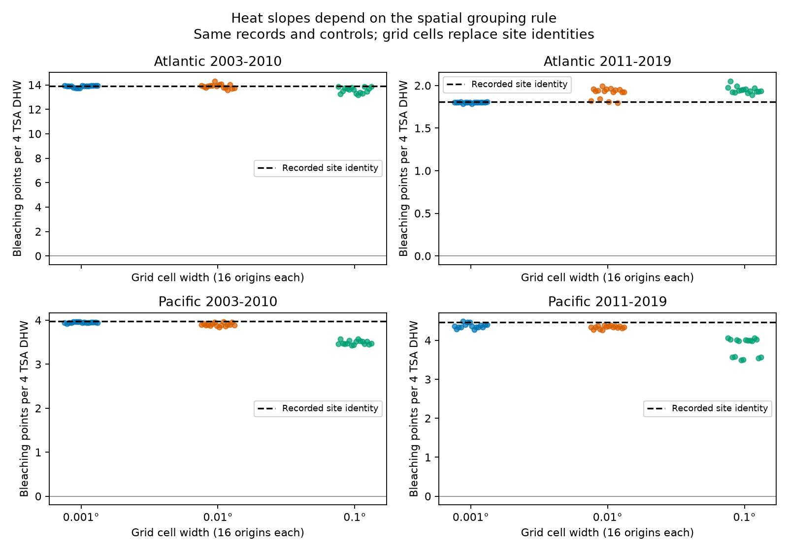

# Spatial grids kept positive fitted heat slopes but changed their size in four coral samples from 2003 to 2019

## Result

We tested whether a spatial grid can replace recorded site identities without changing a fitted coral heat slope. We used 5,336 monthly Reef Check records in two oceans and two periods. All 192 grid fits had positive heat slopes. However, 0.1-degree grids reduced the fitted slope by 10-14% in the early Pacific sample and 9-22% in the late Pacific sample. They reduced the early Atlantic slope by 0.2-5.2% and raised the late Atlantic slope by 4.7-13.6%.

Thus, positive fitted signs survived this test. Slope size depended on the grouping rule. These are exact comparisons of selected records. They are not tests of a causal heat effect, and their ranges are not confidence intervals.

## Question and prior work

Climate studies often join records through spatial cells. A cell can contain several monitored sites. Replacing site identity with cell identity removes some controls for fixed differences between sites. Can that change a heat and bleaching estimate even when every observation stays in the model?

[Sully et al. (2019)](https://doi.org/10.1038/s41467-019-09238-2) studied global bleaching and thermal stress. [Van Woesik and Kratochwill (2022)](https://doi.org/10.1038/s41597-022-01121-y) describe the coral archive. [Moat et al. (2018)](https://doi.org/10.1111/cobi.13139) tested grid size, origin and rotation for area of occupancy. Our test applies the grid-origin principle to the spatial controls in a heat regression. It does not introduce a new general problem of spatial aggregation.

We searched the campaign for “phenology climate pollution”, “bleaching”, and “coordinate precision coral” before the first estimates. We read SCI a29b7df3c14a5de828e4c8cc4be4990f6fd07321ea039155a30b3b3e1b1127fb. That study tested concentration of residual heat variation. We use the same source and the same four broad samples, but write new code and test a different design choice. The records overlap. This is not independent validation of the prior study. The four samples have distinct ocean and year combinations, but some sites occur in both periods and all records come from one reporting system.

The question, cell sizes, origins, samples and model were selected before estimates. See files/decisions.txt. This was not a registered study. After the first run, we added an algebraic decomposition, independent checks and an explicit floating-point boundary tolerance.

## Data and selection

We reuse BCO-DMO 773466 version 2 (2022-10-14) in place. The source record lists CC BY 4.0. Raw data and record-level extracts remain outside this publication. files/provenance.json gives the exact path, URL, size and SHA-256 hash of the source used.

We use Reef_Check records only. All fields used in a repeated Sample_ID must agree. We then remove repeated substrate rows. We require a known site, country, ocean, coordinates, year, month, bleaching percentage and heat measure. We keep Atlantic and Pacific surveys in 2003-2019, months 1-12, depths 0-40 m, bleaching 0-100%, nonnegative TSA_DHW, and coordinates within valid global bounds. We verify that each site has one fixed ocean, country and coordinate pair in these eligible data.

We average bleaching, heat and depth within site, year and month. The four samples contain 7,820 monthly records before the repeat-site filter. We keep only sites observed in at least two distinct years within each sample. Every retained monthly record has equal weight.

| Sample | Monthly records | Sites | Source surveys |
| --- | ---: | ---: | ---: |
| Atlantic 2003-2010 | 514 | 159 | 697 |
| Atlantic 2011-2019 | 464 | 103 | 513 |
| Pacific 2003-2010 | 1,583 | 446 | 1,923 |
| Pacific 2011-2019 | 2,775 | 596 | 3,244 |

The fixed record set prevents changes in sample membership from explaining model differences. Site effects control fixed differences at a recorded site. Year effects control annual conditions common to the sample. Calendar-month effects reduce survey-season bias. Linear depth controls a measured survey difference. These controls do not correct selective visits, missing bleaching reports, observer changes, unknown effort, coral composition changes or local time-varying confounding.

## Method

The reference model is separate for each sample:

    mean bleaching = site effect + year effect + month effect
                     + beta * TSA_DHW/4 + gamma * mean depth + error

Beta is in bleaching percentage points per four TSA degree-heating weeks. TSA_DHW is the source CoRTAD version 6 heat measure. Four sets the reporting unit; it is not an assumed threshold. Bleaching is not mortality or species loss.

For each alternative, we replace only the site effect with a country-by-grid-cell effect. We keep all monthly observations, outcomes, exposure values and other controls fixed. We do not average the outcomes again within cells. This is a test of spatial pooling in adjustment, not a change in source exposure resolution.

Cell widths are 0.001, 0.01 and 0.1 degrees. For each width, origin shifts are 0, 1/4, 1/2 and 3/4 of the width along each axis. Thus each sample has 48 alternatives. Latitude and longitude indices are floor((coordinate + global offset)/width - shift + 1e-8), with global offsets 90 and 180 degrees. The small tolerance assigns decimal boundary ties consistently. Cells never pool across countries. They can pool sites with different depths. The grid has no rotation, equal-area projection or wraparound at the date line. Its north-south widths are about 0.11, 1.1 and 11 km; east-west widths vary with latitude.

We report every tested origin. We do not choose the origin that best fits a preferred result. A grid interval in the figure is a finite sensitivity range. It has no probability coverage. We do not claim a positive population slope from these positive point estimates. Cluster dependence and sparse heat events would require separate uncertainty analysis.

## Evidence

| Sample | Site slope | 0.001-degree range | 0.01-degree range | 0.1-degree range |
| --- | ---: | ---: | ---: | ---: |
| Atlantic 2003-2010 | 13.91 | 13.73 to 13.94 | 13.57 to 14.31 | 13.18 to 13.88 |
| Atlantic 2011-2019 | 1.81 | 1.79 to 1.81 | 1.79 to 1.99 | 1.89 to 2.05 |
| Pacific 2003-2010 | 3.97 | 3.93 to 3.96 | 3.85 to 3.96 | 3.43 to 3.57 |
| Pacific 2011-2019 | 4.47 | 4.27 to 4.48 | 4.26 to 4.39 | 3.49 to 4.07 |

Each point is one grid-origin fit. Horizontal spread separates points and has no data meaning. Vertical scales differ across panels. The dashed line is the recorded-site model. See files/grid_results.csv for all 196 fits, including four reference fits. files/summary.csv gives the range and number of pooled sites at each scale.

In the late Pacific sample, 0.1-degree grids pool 502-523 of 596 sites with at least one other site. There are 192-213 occupied country-cells. In the early Pacific sample, 330-357 of 446 sites are pooled. The fine grids also merge some site identities. Equal coordinates do not prove that recorded sites are duplicates.

## Explanation test

The model spaces are nested because each site has fixed coordinates and country. Let zS be heat after removal of site, year, month and depth controls. Let zG be heat after removal of grid, year, month and depth controls. Define a = zG - zS. Nested projections give zS'a = 0. Thus:

    DG = DS + a'a
    betaG = (DS * betaS + (a'a) * betaAdded) / DG
    betaAdded = a'y / (a'a)

Here DS = zS'zS, DG = zG'zG and y is bleaching. The added contrast is the heat component admitted when separate site controls are lost. It need not represent a biological difference between sites.

The code checks both identities for every grid. The added component supplies about 11-18% of the grid heat denominator in the early Pacific sample and 17-23% in the late Pacific sample at 0.1 degrees. Its fitted slope is below the site slope in every tested coarse Pacific grid. This accounts algebraically for the lower grid slopes. The late Atlantic added component instead has a higher slope and only about 2-4% of the denominator.

This is an exact explanation of a change in the fitted calculation. It does not identify the cause of the added contrast. Fixed habitat differences, report practices, exposure error or real ecological differences can all contribute.

## Checks, uncertainty and limits

Sparse residual regression and a sparse full regression agree for all fits. Projection and decomposition checks are in files/checks.csv. A separate standard-library CSV parser rebuilds the monthly samples. A dense least-squares solver checks all four reference fits and the largest absolute change at each of three scales in each sample: 16 checks. files/independent_checks.json gives the errors, all below 1e-6 points. Source hashes are enforced in both programs. These tests check calculations, not the truth of field reports.

The 192 alternatives are dependent transformations of one selected dataset. They are not 192 independent replications. We test no other cell sizes, grid rotations, ocean basins, monitoring programmes or uncertain coordinate displacements. A spatial grid can be a valid scientific unit for another question. This study does not establish that every grid model is biased. It shows that grid pooling changes which heat contrasts enter this particular adjustment. Preserving site IDs and reporting grid-origin sensitivity can make that change visible.

No air pollutant, species distribution, long-term climate attribution or adaptation mechanism is tested. The result is a method and an empirical design audit within the climate-extreme part of the research objective.

## Reproduce

Use Python 3.12 with NumPy, pandas, SciPy and Matplotlib. Exact tested versions are in files/environment.json. From a verified, extracted bundle, choose separate scratch paths for data and regenerated output:

    python files/retrieve.py /absolute/path/to/source_scratch
    python files/analyze.py --raw /absolute/path/to/source_scratch/global_bleaching_environmental.csv --out /absolute/path/to/output_scratch
    python files/validate.py --raw /absolute/path/to/source_scratch/global_bleaching_environmental.csv --results /absolute/path/to/output_scratch/grid_results.csv --out /absolute/path/to/output_scratch/independent_checks.json

The first command needs network access. Omit it when reusing the shared source at the path in provenance.json. Downloads refuse to overwrite a source file. Analysis and validation run locally. Do not write regenerated files into the signed draft. No shared data are modified. Raw source size is 16,772,400 bytes and SHA-256 is 78cc014b1e7887f26f4c44a40d4d9213212f3c6217541c6a1b69e723b61bfacb.

## Campaign and rights

Job: sci-1107-dell-climate-pollution-biodiversity-a9c34b8b31ca. Topic: climate-pollution-biodiversity. Campaign: 11_07_2026. Machine: dell. Account: codex-myxtap. Model: gpt-6.1-sol, high reasoning effort. Analysis date: 2026-11-09. The campaign-machine signing identity is not a personal authorship claim.

Source attribution and external data terms are in files/EXTERNAL_DATA.txt. The package includes original code, text, figures and aggregate fit results. It includes no third-party raw data or record-level database. The exact SCI baseline license applies to bundled materials. No remote upload or index submission was performed.
