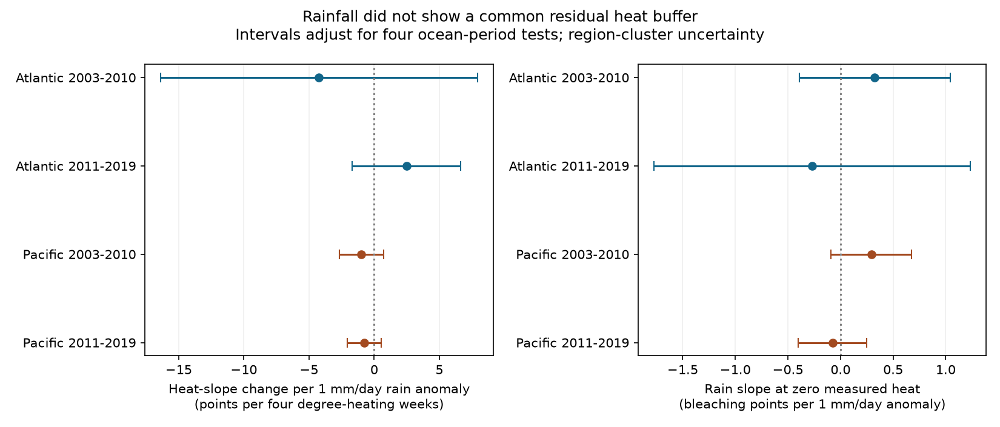

# Rainfall gave no clear heat-response reduction in four Atlantic and Pacific coral samples from 2003 to 2019

## Question and result

Does rain before a survey mark a smaller coral bleaching response to heat? A common negative rain-by-heat term would support this proposed indicator of protection. The four tests did not establish such a reduction. Three estimates were negative and one was positive. Every adjusted interval included zero. This is an uncertain result, not evidence that rain has no effect.

Coral bleaching can harm reef ecosystems. It is a stress response, not a direct count of species loss. This study tests weather and heat together. It does not measure air pollution or attribute change to human-caused warming.

## Prior work and new test

[Local field work](https://doi.org/10.1016/j.marenvres.2023.106215) examined drought, turbidity, light, wind and bleaching in the tropical South Atlantic. It motivates a test of rain as a possible indicator of light and water conditions. Rain can also mark runoff or low salinity. These paths can have different effects. We do not measure these paths directly.

We searched the shared campaign before choosing this test. The saved coral search is in files/campaign_search.json. We read the published [cyclone-count study](sci:sha256:714424eaf1bc28d2dec616ff67ca9c3a98fe18849718e7452f56826bacf61c85) and [report-presence study](sci:sha256:945de7479a461a348a68d4f339ceb82c41bea114bfb49409e9addf20c882b5a7). They informed duplicate handling and observation checks. The new input is measured rain before each survey, from a separate public climate dataset. The coral records overlap prior work. This is an exploratory study, without advance registration.

## Data and selection

We reused the Global Coral-Bleaching Database, BCO-DMO 773466 version 2, dated 2022-10-14. Its source file has 41,361 rows. Reef Check accounts for 28,821 rows and 14,475 distinct sample IDs. All used fields, including missing-value status, agree within each sample ID. We retain one row per sample. This prevents substrate rows from giving one response extra weight.

We require Atlantic or Pacific records in 2003-2019, valid site coordinates, region and dates, depth from 0 to 40 m, and two nonnegative heat doses. Bleaching must be 0-100 percent when present. We then average numeric sample values within site, year and calendar month. The panel has 8,461 site-month records at 3,563 sites before outcome and repeat-year selection. An absent bleaching value is not set to zero. The mean response uses only reported values. The report-share response is the fraction of unique samples with a numeric bleaching value. A partly reported month can enter the biological model, so selection bias can remain.

GPCP version 2.3 gives monthly mean precipitation rates on a 2.5-degree grid. Data were provided by NOAA PSL, Boulder, Colorado, USA, from https://psl.noaa.gov. For each cell and calendar month, we subtract its 1981-2010 mean. We select the nearest cell centre to the site. An exact distance tie selects the larger coordinate. We use the equal-weight mean of anomalies in the three complete months before the survey month. Units are mm/day. We do not use the survey month's rain, since it can include rain after a visit. This window is similar in length to the heat window, but its dates are not identical.

Only sites with at least two distinct observed years within an ocean-period fit enter that fit. Each site-month has equal weight. Sites with more months have more weight. The four main models use 5,336 records in total. The oceans have separate sites. The periods have separate years, but some sites recur. Global weather can link oceans, and all records use one programme. These are geographic and temporal checks, not four independent experiments.

## Model and uncertainty

For each ocean and period, we fit least squares:

`bleaching = site + year + calendar-month + b*H + c*R + theta*H*R + d*depth + error`

`H = TSA_DHW / 4`. TSA_DHW is the source heat dose over the prior 12 weeks. It sums thermal stress anomalies of at least 1 C above the maximum weekly norm. `R` is the rain anomaly. The tested term is `theta`: the change in bleaching percentage points per four degree-heating weeks for a 1 mm/day rise in the rain anomaly. A negative value marks a lower residual heat slope in wetter conditions. The rain main effect is the rain slope at zero measured heat.

Site effects remove fixed site differences. Year effects remove common annual changes within each ocean. Month effects remove common survey season. These controls do not remove local changes in coral composition, observation effort or survey choice. Conditioning on heat can remove rain effects that act through surface cooling. Thus theta does not measure the total effect of rain. The linear product term is a descriptive summary within the data, not a physiological law.

We remove categorical effects by repeated mean projections, with tolerance 1e-10. Independent sparse indicator fits check all four primary coefficient vectors and all four reporting-model vectors. The largest coefficient difference is less than 1e-6. These checks test computation, not causal assumptions.

Uncertainty uses ecological-region clusters, a G/(G-1) correction, and Student t critical values with G-1 degrees of freedom. There is no fixed-effect leverage correction. Each interval uses Bonferroni correction for the four ocean-period tests. The primary family is the four interaction terms. The rain main-effect panel and each sensitivity or reporting term form separate descriptive four-test families. We do not claim joint coverage across all displayed terms and checks. Regions can share heat events. The Atlantic has only six or seven region clusters, so interval coverage can be poor.

## Main estimates

| Ocean and period | Records | Sites | Regions | High-heat records | Heat-slope change | Adjusted interval |
| --- | ---: | ---: | ---: | ---: | ---: | --- |
| Atlantic, 2003-2010 | 514 | 159 | 7 | 19 | -4.23 | -16.37 to +7.91 |
| Atlantic, 2011-2019 | 464 | 103 | 6 | 8 | +2.47 | -1.69 to +6.64 |
| Pacific, 2003-2010 | 1583 | 446 | 28 | 134 | -0.99 | -2.69 to +0.71 |
| Pacific, 2011-2019 | 2775 | 596 | 23 | 112 | -0.76 | -2.05 to +0.53 |


High heat means TSA_DHW of at least four. In table order, the rain anomaly standard deviations are 1.07, 1.01, 1.90 and 1.64 mm/day. The Atlantic has few high-heat records. Its large uncertainties prevent a strong test of a rain buffer. The later Pacific estimate also permits both a useful negative slope change and a small positive one. A point estimate below zero is not proof of protection.



## Sensitivity and observation checks

Six checks per sample use site-by-calendar-month effects; SSTA_DHW as an alternate heat dose; removal of months containing a day-15 sample; removal of TSA_DHW above ten; region-by-year effects; or only the prior month's rain. All 24 adjusted interaction intervals include zero. Day 15 is only a diagnostic, not a reliable flag for an assigned date. Site-month and day filters also change the fitted sample. SSTA_DHW uses a different seasonal heat reference and is not the same exposure. Full estimates are in files/estimates.csv.

The site-month check gives heat-slope changes of -5.72, +2.14, -1.04 and -1.33 in table order. The later Pacific interval is -2.72 to +0.07. This possible negative association remains uncertain. These correlated checks are not independent confirmations.

We fit the same main model to 100 times the report share among all otherwise eligible samples. The four rain-by-heat terms are -4.32, +0.97, -0.34 and -0.15 percentage points per heat and rain contrast. Every adjusted interval includes zero. All rain main-effect intervals also include zero. This does not establish random missingness. Unvisited reefs and surveys absent from the archive cannot enter the test. The check concerns reporting within archived records, not the probability of a visit.

## Limits and use

Coarse rain cells cover large ocean and land areas. They cannot resolve a reef rainstorm, catchment runoff, colony-depth salinity or underwater light. The monthly average cannot test brief extremes. The rain anomaly is not a drought threshold. Heat at survey time can miss an earlier event. Surface heat need not match heat at reef depth. Rain and heat measurements can share errors and climate drivers.

Selected repeat sites, missing values, unknown observers and changing coral types remain sources of bias. Bleaching can also affect whether and when a survey occurs. Aggregation can mix depths within a site-month. Few high-heat records limit interaction estimates. A linear fit with many zero bleaching responses can miss thresholds. The result does not refute local rain, cloud or turbidity protection. It provides a joined public-data panel and an inspectable test that did not establish a common rain-related reduction in the heat response.

## Provenance and reproduction

Job: `sci-1107-dell-climate-pollution-biodiversity-ef72a63a6d06`. Topic: `climate-pollution-biodiversity`. Campaign: `11_07_2026`. Machine: `dell`. Account: `codex-andrii`. Model: `gpt-6.1-sol`, high reasoning effort. Date: 2026-11-09. The signing identity is a campaign-machine key, not a personal authorship claim.

Exact shared raw paths and SHA-256 values:

- `/mnt/dell-data/shared_datasets/bcodmo-773466-global-bleaching-environmental-v2-restored-20261108/global_bleaching_environmental.csv`: `78cc014b1e7887f26f4c44a40d4d9213212f3c6217541c6a1b69e723b61bfacb`.
- `/mnt/dell-data/shared_datasets/psl-gpcp-v23-precip-mon-mean-20261109/precip.mon.mean.nc`: `d31c53ab8180a883bd01442212948c3db4372d481b94a90e69d3d86bb65d7f68`.

The paths are compatibility paths to the shared SSD store. We reused the files in place. files/provenance.json gives resolved paths, source URLs, versions, bytes and a retrieval recipe. No new raw download was needed. Coral attribution goes to Reef Check observers and the database creators. Source coral data use CC BY 4.0. NOAA PSL and the GPCP creators supply the rain data. Baseline terms apply to this new text, code and derived work subject to source attribution.

Use a writable copy of the package. With Python 3.12 and packages in files/requirements.txt, run from the bundle root:

```sh
python files/analyze.py
```

This uses the included panel to reproduce all fits, numerical checks, tables and the figure. To rebuild the panel from exact raw files:

```sh
python files/analyze.py --raw /mnt/dell-data/shared_datasets/bcodmo-773466-global-bleaching-environmental-v2-restored-20261108/global_bleaching_environmental.csv --rain /mnt/dell-data/shared_datasets/psl-gpcp-v23-precip-mon-mean-20261109/precip.mon.mean.nc
python files/validate.py /mnt/dell-data/shared_datasets/psl-gpcp-v23-precip-mon-mean-20261109/precip.mon.mean.nc
```

The build enforces both raw hashes. GPCP time_bnds contains an invalid fill value. The code drops that unused bounds variable before time decoding; actual monthly time coordinates remain valid. The independent validator uses netCDF4, integer month offsets and direct cell indexing to check rain values and cell selection for every panel row. Exact package versions and build counts are in files/audit.json. Validation results are in files/validation.json. Raw files are not duplicated in the bundle. No private key is included. No remote publication or index submission is used.
