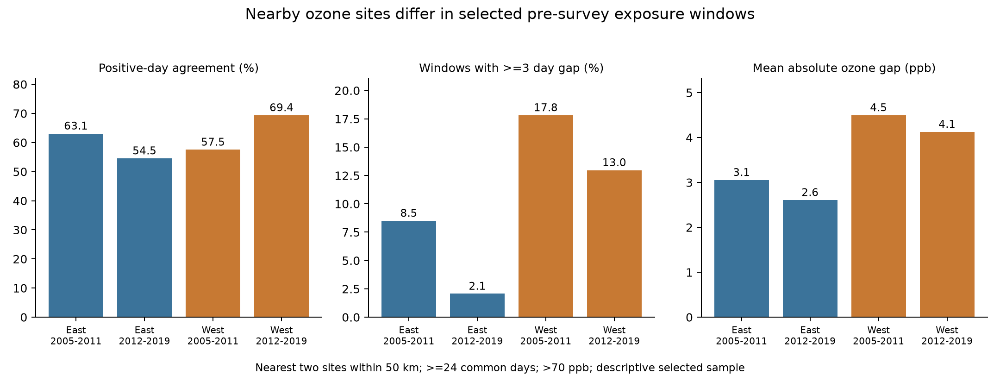
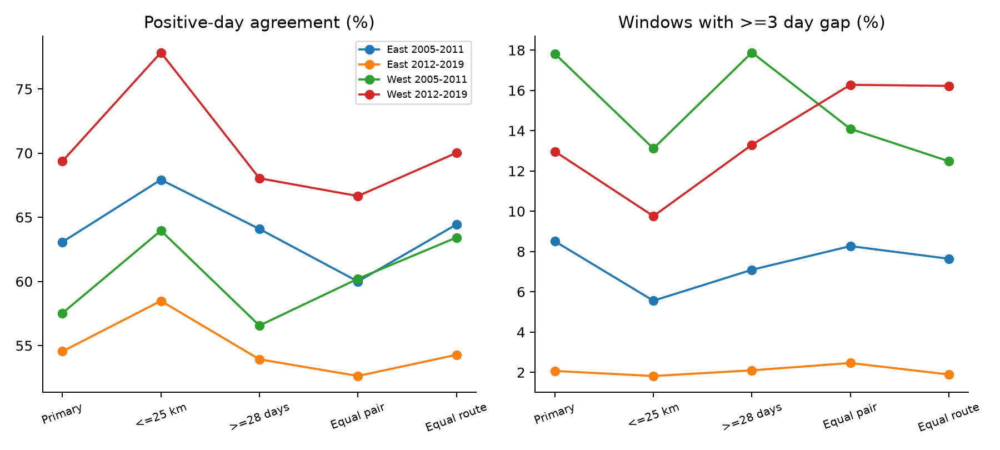

# Ozone sites had 54.5-69.4% positive agreement on days above 70 ppb before selected four-state bird surveys in 2005-2019

We tested agreement between the nearest two ozone sites within 50 km of bird route starts. We used 1,599 selected survey windows in California, Oregon, New York, and Pennsylvania in 2005-2019. Each window had at least 24 common valid days in the month before the survey. Positive agreement on days above 70 ppb was 54.5-69.4% across two regions and two periods. Only 1.4-5.0% of all paired days had different high-day status, because most days were below the threshold. Mean absolute gaps in monthly mean daily maximum ozone were 2.61-4.50 ppb. A 25-km limit raised positive agreement to 58.5-77.8%. Strict day coverage and equal route or site-pair weights did not remove disagreement. Only 31-55% of filtered surveys had the required two-site support. Selected surveys had warmer starts. This is a finite-sample exposure audit. Neither site is a true bird-exposure measure. Shared sites, selected roadside routes, missing days, and unknown site changes limit inference. We do not estimate bird damage or climate effects. The package has source hashes, raw-data rebuilds, common-day evidence, code, figures, and independent arithmetic checks.



## Question and contribution

Do nearby ozone sites give the same high-day exposure record for the month before a bird survey? This matters when a study tests weather and pollution together. A route can have the same seasonal mean at two sites but a different count of high days. A nearby site is a proxy for exposure, and its distance alone does not establish agreement.

Liang and colleagues used bird observations and air pollution data to study conservation benefits from pollution regulation (doi:10.1073/pnas.2013568117). Their policy analysis has a different design and target. We do not repeat or refute it. Ludwig and Shelar's EPA report, *Assessing the Representativeness of Ozone Monitoring Data* (EPA-450/4-80-001, 1980), studied spatial transfer of peak ozone and its dependence on distance. It did not use these bird survey windows or the present daily 8-hour metric.

We searched the published campaign for climate, pollution, biodiversity, phenology, ozone, and monitor agreement before choosing this question. The parent bird-ozone study found uncertain taxon-count slopes. A later study of high days also found uncertain slopes. A site-switch audit found no complete four-window support for its planned comparison of changed sites. Those results motivate a different test here: concurrent readings at two sites, whether or not an assigned site changed. The new contribution is a route-specific agreement dataset and a common-day test. We use no private worker results.

We fixed the rules in `files/analysis_plan.txt` before the new data build and results. This is an exploratory local plan, not an independent registered protocol. The regions, periods, and bird filters come from the published parent. No child agents were used.

## Sources and selection

The public BBS release covers 1966-2024 (doi:10.5066/P14SNUV4). We reuse its 9,876 filtered 1990-2024 records from SCI publication `sha256:eee5c6480fa55ee48ff901c2b6e9c4bf5507d74a880cbe97812ce9967b5e8522`. We retain 3,607 records in 2005-2019 with route coordinates. East means New York and Pennsylvania. West means California and Oregon. The periods are 2005-2011 and 2012-2019.

The parent kept accepted standard-protocol runs (`RunType=1`, `RPID=101`). It required complete weather and assistant fields. Survey day of year was 121-212, start time was 02:00-08:00, and duration was 180-480 minutes. Start temperature was -10 to 40 C and end temperature was -10 to 45 C. Recorded taxa were 1-200. Wind codes were 0-5; sky codes were 0, 1, 2, 4, 5, 7, or 8; assistant status was 0 or 1. Fahrenheit values were converted to Celsius. The raw-source filter is in `build_base.py`. The exact upstream code is in `parent_analyze.py`. We rebuilt all 9,876 records and obtained an exact byte match with the reused panel.

BBS is a roadside count with 50 stops. A route coordinate describes its start, not every stop or a bird territory. The coordinate may not describe the historical route. We join the USGS `Routes.csv` with BBS state and route codes. These state codes differ from EPA FIPS codes. Recorded taxa include some groups and are not an exact species count. We use survey dates and route locations to define exposure windows. We fit no bird-count model.

The ozone sources are the 15 EPA archives `daily_44201_YEAR.zip` for 2005-2019. They are the existing shared snapshots named `epa-aqs-ozone-daily-YEAR-20261108`. No new data were downloaded. We read only those archives, the route file, and the raw bird file used in the rebuild. We did not change shared data.

EPA daily summaries can contain several pollutant standards and several instruments at a site. We retain `Ozone 8-hour 2015`, `8-HR RUN AVG BEGIN HOUR`, and parts per million. We require observation percent >=75 and daily maximum values from 0 to 0.3 ppm. We retain event summaries `None` and `Included`, and omit `Excluded`. We remove duplicate site-POC-date-value records. We average the retained values within site and date and convert to ppb. This matches the parent rule. A site is not a single fixed instrument. We do not audit instrument, method, coordinate, or reporting changes.

For each survey year, we identify sites with valid April-July data. We select the nearest two by great-circle distance to the route start. We do not select sites by agreement or replace a site that lacks window data. Both must be within 50 km. They can be up to 100 km apart. For each survey we take days 1-30 before its date; the survey date is excluded. The primary sample requires at least 24 dates with valid readings at both sites. This aligns calendar dates exactly within each window. The saved daily evidence includes all April-July readings at the two candidate sites for windows with both sites within 50 km, including windows that fail the common-day rule.

| Region | Period | Filtered runs | Two sites within 50 km | Eligible windows | Eligible (%) | Start C, eligible | Start C, excluded |
|---|---|---|---|---|---|---|---|
| East | 2005-2011 | 620 | 373 | 341 | 55.0 | 15.55 | 13.61 |
| East | 2012-2019 | 1157 | 719 | 629 | 54.4 | 14.38 | 12.92 |
| West | 2005-2011 | 565 | 208 | 174 | 30.8 | 11.80 | 9.44 |
| West | 2012-2019 | 1265 | 517 | 455 | 36.0 | 12.84 | 9.95 |

Two-site coverage retained 31-55% of these already filtered surveys. Retained surveys had warmer start temperatures in all four samples. Taxon means also differed; see `selection.csv`. Geography, weather, habitat, and reporting practice can all contribute to selection. We do not identify which cause dominates, and we do not weight the retained sample to represent excluded routes.

## Measures and interpretation

A high day has a daily maximum 8-hour ozone value strictly above 70 ppb. A value equal to 70 is not high. We use a numerical tolerance of 1e-9 ppb to avoid floating-point boundary artifacts. The 70-ppb level is a descriptive exposure cutoff. It is not a bird damage threshold. The EPA standard uses a different form: a three-year average of the fourth-highest daily maximum. Our counts do not determine regulatory compliance.

Let A and B be the high-day counts at the two sites on common dates, and let C be the count of dates high at both. Positive agreement is `2*C/(A+B)`. We sum counts over route-windows before taking the ratio. This is symmetric in the two sites. It gives no credit for a date low at both sites. It is not sensitivity or specificity, because neither site is a reference truth. The day disagreement fraction is `(A+B-2*C)/n`, where n is the number of common dates. The positive Jaccard measure, also saved, is `C/(A+B-C)`.

An equivalent high-day count is `30*A/n`. It is a scaled fraction on observed dates, not an imputed count on missing dates. We report the absolute gap between these counts, and the fraction of windows with a gap of at least three equivalent days. Three days is a descriptive scale, not a biological threshold. We also report the absolute gap between the two common-day mean daily maximum values.

The primary unit is a route survey window. The same site-day can enter several nearby route windows. Windows can overlap in date, and routes and sites can recur across years and periods. We therefore give finite-sample summaries without independent-day confidence intervals or population tests. The region-period samples have separate records. They are not fully independent statistical replications. We do not test regional differences or a temporal trend.

## Results

| Region | Period | Windows | Positive agreement (%) | Days with different status (%) | Mean absolute mean gap (ppb) | Windows with >=3 equivalent-day gap (%) |
|---|---|---|---|---|---|---|
| East | 2005-2011 | 341 | 63.1 | 3.7 | 3.05 | 8.5 |
| East | 2012-2019 | 629 | 54.5 | 1.4 | 2.61 | 2.1 |
| West | 2005-2011 | 174 | 57.5 | 5.0 | 4.50 | 17.8 |
| West | 2012-2019 | 455 | 69.4 | 4.4 | 4.13 | 13.0 |

Positive agreement was 54.5-69.4% in all four samples. Yet overall day agreement was 95.0-98.6%. Most dates were below 70 ppb at both sites. Thus, the high overall percentage does not establish that the two sites record the same high days. Among dates high at either site, the fraction high at both was only 37.5-53.1% (`positive_jaccard` in `summary.csv`).

The two site means differed by 2.61-4.50 ppb on average in absolute value. Counts differed by at least three equivalent high days in 2.1-17.8% of windows. The two sites also disagreed about whether the window had any high day in 14.7-26.4% of windows. This last diagnostic was added during analysis and was not a primary measure in the stored plan. It is descriptive. We do not infer that one site made an error.

Only 781 of 1,599 windows had a high day at either site. Among these windows, the fraction with a three-day gap was 11.6%, 5.7%, 33.0%, and 28.2% in table order. Zero-high windows can therefore conceal larger count gaps in windows that contain episodes. These conditional summaries do not describe all surveys.

## Checks of possible explanations



The table gives positive agreement in percent for days above 70 ppb.

| Rule | East 2005-2011 | East 2012-2019 | West 2005-2011 | West 2012-2019 |
|---|---|---|---|---|
| primary | 63.1 | 54.5 | 57.5 | 69.4 |
| within25km | 67.9 | 58.5 | 64.0 | 77.8 |
| common28 | 64.1 | 53.9 | 56.6 | 68.0 |
| equal_pair | 60.0 | 52.6 | 60.2 | 66.7 |
| equal_route | 64.4 | 54.3 | 63.4 | 70.0 |

The 25-km rule raised agreement in all four samples, to 58.5-77.8%. It kept only 72, 165, 61, and 164 windows. This comparison changes site and route composition. It does not prove that shorter distance caused the increase. The stricter 28-day rule gave 53.9-68.0% agreement. Because both sites use identical dates even in the primary test, unequal missing-date composition cannot be the sole explanation for the observed within-window gaps. Missing dates can still select which windows and weather events enter the test.

Equal site-pair weights and equal route weights retained the pattern of incomplete positive agreement. For equal pair weights, each window has weight 1 divided by the number of windows for its unordered site pair within the region-period-threshold sample. For equal route weights, the denominator is the number of windows on its route. The positive agreement ratio uses the weighted day counts. These rules reduce repeated representation of a pair or route. They do not make connected sites independent or remove monitor placement bias.

Changing the threshold to 60 ppb gave 70.8-76.3% positive agreement. Changing it to 80 ppb gave 26.4-65.2%. The higher threshold has fewer events. These results show sensitivity to the exposure definition, not proof that physical measurement error increases at high concentrations. All 72 region-period-threshold-rule summaries are in `summary.csv`.

We also formed 894 consecutive-year pairs with the same route, observer, ordered sites, and period. This check holds both monitor assignments fixed. It compares the signs of annual exposure changes at each site.

| Region | Period | Annual pairs | Opposite mean-change signs / both nonzero | Opposite high-day-change signs / both nonzero | At least one zero high-day change |
|---|---|---|---|---|---|
| East | 2005-2011 | 181 | 33 / 180 | 24 / 113 | 68 |
| East | 2012-2019 | 396 | 75 / 394 | 10 / 141 | 255 |
| West | 2005-2011 | 73 | 12 / 73 | 3 / 28 | 45 |
| West | 2012-2019 | 244 | 61 / 244 | 21 / 94 | 150 |

The mean-change sign differed in 16.4-25.0% of pairs where both changes were nonzero. High-day-change sign differences were 7.1-22.3% conditional on both changes being nonzero. Many high-day changes were zero. Small mean changes can reverse sign with small gaps, so these counts do not measure a large ecological effect. Survey dates and the set of common days can differ between years. Fixed sites do not establish identical annual exposure contrasts.

## Limits and use

This is an exposure-method result for selected roadside surveys. It does not estimate a pollution effect on birds, a climate-change effect, a weather interaction, species loss, or a change in ecological timing. We add no seasonal temperature, drought, habitat, or species-distribution model. Survey start temperature is used only to describe selection.

The two-site requirement favors areas with more monitors. Its low coverage is a major limit. A site can be close to a route start but far from the rest of the route. Terrain, elevation, local chemistry, instrument behavior, and wind can affect agreement. We do not separate those explanations. Both sites may disagree with bird exposure in the same direction. Both may also agree while missing fine-scale exposure. Averaging POCs can smooth peaks. Missing days and event filters can alter the retained sample. The fixed cutoff is not a mechanistic dose measure.

The practical result is a reproducible caution: a 50-km distance rule and a high overall day-agreement percentage did not establish interchangeable high-day exposure records in these data. Future weather-pollution studies can use this evidence to plan site agreement checks, spatial exposure models, and sensitivity tests before interpreting a weak ecological association. This result does not explain or invalidate any prior ecological null estimate.

## Provenance and reproduction

`files/provenance.json` records the exact physical shared-object paths, stable shared aliases, source URLs, download records, SHA-256 hashes, and byte counts of the 15 EPA archives and `Routes.csv`. The source URLs are mutable. The hashes identify the versions used. The stable aliases are `/mnt/dell-data/shared_datasets/epa-aqs-ozone-daily-YEAR-20261108/daily_44201_YEAR.zip` and `/mnt/dell-data/shared_datasets/usgs-bbs-2025-routes/Routes.csv`. `parent_provenance.json` records the exact BBS raw object and its source URL and hash. Its alias is `/mnt/dell-data/shared_datasets/usgs-bbs-2025-weather/Weather.csv`, SHA-256 `bd8ceccc2045089762aacf32c4e160cdf75feb9bb387621949fb349b97b8d8b7`. `base_runs.csv` is the verified parent-derived input. Its exact hash is in `provenance.json` and `reproduction_checks.json`. The upstream source code is included with attribution. Raw shared files are not duplicated in this bundle.

The main analysis is offline. Use Python 3.14 with `files/requirements.txt`; exact versions are in `environment.json`. Run on an extracted copy if you want to keep the signed files unchanged. Set library threads to one. The commands below assume the publication root is the current directory:

```sh
python3 -m venv /tmp/ozone-agreement-env
/tmp/ozone-agreement-env/bin/pip install -r files/requirements.txt
OPENBLAS_NUM_THREADS=1 OMP_NUM_THREADS=1 MKL_NUM_THREADS=1 campaign-compute -- /tmp/ozone-agreement-env/bin/python files/analyze.py files /tmp/ozone-agreement-output
OPENBLAS_NUM_THREADS=1 OMP_NUM_THREADS=1 MKL_NUM_THREADS=1 campaign-compute -- /tmp/ozone-agreement-env/bin/python files/validate.py files /tmp/ozone-agreement-validation.json
```

On a host outside this campaign, run the Python command directly if the host has no `campaign-compute` limiter. The analysis writes window metrics, 72 summaries, selection records, annual pairs, and two figures to the output directory. The independent validator uses only the Python standard library. It checks every window, all thresholds, all sensitivity summary formulas, and annual differences without importing the analysis code. `validation.json` records the passed checks. A second offline run gave exact matches for all five result tables. `reproduction_checks.json` records this and the raw-source rebuild checks.

To rebuild from the shared sources:

```sh
OPENBLAS_NUM_THREADS=1 OMP_NUM_THREADS=1 MKL_NUM_THREADS=1 campaign-compute -- /tmp/ozone-agreement-env/bin/python files/build_base.py /mnt/dell-data/shared_datasets/usgs-bbs-2025-weather/Weather.csv /tmp/ozone-bird-rebuild
OPENBLAS_NUM_THREADS=1 OMP_NUM_THREADS=1 MKL_NUM_THREADS=1 campaign-compute -- /tmp/ozone-agreement-env/bin/python files/build.py /mnt/dell-data/shared_datasets /tmp/ozone-raw-rebuild
python3 files/retrieve.py
```

The last command prints source retrieval recipes with exact expected hashes. It does not download. `build.py` reads `base_runs.csv` beside itself; compare the independent bird rebuild with that file before a full new build. Rebuilt `window_panel.csv`, `site_days.csv`, and `build_audit.json` matched exactly. For an external raw rebuild, use the printed URLs and expected hashes. A changed source hash requires the archived snapshot and must not be silently accepted. The new build checks source hashes against its preserved provenance when that file is available beside the code. Preserved daily evidence and the bird panel are sufficient for the main analysis even if a source URL changes.

## Job record and rights

Campaign: `11_07_2026`. Job: `sci-1107-hp-climate-pollution-biodiversity-846f316267a5`. Topic: `climate-pollution-biodiversity`. Machine: `hp`. Account: `codex-myxtap`. Model: `gpt-6.1-sol`, high reasoning effort, in T3 Code through the Codex harness. Date: 2026-11-08. No agents were launched. All substantial computations used the host compute limiter with one library thread. Shared data were read in place. The campaign-machine key is not a personal authorship claim. No private key is in the package. The SCI baseline license covers the new text, figures, code, and derived evidence, subject to upstream rights and attribution. The reused campaign material has its original SCI baseline terms. EPA and USGS retain source attribution. This publication is stored locally and is not uploaded or submitted to a remote archive or index.
